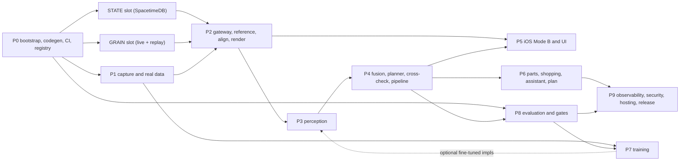
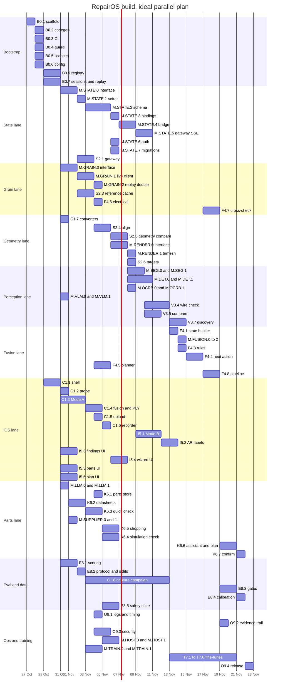

# RepairOS BUILD.md: how to build it, in what order

Version 0.2, 2026-10-24 (adds §0 the 24-hour plan, tracks, the hackathon profile). Companion to [SPEC.md](SPEC.md). SPEC says **what** RepairOS is and the **rules** it must
obey. This file says **how** to build it and **in what order**, so that several people and several coding agents can
work at once without clashing, and so that the result works for **any hardware product**, measured on products the
team never tuned on.

Short sentences. Tables and checklists. Exact commands and paths. Where this file and SPEC.md disagree, SPEC.md wins
and this file gets fixed.

Machine-readable twin: [`build/tasks.yaml`](build/tasks.yaml) (every card, its dependencies, files, prerequisites
and status). Tooling: `build/doctor.py`, `build/next.py`, `build/status.py`, `build/test_tools.py` (§0.6, §0.G). Provider selection:
[`config/providers.yaml`](config/providers.yaml) (§3).

Contents: §0 the 24-hour plan (§0.A–§0.G) and how to use this file (§0.1–§0.6) · §1 prerequisites and the human setup checklist · §2 tech stack · §3 module slots ·
§4 repo scaffold · §5 phases and task cards · §6 integration milestones · §7 test strategy · §8 parallelisation ·
§9 global definition of done · §10 risks and fallbacks · §11 open questions that block cards · §12 SpacetimeDB notes.

---

## Phases: Phase 1 now (no Grain), Phase 2 with Grain

The 24-hour plan in §0 below predates this split; where they differ for Phase 1, this section wins.

**Phase 1 (now, no Grain).** The iPhone LiDAR scanner and photos capture **any** hardware product into a scan package
file: binary PLY in metres, full-resolution JPEG stills with camera pose and intrinsics, and a manifest per
`spec/contracts/scan-package.schema.json` and `spec/contracts/still.schema.json`, in the format Grain will later
accept. RepairOS identifies broken things itself from that package: vision on full-resolution crops, OCR, VLM
checks, evidence fusion via Jev, findings with evidence, `not_inspected` and `insufficient_evidence`. No Grain calls
in Phase 1.

**Phase 2 (later, when Sritej's Grain is ready).** Send the package to Grain; reference designs, the Grain
cross-check, the electrical check with expected values, simulation checks, and the parts and plan pieces that depend
on Grain. The Grain-side cards S2.7–S2.11 and every Grain-dependent card are Phase 2.

**Rule.** A card is Phase 2 if it is a Grain card (S2.7–S2.11, M.GRAIN.*), names a Grain need, or depends (directly
or transitively) on a Phase 2 card; everything else is Phase 1. `build/tasks.yaml` marks Phase 1 cards
`phase1: true`; `python3 -I build/next.py --phase1 [--track all]` lists them. The per-stream card lists with their
phase are in the area files ([areas/README.md](areas/README.md): app, modeling + benchmark, build-plan execution).

**Phase 1 detector (owner, 2026-10-24).** No Grain means no projected targets, so Phase 1 finds parts with a pretrained
open-vocabulary detector and no training: `DET: gdino` in the hackathon profile (Grounding DINO tiny via Hugging Face
`transformers`, Apache-2.0 code and weights, CPU/MPS on the Mac), `owlv2` as the alternative (M.DET.4, optional).
`SEG: none`: crops come from the detector boxes, cut from the full-resolution stills. Prompts are generic part
classes kept in one list in one file (`backend/repairos/vision/generic_classes.py`), plus BOM text when a reference
exists (Phase 2). M.DET.0 + M.DET.1 are Phase 1 cards in the modeling + benchmark stream; M.DET.5 (`none`) is
Phase 2 / legacy. Fine-tunes only if the benchmark shows the need.

---

## 0. The 24-hour plan

Written 2026-10-24 for a hackathon with **under 24 hours left, demo included**. This section overrides the rest of
this file wherever they differ for the next 24 hours; everything else is the full build, which resumes afterwards.
The registry marks every card `track: demo` (on this path) or `track: later` (kept, not built now); the tools
default to the demo track and the `hackathon` provider profile (`config/providers.yaml`).

- **68 demo cards** (67 on the core path + 1 stretch), **95.5 agent-assisted hours** in total (after the Phase 1 detector cards M.DET.0 + M.DET.1 replaced M.DET.5).
- **Critical path 16.5 h**: B0.1 → B0.2 → M.GRAIN.0 → S2.3 → S2.4 → S2.5 → S2.6 → F4.8 → K6.7 → O9.5. With 24 h left that leaves 7.5 h of slack for slippage, the dry run and the video.
- `python3 -I build/status.py` recomputes both from the registry (`--hours-left N` as the clock runs down).
- **No fallback paths** (owner, 2026-10-24: "this just gotta work"). Jev is the fusion engine; there is no rules
  fallback on the demo path. The Grain changes the demo needs are cards with deadlines (§0.D), not optional. If
  Jev, Grain or a key is down, that is a blocker to fix at once, not a degrade path. `insufficient_evidence`
  stays a real outcome with a reason (I4); it is not a fallback.
- Grain's API shape is pinned by the `grain-*` schemas in `spec/contracts/` and checked against the private Grain
  fixtures (`private/grain/observed/`, from Sritej). API details: `private/grain/GRAIN_SPEC.md` and
  `private/grain/GRAIN_STATUS.md` (ask Sritej). Where a card disagrees with them, they win.

### 0.A Timeline

Each lane is one person driving about two agent sessions at once. Times are hours from the start (H0).

| Hour | What happens | Checkpoint |
|---|---|---|
| H0 | Owner confirms §0.C, picks the demo product (Q1) and starts a Grain design turn if it is not Grain-designed (B0.10). Grain: the running server serves current scan diagnosis and the pilot CAD endpoints; private fixtures re-recorded (S2.7). Jev key and one working Jev call (B0.11). Scaffold (B0.1). Hour-1 device test on the phone (C1.2). | Grain `/health` up with a key; Jev answers; repo scaffold merged |
| H0–H2 | Codegen, config, registry (L6); app shell (L1); Grain T3 then T1 + T2 (L3, S2.9, S2.8); word state against contract examples (L4); LLM/VLM slots and the parts / plan screens (L5) | `doctor.py` green on the backend laptop |
| H2–H4 | Grain slot + reference cache + gateway + SQLite state (L2, L6); Mode A capture (L1); Grain T12/T13 prep and T7 pins (L3); fusion slot + suspects (L4); datasheets (L5) | Grain T1 + T2 land by H3, T3 by H4; private fixtures re-recorded, `check.py` gap ledger shorter |
| H4–H6 | ICP + fit gate (L2); point fusion + PLY (L1); Jev client, projection, crops (L3); planner + range check (L4); quick check (L5) | **H6: first real phone scan through Grain `diagnose`** (our app if C1.4 is done, else Stray/Polycam via C1.7). T12 starts on it |
| H6–H10 | Live Grain client + cross-check (L2); Mode B stills + demo captures (L1, C1.9); geometry compare, VLM crops (L3); meter wizard UI (L4); I-have-X + pre-run simulation check (L5) | **H10: Grain T13 holds on the real "part removed" capture** (S2.10); demo captures recorded |
| H10–H12 | Pipeline orchestrator wires the stages (L6, F4.8); targets (L4); plan writer (L5); AR labels (L1) | **H12: end to end on a recorded demo session** (`make replay`) |
| H12–H16 | Confirm loop (L4, K6.7); held-out sanity check (E8.6); bugs from the H12 run; Grain T7 pins used for AR probe labels | **H16: feature freeze.** Stretch K6.8 (pilot CAD) only if everything above is green |
| H16–H18 | Demo script and venue checklist (O9.5); fixes only for what the script hits | |
| H18 | **Dry run** end to end with a stopwatch, live Grain, live Jev, real meter | Go / no-go list |
| H18–H20 | Fix the dry-run blockers only | |
| H20 | **Record the backup video** from a full live run (screen + phone) | Video linked in `demo/video.md` |
| H20–H22 | Polish wording on screens; re-run E8.6; pack | |
| H22 | **Final run** | |
| H24 | Demo | |

### 0.B Lanes and people

The owner can reassign anyone. Sritej owns Grain, so the Grain-side cards (S2.7–S2.11) sit in that lane.

Work is organised in three streams, each run by one person: app, modeling + benchmark, build-plan execution (see [areas/README.md](areas/README.md)); the lanes below are aliases.

| Lane | Scope | People |
|---|---|---|
| L1 | iOS capture: app shell, Mode A, dense point fusion + PLY, upload, Mode B stills, AR labels, Stray or Polycam converter (Q16) | Elysi (with Sritej) |
| L2 | Backend + Grain client + align: state, gateway, blobs, Grain slot, reference cache, ICP, cross-check | Rohan |
| L3 | Fusion and vision crops + Grain side: Jev, geometry compare, projection, crops; Grain-side API targets T1-T3, T12-T13, T7 | Sritej + Elysi (Sritej lands the Grain-side cards S2.7-S2.11) |
| L4 | Meter wizard + electrical: word state, next action, planner, range check, wizard UI, confirm | Jayden |
| L5 | Parts, I have X, plan, assistant + VLM: LLM and VLM slots, datasheets, quick check, simulation check, plan writer | Samik |
| L6 | Demo + integration: hour 0, scaffold, codegen, pipeline, findings UI, demo script, backup video | Agents, coordinated by Sritej; Rohan runs the H0 scaffold cards; Samik + Jayden take the demo script and video from H16 |

Cards per lane, in planned order (start–end from a two-session-per-lane schedule over the registry's
dependencies and estimates; real times drift, `build/next.py --lane L<n>` shows what is ready):

| Card | Title | Depends on | Planned | Est. h |
|---|---|---|---|---|
| **L1** | Elysi (with Sritej) | | | **16 h** |
| C1.1 | iOS app shell: SwiftUI navigation, settings, gateway pairing, session model, live event... | - | H0–H2 | 2 |
| C1.2 | Device capability probe: hi-res still size, 4K + sceneDepth, ultrawide minimum focus | - | H0–H0.5 | 0.5 |
| C1.3 | Mode A capture: ARKit depth + confidence, keyframe selection, poses, gravity, coverage... | C1.1 | H2–H5 | 3 |
| C1.7 | Day-0 converters: Stray Scanner and Polycam raw export to the recorded-session format | B0.7 | H3–H4.5 | 1.5 |
| C1.5 | Upload client: chunked, resumable, idempotent, per-device token | C1.1, S2.1 | H4.75–H5.75 | 1 |
| C1.4 | Point fusion (dense, no coarse voxel averaging), plane + AR-box crop, binary PLY export... | C1.3 | H5–H7.5 | 2.5 |
| I5.1 | Mode B guided close-ups: AR rings on targets, blur/smudge/tracking gates, 12 MP still w... | C1.3 | H5.75–H8.75 | 3 |
| C1.9 | Demo captures: the demo product whole, one part removed, one connector unplugged; recor... | C1.4, C1.5 | H7.5–H8.5 | 1 |
| I5.2 | AR labels: project reference parts and pins into the camera after alignment | I5.1 | H8.75–H10.25 | 1.5 |
| **L2** | Rohan | | | **13 h** |
| M.GRAIN.0 | GRAIN slot interface (reference files, scans, diagnose, call, electrical check, chat de... | B0.9, B0.2 | H2–H3 | 1 |
| S2.1 | FastAPI gateway: device pairing, uploads, reducer calls through the STATE slot, SSE liv... | B0.2, B0.6, B0.9, M.STATE.0 | H2.75–H4.75 | 2 |
| S2.3 | Reference cache per product model, unknown-product brief and design turn, no-harness de... | M.GRAIN.0 | H3–H4.5 | 1.5 |
| S2.4 | Alignment: gravity-aware robust ICP arkit_world to design, yaw search, scale sanity, fi... | B0.7, S2.3 | H4.5–H7 | 2.5 |
| M.GRAIN.1 | Live Grain client: real API, interface version pin, schema validation, idempotent uploa... | M.GRAIN.0 | H4.75–H7.25 | 2.5 |
| M.RENDER.1 | trimesh ray-cast renderer (MIT, CPU, headless anywhere) | M.RENDER.0 | H7–H8.5 | 1.5 |
| F4.7 | Grain cross-check: scan upload by id, diagnose, call with findings, compact merge, disa... | M.GRAIN.1, S2.4, S2.9 | H7.25–H9.25 | 2 |
| **L3** | Sritej + Elysi (Sritej lands the Grain-side cards S2.7-S2.11) | | | **15.5 h** |
| B0.11 | Hour 0: Jev (TypeSafe) key in backend/.env and one working Jev call on a hand-written R... | - | H0–H0.5 | 0.5 |
| S2.7 | Grain side, H0: the running Grain serves current scan diagnosis (`not_visible` parts) and the pilot CA... | - | H0–H0.5 | 0.5 |
| B0.10 | Hour 0: decisions, demo product, Grain server up (S2.7 done), key, tunnel... | - | H0.5–H1.5 | 1 |
| S2.9 | Grain side: T3 structured fix subject{kind, id, pins} and sources[] on /call fixes | S2.7 | H0.5–H1.5 | 1 |
| S2.11 | Grain side: T7 pin positions in the design frame for every connector pin and harness end, o... | S2.7 | H1.5–H3.5 | 2 |
| S2.8 | Grain side: T1 range verdicts and T2 a verdict on every /electrical/check row, joined to its... | S2.7 | H1.5–H3 | 1.5 |
| S2.10 | Grain side: T12 + T13 diagnose holds on real iPhone captures; a removed part is never `ok`... | S2.7 | H3–H5 | 2 |
| M.FUSION.1 | Jev client (TypeSafe hosted): noul/choice over our word state, shuffled options with se... | M.FUSION.0, B0.11 | H4–H5.5 | 1.5 |
| M.RENDER.0 | RENDER slot interface (pose + reference -> part-id mask, depth, projected pins, rows in... | B0.9, S2.3 | H5–H6.5 | 1.5 |
| M.SEG.0 | SEG slot interface (boxes + points -> masks on full-resolution crops) and conformance s... | B0.9, M.RENDER.0 | H6.5–H7.5 | 1 |
| S2.5 | Per-part geometry compare: visibility from real poses, coverage, offset, shifted/missin... | S2.4 | H7–H8.5 | 1.5 |
| V3.5 | Per-part compare: silhouette IoU, edge chamfer, VLM crop pair through the VLM slot | M.SEG.0, M.VLM.0, S2.5 | H8.5–H10 | 1.5 |
| **L4** | Jayden | | | **14 h** |
| F4.1 | Evidence to words: state builder for fusion (numbers never leave code) | B0.2 | H2–H3.5 | 1.5 |
| M.FUSION.0 | FUSION slot interface (ask noul/choice over a word state) and conformance suite with re... | B0.9, F4.1 | H3.5–H4 | 0.5 |
| F4.4 | Suspect ranking and NextAction: fusion slot (Jev), meter-reading override in code (I2),... | M.FUSION.0, F4.1 | H4–H6 | 2 |
| F4.5 | Meter test planner: power path from nets, suspects first, bisection, power state before... | S2.3 | H4.5–H7 | 2.5 |
| F4.6 | Electrical expectations: ranges from electrical.json or report sim, derived ohms_max, l... | S2.3, S2.8 | H6–H8 | 2 |
| I5.4 | Meter wizard UI: NextAction steps, power-state banner, typed and spoken readings, Meter... | C1.1, F4.5 | H7–H9.5 | 2.5 |
| S2.6 | Mode B target list from harness, geometry findings and symptom power path | S2.5, F4.5 | H8.5–H10 | 1.5 |
| K6.7 | Confirm loop: rescan or re-run reading, compare against the plan, close or reopen | K6.6, F4.8 | H12–H13.5 | 1.5 |
| **L5** | Samik | | | **16 h** |
| M.LLM.0 | LLM slot interface (complete, tool loop, structured output, prompt cache hints) and con... | B0.9 | H2–H2.5 | 0.5 |
| M.VLM.0 | VLM slot interface (crop pair -> structured state, cannot_tell escalation) and conforma... | B0.9 | H2–H2.5 | 0.5 |
| I5.5 | Parts-on-hand UI: typed, spoken or photographed items, verdict and reasons | C1.1 | H2.5–H4 | 1.5 |
| I5.6 | Plan and confirm UI: safety block first, steps with AR labels, have/print/buy, rescan o... | C1.1 | H2.5–H4 | 1.5 |
| M.LLM.1 | Anthropic LLM implementation (anthropic SDK, MIT) | M.LLM.0 | H4–H5 | 1 |
| M.VLM.1 | Anthropic VLM implementation (small model first, larger on cannot_tell) | M.VLM.0 | H4–H5.5 | 1.5 |
| K6.2 | Datasheet fetch and field extraction (ratings table first), with provenance, through th... | S2.1, M.LLM.0 | H5–H7 | 2 |
| K6.1 | Parts-on-hand store and matching order (exact mpn, same spec, researched substitute) | S2.1 | H5.5–H6.5 | 1 |
| K6.3 | Quick check in code plus safety rules S1-S5 and protective-part logic; fusion-slot tria... | K6.1, K6.2, M.FUSION.0 | H7–H9.5 | 2.5 |
| K6.4 | Simulation check via Grain: project copy, detached design turn, report read, cached per... | M.GRAIN.0, K6.3 | H9.5–H11 | 1.5 |
| K6.6 | Assistant tool loop and plan writer through the LLM slot; plan validator for I2/S3/I5 | F4.4, F4.7, K6.3, M.LLM.0 | H9.5–H12 | 2.5 |
| K6.8 (stretch) | Stretch: Grain pilot CAD: mount or enclosure edit by text, STEP + STL export, rough pri... | B0.10 | after H16, if the core is done | 3 |
| **L6** | Agents, coordinated by Sritej; Rohan runs the H0 scaffold cards; Samik + Jayden take the demo script and video from H16 | | | **18.25 h** |
| B0.1 | Repo scaffold, Makefile, LICENSE, NOTICE, .gitignore | - | H0–H0.5 | 0.5 |
| B0.8 | Build tooling: tasks.yaml, doctor.py, next.py, status.py | - | H0–H0.5 | 0.5 |
| B0.2 | Contract codegen: Pydantic v2 models, Swift Codable types and TypeScript types from spe... | B0.1 | H0.5–H2 | 1.5 |
| B0.6 | Config and secrets: backend .env loading, release-build lockout of replay and dev-only... | B0.1 | H0.5–H1 | 0.5 |
| B0.9 | Provider registry: config/providers.yaml loader, slot Protocols, env overrides, conform... | B0.6 | H1–H2 | 1 |
| B0.7 | Recorded-session format and replay runner (real captures, real Grain responses) | B0.2 | H2–H3 | 1 |
| M.STATE.0 | STATE slot interface (StateStore, JobQueue, LiveEvents Protocols) and conformance suite | B0.9, B0.2 | H2–H2.75 | 0.75 |
| M.STATE.11 | SQLite STATE implementation: contract rows as JSON + lifted columns, transitions enforc... | M.STATE.0 | H2.75–H4.75 | 2 |
| I5.3 | Findings and suspects UI: words not numbers, evidence crop + render, not_inspected and... | C1.1 | H3–H4.5 | 1.5 |
| M.GRAIN.2 | Replay double: serves recorded real Grain responses by request hash; CI and dev only; r... | M.GRAIN.0 | H4.5–H5.5 | 1 |
| M.BLOB.0 | BLOB slot interface (put, get, presign, delete, size) and conformance suite | B0.9 | H4.75–H5 | 0.25 |
| M.HOST.3 | Local Mac dev runtime (CPU or MPS, small models, never for release) | B0.1 | H5–H5.5 | 0.5 |
| M.BLOB.1 | Local disk blob store under data/ with content hashes | M.BLOB.0 | H5.5–H6 | 0.5 |
| M.OCRB.3 | OCRB `none`: no backend OCR; label text is typed or read on the phone (hackathon) | B0.9 | H5.5–H5.75 | 0.25 |
| M.DET.0 + M.DET.1 | Phase 1 detector: slot interface + Grounding DINO tiny, zero-shot (moved to L3 / modeling stream; Phases) | B0.9 | H5.75–H8.75 | 3 |
| M.SEG.4 | SEG `none`: no segmenter; crops come from projected node bounds (hackathon) | M.SEG.0 | H7.5–H7.75 | 0.25 |
| F4.8 | Pipeline orchestrator per scan: stages as jobs on the STATE slot, insufficient_evidence... | F4.4, F4.7, S2.6, V3.5, M.RENDER.0, S2.1, M.STATE.11, M.FUSION.1 | H10–H12 | 2 |
| E8.6 | One held-out sanity check: run the demo path on a unit or product not used for tuning;... | F4.8, C1.9 | H12–H13 | 1 |
| O9.5 | Demo script, dry run, recorded backup video, venue checklist (network, power, Grain URL... | K6.7, C1.9 | H16–H22 (fixed slots, §0.A) | 3 |

### 0.C Decisions for the 24 hours

The open questions of SPEC.md §11, settled so nobody waits. The owner can overrule any of them; the registry's
`decisions:` list mirrors this table and the tools stop counting these questions as blockers.

| Q | Decision |
|---|---|
| Q1 | Demo product picked by the owner at H0: low-voltage DC, removable connector or harness, battery or USB supply on a clear power path, table-sized, ideally Grain-designed (else Grain designs a reference by chat at H0-H2, design_trust low). Two units if possible. Facts only in samples/. |
| Q2 | RepairOS ICP is primary; Grain align=icp on the raw scan is the cross-check |
| Q3 | claude-sonnet-5-5 for assistant and plan text; claude-haiku-5-5 for crop yes/no, cannot_tell escalates to Sonnet; Anthropic key on the backend only |
| Q4 | Owner: Jev is the demo fusion engine (FUSION=jev). No rules fallback on the demo path; Jev down is a blocker to fix at once |
| Q5 | Grey band 0.35-0.65 asks Grain /look for a second opinion |
| Q6 | Upload dense points at <= 2 mm spacing, high-confidence pixels only, 0.3-0.5 m range, overlapping frames averaged per surface point; no coarse voxel averaging (G29). Checked on the first real capture at H6 |
| Q7 | Reference cache on backend disk keyed by Grain project id + last_build (hash when T11 lands) |
| Q8 | Simulation-checked swap pre-run and cached before the demo |
| Q9 | RepairOS searches and ranks substitutes; Grain only checks (simulation check) |
| Q10 | On device: capture + Apple Vision OCR only; no Core ML |
| Q11 | Hi-res still size and formats answered by the 10-line device test in H0-H1 (C1.2) |
| Q12 | Start with 3 stills; ask for more only on insufficient_evidence |
| Q13 | insufficient_evidence then 'the meter proves it' is an acceptable demo beat |
| Q14 | A scan fits in 2 minutes |
| Q15 | One phone, free Apple ID signing, no TestFlight |
| Q16 | Fallback capture app: Polycam Developer Mode or Stray Scanner, whichever someone has; our app is primary |
| Q17 | No purchases; a ring light is optional |
| Q18 | Licence follow-ups after the hackathon; add no dependency outside Apache/MIT/BSD/CC-BY |
| Q19 | RunPod not used |
| Q-S1 | SpacetimeDB deferred with the STDB cards |
| Q-S2 | SpacetimeDB deferred with the STDB cards |
| Q-S3 | SpacetimeDB deferred with the STDB cards |
| Q-S4 | SpacetimeDB deferred with the STDB cards |
| Q-G1 | Feedback into predicted-beside-measured: later idea |
| Q-G2 | Made-part price: the pilot's print estimate for simple printed parts; otherwise 'no price' |

Unknowns that remain are **tests with an hour**: hi-res still size and formats (C1.2, H1); real LiDAR noise and
whether a removed part is caught (C1.9 + S2.10, H6–H10); Jev latency on our state (B0.11, H1); `/look` latency
behind the network actually used (H6, only if a grey-band part shows up).

### 0.D Grain: what must land, and when

The owner owns Grain; these are demo cards in lane L3 with deadlines (Grain-side plan: `private/grain/GRAIN_STATUS.md`
§4, ask Sritej). Each one ends with Sritej re-recording the private Grain fixtures and a green
`spec/contracts/check.py`; the gap ledger shrinks.

| Card | Grain change (API level) | Closes | Lands by | RepairOS cards that use it |
|---|---|---|---|---|
| S2.7 | The running Grain serves current scan diagnosis (`not_visible` for parts the scan did not cover) and the pilot CAD endpoints; private fixtures re-recorded; scans accepted as binary PLY (the only format we send) | G6, G27, G28 | H1 | everything Grain-facing |
| S2.8 | T1 voltage judged against `[min, max]`; T2 a verdict on every electrical row (`ok, off, open, pin_not_on_net, unknown_net, no_expected`), `id` + `i` echoed, findings carry `reading: i` | G2, G22 | H3 | F4.6, I5.4 |
| S2.9 | T3 `subject{kind, id, pins}` and `sources[]` on `/call` fixes | G23 | H4 | F4.7, K6.6 |
| S2.10 | T12 `diagnose` holds on the first real iPhone captures (H6); T13 a removed part is never `ok` at phone LiDAR noise (5–10 mm per point) | G1, G29 | H10 | C1.9, F4.7, the demo's scan beat |
| S2.11 | T7 pin positions (`out/pins.json`) and per-conductor harness ends in net naming | G25, G26 | H14 | I5.2, M.RENDER.0, S2.3 |

Not in the 24 hours (after the demo path works): T6 detached `/call`, T5 photo references and metadata, T4 our
findings inside `/call`; also T8 expected values on every net, T9 gravity/frame on upload, T10 version +
idempotency, T11 project copy + build hash. Until they land RepairOS calls Grain the way the API works today (no
photos in `/call`; grey-band crops via photo upload + `/look`; our suspects merged with Grain's fixes on our side;
`/call/schema` snapshot as the version pin; list scans before a re-upload; project copy through the project files
API). That is how the API works now, not a degraded mode.

API facts every Grain-facing card must get right (details: `private/grain/GRAIN_SPEC.md` §3, ask Sritej):
- Design frame = `out/model.glb`: **millimetres, Z up**. ARKit is metres, Y up. Upload the aligned cloud in the design frame in metres with `units=m`, `align=none`.
- Scan upload `name` **must end in the extension** (`<scan_id>.ply`); Grain makes the scan `id`. Binary PLY with extra per-vertex properties is accepted. Dense points (≤ 2 mm spacing), no coarse voxel averaging (our capture rule, G29).
- `diagnose` keys parts by `name` (GLB node; sub-parts `U1:usb`); `ref` is the BOM ref or `null`.
- `/electrical/check` returns `{status, readings[], findings[], expected_volts, sources}`; `/call` `fixes[].confidence` is a word (`low|medium|high`); `/look` confidences are numbers 0–1.
- `/call` photos are base64 only and slow: never put photos in `/call`; send them by photo upload + `/look`.
- Readings use net-style pins (`J2.1`); harness ends are written `<board>.J2.1` (strip the board prefix).
- No pin positions until S2.11: the per-crop question is connector-level ("is this connector seated").
- Grain does not diagnose against a non-Grain reference (an unknown product gets a Grain design by chat first), expose typed CAD edits on full projects, order parts, quote fabrication, slice or drive a printer.

### 0.E Scope: in and out

**In (the demo path):** our ARKit app (capture; Stray/Polycam export as the second capture path, Q16) → backend:
our ICP with gravity + fit gate → Y-up → Z-up → Grain upload + `diagnose` (cross-check) → stills with pose →
connector-level targets projected from GLB node bounds into the stills → full-resolution crops → Claude VLM
yes/no per crop (`claude-haiku-5-5`, `cannot_tell` → `claude-sonnet-5-5`) → findings → **Jev** fuses and picks the
next action → meter wizard (test plan along the power path, bisection, our `[min, max]` check in code, Grain
`/electrical/check`) → "I have X" quick check + a pre-run simulation check → repair plan (`claude-sonnet-5-5`) →
re-measure / rescan to confirm. Plus the demo script and a recorded backup video. Stretch: Grain pilot CAD (K6.8).

**Out (track: later; the cards stay):** SpacetimeDB and every STDB card (STATE=sqlite, M.STATE.11); the rules
fusion engine (F4.3, M.FUSION.2); SAM 2 and PaddleOCR (SEG/OCRB=none; Grounding DINO tiny is in, see Phases); the wire check per harness
row (V3.4) and discovery mode (V3.7); PromptDA; the training tier (P7, RunPod); generalisation gates (P8, except
the one sanity check E8.6); hosting and observability beyond the laptop (P9), S3, Modal, Lambda; speech (typed
readings only); shopping and supplier search (K6.5, M.SUPPLIER.*: buy rows come from Grain's BOM); CI, the
generality guard and the licence manifest (B0.3–B0.5; reviewers check GEN1 by eye; no new dependency outside
Apache/MIT/BSD/CC-BY, Q18).

### 0.F Cut list (what drops first if late)

Cut from the top. Nothing on this list is replaced by a fake or a fallback; it is simply not shown.

1. K6.8 pilot CAD stretch (not started unless the core is green at H16).
2. I5.2 AR labels: the wizard names probe points in words and highlights the connector box in the still instead of
   live AR labels.
3. K6.4 pre-run simulation check: "I have X" shows the quick check in code only and says the simulation check was
   not run.
4. C1.7 converter, once our app produces scans (keep it until the H6 scan is in).
5. E8.6 sanity check moves after the demo.
6. Grey-band `/look` second opinion (F4.7 step 4).
7. The rescan half of K6.7: confirm by re-measurement only.

Never cut: the meter proving the fault (I2), power state before probe points (S4), `not_inspected` never `ok` (I3),
Jev on the real word state, the real Grain cross-check, the backup video.

### 0.G How the tools follow this plan

| Command | Does |
|---|---|
| `python3 -I build/doctor.py` | Prerequisites of demo-track cards under the active profile only (`--track all`, `--profile full` for the rest) |
| `python3 -I build/next.py [--lane L3]` | Ready demo cards with lane, estimate and critical-path hours; `blocked` cards stay out until cleared |
| `python3 -I build/status.py [--hours-left 18]` | Demo critical path in hours, whether it fits, load per lane, Grain cards, human steps |
| `python3 -I build/test_tools.py` | Self-test of the tooling |

### How to use this file (§0.1–§0.6)

### 0.1 Three kinds of text

| Where | What it holds | Who changes it |
|---|---|---|
| SPEC.md | Purpose, flow, stage table, data contracts, invariants (I, S, A, GEN, L, W), decision log, open questions | Anyone, by PR, with a decision-log row (W2) |
| BUILD.md (this file) | Phases, task cards, tests, milestones, parallel plan, risks | The card's PR when the card's text changes; a dedicated small PR for cross-cutting changes |
| `build/tasks.yaml` | The same cards as data: dependencies, files owned, prerequisites, status | Card data by PR; status fields are optional, updated by whoever merges |

Card text here and the entry in `tasks.yaml` must agree. CI (`tools/check_tasks_sync.py`, card B0.3) fails when a
card id exists in one and not the other, or when the dependency lists differ.

### 0.2 Task-card format

Every card in §5 has these fields, in this order:

| Field | Meaning |
|---|---|
| **ID** | `<letter><phase>.<n>` for core cards (`S2.4`), `M.<SLOT>.<n>` for module cards (`M.STATE.2`). `M.<SLOT>.0` is always the slot interface + conformance suite |
| **Kind** | `core` (needed whatever providers are chosen) or `module` (one slot implementation) |
| **Goal** | One or two sentences |
| **Depends on / Parallel with** | Card ids. "Parallel with" lists cards that own disjoint files and can run at the same time |
| **Human prerequisites** | Ids from `human_steps` in `tasks.yaml`; `build/doctor.py` checks them |
| **Files** | Globs the card owns (only this card edits them while it is claimed) |
| **Inputs / Outputs** | Contract objects (`spec/contracts/*.schema.json`) and internal types |
| **Steps** | Implementation notes: algorithms, parameters, edge cases, failure modes, fallbacks |
| **Test first** | The test to write before the code |
| **Acceptance** | Measurable, product-agnostic criteria |
| **Done** | What "done" means beyond green tests (docs, status, registry) |

### 0.3 Claiming a card (people and agents)

1. `python3 -I build/doctor.py`. If it prints `HUMAN ACTION NEEDED` for your card, ask the human. Do the part of the card that does not need the missing thing, or pick another card. Never stub, mock or fake around a missing key, device or service (SPEC GEN3).
2. `python3 -I build/next.py --stream <app|modeling|build>` (or `--lane L<n>`) lists the cards that are ready: dependencies done, prerequisites met, no file overlap with claimed cards.
3. Claim: tell your stream channel the card id and your branch name. That is the whole claim.
4. Branch from fresh `main`: `git fetch origin && git switch -c <you>/<card-id>-<slug> origin/main` (e.g. `ana/s2-4-alignment`). `build/next.py` prints the branch name.
5. Build test-first inside the card's `owns` paths. Run `make test` and `python3 -I spec/contracts/check.py`.
6. `git fetch origin && git rebase origin/main`, then open a PR to `main` with the card id in the title and a short what / why / how tested. One card per PR.
7. Review by another collaborator. Squash-merge.

**Stale claims.** A claim with no pushed branch and no PR for **24 hours** is free again: say so in the stream channel and take it.

**Blocked.** If a card cannot proceed (human step, open SPEC §11 question, Grain capability), say why in the stream channel and pick another card. Setting `status: blocked` with the reason in `build/tasks.yaml` keeps it out of the ready list (optional).

### 0.4 File ownership and shared files

- Cards that run in parallel own **disjoint** files (`owns` globs in `tasks.yaml`). `build/next.py` refuses to list a card whose globs overlap a claimed card's.
- **Shared files** change only in small dedicated PRs, or under a stated rule:

| Shared file | Rule |
|---|---|
| `spec/contracts/*` | A contract change is its own card and PR, reviewed first. Producers and consumers rebase on it. `grain-*` schemas follow Grain's API (details: `private/grain/GRAIN_SPEC.md` §6, ask Sritej); a Grain-side change comes with re-recorded private fixtures (Sritej) and a green `check.py` |
| `SPEC.md` | Decision-log row + the section that changed, in the PR that changes behaviour (W2). Pure wording fixes: tiny PR |
| Generated code (`backend/repairos/contracts/**`, `ios/RepairOS/Contracts/**`, `stdb/src/contracts/**`, `bridge/src/module_bindings/**`) | **Never hand-edited.** `make codegen` regenerates; CI fails on drift |
| `.github/workflows/*` | Owned by B0.3; other cards add a job in a tiny PR that touches only their job file |
| `config/providers.yaml` | A default change is a SPEC decision-log row. Adding an implementation id is part of that implementation's card |
| `backend/repairos/config/thresholds.yaml` | Threshold changes carry the held-out eval numbers in the PR (GEN2) |
| `build/tasks.yaml` status fields | Optional; whoever merges may update them |
| `build/STATUS.md` | Generated. Regenerate in your PR; never edit |
| `Makefile`, `backend/.env.example` | Append-only additions in the card that needs them; conflicts resolved by keeping both |

**CODEOWNERS proposal** (`.github/CODEOWNERS`, card B0.3): `spec/contracts/ @<lead> @<grain-liaison>`, `SPEC.md @<lead>`,
`ios/ @<ios-owner>`, `stdb/ bridge/ @<state-owner>`, `backend/repairos/parts/ backend/repairos/shopping/ @<safety-reviewer>`,
`eval/ @<eval-owner>`, `licenses/ LICENSE NOTICE @<lead>`. Names are filled in when the team is assigned; until then
every PR needs one approval from a different collaborator.

### 0.5 Sync rules

- `git fetch origin && git rebase origin/main` before you start and again before opening the PR.
- Never force-push a branch you do not own. Never push to `main` (W1).
- On a conflict, read the other side's change and keep its intent. Do not overwrite it. If the conflict is in a shared file, ask the other author.
- Generated files: do not resolve by hand; re-run `make codegen` after the rebase.
- Squash-merge is fine. The PR title carries the card id.

### 0.6 The tooling

| Command | What it does |
|---|---|
| `python3 -I build/doctor.py [--offline] [--cards S2.4,S2.5] [--track demo\|later\|all] [--profile hackathon\|full]` | Checks prerequisites of the cards on the track (default `demo`) for the **selected** implementations of the active profile (default `hackathon`, env `REPAIROS_PROFILE`) only: tool versions, `backend/.env` keys (never printed), Grain / Jev / SpacetimeDB reachability (skip with `--offline`), iPhone connected, Xcode signing, licence files. Prints `HUMAN ACTION NEEDED`: what, why, which cards it blocks, exactly how to do it, and which `config/providers.yaml` key to change to avoid it |
| `python3 -I build/next.py [--track ...] [--lane L2] [--all] [--gh] [--phase P2]` | Cards ready to claim now with estimate (hours) and lane, sorted by critical-path weight; why the others wait (`blocked` cards stay out until set back to `todo`) |
| `python3 -I build/status.py [--track ...] [--hours-left 24]` | Writes `build/STATUS.md`: the demo critical path in hours and whether it fits in the hours left, load per lane, ready and waiting cards, Grain cards, optional and stretch work tracked separately; then module slots (selected implementation and its state), blocked cards and why, human steps outstanding, open SPEC §11 questions blocking cards, Grain §10 capabilities needed, remaining critical path, the "fully works" checklist with met / not met |
| `python3 -I build/test_tools.py` | Self-test of the tooling (stdlib unittest) |
| `make check` | `spec/contracts/check.py`, codegen drift, ruff + mypy, SwiftLint, generality guard, licence check, tasks.yaml sync |
| `make test` | Backend unit + replay + conformance (selected providers) tests; iOS unit tests if Xcode is present |
| `make replay SESSION=<id>` | Runs the whole backend pipeline on one recorded real session with the Grain replay double |
| `make eval` | Scores all recorded sessions by split; writes `eval/results/latest.json` |

Agents run `doctor` → `next` → claim (stream channel + branch name) → branch → build → `make test` + `check.py` → PR.

---

## 1. Prerequisites and the human setup checklist

### 1.1 One-time human setup checklist

Tick these once per team. `build/doctor.py` re-checks what it can on every run and names the cards each item blocks.

| # | Item | Needed for | How | doctor check |
|---|---|---|---|---|
| H1 | Dev machine: Python 3.12+, git, gh (logged in), Node 22+ | everything | `brew install python@3.12 gh node@22`, `gh auth login` | `dev_tools`, `repo_access` |
| H2 | Xcode 26.x, Swift 6.x, iOS 26 SDK on a Mac | all iOS cards, Core ML export | App Store, open once, `xcode-select --install` | `xcode` |
| H3 | Apple ID in Xcode with a development team; decide on the $99 Developer Program (TestFlight) or free sideload (SPEC Q15) | run on the phone; release | Xcode > Settings > Accounts; `ios/Config/Signing.xcconfig` (gitignored) with `DEVELOPMENT_TEAM` | `signing` |
| H4 | iPhone 16 Pro or Pro Max, Developer Mode on, cable | capture, Mode B, AR, OCR, speech | Settings > Privacy & Security > Developer Mode; trust the Mac; `xcrun devicectl list devices` | `device` |
| H5 | Grain access: `GRAIN_URL`, `GRAIN_KEY`, the demo product's project id `GRAIN_TEST_PROJECT` | every Grain card (GEN3: real API, no mock) | Sritej runs Grain and issues a Grain API key at H0 (B0.10; how: `private/grain/GRAIN_SPEC.md` §2); `backend/.env` | `env_grain`, `env_grain_project` |
| H6 | TypeSafe (Jev) key `TYPESAFE_KEY` | FUSION=jev (both profiles; H0 card B0.11) | TypeSafe console | `env_jev` |
| H7 | LLM/VLM key: `ANTHROPIC_API_KEY` (default) or `OPENAI_API_KEY`, owner decides whose (SPEC Q3) | LLM, VLM slots | `backend/.env` | `env_anthropic` / `env_openai` |
| H8 | (full profile only) SpacetimeDB: `spacetime` CLI 2.13.x; a server (local `spacetime start`, or Maincloud login); `SPACETIMEDB_URL`, `SPACETIMEDB_DB` | STATE=spacetimedb | `curl -sSf https://install.spacetimedb.com \| sh`; `spacetime start`; for Maincloud `spacetime login` and the owner confirms the terms (Q-S1) | `spacetime_cli`, `spacetime_server`, `spacetime_login` |
| H9 | (full profile only) GPU box: Linux, NVIDIA GPU ≥ 16 GB, Docker; `HOST_SSH` | HOST=docker_gpu (detector, segmenter, OCR, depth) | a RunPod pod, a lab machine or a cloud VM; or `HOST: local_mac` for CPU dev | `env_host_ssh` |
| H10 | (full profile only) RunPod account, `RUNPOD_API_KEY`, network volume `repairos-data` (50–100 GB) | TRAIN=runpod; optionally hosting (Q19) | runpod.io | `env_runpod` |
| H11 | Multimeter: continuity (beep), DC volts, ohms; note its continuity threshold | real readings in recorded sessions (I2) | any DMM | manual |
| H12 | Test products: ≥ 3 categories now, 6+ for the generalisation gate; include a Grain-designed kit, a product Grain did not design, one with no harness; two units of at least one (one fault-free). Owner picks (SPEC Q1). | real-data capture, evaluation | record in `eval/categories.yaml` and `samples/sessions/*/session.json`; never in code | manual |
| H13 | Optional: cross-polarised ring light or polariser film (SPEC Q17) | wire colour and connector checks | owner approves | manual |
| H14 | Licence decisions: `LICENSE` Apache-2.0 + `NOTICE` merged; emails (SPEC Q18); SpacetimeDB licence fit and Maincloud terms (Q-S1, Q-S2) | repo going public (L1); STATE slot | owner | `license_files` |
| H15 | Repo settings: branch protection on `main` (PR + 1 approval + green CI); GitHub Actions secrets for the scheduled Grain contract job (`GRAIN_URL`, `GRAIN_KEY`, `GRAIN_TEST_PROJECT`) | W1, CI | owner | manual |

### 1.2 Accounts, keys and where they live

| Secret / account | Env var | Lives | Never |
|---|---|---|---|
| Grain staging | `GRAIN_URL`, `GRAIN_KEY`, `GRAIN_TEST_PROJECT`, `GRAIN_INTERFACE_VERSION` | `backend/.env`; CI secrets for the scheduled contract job | on the phone, in git, in logs |
| TypeSafe / Jev | `TYPESAFE_KEY` | `backend/.env` | same |
| Anthropic / OpenAI / self-hosted | `ANTHROPIC_API_KEY` / `OPENAI_API_KEY` / `OPENAI_COMPATIBLE_URL` (+`OPENAI_COMPATIBLE_KEY`) | `backend/.env` | same |
| SpacetimeDB | `SPACETIMEDB_URL`, `SPACETIMEDB_DB`, `SPACETIMEDB_SERVICE_TOKEN` (the backend's identity token, M.STATE.6) | `backend/.env`; the bridge reads the same file | the phone gets a **per-device identity token**, never the service token |
| RunPod / Modal / Lambda | `RUNPOD_API_KEY` / Modal CLI token / `LAMBDA_API_KEY` | `backend/.env` or the CLI's own store | same |
| S3 (optional) | `S3_ENDPOINT`, `S3_BUCKET`, `AWS_ACCESS_KEY_ID`, `AWS_SECRET_ACCESS_KEY` | `backend/.env` | same |
| Apple signing | `DEVELOPMENT_TEAM` | `ios/Config/Signing.xcconfig` (gitignored) | git |

Rules: `backend/.env` is gitignored; `backend/.env.example` lists every variable with an empty value and a comment.
The phone holds only a per-device token issued by the gateway at pairing (A6). `gitleaks` runs in CI (O9.3). Logs
redact anything that looks like a key (O9.1).

### 1.3 Versions to pin

| Thing | Pin | Where |
|---|---|---|
| Xcode | 26.x (latest stable at bootstrap; record the exact build in `ios/README.md`) | `ios/README.md`, CI `ios.yml` |
| iOS deployment target | 18.0 (iPhone 16 Pro shipped with it); iOS 26-only APIs behind `if #available` (`DetectLensSmudgeRequest`, `RecognizeDocumentsRequest`) | `ios/RepairOS.xcodeproj` |
| Swift | 6.x, strict concurrency | project settings |
| Python | 3.12.x | `backend/pyproject.toml` `requires-python = ">=3.12,<3.13"`, `.python-version` |
| Node | 22 LTS (codegen, mermaid, the SpacetimeDB module and bridge) | `.nvmrc`, `stdb/package.json`, `bridge/package.json` `engines` |
| SpacetimeDB | CLI and server 2.13.x; `spacetimedb` npm 2.13.0 | `stdb/package.json`, `bridge/package.json`, `backend/.env.example` comment |
| Python deps | exact versions in `backend/requirements.lock` (generated by `uv pip compile` or `pip-compile`) | `backend/` |
| Model weights | exact file hashes in `licenses/weights.json` | `licenses/` |
| Grain interface version | the string Grain reports; `config/providers.yaml: grain_interface_version` | config |

Exact dependency versions are chosen at bootstrap (B0.1, B0.2) by `pip install` of the newest release that satisfies
the constraints below, then frozen into the lock file. This file names the libraries and the licences, not patch
versions, so it does not go stale on day two.

### 1.4 Licence rules for every dependency

SPEC L1–L5 apply. In practice:

1. Before adding a dependency, read its licence file (not the README badge). Record it in `licenses/manifest.json` with the URL you read it at (card B0.5).
2. Allowed to ship: Apache-2.0, MIT, BSD-2/3, ISC, CC-BY-4.0 (data), PSF, Zlib, MPL-2.0 (file-level copyleft, dev tools only unless the lead approves).
3. Never shipped: GPL, AGPL, LGPL (static), CC-BY-NC, CC-BY-SA, research-only, "SAM License"-style custom licences until counsel reads them. GPL tools may be used as tools (Blender, BlenderProc, X-AnyLabeling) when their output is ours.
4. No licence file = all rights reserved (L4). Clean-room re-implementation of the idea only.
5. L5 names the one exception: the SpacetimeDB server runtime (BSL 1.1), run as a service under its Additional Use Grant. `tools/license_check.py` has an explicit allow-entry for it with the grant conditions and the Change Date; nothing else may use that entry.
6. Model weights are dependencies. `licenses/weights.json` lists each weight file, source URL, licence, hash. The HOST image refuses to download a weight that is not in the manifest.
7. Datasets used for training or tuning anything that ships: CC-BY-4.0 or more permissive only, listed in `licenses/datasets.json`. Research-only sets are allowed in experiments and must be named as such in the report (L3).

---

## 2. Tech stack, pinned, with licence per item

One default and one fallback per row. Justification in one line. "Slot" names the module slot (§3) where config
picks between them; rows without a slot are core.

### 2.1 iOS

| Part | Default | Licence | Fallback | Why |
|---|---|---|---|---|
| UI | SwiftUI | Apple SDK | UIKit for the camera preview if SwiftUI lags | Fast to build; team knows it |
| AR, depth, poses | ARKit (`ARWorldTrackingConfiguration`, `.smoothedSceneDepth`, `captureHighResolutionFrame`) | Apple SDK | none; this is the product | Only API with LiDAR depth + poses + hi-res stills in one session |
| 3D overlay | RealityKit for rings and labels | Apple SDK | SceneKit | Native with ARKit |
| OCR (slot OCRD) | Vision `VNRecognizeTextRequest` | Apple SDK | backend OCR only | Free, on-device, fast |
| Stills | AVFoundation for the optional macro pass (ultrawide, no pose) | Apple SDK | skip macro | Macro needs AVFoundation outside the AR session |
| On-device models | Core ML (`.mlpackage`), `coremltools` 8.x to convert | Core ML: Apple SDK; coremltools BSD-3 | none on-device; backend runs them | A7: free compute where it makes sense |
| Speech (slot SPEECH) | Speech framework on-device | Apple SDK | typed only | Readings spoken hands-free |
| Networking | `URLSession` with background uploads | Apple SDK | none | Resumable uploads of 3–5 MB stills |
| Contract types | generated Swift `Codable` structs (B0.2) | ours (Apache-2.0) | none | One source of truth |
| Lint / format | SwiftLint, swift-format | MIT / Apache-2.0 | none | CI consistency |
| Tests | XCTest | Apple SDK | none | Built in |

### 2.2 Backend (gateway + workers)

| Part | Default | Licence | Fallback | Why |
|---|---|---|---|---|
| Web framework | FastAPI | MIT | Starlette alone | Pydantic-native, async, OpenAPI for the phone client |
| Models / validation | Pydantic v2 (generated from `spec/contracts`) | MIT | none | W3: validate everything against the schemas |
| Server | uvicorn | BSD-3 | hypercorn (MIT) | Standard |
| HTTP client | httpx | BSD-3 | aiohttp (Apache-2.0) | Async, timeouts, retries |
| State (slot STATE) | SpacetimeDB 2.13.x server as a service; our module in TypeScript (`stdb/`); bridge on the official TypeScript SDK (`bridge/`); gateway calls reducers over the HTTP API | server BSL 1.1 (L5); `spacetimedb` npm: conflict BSL/ISC (Q-S2); our module + bridge Apache-2.0 | Postgres 16 (PostgreSQL licence) + huey (MIT) + SSE relay | Owner decision; live subscriptions push findings to the phone; reducers enforce transitions |
| Blob store (slot BLOB) | local disk `data/blobs/<sha256>` | ours | any S3-compatible via boto3 (Apache-2.0) | Scans 0.5–5 MB, stills 3–5 MB, crops: references in tables |
| Point clouds, ICP | Open3D | MIT | trimesh ICP (MIT) | Robust point-to-plane ICP, KD-trees, TSDF |
| Mesh, ray casting (slot RENDER) | trimesh + embreex (Embree bindings) | MIT + Apache-2.0 | pyrender (MIT, EGL on a headless GPU); Open3D offscreen (MIT) | CPU ray casting works headless on any box; no GL context needed |
| Numerics | numpy, scipy, scikit-image, opencv-python-headless | BSD-3, BSD-3, BSD-3, Apache-2.0 | none | Skeletons, Lab colour, Canny, chamfer |
| Detector (slot DET) | Grounding DINO (Swin-T) via `transformers` | Apache-2.0 | Florence-2 (MIT); OWLv2 (Apache-2.0); fine-tuned RF-DETR-S (Apache-2.0) | Best open zero-shot on industrial classes |
| Segmenter (slot SEG) | SAM 2.1 (hiera-small) | Apache-2.0 | fine-tuned thin-wire UNet (ours) | Promptable with boxes and endpoint points |
| OCR (slot OCRB) | PaddleOCR (PP-OCRv5/v6 mobile) | Apache-2.0 | Florence-2 OCR-with-region (MIT) | Small, fast, Apache |
| Depth (slot DEPTH) | none | - | Prompt Depth Anything ViT-S (Apache-2.0; backbone DA-V2-Small Apache-2.0) | Optional; decided by measured minimum detectable shift (Q6) |
| Fusion (slot FUSION) | Jev via `typesafe` Python SDK | SDK MIT; hosted service | rules engine `policy.json` (ours; later track, not on the demo path) | Calibrated probabilities over word state |
| LLM (slot LLM) | `anthropic` Python SDK | MIT | `openai` SDK (Apache-2.0); OpenAI-compatible self-hosted (vLLM Apache-2.0 + an Apache-2.0 model) | Tool loop, plan text, extraction |
| VLM (slot VLM) | same SDK, small model first, larger on `cannot_tell` | MIT | OpenAI; Qwen3-VL-8B self-hosted (Apache-2.0) | Crop pairs, structured yes/no |
| Supplier search (slot SUPPLIER) | BOM url fetch + LLM discovery, deterministic selection | ours | Nexar (Octopart) API; Digi-Key API | A5: AI discovers, code decides |
| Job runner | SpacetimeDB `job` table + scheduled reducer + bridge fan-out (part of STATE) | see STATE | huey (MIT) with SQLite or Valkey (BSD-3) | One state layer, one queue |
| Config | `pydantic-settings` + `config/providers.yaml` | MIT | - | Env overrides, typed |
| Logging / tracing | `structlog` JSON; OpenTelemetry SDK (optional exporter) | MIT / Apache-2.0 | stdlib logging | Per-stage timing, request ids |
| Tests | pytest, pytest-asyncio, `jsonschema` | MIT, Apache-2.0, MIT | stdlib validator in `check.py` | - |
| Lint / types | ruff, mypy | MIT, MIT | - | - |
| Secret scan | gitleaks | MIT | trufflehog (AGPL: **tool only**, never shipped) | CI |
| Containers | Docker, Caddy for TLS | Apache-2.0 / Apache-2.0 | nginx (BSD-2) | HOST slot |

### 2.3 SpacetimeDB module and bridge

| Part | Default | Licence | Fallback | Why |
|---|---|---|---|---|
| Module language | TypeScript (`stdb/`, `spacetimedb` package, Node 22) | package: BSL 1.1 per `LICENSE.txt`, ISC per `package.json` (Q-S2); runs inside the DB, not shipped to users | Rust module (`crates/bindings` Apache-2.0; procedures need the `unstable` feature) | Procedures (outbound HTTP, scheduling) are stable in TypeScript; v2.13.0 added TypeScript submodules; codegen is one CLI call |
| Worker bridge | Node 22 service on the official TypeScript client SDK (same package) | as above | Python polling the HTTP SQL endpoint (no SDK) | No maintained Python SDK exists (PyPI `spacetimedb-sdk` 0.7.0, Dec 2023, not listed in the official SDK docs) |
| Gateway to DB | SpacetimeDB HTTP API (`/v1/database/...`) with the backend's identity token | server interface | bridge proxies | Reducer calls and SQL from Python without an SDK |
| Phone to live state | gateway SSE relay (default, `STDB_PHONE_PATH: gateway`) | ours | community Swift SDK `ekscrypto/spacetimedb-swift-sdk` (MIT, beta) direct | No official Swift SDK; keep one phone-facing origin and one auth scheme first |

### 2.4 Codegen

| From | To | Tool | Licence | Output path |
|---|---|---|---|---|
| `spec/contracts/*.schema.json` | Pydantic v2 models | `datamodel-code-generator` (`--input-file-type jsonschema --output-model-type pydantic_v2.BaseModel`) | MIT | `backend/repairos/contracts/models.py` |
| same | Swift `Codable` | `quicktype` (`--lang swift --src-lang schema`) | Apache-2.0 | `ios/RepairOS/Contracts/*.swift` |
| same | TypeScript types for the module and bridge | `json-schema-to-typescript` | MIT | `stdb/src/contracts/*.ts` |
| published SpacetimeDB module | TypeScript client bindings for the bridge | `spacetime generate --lang typescript --out-dir bridge/src/module_bindings` | CLI (BSL server tooling; output is ours) | `bridge/src/module_bindings/` |
| `backend/pyproject.toml` | lock file | `uv pip compile` (uv: Apache-2.0/MIT) | - | `backend/requirements.lock` |

`make codegen` runs all of them. CI runs `make codegen && git diff --exit-code` so generated files never drift.
Generated files carry a header "GENERATED by tools/codegen; do not edit".

### 2.5 CI (GitHub Actions)

| Job | Runs on | What | Blocks merge |
|---|---|---|---|
| `contracts` | ubuntu | `python3 -I spec/contracts/check.py`; `tools/check_tasks_sync.py` | yes |
| `codegen-drift` | ubuntu | `make codegen && git diff --exit-code` | yes |
| `backend` | ubuntu | ruff, mypy, `pytest backend/tests/unit backend/tests/replay -m "not gpu and not live"` | yes |
| `conformance` | ubuntu (CPU impls) / self-hosted GPU runner (GPU impls, nightly) | `pytest backend/tests/conformance --impl <selected>` on recorded real data | yes for CPU impls; nightly for GPU |
| `guard` | ubuntu | `tools/generality_guard.py` (product names, refs, provider names in core) | yes |
| `licenses` | ubuntu | `tools/license_check.py` (pip metadata, npm, Swift packages, weights manifest) | yes |
| `secrets` | ubuntu | gitleaks | yes |
| `stdb-module` | ubuntu | `cd stdb && npm ci && npm test && npx spacetime build` (module compiles; reducer unit tests) | yes |
| `ios` | macos-15 | `xcodebuild build-for-testing -scheme RepairOS -destination 'generic/platform=iOS'`; unit tests on simulator for pure logic | yes |
| `eval` | self-hosted GPU runner, nightly + on `eval/**` or `backend/repairos/**` PRs with label `eval` | `make eval`; `eval/gates.py` compares against `eval/results/baseline.json` | yes when triggered |
| `grain-contract` | ubuntu, scheduled daily + manual | `pytest backend/tests/contract -m live` against Grain staging; refreshes recorded fixtures as an artifact | no (alerts) |

---

## 3. Module slots: core + swappable parts

Profiles: `config/providers.yaml` holds a `hackathon` profile (the default for the 24 hours, §0) and a `full` profile (the defaults in the table below). `REPAIROS_PROFILE=<name>` picks one; `REPAIROS_SLOT_<SLOT>` overrides one slot. Hackathon values: GRAIN=live (Phase 2 only), FUSION=jev, LLM/VLM=anthropic, DET=gdino (Phase 1, zero-shot), SEG/OCRB=none, OCRD=apple_vision, DEPTH=none, RENDER=trimesh, STATE=sqlite, BLOB=local, SUPPLIER=bom_and_web, TRAIN=none, HOST=local_mac, SPEECH=typed_only.

The product is **core** (works whatever providers are chosen) plus **module slots**. Each slot has a stable
interface, a conformance suite, a default implementation and alternatives. **Config, not code, picks the
implementation**: `config/providers.yaml` (env override `REPAIROS_SLOT_<SLOT>=<impl>`), read by
`backend/repairos/registry.py`. Core code imports the slot Protocol only; provider names never appear in core code
(the generality guard, B0.4, bans the provider-name list in `tools/generality_guard.toml` from `backend/repairos/**`
outside `backend/repairos/slots/`).

### 3.1 Slot table

| Slot | Interface (Python Protocol in `backend/repairos/slots/<slot>.py` unless noted) | Default (`impl`) | Alternatives | Licence of each | Config key | Human prerequisites (default) |
|---|---|---|---|---|---|---|
| **STATE** | `StateStore` (put/get/list per contract object by id, optimistic `rev`), `JobQueue` (enqueue, claim, heartbeat, complete, fail), `LiveEvents` (subscribe(session_id) → async iterator of row changes). Rows are the contract objects (§12.3) | `spacetimedb` (server 2.13.x, TS module, Node bridge, HTTP API from the gateway) | `postgres_queue` (Postgres 16 + huey + SSE relay); `sqlite` (one process, SQLite + polled SSE; hackathon, M.STATE.11) | SpacetimeDB server BSL 1.1 (L5); C# SDK Apache-2.0; Rust SDK BSL 1.1; TS package BSL/ISC conflict (Q-S2); Postgres: PostgreSQL licence; huey MIT | `STATE`, `STATE_TARGET` (local / maincloud), `STDB_MODULE_LANG`, `STDB_WORKER_BRIDGE`, `STDB_PHONE_PATH` | `spacetime_cli`, `spacetime_server` (+ `spacetime_login` for Maincloud) |
| **BLOB** | `BlobStore` (put(bytes, content_type) → `blob://sha256`, get, presign(ttl), delete, size) | `local` (disk under `data/blobs/`) | `s3` (boto3) | ours; boto3 Apache-2.0 | `BLOB` | none / `s3_credentials` |
| **GRAIN** | `GrainClient` (reference_files, bom, electrical, upload_scan, diagnose, call, electrical_check, chat_detached + poll, copy_project, interface_version). Shapes: the five `grain-*` schemas | `live` (real API, pinned version) | `replay` (recorded real responses; CI/dev only, refused in release) | ours | `GRAIN`, `grain_interface_version` | `grain_key`, `grain_project` |
| **FUSION** | `FusionEngine` (ask(state_words, questions[noul/choice]) → probabilities, model id, latency) | `jev` (TypeSafe hosted; both profiles) | `rules` (deterministic `policy.json`, F4.3; later track) | TypeSafe SDK MIT; rules ours | `FUSION` | `jev_key` / none |
| **LLM** | `TextModel` (complete, tool_loop(tools, max_turns), structured(schema), cache_hint(product_block)) | `anthropic` | `openai`, `openai_compatible` (vLLM + Apache-2.0 model) | anthropic SDK MIT; openai SDK Apache-2.0; vLLM Apache-2.0 | `LLM` | `anthropic_key` / `openai_key` / `openai_compatible_url` |
| **VLM** | `VisionJudge` (judge_pair(real_crop, render_crop, expectation_words, options) → `{choice, confidence_word, model}`, escalate on `cannot_tell`) | `anthropic` | `openai`, `qwen3vl` | as above; Qwen3-VL-8B Apache-2.0 | `VLM` | `anthropic_key` / `openai_key` / `openai_compatible_url` + `gpu_box` |
| **DET** | `Detector` (detect(image, prompts[str]) → boxes with scores and matched prompt). Prompts come from `vision/prompts.py` (generic classes + BOM text) | `gdino` | `florence2`, `owlv2`, `rfdetr` (fine-tuned), `none` (legacy, M.DET.5); hackathon = `gdino` tiny, zero-shot (Phases) | Apache-2.0, MIT, Apache-2.0, Apache-2.0 (Nano/S/M/L weights) | `DET` | `gpu_box` |
| **SEG** | `Segmenter` (segment(crop, boxes, points_pos, points_neg) → masks with scores) | `sam2` (2.1) | `wireseg` (fine-tuned), `sam2_coreml` (on-device, stretch), `none` (hackathon, M.SEG.4) | Apache-2.0; ours; Apple Core ML port Apache-2.0 | `SEG` | `gpu_box` |
| **OCRB** | `TextReader` (read(crop) → regions with text, confidence, polygon) | `paddleocr` | `florence2`, `none` (hackathon, M.OCRB.3) | Apache-2.0; MIT | `OCRB` | `gpu_box` |
| **OCRD** | Swift `OCRProvider` protocol (`recognize(CGImage) async -> [TextRegion]`) | `apple_vision` | `none` | Apple SDK | `OCRD` | `iphone` |
| **DEPTH** | `DepthRefiner` (refine(keyframes, arkit_depth) → dense depth per keyframe or passthrough) | `none` | `promptda` (ViT-S + TSDF) | Apache-2.0 | `DEPTH` | none / `gpu_box` |
| **RENDER** | `ExpectedViewRenderer` (render(reference, pose, intrinsics, size) → part-id mask, depth, projected pins, rows in view) | `trimesh` (ray cast, CPU) | `pyrender` (EGL), `open3d`, `realitykit` (on-device, stretch) | MIT; MIT; MIT; Apple SDK | `RENDER` | none |
| **SUPPLIER** | `SupplierSearch` (by_mpn(mpn), by_spec(spec_words) → candidates with price, url, stock, lead, `price_source`, `found_by`) | `bom_and_web` | `nexar`, `digikey` | ours; vendor APIs (terms to read) | `SUPPLIER` | `anthropic_key`-class key for discovery / `nexar_key` / `digikey_key` |
| **TRAIN** | `Trainer` (submit(recipe) → job id, status, fetch_artifacts). A recipe is `training/recipes/*.yaml` run by `training/run.py` | `runpod` | `modal`, `lambda`, `local_mac` | provider terms; our scripts Apache-2.0 | `TRAIN` | `runpod` / `modal_account` / `lambda_key` / none |
| **HOST** | Container contract: `deploy/Dockerfile` image, env contract (`backend/.env.example`), `/healthz`, weight download with manifest check | `docker_gpu` (any Linux GPU box, incl. a RunPod pod) | `modal`, `local_mac` (dev only) | Docker Apache-2.0; Caddy Apache-2.0 | `HOST` | `gpu_box` / `modal_account` / none |
| **SPEECH** | Swift `SpeechProvider` protocol (`transcribeReading() async -> ReadingUtterance`) | `apple_speech` | `typed_only` | Apple SDK | `SPEECH` | `iphone` |

### 3.2 Registry

`backend/repairos/registry.py` (card B0.9):

```python
# core code does this and nothing else:
from repairos.registry import slot
detector = slot("DET")          # returns the configured Detector implementation
engine = slot("FUSION")         # returns the FusionEngine (Jev)
```

- Implementations register with a decorator in their own package `backend/repairos/slots/<slot>_<impl>/__init__.py`: `@register("DET", "gdino")`.
- The registry reads `config/providers.yaml`, applies `REPAIROS_SLOT_*` overrides, imports only the selected package (so an unselected provider's heavy dependencies are never imported), and refuses dev-only implementations (`GRAIN=replay`, `HOST=local_mac`, `STATE_TARGET` unset) when `REPAIROS_RELEASE=1` (B0.6).
- `FUSION`: the registry returns the selected engine (Jev). There is no wrapping fallback engine (owner decision, 2026-10-24: A3 removed); hard evidence (a meter reading) overrides any engine answer in code (I2). Every `Suspect` carries `fusion_source`.

### 3.3 Conformance tests per slot

Every implementation must pass the slot's suite in `backend/tests/conformance/<slot>/` on **recorded real data**
(`samples/`), with the same assertions for every implementation. `pytest backend/tests/conformance/det --impl gdino`.
A new implementation is `done` only when its suite is green and its card lists the run. Suites check:

| Slot | Conformance assertions (same for every impl) |
|---|---|
| STATE | put/get round-trip for every contract example; `rev` conflict rejected; job claim is exclusive under 10 concurrent claimers; a subscriber sees an insert within 2 s; transition rules: `Suspect.verdict=confirmed` without `proof_reading_id` rejected; `Finding.is_proof=true` with `source!=repairos.meter` rejected; `not_inspected` → `ok` rejected |
| BLOB | put/get byte-exact for 0 B, 5 MB, 50 MB; presign url fetchable within ttl, not after; delete removes |
| GRAIN | every method's response validates against its `grain-*` schema; `interface_version` mismatch raises `GrainInterfaceDrift`; re-upload of the same `name` reuses the existing scan id (list first; `Idempotency-Key` when T10 lands); `call` never sets `rebuild` and never carries photos; detached chat polls to completion or times out with a typed error |
| FUSION | returns a probability per question in [0, 1]; `choice` sums to 1 ± 0.01; option order shuffled with a recorded seed; a numeric literal in the state raises (S5 guard); p95 latency < 3 s |
| LLM | structured output validates against the given schema on 20 recorded prompts; tool loop stops at max_turns; prompt-injection probe in `state` does not alter `instructions` behaviour (A9) |
| VLM | on 40 recorded crop pairs with human labels: accuracy ≥ 0.8 on `seated/gap_visible/unplugged`, and `cannot_tell` rate ≤ 0.3; output always one of the allowed options |
| DET | on the recorded still set: recall at expected location ≥ 0.9 for parts larger than 3 cm, ≥ 0.6 for connectors; at most 2 false `unexpected_part` per still at the default score threshold; runs on a 4032 px still downscaled to 1024 px in < 3 s on the reference GPU |
| SEG | on recorded crops with human masks: mask IoU ≥ 0.7 for connectors and parts, ≥ 0.5 for single wires; never upsamples the crop for masks |
| OCRB | on recorded label crops: character error rate ≤ 0.15; BOM value match F1 ≥ 0.8 |
| OCRD | same on-device with the Swift suite |
| DEPTH | output depth is metric (median abs error vs ARKit depth on high-confidence pixels < 2 cm) or passthrough is identical to input |
| RENDER | rendered part-id mask vs the Mode A keyframe silhouette after alignment: IoU ≥ 0.6 on sharp keyframes; projected pin pixels within 25 px of hand-marked pins on the recorded set; deterministic (two renders byte-identical) |
| SUPPLIER | every candidate has a `price_source` and `found_by`; prices parsed from recorded pages match the human-read price within 1 %; no candidate without a url |
| TRAIN | the smoke recipe (1 minute, tiny model) runs to completion and `fetch_artifacts` returns `metrics.json` and a weights file |
| HOST | container builds; `/healthz` 200; weight download refuses a hash not in `licenses/weights.json`; `REPAIROS_RELEASE=1` refuses dev-only providers |
| SPEECH | on 30 recorded utterances: parsed value and unit correct ≥ 0.9 ("twelve point one volts" → 12.1 V; "no beep" → continuity false) |

### 3.4 How to swap a module

1. Check the alternative has a card (`M.<SLOT>.<n>`) in §5 and `tasks.yaml`. If not, add one (interface unchanged).
2. Claim and implement it in `backend/repairos/slots/<slot>_<impl>/` (or the iOS equivalent). Register it. Add its human prerequisites to `human_steps` if new, and its env variables to `backend/.env.example`.
3. Pass the conformance suite: `pytest backend/tests/conformance/<slot> --impl <impl>`. Paste the run summary in the PR.
4. Change `config/providers.yaml` (`<SLOT>: <impl>`). If this changes the **default**, add a SPEC.md §8 decision-log row in the same PR (W2) and update §2 of this file.
5. `python3 -I build/doctor.py` now checks the new implementation's prerequisites and stops checking the old one's.
6. Run `make eval` on the held-out split and attach the numbers (GEN2). A swap that lowers the held-out score is not merged as a default.

---

## 4. Repo scaffold

Target tree. One line per directory or key file. Generated files marked (gen). Consistent with SPEC §9.

```
RepairOS/
  SPEC.md                         what and rules (single source of truth)
  BUILD.md                        this file: how and in what order
  AGENTS.md, CLAUDE.md            agent entry point; CLAUDE.md points at AGENTS.md
  README.md                       project front page (stale passages listed in SPEC §13; refreshed in O9.4)
  LICENSE, NOTICE                 Apache-2.0 text; attributions (B0.1)
  Makefile                        bootstrap, codegen, check, test, replay, eval, run-* targets (B0.1)
  .gitignore, .nvmrc, .python-version
  .github/
    workflows/ci.yml              contracts, codegen drift, backend, guard, licences, secrets, stdb-module (B0.3)
    workflows/ios.yml             xcodebuild build-for-testing + unit tests (B0.3)
    workflows/eval.yml            nightly and labelled-PR evaluation with gates (E8.3)
    workflows/grain-contract.yml  scheduled live Grain staging contract tests (M.GRAIN.3)
    CODEOWNERS, pull_request_template.md
  build/
    tasks.yaml                    the card registry (source of truth for tooling)
    _lib.py, doctor.py, next.py, status.py, test_tools.py
    STATUS.md                     generated by status.py
  config/
    providers.yaml                which implementation fills each slot
  spec/contracts/                 JSON Schemas, examples, check.py (the contract)
  areas/                          one file per work stream (app, modeling + benchmark, build-plan execution)
  private/grain/                  gitignored, from Sritej: Grain API details, the private Grain fixtures (observed/), Grain examples
  docs/
    device-probe.md               results of C1.2 on real hardware
    stdb-auth.md, stdb-migrations.md, stdb-observability.md   STATE runbooks
    privacy.md, release.md, CONTRIBUTING.md
  tools/
    codegen/                      gen_pydantic.sh, gen_swift.sh, gen_ts.sh, stdb_bindings.sh (B0.2, M.STATE.3)
    generality_guard.py, generality_guard.toml                 CI guard (B0.4)
    license_check.py              manifest check (B0.5)
    guard_proprietary.py, hooks/pre-commit   blocks Grain internals and private/ paths from commits
    check_tasks_sync.py           BUILD.md vs tasks.yaml (B0.3)
    check_stdb_drift.py           table types vs contracts (M.STATE.3)
    replay.py                     run the pipeline on a recorded session (B0.7)
    convert_stray.py, convert_polycam.py                      day-0 capture converters (C1.7)
  licenses/
    manifest.json                 every shipped dependency: name, version, licence, url read, role
    weights.json                  every model weight: file, sha256, source, licence
    datasets.json                 every dataset used for training or tuning
  samples/
    README.md, session.schema.json                             recorded-session format (B0.7)
    sessions/<session_id>/        REAL captures: session.json, scan/, stills/, readings/, truth.json, parts/
    grain/<request_sha256>.json   recorded REAL Grain responses for the replay double (M.GRAIN.2)
  eval/
    categories.yaml               product categories and which are held out (E8.2)
    protocol.md, assign_split.py, leakage_check.py            protocol and split tooling (E8.2)
    truth.schema.json, score.py, metrics.py                   scoring (E8.1)
    gates.py, calibration.py                                   gates (E8.3), reliability (E8.4)
    results/baseline.json, results/latest.json, results/calibration.json
  stdb/                           SpacetimeDB module (TypeScript)
    package.json, tsconfig.json, README.md
    src/index.ts                  module entry: tables, reducers, procedures export
    src/contracts/*.ts            (gen) TS types from spec/contracts
    src/tables/*.ts               one table per contract object + job, device, stage_timing, grain_call_log
    src/reducers/*.ts             transitions per object (I1-I4 enforced), job lifecycle
    src/procedures/*.ts           scheduled job dispatch (optional outbound HTTP to workers)
    src/auth/*.ts                 identity roles: device, service, admin
    src/obs/*.ts                  timing rows, log helpers
    tests/*.test.ts               reducer unit tests against a local server
    scripts/start.sh, publish.sh, backup.sh, restore.sh
  bridge/                         Node worker bridge (official TypeScript SDK)
    package.json, src/index.ts    subscribe to job and session tables; fan out to Python workers over local HTTP; SSE relay
    src/module_bindings/          (gen) spacetime generate output
  backend/
    pyproject.toml, requirements.lock, README.md, .env.example
    repairos/
      main.py                     uvicorn entry (gateway)
      config.py                   settings, .env, release lockout (B0.6)
      registry.py                 slot registry (B0.9)
      contracts/models.py         (gen) Pydantic v2 models
      api/                        routes: pairing, uploads, sessions, events (SSE), readings, parts, plans, trace (S2.1)
      slots/                      <slot>.py Protocols; <slot>_<impl>/ implementations (module cards)
      sessions/                   recorded-session reader/writer (B0.7)
      reference/                  cache, unknown-product brief, discovery, degradation (S2.3, V3.7)
      geometry/                   align.py, sampling.py, compare_geom.py (S2.4, S2.5)
      render/expected_view.py     slot-independent expected-view assembly (M.RENDER.0)
      vision/                     generic_classes.py, prompts.py, match.py, crops.py, ocr_match.py (DET/SEG/OCR interfaces)
      wiring/                     targets.py, wire_check.py, colour.py, graph.py, planner.py, electrical.py
      compare/                    silhouette, edges, VLM pair assembly (V3.5)
      fuse/                       state.py, rules.py, suspects.py, next_action.py, merge.py (F4.x)
      grain/crosscheck.py         Grain cross-check orchestration (F4.7)
      pipeline/                   per-scan orchestrator, stage jobs, confirm.py (F4.8, K6.7)
      parts/                      store, matching, datasheet, quick_check, safety, sim_check (K6.x)
      shopping/                   candidates, selection, budget (K6.5)
      assistant/                  tool loop, plan writer, plan validator (K6.6)
      obs/                        log.py, timing.py, evidence.py (O9.x)
      security/                   device tokens, retention, redaction (O9.3)
      config/thresholds.yaml, words.yaml, policy.json          tunables (never product-specific)
      workers/                    worker entry points: perception, geometry, fusion, assistant (consume jobs via the bridge)
    tests/
      unit/, replay/, conformance/<slot>/, contract/ (live Grain), safety/
  ios/
    RepairOS.xcodeproj/
    Config/Signing.xcconfig       (gitignored) DEVELOPMENT_TEAM
    RepairOS/
      App/                        entry, navigation, settings, pairing (C1.1)
      Model/                      session state, live event store (C1.1)
      Networking/                 gateway client, uploads, SSE events (C1.1, C1.5)
      Contracts/                  (gen) Swift Codable types
      Capture/ModeA/, Fusion/, ModeB/, SessionRecorder.swift, DeviceProbe.swift
      AR/                         rings, labels (I5.1, I5.2)
      Vision/                     OCRProvider protocol + AppleVisionOCR (OCRD slot)
      Speech/                     SpeechProvider protocol + implementations (SPEECH slot)
      UI/Findings/, Wizard/, Parts/, Plan/
      Realtime/                   optional direct SpacetimeDB client (M.STATE.9)
      MLModels/                   optional Core ML models (stretch)
    RepairOSTests/
  training/
    README.md, requirements-train.txt, run.py, recipes/*.yaml
    data/, synth/, detector/, wires/, connector_state/, export/
    runpod/, modal/, lambda/      per-provider launch glue (TRAIN slot)
  deploy/
    Dockerfile, compose.yaml, healthcheck.py, README.md
    docker_gpu/, modal/, local_mac/
  demo/                           demo script, venue checklist, backup video link (O9.5)
  data/                           (gitignored) blobs, caches, SQLite state (hackathon), local SpacetimeDB data dir
```

---

## 5. Phases and task cards

### 5.0 Phase order and what each phase proves

| Phase | Name | Proves | Core cards | Module cards |
|---|---|---|---|---|
| P0 | Bootstrap, codegen, CI, tooling, registry | The repo builds, contracts generate types in three languages, CI guards generality and licences, agents can claim work | B0.1–B0.9 | - |
| P1 | Capture and real data | A real phone produces `ScanPackage` and `Still` objects; real sessions are recorded for replay | C1.1–C1.8 | - |
| P2 | State layer, gateway, Grain, reference, align, render | State lives in SpacetimeDB, the gateway ingests, the real Grain API is wrapped and recorded, scans align to any reference and render expected views | S2.1, S2.3–S2.6 | STATE, BLOB, GRAIN, RENDER |
| P3 | Perception | Detector, segmenter, OCR and wire check produce findings on any product's stills | V3.4, V3.5, V3.7 | DET, SEG, OCRB, VLM, DEPTH |
| P4 | Fusion, next action, planner, cross-check, pipeline | Suspects, next actions, meter plans and Grain cross-check; the whole backend runs on a replayed session | F4.1, F4.3–F4.8 | FUSION |
| P5 | iOS Mode B and UI | Guided close-ups, AR labels, wizard, parts and plan screens | I5.1–I5.6 | OCRD, SPEECH, (RENDER realitykit, STATE direct) |
| P6 | Parts, shopping, assistant, plan, confirm | "I have X", deterministic shopping, a validated plan, confirm loop | K6.1–K6.7 | LLM, SUPPLIER |
| P7 | Training tier | Targeted fine-tunes improve held-out numbers; weights exported with licences | T7.1–T7.6 | TRAIN, (DET rfdetr, SEG wireseg) |
| P8 | Evaluation and gates | Generalisation is measured on held-out categories; CI blocks regressions and one-product fixes | E8.1–E8.5 | - |
| P9 | Observability, security, hosting, release | Logs, traces, evidence trails, privacy, licence audit, deployable | O9.1–O9.4 | HOST, (BLOB s3, STATE obs) |

Phases overlap; §8 has the parallel plan. Cards below are grouped by phase; module cards follow the core cards of
the phase where their interface lands. Field order per card: Kind · Depends · Parallel with · Human · Est. Then Goal,
Files, Inputs/Outputs, Steps, Test first, Acceptance, Done.

---

### 5.1 Phase P0: bootstrap, codegen, CI, tooling, registry

#### B0.1 Repo scaffold, Makefile, LICENSE, NOTICE, .gitignore
core · Depends: none · Parallel with: B0.8 · Human: dev_tools, repo_access · 0.5 d

**24 h:** `B0.1` **demo** · L6 · 0.5 h. Makefile (`bootstrap`, `run-gateway`, `test`, `doctor`, `next`, `status`), pyproject with core deps only, LICENSE + NOTICE, .gitignore. CONTRIBUTING is five lines pointing at AGENTS.md.

**Goal.** A repo anyone can clone and run `make bootstrap && make check` on. LICENSE and NOTICE exist before the repo
goes public (L1).

**Files.** `Makefile`, `LICENSE`, `NOTICE`, `.gitignore`, `.nvmrc`, `.python-version`, `backend/pyproject.toml`,
`backend/repairos/__init__.py`, `backend/README.md`, `ios/README.md`, `docs/CONTRIBUTING.md`.

**Steps.**
1. `LICENSE` = Apache-2.0 text from apache.org. `NOTICE` = "RepairOS, Copyright 2026 the RepairOS contributors" plus the Apple sample-code notice line if any of it is used.
2. `Makefile` targets: `bootstrap` (create `.venv` with Python 3.12, `pip install -e backend[dev]`, `npm ci` in `stdb/` and `bridge/` when present), `codegen`, `check`, `test`, `replay SESSION=`, `eval`, `run-gateway` (`uvicorn repairos.main:app --reload --port 8000`), `run-workers`, `run-bridge`, `run-stdb` (`spacetime start`), `doctor`, `next`, `status`.
3. `backend/pyproject.toml`: project `repairos`, `requires-python >=3.12,<3.13`, deps split into `[core]`, `[gpu]`, `[dev]`, `[slot-<name>]` extras so an unselected provider's deps are never installed by default.
4. `.gitignore`: `backend/.env`, `ios/Config/Signing.xcconfig`, `data/`, `.venv`, `node_modules`, `*.mlpackage` binaries, `eval/results/latest.json` is **tracked** (evidence), `samples/sessions/*/scan/*.ply` tracked via Git LFS (add `.gitattributes`).
5. `docs/CONTRIBUTING.md`: the §0 workflow in 20 lines, linking here.

**Test first.** A shell test `backend/tests/unit/test_scaffold.py` asserts the Makefile targets exist and `python -c "import repairos"` works.

**Acceptance.** Fresh clone, `make bootstrap && make check` green on macOS and ubuntu in under 5 minutes (no GPU deps installed by default). `LICENSE` is byte-identical to the Apache-2.0 text. `NOTICE` present.

**Done.** CI (B0.3) runs on the PR. `tasks.yaml` status done.

#### B0.2 Contract codegen: Pydantic v2, Swift Codable, TypeScript types
core · Depends: B0.1 · Parallel with: B0.3, B0.4, B0.5, B0.6 · Human: dev_tools · 1 d

**24 h:** `B0.2` **demo** · L6 · 1.5 h. Pydantic models (backend) and Swift Codable (iOS) only; the TypeScript output is later (no SpacetimeDB). Drift check is a Makefile target; CI is later (B0.3).

**Goal.** One command turns `spec/contracts/*.schema.json` into typed models in Python, Swift and TypeScript. Hand
edits are impossible to merge (CI drift check).

**Files.** `tools/codegen/gen_pydantic.sh`, `gen_swift.sh`, `gen_ts.sh`, `tools/codegen/README.md`,
`backend/repairos/contracts/models.py` (gen), `ios/RepairOS/Contracts/*.swift` (gen), `stdb/src/contracts/*.ts` (gen).

**Inputs/Outputs.** All 15 schemas → models; the examples in `spec/contracts/examples/` must load into each.

**Steps.**
1. Python: `datamodel-codegen --input spec/contracts --input-file-type jsonschema --output backend/repairos/contracts/models.py --output-model-type pydantic_v2.BaseModel --use-standard-collections --use-union-operator --field-constraints --strict-nullable --use-schema-description`. Post-process: one module, `model_config = ConfigDict(extra="allow")` for `grain-*` (they are `additionalProperties: true`), `extra="forbid"` for ours.
2. Swift: `quicktype --src-lang schema --lang swift --out ios/RepairOS/Contracts/<Name>.swift --struct-or-class struct --coding-keys` per schema. Post-process with a sed pass for `Sendable` conformance.
3. TypeScript: `json2ts -i 'spec/contracts/*.schema.json' -o stdb/src/contracts/`.
4. Every generated file starts with `// GENERATED by tools/codegen from spec/contracts/<file>. Do not edit.`
5. `make codegen` runs all three; `make check` runs them and `git diff --exit-code` on the output paths.
6. Round-trip tests: load each example with the Python model, dump, compare to the example JSON (order-insensitive); Swift unit test decodes each example from a bundled copy; TS test compiles against the example literals.

**Test first.** `backend/tests/unit/test_contracts_roundtrip.py` parametrised over the 15 examples.

**Acceptance.** All 15 examples round-trip in Python and decode in Swift and TS. `make codegen` is idempotent (second run produces no diff). A deliberately hand-edited generated file fails CI.

**Done.** `tools/codegen/README.md` says how to add a schema. B0.7 and S2.1 can import the models.

#### B0.3 CI: contracts, lint, unit tests, codegen drift, tasks.yaml sync, iOS build, PR template, CODEOWNERS
core · Depends: B0.1 · Parallel with: B0.2, B0.4, B0.5, B0.6 · Human: repo_access · 1 d

**24 h:** `B0.3` later

**Goal.** Every PR is checked the same way (§2.5). Nothing merges red.

**Files.** `.github/workflows/ci.yml`, `.github/workflows/ios.yml`, `.github/CODEOWNERS`,
`.github/pull_request_template.md`, `tools/check_tasks_sync.py`.

**Steps.**
1. `ci.yml` jobs as in §2.5 (contracts, codegen-drift, backend, guard, licenses, secrets, stdb-module). Jobs for tools that land later (guard, licences, stdb) are added by those cards as separate job files included via `workflow_call` or by appending a job; B0.3 leaves a documented hook point.
2. `tools/check_tasks_sync.py`: parses BUILD.md §5 headings (`#### <ID> `) and `build/tasks.yaml`; fails on ids missing on either side, mismatched `Depends:` lists, or a card status `done` whose heading is missing. Also validates `tasks.yaml` with `build/_lib.validate_tasks`.
3. `ios.yml` on `macos-15`: `xcodebuild -scheme RepairOS -destination 'generic/platform=iOS' build-for-testing CODE_SIGNING_ALLOWED=NO`; unit tests for pure logic on the simulator (`-destination 'platform=iOS Simulator,name=iPhone 16 Pro'`). Device tests are manual (§7).
4. PR template: card id, SPEC sections touched, decision-log row (yes/no), conformance run pasted (module cards), held-out eval numbers (perception/fusion/parts changes), "no product-specific facts added" checkbox.
5. CODEOWNERS as §0.4.
6. Concurrency groups so a new push cancels the previous run; caching for pip and npm.

**Test first.** `backend/tests/unit/test_tasks_sync.py` with a fixture BUILD.md snippet and tasks.yaml snippet that disagree → the checker fails.

**Acceptance.** A PR with a hand-edited generated file, a missing card heading, or a failing example is blocked. Green run under 10 minutes without GPU jobs.

**Done.** Branch protection enabled by the owner (H15) requiring `ci` and `ios`.

#### B0.4 Generality guard
core · Depends: B0.1 · Parallel with: B0.2, B0.3, B0.5, B0.6 · Human: none · 1 d

**24 h:** `B0.4` later

**Goal.** CI fails when product-specific facts or provider names are hard-coded in core code (GEN1, §3).

**Files.** `tools/generality_guard.py`, `tools/generality_guard.toml`, `backend/tests/unit/test_generality_guard.py`.

**Steps.** The guard scans `backend/repairos/**/*.py`, `ios/RepairOS/**/*.swift`, `stdb/src/**/*.ts`, `bridge/src/**/*.ts`
(excluding `*/Contracts/*`, `*/contracts/*`, `*/module_bindings/*`, `*/tests/*`) and fails on:
1. **Part-ref literals**: string literals matching `^[A-Z]{1,5}\d{1,3}(\.\d+)?$` (e.g. `J1`, `F1`, `U1`, `J1.2`) outside `tests/`, `samples/`, `spec/`. Allowed in a regex pattern string (the guard skips literals that contain `\d`, `[` or `^`).
2. **Net-name and id literals**: literals matching `^[A-Z][A-Z0-9_]{2,}$` that are not in the allow-list of generic tokens (`VIN`, `GND`, `VCC`, `VBAT`, `NET`, enum values from the schemas), and anything starting with `prod_`, `proj_`, `scan_`, `sess_`.
3. **Class lists**: a list or tuple literal of ≥ 4 lowercase nouns in any file other than `backend/repairos/vision/generic_classes.py`. Generic classes live there and nowhere else; BOM-derived prompts are built at runtime (`prompts.py`).
4. **Product tokens** from `[denylist]` in `generality_guard.toml`: a reviewer-maintained list of brand names and product words that have slipped in before. Case-insensitive, word-boundary. The TOML starts with a comment explaining it is a guard config, not product knowledge, and must contain no electronics category words.
5. **Provider names in core**: `[providers]` list (`anthropic`, `openai`, `claude`, `gpt`, `jev`, `typesafe`, `runpod`, `modal`, `lambda`, `spacetimedb`, `spacetime`, `postgres`, `sqlite`, `boto3`, `s3`, `paddle`, `florence`, `grounding`, `sam2`, `promptda`, `trimesh`, `pyrender`, `open3d`, `nexar`, `digikey`) in any import or literal under `backend/repairos/**` except `backend/repairos/slots/**` and `registry.py`. Also `ios/RepairOS/**` except `Vision/`, `Speech/`, `Realtime/`.
6. **Threshold files**: `thresholds.yaml`, `words.yaml`, `policy.json` must not contain keys matching rules 1–2 or 4.
7. Output: file:line, rule, literal, and the fix ("read it from the reference at runtime", "move to a slot package"). `--explain` prints the rules. Exit 1 on any hit.

**Test first.** Fixtures with each violation type and one clean file; the test asserts each is caught and the clean file passes. Also a test that the guard's own denylist contains no generic electronics category word (from `generic_classes.py`).

**Acceptance.** All seven rules enforced; zero false positives on the scaffold; run time < 10 s on the full repo; wired into `make check` and `ci.yml`.

**Done.** `docs/CONTRIBUTING.md` links the rules. A PR adding `"J1"` to `wiring/planner.py` fails CI (demonstrated in the PR description).

#### B0.5 Licence manifest and check
core · Depends: B0.1 · Parallel with: B0.2–B0.4, B0.6 · Human: license_decisions · Questions: Q18, Q-S1, Q-S2 · 1 d

**24 h:** `B0.5` later

**Goal.** Every shipped dependency, weight and service runtime is in `licenses/manifest.json` with an allowed licence; CI enforces L2–L5.

**Files.** `tools/license_check.py`, `licenses/manifest.json`, `licenses/weights.json`, `licenses/datasets.json`, `licenses/README.md`.

**Steps.**
1. Python: read `backend/requirements.lock`, query installed metadata (`importlib.metadata`), normalise licence strings (SPDX), compare to `[allow]`. Packages with unparsable metadata need a manual `manifest.json` row with the URL read.
2. npm: `npm ls --json --prod` in `stdb/` and `bridge/` + `license-checker-rseidelsohn` output or our own `package.json` read. The `spacetimedb` package is flagged `conflict` until Q-S2; allowed only with `role: server-side` and never under `ios/`.
3. Swift packages: `Package.resolved` → a manual manifest row each (no metadata API); the check fails when a resolved package has no row.
4. Weights: `licenses/weights.json` rows `{file, sha256, source_url, licence, licence_url_read, role}`; the HOST image's downloader (M.HOST.0) refuses anything not listed.
5. Service runtimes: `manifest.json` has a `services` section; the single L5 entry for SpacetimeDB with `grant_conditions: ["<=1 production instance", "not a Database Service"]`, `change_date: 2031-10-14`, `change_license: AGPL-3.0 w/ linking exception`. Any second BSL entry fails.
6. Datasets: `datasets.json` rows; training scripts (T7.1) refuse an unlisted dataset.
7. Output: a table and exit 1 on any disallowed, unknown or conflicting entry (conflicts are allowed only with `conflict_ack_by` and an open question id).

**Test first.** Fixture lock files with an AGPL package, a package without licence, a weight not in the manifest → each fails.

**Acceptance.** `make check` fails on an AGPL/GPL/NC addition. Manifest covers 100 % of `requirements.lock`, `Package.resolved`, and both npm trees.

**Done.** `licenses/README.md` explains how to add a row. O9.4 audits it before release.

#### B0.6 Config and secrets
core · Depends: B0.1 · Parallel with: B0.2–B0.5 · Human: none · 0.5 d

**24 h:** `B0.6` **demo** · L6 · 0.5 h. Settings, `.env`, `redact()`; the release lockout stays (the hackathon profile is development-only).

**Goal.** One typed settings object; `.env` loading; a release lockout for dev-only providers.

**Files.** `backend/repairos/config.py`, `backend/.env.example`, `backend/tests/unit/test_config.py`.

**Steps.** `pydantic-settings` `Settings` with every variable in §1.2; `REPAIROS_RELEASE` flag; `settings.redact()` for logs; `providers_path` (default `config/providers.yaml`); validation that a release build has `GRAIN != replay`, `HOST != local_mac`, `STATE_TARGET` set, and no `REPAIROS_SLOT_*` overrides. `.env.example` lists every key with an empty value and a one-line comment and which slot needs it.

**Test first.** Release flag + `GRAIN=replay` → `SystemExit` with a clear message. Missing key → typed error naming the key, never the value.

**Acceptance.** Settings load from `.env` and the environment; secrets never appear in `repr`, logs or errors (test greps).

**Done.** `doctor.py`'s env check list matches `.env.example` (a test diff).

#### B0.7 Recorded-session format and replay runner
core · Depends: B0.2 · Parallel with: B0.3–B0.6, B0.9 · Human: none · 1.5 d

**24 h:** `B0.7` **demo** · L6 · 1 h. Session layout, reader/writer and `tools/replay.py` over the stages that exist. The backend writes every object it receives into a session dir, so the demo run is replayable (H12 checkpoint, backup video).

**Goal.** A directory format for **real** captures so the backend is developed and regression-tested on replayed real
data, and a runner that pushes one session through the pipeline. No synthetic product, no fake Grain (GEN3).

**Files.** `samples/README.md`, `samples/session.schema.json`, `backend/repairos/sessions/{reader,writer,ids}.py`,
`tools/replay.py`, `backend/tests/replay/conftest.py`.

**Format.** `samples/sessions/<session_id>/`:
```
session.json         session_id, object_id (physical unit), category (eval/categories.yaml id), product_id, make_model,
                     operator, lighting (room/torch/polarised), device, app_version, meter {model, continuity_ohms_threshold},
                     split (train/val/test/heldout, written by eval/assign_split.py), notes
scan/scan_package.json   ScanPackage (contract) with relative file paths
scan/points_arkit_world.ply, kf_*.jpg, kf_*_depth.png (uint16 mm), kf_*_conf.png
stills/<still_id>.json   Still (contract); stills/<still_id>.jpg, _depth.png, _conf.png
readings/<reading_id>.json  MeterReading (contract) typed by the operator from the real meter
parts/<item_id>.json        PartOnHand (contract) as the user described it, photo alongside
truth.json           induced faults: [{subject{kind,ref,pins}, fault, magnitude_mm?, notes}], not_inspected_expected[], negatives: true/false
grain/               recorded REAL Grain responses used during this session: <request_sha256>.json {request, response, received_at, interface_version}
```
Ids: `session_id = sess_<yyyymmdd>_<4 hex>`, `scan_id = scan_<8 hex>`, `still_id = s<n>`, object_id is a stable string per physical unit (`obj_<8 hex>`), never a product name.

**Steps.**
1. `session.schema.json` (draft 2020-12) validates `session.json` and `truth.json`; `check.py` is extended to validate sessions too (`--sessions`).
2. `reader.py` yields contract models; `writer.py` is used by the phone exporter (C1.6) and converters (C1.7) through a documented layout, and by the Grain recorder (M.GRAIN.1) to append `grain/*.json`.
3. `tools/replay.py --session <id> [--stage align|render|detect|...] [--grain replay|live]`: sets `GRAIN_MODE`, runs `pipeline.run_session()` (F4.8 provides it; until then replay runs the stages that exist), writes outputs to `data/replay/<session_id>/` and a `summary.json` with per-stage timing and findings.
4. `conftest.py` fixture `session(id)` and marker `replay`; tests parametrise over all sessions whose `split != heldout` (held-out sessions are only read by `make eval`, E8.3, never by tests: a conftest guard raises if a test opens one).

**Test first.** A reader test on a minimal session fixture built from the contract examples (placeholder ids); a test that opening a `heldout` session from a unit test raises.

**Acceptance.** `make replay SESSION=<id>` works on the first real session from C1.7 within P1. The format holds everything the pipeline needs with no product fact in code. Validation of all sessions in CI < 30 s.

**Done.** `samples/README.md` documents the format and the capture protocol pointer (C1.8).

#### B0.8 Build tooling: tasks.yaml, doctor.py, next.py, status.py
core · Depends: none · Parallel with: B0.1 · Human: none · 1 d · status: in_review (PR #3, plus the 24-hour update)

**24 h:** `B0.8` **demo** · L6 · 0.5 h. This PR: tracks, hours, lanes, profiles, the four review fixes, `build/test_tools.py`.

**Goal.** §0.6. Already written in this PR; this card tracks its review and the follow-ups: `--gh` claim detection
verified against the real repo, `tools/check_tasks_sync.py` (B0.3) consuming `_lib`, and `spacetime login show`
(the CLI subcommand is **unverified**; doctor reports `?` if it differs).

**Acceptance.** `python3 -I build/doctor.py --offline`, `next.py --offline`, `status.py --offline` run with stdlib only on a fresh clone; `tasks.yaml` validates; STATUS.md regenerates.

#### B0.9 Provider registry
core · Depends: B0.6 · Parallel with: B0.7 · Human: none · 1.5 d

**24 h:** `B0.9` **demo** · L6 · 1 h. Registry, `slot()`, profile resolution (`REPAIROS_PROFILE`, `REPAIROS_SLOT_*`). The conformance runner is a plain pytest option.

**Goal.** §3.2: config picks implementations; core code sees Protocols only; conformance runner.

**Files.** `backend/repairos/registry.py`, `backend/repairos/slots/__init__.py`, `backend/repairos/slots/{state,blob,grain,fusion,llm,vlm,detector,segmenter,ocr,depth,renderer,supplier,trainer}.py` (Protocol stubs; each `M.<SLOT>.0` card fills the Protocol body), `backend/tests/conformance/conftest.py` (`--impl` option, loads the named implementation, skips when its human prerequisites are missing with a loud reason), `backend/tests/conformance/README.md`.

**Steps.** Loader for `config/providers.yaml` (the same subset parser as `build/_lib.py`, vendored, or PyYAML since the backend may use it); `@register(slot, impl)`; lazy import of `repairos.slots.<slot>_<impl>`; `slot(name)` cached per process; rules-fallback wrapper for FUSION; release lockout (B0.6). Unknown impl → error listing the registered ones and the config key.

**Test first.** Two toy implementations of a toy slot; config selects one; the other's module is never imported (assert via `sys.modules`).

**Acceptance.** Swapping `DET: gdino` → `DET: florence2` changes the loaded class with no code change; the guard (B0.4) finds no provider name outside `slots/`.

**Done.** Every `M.<SLOT>.0` card has its Protocol file to fill.

#### B0.10 Hour 0: decisions, demo product, Grain up, key, tunnel
core · Depends: none · Parallel with: B0.1, C1.1, C1.2 · Human: none (this card sets them up) · 1 h

**24 h:** `B0.10` **demo** · L3 · 1 h Grain: G20: quick-tunnel URL changes on restart: GRAIN_URL lives in backend/.env, never in code; prefer Grain on the demo laptop.

**Goal.** Everyone can start at H0+1 h against a real, running Grain and a known demo product.

**Steps.**
1. Owner confirms the §0.C decisions (or overrules them in the team channel) and picks the demo product (Q1 criteria). If it is not Grain-designed, start Grain's design turn by chat now (handshake H5, detached; answer its first questions); `design_trust: low`.
2. Grain side (Sritej): S2.7 (current scan diagnosis and pilot endpoints live, private fixtures re-recorded) runs in parallel; S2.8 (T1 + T2) and S2.9 (T3) follow by ~H5. These must land: the demo path is built on them.
3. Key: Sritej issues a Grain API key → `GRAIN_KEY`; `GRAIN_URL` = the Grain laptop's LAN address, or a tunnel URL if the phone or backend sit elsewhere (a quick tunnel changes on restart, G20; prefer running Grain on the demo laptop). `GET /health` must show `keys_required: true` and `agent_ready`.
4. `backend/.env` on the backend laptop: `GRAIN_URL`, `GRAIN_KEY`, `GRAIN_TEST_PROJECT` (the demo product's project id), `ANTHROPIC_API_KEY` (Q3). Nothing in git.
5. Assign lanes (§0.B) and claim the H0 cards (`python3 -I build/next.py`).

**Acceptance.** `python3 -I build/doctor.py` shows `grain_key`, `grain_project`, `anthropic_key` ok on the backend laptop; `curl $GRAIN_URL/health` answers; the demo product is on the table.

#### B0.11 Hour 0: Jev key and one working Jev call
core · Depends: none · Parallel with: B0.10, B0.1 · Human: jev_key · Questions: Q4 · 0.5 h

**24 h:** `B0.11` **demo** · L3 · 0.5 h

**Goal.** Jev is the demo's fusion engine (owner decision, Q4): prove at H0 that the key works and that Jev answers on our state format, so nobody discovers a Jev problem at H12.

**Steps.** `TYPESAFE_KEY` in `backend/.env` (backend only). `tools/jev_smoke.py` (stdlib or the `typesafe` SDK, MIT) sends one hand-written RepairOS word state (F4.1 shape, no numbers: `connector_at_end: gap visible`, `scan: partly`, `meter: not tested`, `on_symptom_power_path: yes`) with one `noul` and one `choice` question, prints the probabilities, model id and latency, and saves the request/response pair as the first recorded Jev fixture.

**Acceptance.** The smoke call returns valid probabilities in < 3 s; `doctor.py` shows `jev_key` ok. If it fails, it is fixed now (TypeSafe support, key, network); there is no rules fallback on the demo path.

---

### 5.2 Phase P1: capture and real data

#### C1.1 iOS app shell
core · Depends: none · Parallel with: S2.x, B0.x · Human: dev_tools, xcode, iphone, apple_signing · 1.5 d

**24 h:** `C1.1` **demo** · L1 · 2 h. SwiftUI shell; a gateway URL field and one static device token from `backend/.env` instead of QR pairing (pairing later, O9.3); session store + SSE. Starts at H0 with hand-written Codable types; the generated ones drop in when B0.2 lands (H2).

**Goal.** A SwiftUI app that pairs with a gateway, holds a session, shows live state, and hosts the capture and UI
screens as tabs or a flow.

**Files.** `ios/RepairOS.xcodeproj/**`, `ios/RepairOS/App/**`, `ios/RepairOS/Model/**`, `ios/RepairOS/Networking/Client*.swift`, `ios/RepairOS/Networking/Events*.swift`, `ios/RepairOSTests/App/**`.

**Steps.**
1. Project: iOS 18.0 target, Swift 6 strict concurrency, `Signing.xcconfig` include (gitignored), SwiftLint plugin.
2. Pairing: the gateway prints a QR code (`repairos pair`); the app scans it, calls `POST /v1/devices/pair {code}` and stores the per-device token in the Keychain. No service key ever (A6).
3. `GatewayClient` (async/await, `URLSession`), typed with the generated Contracts; `EventStream` consumes `GET /v1/sessions/{id}/events` (SSE) and applies row changes to an observable `SessionStore` (findings, suspects, next actions, readings, plan).
4. Flow: Home (saved products, new session) → Identify product (typed / label photo via OCRD) → Symptom → Mode A → Findings → Mode B → Wizard → Parts → Plan → Confirm. Each screen is a card in P5; C1.1 wires empty screens.
5. Settings: gateway URL, pairing, torch default, "record session for replay" toggle (C1.6).
6. Error states: offline, gateway unreachable, session expired; every state has a visible message, never a silent spinner.

**Test first.** `SessionStore` unit tests: applying an SSE `upsert` for each contract type updates the right collection; `rev` ordering respected.

**Acceptance.** App installs on the phone, pairs, opens a session, and shows a live row within 2 s of the backend writing it (tested with S2.1's test endpoint). Zero secrets in the bundle (`strings` check in O9.3).

**Done.** `ios/README.md` has the run instructions.

#### C1.2 Device capability probe
core · Depends: none · Parallel with: C1.3 · Human: iphone · Questions: Q11 · 0.5 d

**24 h:** `C1.2` **demo** · L1 · 0.5 h. The hour-1 device test (Q11): about 10 lines in a scratch target. Log the video formats, capture one hi-res frame with `.smoothedSceneDepth` on, read the ultrawide minimum focus. Numbers go to the team channel and `docs/device-probe.md`.

**Goal.** Answer Q11 with numbers: hi-res still resolution, whether the 4K video format runs with `sceneDepth`, ultrawide minimum focus distance.

**Files.** `ios/RepairOS/Capture/DeviceProbe.swift`, `docs/device-probe.md`.

**Steps.** Log `ARWorldTrackingConfiguration.supportedVideoFormats` with `imageResolution` and `isRecommendedForHighResolutionFrameCapturing`; try `recommendedVideoFormatForHighResolutionFrameCapturing` with `.smoothedSceneDepth` enabled and capture one frame; read `AVCaptureDevice.minimumFocusDistance` for the ultrawide. Write the table to `docs/device-probe.md` with iOS version and device model.

**Acceptance.** `docs/device-probe.md` filled from a real device; Q11 moved to SPEC §8 as a decision.

#### C1.3 Mode A capture
core · Depends: C1.1 · Parallel with: C1.2, S2.x · Human: iphone · Questions: Q14 · 3 d

**24 h:** `C1.3` **demo** · L1 · 3 h. Depth + confidence + poses + intrinsics + gravity + keyframes. The coverage heat map is a progress ring; thermal state is logged only. A scan fits in 2 minutes (Q14).

**Goal.** A 60–90 s orbit yields depth + confidence, keyframes with poses and intrinsics, gravity, tracking state, and a coverage heat map, for any object the user frames.

**Files.** `ios/RepairOS/Capture/ModeA/**`, `ios/RepairOSTests/Capture/ModeA/**`.

**Steps.**
1. `ARWorldTrackingConfiguration` with `.smoothedSceneDepth`, plane detection, world alignment `.gravity`; the recommended video format (1920×1440).
2. Per frame: keep `depthMap` (256×192 Float32 m), `confidenceMap`, `camera.transform`, `camera.intrinsics`, timestamp, `trackingState`, exposure.
3. Keyframe selection: every ≥ 10 cm of travel or ≥ 15° of rotation; reject `trackingState != .normal`; Laplacian variance (on a 480 px grey downscale) below `sharpness_min` (start 150, tune in C1.8 sessions); `DetectLensSmudgeRequest` on iOS 26 when available.
4. AR box: user drags a box around the product; a plane under it is detected; both go into `crop_box` and `supporting_plane_removed`.
5. Coverage heat map on a coarse voxel grid (10 mm) painted green where ≥ 3 high-confidence hits; a progress ring; haptic when coverage ≥ 0.8 of the box faces seen.
6. Thermal: watch `ProcessInfo.thermalState`; at `.serious` reduce frame processing to 5 fps and warn; Q14 decides the session cap.
7. Output: raw frame buffers to C1.4 (in memory, no disk until fusion) and the keyframe list.

**Test first.** Keyframe selector unit tests with synthetic pose sequences (travel/rotation thresholds; tracking rejects; sharpness rejects).

**Acceptance.** On a real object of 15–40 cm: ≤ 90 s, 40–80 keyframes, no frame with `limited` tracking kept, heat map covers ≥ 80 % of the visible faces, thermal state never `.critical`. Measured and logged per session (`session.json` notes).

**Done.** Works on at least two different physical objects from different categories.

#### C1.4 Point fusion, crop, PLY export, ScanPackage
core · Depends: C1.3 · Parallel with: S2.x · Human: iphone · Questions: Q6 · 2 d

**24 h:** `C1.4` **demo** · L1 · 2.5 h. Dense points at <= 2 mm spacing (Q6): high-confidence pixels only, 0.3-0.5 m range, overlapping frames averaged per surface point, **no coarse voxel averaging** (G29: it makes a removed part harder to catch at phone noise). Binary little-endian PLY, `x y z` float32 metres + `red green blue confidence` uchar (extra properties are accepted). Points stay in `arkit_world`, metres, Y up; the backend aligns (S2.4).

**Goal.** A 3 mm voxel shell in `arkit_world`, cropped to the box and above the plane, exported as binary PLY with colour, confidence and view count, plus the `ScanPackage` JSON.

**Files.** `ios/RepairOS/Capture/Fusion/**`, `ios/RepairOSTests/Capture/Fusion/**`.

**Steps.**
1. Unproject high-confidence depth pixels with the frame intrinsics and pose; skip pixels outside the AR box (+ 2 cm margin) or below plane + 5 mm.
2. Hash-grid voxels at `voxel_mm` (default 3; Q6): per voxel running mean position, mean colour (from the 1920×1440 frame), hit count, max confidence, view count (distinct keyframes).
3. Export points with hits ≥ 2 as binary little-endian PLY: `x y z` float, `red green blue uchar`, `confidence uchar`, `views uchar`; header comments carry `scan_id`, `frame=arkit_world`, `units=m`, `voxel_mm`, `gravity`.
4. `ScanPackage`: fill every required field; `gravity_arkit_world` from `ARWorldTrackingConfiguration.worldAlignment = .gravity` (= `[0,-1,0]`); `coverage_hint`; keyframes with relative file paths; depth as `uint16_mm` PNG, confidence PNG.
5. Memory: cap voxels at 2 M; if exceeded, raise `voxel_mm` to 4 and warn.
6. Validate the package against the schema on-device (generated Codable encode + a small on-device validator for required fields) before upload.

**Test first.** Fusion on a synthetic depth frame of a known plane and box → point count within 5 % of expected, no points below the plane.

**Acceptance.** Real scan: 20k–80k points at 3 mm, file 0.3–1.5 MB, fuse time < 5 s after the orbit, package validates with `check.py` after upload. The same object scanned twice aligns to itself with ICP RMSE < 4 mm (checked in S2.4).

**Done.** `samples/` gains the first phone-captured session via C1.6.

#### C1.5 Upload client
core · Depends: C1.1, S2.1 · Parallel with: I5.x · Human: none · 1 d

**24 h:** `C1.5` **demo** · L1 · 1 h. Plain multipart POST with retry and a visible queue; resumable chunking later. JPEG only: Grain takes no HEIC.

**Goal.** Reliable uploads of packages, stills and readings over venue Wi-Fi.

**Files.** `ios/RepairOS/Networking/Upload*.swift`, `ios/RepairOSTests/Networking/**`.

**Steps.** `URLSession` background configuration; chunked PUT to `PUT /v1/blobs/{sha256}?offset=` with resume; `Idempotency-Key` = object id; JSON objects posted after their blobs; retry with jitter (max 5); a visible upload queue with per-item state; HEIC→JPEG q90 conversion before upload (Grain and most tooling do not take HEIC).

**Test first.** Resume logic unit test with a fake server that drops the connection at 60 %.

**Acceptance.** A 5 MB still uploads over a throttled 2 Mbit/s link with two forced disconnects; no duplicate rows created (server test in S2.1).

#### C1.6 On-phone session recorder
core · Depends: C1.4 · Parallel with: C1.5 · Human: iphone · 1 d

**24 h:** `C1.6` later

**Goal.** With "record session" on, the phone writes a complete recorded session (B0.7 format) to its Documents folder, exportable via Files or AirDrop, so real captures feed replay tests and evaluation.

**Files.** `ios/RepairOS/Capture/SessionRecorder.swift`, `ios/RepairOSTests/Capture/SessionRecorderTests.swift`.

**Steps.** Mirror every uploaded object and blob into `sessions/<session_id>/` with the B0.7 layout; `session.json` fields filled from a short form (object id from a saved list of physical units, category, lighting, operator initials, meter model); `truth.json` entered after the session from a checklist of induced faults (part/wire picker from the reference's refs, fault type, magnitude). Readings typed in the wizard are recorded verbatim.

**Acceptance.** A session exported from the phone passes `check.py --sessions` and `make replay` without edits.

#### C1.7 Day-0 converters (Stray Scanner, Polycam raw)
core · Depends: B0.7 · Parallel with: C1.1–C1.4 · Human: iphone · Questions: Q16 · 1 d

**24 h:** `C1.7` **demo** · L1 · 1.5 h. The second capture path (Q16): whichever of Polycam Developer Mode or Stray Scanner someone has; video is never sent to Grain (frames become JPEG stills, depth + odometry become the PLY). Feeds the H6 first real scan if the app is not ready.

**Goal.** Backend work starts before the app exists, on real posed RGB-D captured with Stray Scanner (MIT) or Polycam Developer Mode.

**Files.** `tools/convert_stray.py`, `tools/convert_polycam.py`, `backend/tests/unit/test_converters.py`.

**Steps.** Stray: `rgb.mp4` → keyframes (ffmpeg, LGPL tool use only, or OpenCV), `depth/*.png` (uint16 mm), `confidence/*.png`, `odometry.csv` (poses, intrinsics) → fuse with Open3D at 3 mm → PLY + `ScanPackage`; gravity from the IMU if present, else ask the operator to confirm the up axis. Polycam: `cameras/*.json`, `depth/`, `confidence/`, `keyframes/`. No Mode B stills from these tools; stills can be added as `kind: label` photos with `pose_reliable: false`.

**Acceptance.** Two real captures converted and replayed; alignment to a reference succeeds in S2.4 on at least one.

#### C1.8 Real-data capture campaign
core · Depends: C1.7, E8.2 · Parallel with: everything in P2–P4 · Human: iphone, multimeter, test_products · Questions: Q1 · 3 d (spread over weeks)

**24 h:** `C1.8` later

**Goal.** The evaluation and replay corpus: many real sessions across categories, with induced faults and negatives, following the protocol in `eval/protocol.md`.

**Files.** `samples/sessions/**` (data, Git LFS for binaries), `eval/categories.yaml` (shared: append rows).

**Protocol (summary; full text in E8.2).** Per physical object: ≥ 3 sessions by ≥ 2 operators under 2 lighting setups; faults induced non-destructively one at a time and in pairs (connector unplugged; half-seated 1/2/4 mm with a shim; wire on the adjacent pin; two colours swapped; wire removed; part removed; part shifted 5/10/20 mm; label obscured); at least as many fault-free sessions as faulted; deliberate insufficient-evidence captures (blur, dark, occluded). Real meter readings typed. `truth.json` per session. Categories tagged; held-out categories captured by someone who does not tune the pipeline and stored under `samples/sessions/heldout/` (read only by `make eval`).

**Acceptance.** ≥ 3 categories and ≥ 30 sessions before M3; ≥ 6 categories (incl. a Grain-designed kit, a non-Grain product, a no-harness product) and ≥ 80 sessions before the generalisation gate is enforced; every session validates; no product name in any code path (guard).

#### C1.9 Demo captures through Grain (T12)
core · Depends: C1.4, C1.5 · Parallel with: S2.x, F4.x · Human: iphone, multimeter, test_products · Questions: Q1, Q14 · 1 h

**24 h:** `C1.9` **demo** · L1 · 1 h Grain: T12 + T13 (S2.10): these captures go through diagnose at H6; the staged fault is a part that leaves open space behind it (G1, G29).

**Goal.** The real data the demo and the backup video run on, and the first real phone scans through Grain (T12, H6): the demo product scanned whole, with one part removed, and with one connector unplugged, each recorded as a session (B0.7 layout) with stills and real meter readings.

**Steps.** Three Mode A scans (≤ 2 min each, Q14) plus Mode B stills on the targets; a `truth.json` per session; upload each through the backend so S2.4 aligns it and F4.7 sends it to Grain `diagnose`; post the three diagnose results in the team channel for the Grain side: wrong verdicts are fixed in Grain by ~H10 (S2.10: T12 + T13). Stage a fault that leaves open space behind it (a removed part, an unplugged connector pulled clear), and capture at 0.3–0.5 m with many overlapping passes (G29). A second unit, if there is one, is captured once and kept aside for E8.6.

**Acceptance.** Three sessions under `samples/sessions/demo-*/` that validate and replay (`make replay`); the removed part comes back non-`ok` from us and from Grain, or the disagreement is written down.

---

### 5.3 Phase P2: state layer, gateway, Grain, reference, align, render

#### M.STATE.0 STATE slot interface and conformance suite
module STATE/interface · Depends: B0.9, B0.2 · Parallel with: M.GRAIN.0, M.BLOB.0 · Human: none · 1.5 d

**24 h:** `M.STATE.0` **demo** · L6 · 0.75 h. Protocols only (StateStore, JobQueue, LiveEvents) and a short suite: round trip, I1-I3 transition rejects, subscriber sees an insert.

**Goal.** The Protocols every state implementation satisfies, and the suite that proves it (§3.3).

**Files.** `backend/repairos/slots/state.py`, `backend/tests/conformance/state/**`.

**Interface.**
```python
class StateStore(Protocol):
    async def put(self, obj: ContractModel, *, expect_rev: int | None = None) -> int   # returns new rev; raises RevConflict
    async def get(self, kind: str, id: str) -> ContractModel | None
    async def list(self, kind: str, *, session_id: str | None = None, scan_id: str | None = None) -> list[ContractModel]
    async def transition(self, kind: str, id: str, action: str, payload: dict) -> ContractModel  # named reducer, enforces I1-I4
class JobQueue(Protocol):
    async def enqueue(self, job: Job) -> str; async def claim(self, worker: str, kinds: list[str]) -> Job | None
    async def heartbeat(self, job_id: str) -> None; async def complete(self, job_id: str, result: dict) -> None; async def fail(self, job_id: str, error: str, retry: bool) -> None
class LiveEvents(Protocol):
    def subscribe(self, session_id: str) -> AsyncIterator[RowEvent]   # RowEvent{kind, id, op: insert|update|delete, row, rev}
```
`Job{job_id, session_id, scan_id, kind (align|render|detect|segment|ocr|wire_check|compare|fuse|crosscheck|plan|sim_check|shopping), inputs: dict, status, attempts, worker, created_at, ...}`.
Transitions are named: `finding.create`, `suspect.update_from_fusion`, `suspect.confirm(reading_id)`, `suspect.clear(reading_id)`, `next_action.issue`, `reading.record`, `plan.create`, `plan.confirm`, `plan.reopen`, `still.mark_not_inspected`, `scan.set_alignment`.

**Conformance (§3.3 STATE).** Round-trips for all 15 contract examples; `RevConflict`; exclusive claim under 10 concurrent claimers; subscriber latency ≤ 2 s; transition rules from I1–I4 rejected with typed errors.

**Acceptance.** The suite runs against the SpacetimeDB implementation and (later) the Postgres one with zero implementation-specific assertions.

#### M.STATE.1 SpacetimeDB setup
module STATE/spacetimedb (required) · Depends: M.STATE.0 · Parallel with: M.GRAIN.1, M.BLOB.1 · Human: spacetime_cli, spacetime_server (+ spacetime_login for Maincloud) · Questions: Q-S1, Q-S3 · 1 d

**24 h:** `M.STATE.1` later

**Goal.** A SpacetimeDB module project that builds, publishes locally and to Maincloud, with the env wiring the gateway, bridge and tests use.

**Files.** `stdb/package.json`, `stdb/tsconfig.json`, `stdb/README.md`, `stdb/scripts/{start.sh,publish.sh}`; shared: `Makefile` (`run-stdb`, `stdb-publish`), `backend/.env.example` (`SPACETIMEDB_URL`, `SPACETIMEDB_DB`, `SPACETIMEDB_SERVICE_TOKEN`).

**Steps.**
1. Install the CLI (`curl -sSf https://install.spacetimedb.com | sh`; verify `spacetime --version` is 2.13.x). Pin `spacetimedb` npm 2.13.0 in `stdb/package.json` (`engines.node >=22`).
2. `spacetime init --lang typescript stdb` (or hand-create with the same layout); module name `repairos`.
3. Local: `spacetime start` (data dir under `data/stdb/`, gitignored); `spacetime publish repairos --server local` from `stdb/`. `scripts/start.sh` wraps it; `scripts/publish.sh --target local|maincloud` wraps publish with `--server maincloud` after `spacetime login`.
4. Maincloud: `spacetime login` (GitHub/Google), `spacetime publish repairos --server maincloud`; record the database identity printed in `stdb/README.md` (not a secret). Free tier pauses idle databases and resumes on connection (docs, read 2026-10-23); Pro $25/month, Team $250/month (pricing page). Owner confirms terms (Q-S1).
5. `backend/.env.example`: `SPACETIMEDB_URL=http://127.0.0.1:3000`, `SPACETIMEDB_DB=repairos`, `SPACETIMEDB_SERVICE_TOKEN=` (M.STATE.6 fills how to get it).
6. CI job `stdb-module`: `npm ci && npm test && spacetime build` (compiles without a server). Publishing happens from a developer machine or the HOST deploy, never from CI.

**Test first.** `stdb/tests/smoke.test.ts`: the module exports at least one table and one reducer; `spacetime build` exit 0 in CI.

**Acceptance.** `make run-stdb && make stdb-publish` publishes to a local server; `spacetime logs repairos` shows the module start; `doctor.py` reports `spacetime_cli` and `spacetime_server` ok.

#### M.STATE.2 SpacetimeDB schema and reducers
module STATE/spacetimedb (required) · Depends: M.STATE.1, B0.2 · Parallel with: M.GRAIN.1 · Human: spacetime_cli, spacetime_server · 2.5 d

**24 h:** `M.STATE.2` later

**Goal.** Tables for every contract object plus jobs, devices and timing; reducers that are the only way to change rows and that enforce I1–I4; scheduled dispatch.

**Files.** `stdb/src/tables/**`, `stdb/src/reducers/**`, `stdb/src/index.ts`, `stdb/tests/**`.

**Table mapping (§12.3 has the full list).** One table per contract object, primary key = the contract id, plus `rev: u32`, `session_id`, `updated_at`, and a `json: string` column holding the full validated contract JSON; a few hot fields are lifted into typed, indexed columns (`scan_id`, `subject_ref`, `state`, `verdict`, `kind`, `status`). Rationale: the JSON Schemas stay the cross-language source of truth; table types are generated from them (B0.2 TS types) and checked for drift (M.STATE.3); indexed columns give subscriptions and filters without duplicating every nested field. Large binaries never go in rows: `points_file`, `image_file` etc. are `blob://sha256` references into the BLOB slot (SpacetimeDB's own docs allow inline files up to ~100 MB but recommend external storage for large or independently changing data; our stills and scans change independently and are served to the phone by url).

Extra tables: `job` (scheduled dispatch; `status`, `worker`, `heartbeat_at`, `attempts`), `device` (identity, pairing, last seen), `session`, `stage_timing`, `grain_call_log` (request hash, interface version, latency, result ref), `evidence_ref`.

**Reducers (all check `ctx.sender` roles from M.STATE.6).**
- `finding_create(json)`: validate; `is_proof` may be true only when `source == "repairos.meter"` (I1) else reject.
- `suspect_update_from_fusion(json)`: never sets `confirmed`/`cleared`; keeps `proof_reading_id` null unless the reducer is `suspect_confirm(id, reading_id)` / `suspect_clear(id, reading_id)` and the reading exists with `is_proof`-grade source (I2).
- `still_mark_not_inspected(target_id)`: a part skipped becomes `not_inspected`; a later `finding_create` with `state: ok` for a subject that has no still covering it is rejected (I3).
- `next_action_issue(json)`: `instruction` must contain the power state words before probe points for meter actions (S4 check: regex on "Power OFF"/"Power ON" preceding "Probe"); `safety_notes` non-empty for `run_*_test`.
- `reading_record(json)`: stores; triggers `job_enqueue(fuse)` and `job_enqueue(electrical_check)`.
- `plan_create(json)`: rejects a `root_cause` with `verdict: confirmed` and `kind` wire/net without `proof_reading_id` (I2); rejects a plan whose `safety[]` is empty (S3); rejects the word "verified" anywhere in the JSON (I5).
- `job_enqueue/claim/heartbeat/complete/fail`: claim is exclusive (row-level update inside one txn); `fail` with `retry` re-queues up to 3 attempts; a scheduled reducer `job_reaper` (schedule table, every 30 s) re-queues jobs whose heartbeat is older than 120 s. Scheduled functions check `ctx.senderAuth.isInternal` (docs recommend it) so clients cannot call them.
- `scan_set_alignment(scan_id, alignment_json)`; `device_pair(code)`, `device_touch()`.
- Optional procedure `dispatch_jobs` (TypeScript procedures can `ctx.http.fetch`; they must open a txn with `withTx`): POSTs `{job_id}` to the bridge's `/wake` url so workers start within milliseconds instead of waiting for the subscription tick. Off by default; `STDB_WORKER_BRIDGE` decides.

**Test first.** Reducer unit tests against a local server (`stdb/tests/*.test.ts`): each I1–I4 rejection; exclusive claim with 10 parallel callers; the reaper re-queues a stale job.

**Acceptance.** All 15 contract examples insert through their reducers; every I1–I4 violation in §3.3 is rejected with a message naming the invariant; `spacetime publish` with a schema change that only adds tables/columns-with-defaults succeeds without `--delete-data` (automatic migration rules, docs read 2026-10-23: add table/index/reducer always allowed; add column at the end with a default allowed; remove/rename columns fails).

**Done.** `stdb/README.md` lists every table and reducer with the invariant each enforces.

#### M.STATE.3 Client bindings codegen and drift check
module STATE/spacetimedb (required) · Depends: M.STATE.2 · Parallel with: M.STATE.6 · Human: spacetime_cli · 0.5 d

**24 h:** `M.STATE.3` later

**Goal.** Typed bindings for the bridge generated from the published module; CI proves table types and contracts agree.

**Files.** `tools/codegen/stdb_bindings.sh` (`spacetime generate --lang typescript --out-dir bridge/src/module_bindings --project-path stdb`), `bridge/src/module_bindings/**` (gen), `tools/check_stdb_drift.py` (for every contract: the table's lifted columns exist in the schema with compatible types; every schema has a table), CI job addition.

**Acceptance.** `make codegen` regenerates bindings with no diff on a clean tree; removing a contract field used as a lifted column fails `check_stdb_drift.py`.

#### M.STATE.4 Worker bridge
module STATE/spacetimedb (required) · Depends: M.STATE.3 · Parallel with: S2.3, S2.4 · Human: spacetime_cli, spacetime_server · Questions: Q-S2 · 2 d

**24 h:** `M.STATE.4` later

**Goal.** Python workers never speak the SpacetimeDB wire protocol. A small Node service on the official TypeScript SDK subscribes to `job` and session tables and hands work to Python over local HTTP; the Python `StateStore` implementation calls reducers and SQL through the HTTP API.

**Files.** `bridge/**`, `backend/repairos/slots/state_spacetimedb/**` (`store.py`, `queue.py`, `events.py`, `http_api.py`), `backend/tests/unit/test_state_spacetimedb.py`.

**Steps.**
1. Bridge (`bridge/src/index.ts`): connect with the service identity token; subscribe `SELECT * FROM job WHERE status = 'queued'` and `SELECT * FROM <table> WHERE session_id IN (active)`; on job insert, POST `{job}` to the local worker pool (`http://127.0.0.1:8100/jobs`); expose `GET /events?session_id=` as SSE for the gateway relay (M.STATE.5) and `POST /wake` for the optional dispatch procedure. Auto-reconnect (SDK 2.12+ has it for TS clients).
2. Python `StateStore`: `put` → `POST {SPACETIMEDB_URL}/v1/database/{db}/call/<reducer>` with `Authorization: Bearer <service token>`; reads via `POST /v1/database/{db}/sql` with parameterised queries (string-escaped ids; never user text). Validate every row against the Pydantic model on read.
3. `JobQueue.claim` is a reducer call (exclusive in the DB); heartbeat every 30 s from the worker; `complete` writes results through the object reducers in one call sequence, then marks the job done.
4. Alternative `STDB_WORKER_BRIDGE: http_poll`: Python polls `/sql` for queued jobs every 500 ms; same Protocol, no Node. Kept for environments without Node; costs energy on Maincloud.
5. Licence: the bridge depends on the `spacetimedb` npm package (BSL/ISC conflict, Q-S2). It is server-side only; `license_check.py` allows it with `role: server-side` until Clockwork answers.

**Test first.** Against a local server: enqueue 10 jobs, run 3 claimers, assert each job claimed once; a subscriber in the bridge sees an inserted finding and the Python `LiveEvents` iterator yields it within 2 s.

**Acceptance.** STATE conformance suite green with `--impl spacetimedb`; p50 enqueue→claim latency < 300 ms via the bridge, < 1 s via polling.

#### M.STATE.5 Gateway integration and SSE relay
module STATE/spacetimedb (required) · Depends: M.STATE.4 · Parallel with: S2.3–S2.5 · Human: spacetime_server · 1.5 d

**24 h:** `M.STATE.5` later

**Goal.** The phone talks only to the FastAPI gateway; the gateway writes through reducers and relays live rows as SSE.

**Files.** `backend/repairos/slots/state_spacetimedb/{gateway.py,sse.py}`.

**Steps.** `GET /v1/sessions/{id}/events`: the gateway opens the bridge's `/events?session_id=` stream (or subscribes through `LiveEvents`) and forwards `RowEvent`s as SSE `event: <kind>` with `id: <rev>`; `Last-Event-ID` resumes from the stored rev; heartbeat comment every 15 s; per-device authorisation: a device sees only sessions it owns (M.STATE.6). Backpressure: coalesce updates per (kind, id) if the client lags.

**Acceptance.** Phone receives a finding ≤ 2 s after the worker reducer call over venue-grade Wi-Fi; reconnect with `Last-Event-ID` replays missed rows; a device cannot subscribe to another device's session (test).

#### M.STATE.6 SpacetimeDB auth
module STATE/spacetimedb (required) · Depends: M.STATE.2 · Parallel with: M.STATE.3, M.STATE.4 · Human: spacetime_server · 1 d

**24 h:** `M.STATE.6` later

**Goal.** Three roles: `device` (phones), `service` (gateway, bridge, workers), `admin` (operators). The phone never holds a service key (A6).

**Files.** `stdb/src/auth/**`, `backend/repairos/slots/state_spacetimedb/identity.py`, `docs/stdb-auth.md`.

**Steps.**
1. Identities: SpacetimeDB issues an identity + token to anonymous connections and accepts OpenID Connect tokens (docs, read 2026-10-23). The backend obtains a **service identity** once (`POST /v1/identity` on the server, or an OIDC client-credentials token if an issuer is configured) and stores its token as `SPACETIMEDB_SERVICE_TOKEN` in `backend/.env`. An `admin_grant_role(identity, role)` reducer, callable only by the module owner identity, writes `role` rows.
2. Devices: with `STDB_PHONE_PATH: gateway` the phone has **no** SpacetimeDB identity at all; the gateway acts for it and scopes by `device_id` from the pairing token. With `direct_swift` (M.STATE.9) the phone gets its own anonymous identity token (not a service key) and reducers check `role == device` and `device.owner == ctx.sender`.
3. Reducers check `ctx.sender` against the `role` table: `device` may call `reading_record`, `part_on_hand_add`, `still_mark_not_inspected`, `plan_confirm`; `service` may call everything except `admin_*`.
4. Token storage: service token in `.env` only; device tokens (direct mode) in the iOS Keychain. Rotation runbook in `docs/stdb-auth.md`.
5. Self-hosted exposure: never expose the bare server port; put it behind Caddy, block database create/publish routes from the internet (deploy guides recommend restricting publish to local connections).

**Acceptance.** A client with no role cannot call any mutating reducer (test); a `device` cannot call `finding_create` (test); the service token never appears in logs or the app bundle (O9.3 grep).

#### M.STATE.7 Migrations and backups
module STATE/spacetimedb (required) · Depends: M.STATE.2 · Parallel with: M.STATE.3–M.STATE.6 · Human: spacetime_server · Questions: Q-S3 · 1 d

**24 h:** `M.STATE.7` later

**Goal.** A written, tested runbook for schema changes and data safety.

**Files.** `docs/stdb-migrations.md`, `stdb/scripts/backup.sh`, `stdb/scripts/restore.sh`.

**Steps.**
1. Schema changes follow SpacetimeDB's automatic-migration rules (docs read 2026-10-23): adding tables, indexes and reducers is always allowed; adding a column is allowed only at the end with a default; removing or renaming columns, or adding a column without a default, fails `publish`. For those, use the documented **incremental migration** pattern: add `<table>_v2`, read v2 first and fall back to v1 in reducers, backfill with a scheduled reducer, drop v1 when empty. Our `json` column makes most contract changes additive.
2. `--delete-data` on publish wipes the database; **never in production**. A community-reported CLI change makes the flag an enum (`always|never|on-conflict`); **unverified** against the current CLI reference, so the script checks `spacetime publish --help` and refuses to pass the flag outside `STATE_TARGET: local`.
3. Backups, self-hosted: no official backup/restore documentation was found on 2026-10-23 (only a third-party npm tool, unvetted). Runbook: stop the standalone server, snapshot the data directory (`data/stdb/`) with `tar` + sha256, restart; keep the JWT key files with it (identity tokens stop working without them, per deployment guides). Test `restore.sh` on a scratch server weekly. Maincloud: export path unknown; ask Clockwork (Q-S3). Mitigation for both: the BLOB store holds every binary, and every contract row is also appended to an audit log file by the gateway (`data/audit/<date>.jsonl`), so the state can be rebuilt by replaying reducers.
4. Document the single-instance limit (L5) and what "one production instance" means for staging vs demo (staging runs locally or on a Maincloud free database; production is one database).

**Acceptance.** A test adds a table and a defaulted column and republishes a local database without data loss; `backup.sh` then `restore.sh` on a scratch server reproduces row counts; the runbook is reviewed by a second person.

#### M.STATE.8 SpacetimeDB observability
module STATE/spacetimedb (required) · Depends: M.STATE.4, O9.1 · Parallel with: O9.2 · 0.5 d

**24 h:** `M.STATE.8` later

**Files.** `stdb/src/obs/**`, `docs/stdb-observability.md`. Reducer timing rows (`stage_timing`), `spacetime logs repairos -f` in the runbook, scheduled-function delay (the server warns and records a metric when a scheduled function starts > 50 ms late, per release notes 2.8.0), energy use on Maincloud read from the dashboard and logged daily.

**Acceptance.** Per-scan stage timings include reducer time; a scheduled-function delay shows up in the ops log.

#### M.STATE.9 Optional iOS direct client
module STATE/spacetimedb (optional) · Depends: M.STATE.6, C1.1 · Human: iphone · Questions: Q-S4 · 2 d

**24 h:** `M.STATE.9` later

**Files.** `ios/RepairOS/Realtime/**`. Use `ekscrypto/spacetimedb-swift-sdk` (MIT, beta, speaks `v2.bsatn.spacetimedb`, verified by its README against maincloud; 9 stars, no production deployments claimed) behind the app's `LiveEvents` abstraction; per-device identity token in the Keychain. Only after Q-S4 and a code read of the SDK. Conformance: the Swift suite replays recorded row events and asserts the same `SessionStore` state as the SSE path.

#### M.STATE.10 Alternative: Postgres + huey + SSE relay
module STATE/postgres_queue (optional) · Depends: M.STATE.0 · 3 d

**24 h:** `M.STATE.10` later

**Files.** `backend/repairos/slots/state_postgres/**`. Tables mirror §12.3; transitions enforced in Python with `SELECT ... FOR UPDATE`; `LISTEN/NOTIFY` feeds `LiveEvents`; huey (MIT) on a Postgres or SQLite backend for jobs. Exists so the one-instance BSL constraint never traps the project. Done when the STATE conformance suite passes with `--impl postgres_queue`.

#### M.STATE.11 SQLite STATE implementation (hackathon)
module STATE/sqlite · Depends: M.STATE.0 · Parallel with: S2.1, M.GRAIN.x · Human: none · 2 h

**24 h:** `M.STATE.11` **demo** · L6 · 2 h

**Files.** `backend/repairos/slots/state_sqlite/**`, `backend/tests/unit/test_state_sqlite.py`.

**Steps.** One SQLite file under `data/` (WAL mode). One table per contract object with `id`, `rev`, `session_id`, `updated_at`, a few lifted columns (as §12.3) and the full validated JSON. `transition()` enforces the same I1-I4 rules as the SpacetimeDB reducers (M.STATE.2): `is_proof` only from `repairos.meter`, no `confirmed` without `proof_reading_id`, `not_inspected` never becomes `ok`, no "verified" in a plan. `JobQueue` = a `job` table claimed with `UPDATE ... WHERE status='queued' ... RETURNING` inside `BEGIN IMMEDIATE`, run by an in-process worker pool (asyncio tasks). `LiveEvents` = an `events` table (append-only, autoincrement id) that the gateway's SSE endpoint polls every 250 ms from `Last-Event-ID`.

**Acceptance.** The STATE conformance subset (M.STATE.0) passes with `--impl sqlite`; a finding written by a stage reaches the phone's SSE stream in ≤ 1 s on the laptop.

#### M.BLOB.0 / M.BLOB.1 / M.BLOB.2 Blob store
module BLOB · M.BLOB.0 interface (0.5 d, depends B0.9) · M.BLOB.1 `local` (required, 0.5 d) · M.BLOB.2 `s3` (optional, 1 d, human: s3_credentials)

**24 h:** `M.BLOB.0` **demo** · L6 · 0.25 h. Interface + local disk store; presign = a plain gateway URL. | `M.BLOB.1` **demo** · L6 · 0.5 h | `M.BLOB.2` later

**Interface.** `put(data, content_type) -> BlobRef("blob://sha256:<hex>")`, `get(ref) -> bytes`, `open(ref) -> stream`, `presign(ref, ttl_s) -> url`, `delete(ref)`, `size(ref)`. Content-addressed: the same bytes stored twice are one object; the phone's `PUT /v1/blobs/{sha256}` upload (S2.1) checks the hash on completion.
**Local.** `data/blobs/<2 hex>/<sha256>`; presign = a signed gateway url (`/v1/blobs/{sha}?sig=&exp=`); retention sweeper hook for O9.3.
**S3.** boto3 (Apache-2.0) against any S3-compatible endpoint; presigned urls; server-side encryption on.
**Acceptance.** §3.3 BLOB suite: byte-exact for 0 B, 5 MB, 50 MB; presign expiry honoured.

#### M.GRAIN.0 GRAIN slot interface and conformance suite
module GRAIN/interface · Depends: B0.9, B0.2 · Parallel with: M.STATE.0 · 1.5 d

**24 h:** `M.GRAIN.0` **demo** · L2 · 1 h. Protocol in Grain's real API names (`private/grain/GRAIN_SPEC.md` §4.1) and a conformance suite on the private Grain fixtures (`private/grain/observed/`).

**Files.** `backend/repairos/slots/grain.py`, `backend/tests/conformance/grain/**`.

**Interface** (Grain's real API names and shapes, pinned by the `grain-*` schemas; details: `private/grain/GRAIN_SPEC.md` §4, ask Sritej; [target] = a T-number).
- `health() -> {ok, agent_ready, keys_required, ...}` (`GET /health`, public) and `call_schema() -> dict` (`GET /call/schema`). `interface_version()` returns Grain's `version` once T10 lands; until then it is the sha256 of the `/call/schema` snapshot (H0).
- `project(project) -> {id, name, busy, waiting, last_build{ok, errors, seconds, artifacts[]}, ...}`; `reference_files(project) -> dict[name, bytes]` via `GET /projects/{id}/files/{path}`: `out/model.glb` (**mm, Z up**), `out/model.step`, `out/harness.csv` (`name, from, to, gauge, length_mm, color, conductors`), `out/elec.json`, `out/netlist.net`, `out/main_placement.csv` (board mm, not the design frame), `out/report.json`.
- `bom(project) -> {bought[], made[], total_usd, unpriced[], sources}`; `electrical(project) -> {nets[{name, pins[]}], wires[], expected_volts{NET: {volts, min, max, from}}, measurements, signals{NODE: {min, max, final}}, sim_tool, sim_status, sources}`.
- `upload_scan(project, name, body, units) -> ScanRecord{id, name, file, units, bytes, created, points, bbox_mm, centroid_mm}`: `name` **must end with the format's extension** (`<our_scan_id>.ply`); Grain makes `id`. `list_scans(project)`. [target T9: `frame`, `gravity`, `views`.]
- `diagnose(project, sid, tolerance_mm=2, align="none", crop=False) -> GrainDiagnoseResponse` (`parts[]` keyed by `name` = GLB node, `ref` = BOM ref or null; `verdict` in `ok, partly, damaged, not_seen, shifted, not_visible`).
- `upload_photo(project, sid, name, jpeg) -> record` (JPEG/PNG/WebP, no HEIC, ≤ 8 per record) and `look(project, sid) -> {status, model, judgement{matches_design, observations[{part, what, state, confidence 0-1, photo}]}, seconds}` (slow, synchronous).
- `call(GrainCallRequest) -> GrainCallResponse` (synchronous; `scan: {id}`, `readings`, no photos, `rebuild: false`); `electrical_check(project, {readings}) -> {status, readings[], findings[], expected_volts, sources}`.
- `create_project(name)`, `chat(project, message, detach=True) -> {started, id, model}`, then poll `project()` until `busy` is false (`waiting` true = the agent asked questions), `messages(project)`; a chat while busy is 409.
- `copy_project(project) -> new_id`: [target T11 `POST /copy`]; now copy through the project files API (GET each source file, PUT it into a new project; G16). `build_hash(project)`: [target T11]; now `None`.

Every response is validated against its `grain-*` schema before it is returned (A10). Paths and parameters live only inside `grain_live/`.

**Conformance (§3.3 GRAIN).** Runs against recorded real responses (`samples/grain/`) for both `live` (with `--record` refreshing them against staging) and `replay`.

#### M.GRAIN.1 Live Grain client
module GRAIN/live (required) · Depends: M.GRAIN.0 · Parallel with: M.STATE.1–M.STATE.4 · Human: grain_key, grain_project · Grain §10: reference data, detached work, versioned interface · 2 d

**24 h:** `M.GRAIN.1` **demo** · L2 · 2.5 h. httpx client for handshakes H0-H5 (`private/grain/GRAIN_SPEC.md` §5); `/call/schema` snapshot instead of a version (T10); list scans before a re-upload; recorder. Grain: T10 version + Idempotency-Key (until it lands: snapshot /call/schema and fail on drift; list scans before re-upload; N5, N11); T6 detached /call (until it lands: no photos and no rebuild in /call; G3).

**Files.** `backend/repairos/slots/grain_live/**`, `backend/tests/unit/test_grain_client.py`.

**Steps.**
1. httpx client with `Authorization: Bearer $GRAIN_KEY` (or `X-API-Key`), timeouts (connect 5 s, read 60 s for sync calls; a request behind a Cloudflare tunnel is cut at 100-125 s, so no single call may approach that), retries with jitter on 5xx/connection errors only. Start-up = handshake H0: `GET /health` (check `keys_required`, `agent_ready`), then `GET /call/schema`.
2. Version pin: Grain has no `version` field yet (T10). Compare the whole `/call/schema` response with the pinned snapshot in `samples/grain/call-schema.json`; any drift raises `GrainInterfaceDrift` and the pipeline marks `cross_check: skipped` with the reason (A10). Once T10 lands, compare `version` with `config/providers.yaml: grain_interface_version`.
3. Retry safety: no `Idempotency-Key` yet (T10). Before re-uploading a scan, `GET .../scans` and match our `name`; reuse the existing `id`.
4. Scans go up once as a file body (`?name=<scan_id>.ply&units=m`) and are referenced as `scan: {id}` afterwards. `call` never sets `rebuild: true` and **never carries photos**: `/call` photos are base64 only and slow (G3, G24); a grey-band second opinion is `upload_photo` + `look` on the scan record instead. Our findings cannot go into `/call` yet (T4, N1): merge them with Grain's fixes on our side (F4.7) behind one adapter, so the switch to `findings[]` is local.
5. Design turns: `chat(..., detach=True)` → poll `GET /projects/{id}` with backoff (5 s → 30 s, cap 20 min) until `busy` is false; `waiting: true` means the agent asked questions (read the last message, answer with another chat); typed `GrainTurnTimeout`. One turn per project at a time (409): queue per project.
6. **Recorder**: when `GRAIN_RECORD=1`, every request/response pair is written to `samples/grain/<sha256(method+path+body)>.json` with `received_at` and the schema hash; with the private Grain fixtures (`private/grain/observed/`, re-recorded by Sritej), these are the only fixtures for M.GRAIN.2 (GEN3: recorded **real** responses). Both are gitignored (`samples/**/grain/`, `private/`): recorded Grain responses never go into git.
7. Compaction helper `compact_call_response()` (SPEC §6 rule 5) used by the assistant.

**Test first.** Unit tests with recorded fixtures: schema validation failures surface as typed errors; schema drift raises; a re-upload lists scans first and reuses the id; no `rebuild` and no `photos` in any `call` body (assert on the request); a scan `name` without an extension is refused locally (Grain answers 400).

**Acceptance.** GRAIN conformance green against the live Grain (`pytest backend/tests/conformance/grain --impl live`) and against the private Grain fixtures (`private/grain/observed/`); handshakes H0-H5 (`private/grain/GRAIN_SPEC.md` §5) each recorded once; call latency logged.

#### M.GRAIN.2 Replay double (CI and dev only)
module GRAIN/replay (required for CI) · Depends: M.GRAIN.0 · 0.5 d

**24 h:** `M.GRAIN.2` **demo** · L6 · 1 h. Serves the private Grain fixtures (`private/grain/observed/`) and `samples/grain/` by request, so L3-L5 work offline from H2.

**Files.** `backend/repairos/slots/grain_replay/**`, `samples/grain/README.md`. Serves the private Grain fixtures (`private/grain/observed/`, `{request, body}` pairs recorded from the running Grain) and `samples/grain/<hash>.json` by request (both gitignored; CI without them skips Grain replay); unknown request → `GrainReplayMiss` naming the missing fixture and the command to record it (`GRAIN_RECORD=1 pytest ... --impl live`). Labelled in every log line as `grain=replay (recorded real responses, not a mock)`. Refused when `REPAIROS_RELEASE=1` (B0.6). Never implements behaviour: it cannot answer a request it has not seen.

**Acceptance.** GRAIN conformance green with `--impl replay`; a release build with `GRAIN: replay` exits at startup.

#### M.GRAIN.3 Staging contract tests
module GRAIN/live · Depends: M.GRAIN.1 · Human: grain_key, grain_project · 1 d

**24 h:** `M.GRAIN.3` later

**Files.** `backend/tests/contract/**`, `.github/workflows/grain-contract.yml`. Daily scheduled run against staging with repo secrets: version pin check, reference files present with GLB node names vs BOM refs (sub-parts carry a colon, made parts have `ref: null`), pin positions absent until T7 (recorded), `electrical` ranges vs single values (the G2 trap), idempotent re-upload, `not_inspected` never returns `ok` in `fixes`. Failures open a GitHub issue labelled `grain` with the diff. Refreshed recordings uploaded as a workflow artifact for a human to commit.

#### S2.1 FastAPI gateway
core · Depends: B0.2, B0.6, B0.9, M.STATE.0 · Parallel with: S2.3, S2.4, M.STATE.1–M.STATE.4 · 2 d

**24 h:** `S2.1` **demo** · L2 · 2 h. Sessions, scans, stills, readings, parts, plan, events (SSE), blobs. Device auth = one static token from `.env`.

**Goal.** The only server the phone talks to. Pairing, blob uploads, contract object ingestion, live events, reads.

**Files.** `backend/repairos/api/**`, `backend/repairos/main.py`, `backend/tests/unit/test_api_*.py`.

**Endpoints.** `POST /v1/devices/pair {code}` → device token; `PUT /v1/blobs/{sha256}` (chunked, resumable, hash-verified) → `BlobRef`; `POST /v1/sessions {product_id?, make_model?, symptom}`; `POST /v1/scans` (ScanPackage; blob refs must exist) → enqueues `align`; `POST /v1/stills` → enqueues `render+detect`; `POST /v1/readings` → `reading.record`; `POST /v1/parts` → quick check job; `POST /v1/plans/{id}/confirm`; `GET /v1/sessions/{id}` (full state), `GET /v1/sessions/{id}/events` (SSE, M.STATE.5), `GET /v1/scans/{id}/trace` (O9.2), `GET /v1/blobs/{sha}` (signed), `GET /healthz`. All bodies validated against the generated models (W3); all writes go through `StateStore.transition`. Device auth on everything but `/healthz` and `/pair`. Dev endpoint `POST /v1/dev/emit` (disabled in release) to push a test row for C1.1.

**Test first.** Each endpoint with the contract example as body: 201 and a row readable back; invalid body → 422 with the schema path; wrong device → 403; duplicate upload → same ref, one row.

**Acceptance.** OpenAPI served; p95 < 100 ms for JSON endpoints on the dev box; a 5 MB upload resumes after a dropped connection; nothing in the gateway imports a provider package (guard).

#### S2.3 Reference cache, unknown-product brief, no-harness degradation
core · Depends: M.GRAIN.0 · Parallel with: S2.1, M.STATE.x · Human: grain_key, grain_project · Questions: Q7 · Grain §10 P1 · 2 d

**24 h:** `S2.3` **demo** · L2 · 1.5 h. Fetch, parse and disk-cache one Grain project; reads `out/pins.json` when S2.11 lands. The unknown-product design turn is done by hand at H0-H2 if Q1 needs it. Grain: T11 last_build.hash (until it lands: cache key = project id + last_build.seconds + artifacts; Q7); T7 pins.json + one pin naming lands in S2.11 (~H14); connector-level targets from GLB node bounds are the demo question either way (G25, G26).

**Goal.** One `ReferenceDesign` per product model, fetched or built once via Grain, cached, with `design_trust` and explicit degradation when there is no harness or no reference (A4, I7).

**Files.** `backend/repairos/reference/{cache.py,brief.py,degrade.py,parse.py}`, `backend/tests/unit/test_reference.py`.

**Steps.**
1. `cache.get(product_id)`: cache dir `data/reference/<grain_project_id>/<key>/` with `key` = `last_build.seconds` + the artifacts list from `GET /projects/{id}` now, `last_build.hash` when T11 lands (Q7); a `ReferenceDesign` row in STATE. Refuse to cache while `busy` is true or `last_build.ok` is false (handshake H1).
2. Parse: `out/harness.csv` columns `name, from, to, gauge, length_mm, color, conductors` (ends are written like `J1`, `<board>.J2`, `<board>.J2.1`, `M1.+`: strip the board prefix and match by part ref, G26); `GET /electrical` → nets with `REF.PIN` pins, `wires`, `expected_volts{NET: {volts, min, max, from}}` (not every net has it yet: T8, G13), `signals`; `GET /bom` → `bought[{refs, name, mpn, supplier, url, datasheet, price, qty, line_total, dimensions_mm, why, footprint}]`, `made[{name, process, material, mass_g, size_mm, file, finish}]`; `out/main_placement.csv` (`ref, x, y, rot, side, footprint` in **board** mm, not the design frame); `out/model.glb` in the design frame (**mm, Z up**), node names = diagnose's part `name` (sub-parts carry a colon, `U1:usb`; made parts have no BOM ref) checked against BOM refs (mismatch → `notes`, never a crash). Pin positions do not exist (`pin_positions_available: false` until T7 `out/pins.json`; G25). All parsing is product-agnostic: any ref string, any colour string, any count.
3. Unknown product (`origin: none` → `grain_reconstructed`; G15: `diagnose` only judges against a Grain-designed `model.glb`): build the brief from the user's typed make/model, label OCR text (as `state`, A9), detected parts and observed harness rows (from discovery mode V3.7 after a first capture) → `create_project` + chat with `detach: true` (handshake H5: the first turn ends with questions; answer them from the brief) → poll `GET /projects/{id}` → fetch → `design_trust: low`, `design_turns_used: 1`. For the hackathon the owner runs this turn by hand at H0-H2 if the demo product is not Grain-designed (Q1). One design turn per product model, ever (A4); corrections are follow-up turns capped at 1 by default (open).
4. Degradation ladder (`degrade.py`), each a typed mode the pipeline reads: `full` (geometry + harness + nets + pins); `no_pins` (endpoints = part face centres, wider search radius); `no_harness` (geometry compare + discovery mode + meter wizard driven by the symptom and detected parts; wire check disabled with reason `no_harness`); `no_reference` (discovery mode + symptom-driven meter guide; every geometry stage returns `insufficient_evidence: no_reference`). The plan's `grain.design_trust` reports `none` for the last.
5. Per-product derived caches: canonical Mode B renders (M.RENDER), Jev question templates (F4.1), assistant product block (K6.6), all keyed by `build_hash`.

**Test first.** Parse tests on three synthetic reference sets generated by a test helper with random ref names, random colours and random counts (never a real product); degradation ladder tests: remove harness → `no_harness` mode, remove GLB → `no_reference`.

**Acceptance.** First fetch of a real staging project caches and parses; second call hits the cache (no Grain traffic, asserted); unknown-product path runs end to end against staging once (recorded); the four modes are reachable and tested; no ref literal in code (guard).

#### S2.4 Alignment
core · Depends: B0.7, S2.3 · Parallel with: S2.1, M.STATE.x · 2 d

**24 h:** `S2.4` **demo** · L2 · 2.5 h. Gravity + yaw search + ICP + fit gate into the design frame (**mm, Z up**); upload the aligned cloud with `align=none`; Grain `align=icp` on the raw cloud is the cross-check (Q2). Grain: T9 gravity on upload (until it lands: our ICP with gravity + fit gate, upload in the design frame with align=none; G4, G5).

**Goal.** `arkit_world → design` transform for any product, with a fit gate that refuses to judge on a bad fit.

**Files.** `backend/repairos/geometry/{align.py,sampling.py}`, `backend/tests/unit/test_align.py`; shared `config/thresholds.yaml` (`align:` section).

**Algorithm.**
1. Load the scan PLY (metres); drop points with `confidence < 1` if the property exists; statistical outlier removal (20 neighbours, 2σ).
2. Sample the reference `model.glb` surface at the scan's voxel pitch (`sampling.py`, Poisson disk, all nodes; keep node id per sample for S2.5).
3. Units: the scan is ARKit `arkit_world` (**metres, Y up**); Grain's `model.glb` design frame is **millimetres, Z up**. Scale the scan ×1000 before comparing. Scale sanity: the scan's oriented bbox diagonal vs the reference's within ±20 %; else `insufficient_evidence: bad_alignment` with "scan size does not match the reference" (wrong product or wrong units).
4. Gravity: rotate so `gravity_arkit_world` (`[0, −1, 0]`, ARKit Y up) maps to the design frame's down axis **−Z** (the Y-up → Z-up turn: x stays, ARKit y → design z, ARKit z → design −y), then search yaw about Z only. Grain's `align=icp` takes no gravity (G4); ours does.
5. Coarse: 24 yaw candidates × centroid translation → point-to-point ICP at 4× voxel; keep the top 3 by fitness.
6. Fine: point-to-plane ICP with a robust kernel (Open3D `TukeyLoss`, k = 2× voxel), max correspondence 2× voxel, 50 iterations, on the top 3; choose by fitness then RMSE.
7. Gate: `fitness ≥ 0.5` (tune in C1.8; threshold in `thresholds.yaml`), `rmse_mm ≤ 2 × voxel_mm`, and reference coverage (fraction of visible reference samples with a scan neighbour) ≥ 0.4. Fail → `alignment.gate_passed=false`, `NextAction rescan` with `insufficient_evidence_reason: bad_alignment`; no part verdicts.
8. Write `alignment{}` into the ScanPackage (transform `arkit_world` m → design mm as 16 floats row-major, method, fitness, rmse_mm, gate, `design_points_file` = the transformed cloud as a new blob).
9. Fallback when gravity is missing (day-0 converters): FPFH feature matching + robust global registration, then step 6.
10. Upload for Grain (F4.7): the transformed cloud expressed in the design frame **in metres** (design mm / 1000) as binary PLY, `POST /projects/{p}/scans?name=<scan_id>.ply&units=m` (Grain multiplies by 1000), then `diagnose?align=none&crop=false` (handshake H2). Cross-check (Q2): upload the raw `arkit_world` cloud too (`<scan_id>_raw.ply`) and `diagnose?align=icp`; record Grain's `alignment{transform, rms_mm, inlier_share}` beside ours. A gate failure uploads nothing and asks for a rescan.

**Test first.** Synthetic: sample a random reference mesh (a test helper builds a random assembly of boxes and cylinders), apply a random rigid transform + 3 mm noise + 20 % missing → recovered transform within 3 mm / 1°; gate fails when 60 % of the surface is removed.

**Acceptance.** On the real C1.7/C1.8 sessions with a reference: fitness ≥ 0.5 on ≥ 90 % of good captures; the same object scanned twice gives transforms that agree within 4 mm / 2°; wrong-product sessions fail the scale sanity check. Runtime ≤ 5 s on CPU for 80k points.

#### S2.5 Per-part geometry compare
core · Depends: S2.4 · Parallel with: S2.7-era renderer cards · 1.5 d

**24 h:** `S2.5` **demo** · L3 · 1.5 h. Coverage per GLB node with visibility from the real keyframe poses; our states sit beside Grain's verdicts.

**Goal.** `Finding` per reference part: coverage, offset, state ∈ {ok, partly, shifted, missing, not_inspected, insufficient_evidence}, visibility from where the phone actually was (I3).

**Files.** `backend/repairos/geometry/compare_geom.py`, `backend/tests/unit/test_compare_geom.py`; shared `thresholds.yaml` (`geometry:` section).

**Algorithm.** For each part node's samples: visible = seen by ≥ 1 keyframe camera (inside the frustum, depth-buffer test by ray cast against the whole reference) → `visible_fraction`. If `visible_fraction < 0.2` → `not_inspected`. Else `coverage` = fraction of visible samples with a scan point within `tol_mm` (default 2.5 × voxel; widened ×1.5 when `design_trust: low`); `offset_mm` = mean signed distance along the normal; shift test: translate the part's samples by the median nearest-neighbour vector and recompute coverage; if coverage rises ≥ 0.75 → `shifted` with `shift_mm[3]`. States: `ok ≥ 0.9`, `partly 0.6–0.9`, `missing < 0.2` with `visible_fraction ≥ 0.5`, else `insufficient_evidence` (low visibility or ambiguous). Grain's `diagnose` answers with its own verdict names (`ok`, `partly`, `damaged` with a `missing_region_mm`, `not_seen`, `shifted` with `shift_mm`, `not_visible` with a `why`); the cross-check (F4.7) maps `not_visible` ↔ our `not_inspected` and `not_seen` ↔ our `missing`, and never upgrades a `not_inspected` part to `ok` (I3). Confidence from coverage margin and views; `source: repairos.scan`, `is_proof: false`; `measurements{coverage, offset_mm, shift_mm, views}`; `evidence_refs.keyframe_ids`. Thresholds in `thresholds.yaml` only.

**Test first.** Synthetic assemblies: remove one node → `missing`; translate one by 8 mm → `shifted` with |shift| within 2 mm; a node never in any frustum → `not_inspected`; never `ok` for an unseen node (I3 assertion).

**Acceptance.** On real sessions with `truth.json`: removed parts flagged `missing` or `partly` in ≥ 90 %; shifted ≥ 10 mm flagged `shifted` in ≥ 80 %; no `ok` for parts the cameras could not see (100 %, honesty metric); false `missing` on negatives ≤ 1 per scan.

#### S2.6 Mode B target list
core · Depends: S2.5, F4.5 · Parallel with: V3.x · Questions: Q12 · 1 d

**24 h:** `S2.6` **demo** · L4 · 1.5 h. One target per connector node (named by the harness ends), power path first, cap 3 (Q12). Grain: T7 pin positions land in S2.11 (~H14): targets stay one per connector node; pins refine the AR probe labels (G25, G26).

**Goal.** The deterministic list of close-ups the phone asks for, from the harness, geometry findings and the symptom's power path.

**Files.** `backend/repairos/wiring/targets.py`, `backend/tests/unit/test_targets.py`.

**Rules.** One target per **connector** (G25: no pin or harness-end positions exist, so targets are connector-level): the parts named by the harness `from`/`to` ends, board prefix stripped (`<board>.J2` → `J2`, G26), located by their GLB node bounds; both ends of a wire in one frame when within 15 cm; one per part with a non-`ok` geometry finding; one per part on the symptom power path (F4.5's graph); dedupe by part; order: power path first, then non-ok, then remaining connectors; cap by `targets.max` (default 9; Q12 may start at 3 with more on `insufficient_evidence`). Each target: `target_id`, `part_refs`, `harness_rows`, `reason`, a suggested camera pose in the `design` frame (mm, Z up: 300 mm along the node's outward normal) and the AR anchor (node bounds centre, converted to `arkit_world` with the inverse alignment). In `no_harness` mode: targets = detected parts on the symptom path + all parts with non-ok geometry. In `no_reference` mode: targets = the detected-part list from discovery, capped.

**Acceptance.** Deterministic (same inputs → same list); every harness connector covered when ≤ cap; tests over randomised synthetic harnesses of 2–40 rows.

#### S2.7 Grain side, H0: the running Grain serves current scan diagnosis (`not_visible` parts) and the pilot CAD endpoints; private fixtures re-recorded
core · Depends: none · Parallel with: B0.10, B0.1 · Human: none · 0.5 h

**24 h:** `S2.7` **demo** · L3 (Sritej) · 0.5 h Grain: G6 (`private/grain/GRAIN_STATUS.md` §4 item 1): must land at H0.

Grain-side work (Sritej owns Grain). The Grain server the team uses at H0 returns `not_visible` from `diagnose` for parts the scan did not cover, serves the pilot CAD endpoints K6.8 needs, and accepts binary PLY scans (the only format we send). Sritej re-records the private Grain fixtures (`private/grain/observed/`). **Acceptance:** `diagnose` on a partial scan returns `not_visible` for the parts it could not see; `python3 -I spec/contracts/check.py` green with the private fixtures present.

#### S2.8 Grain side: T1 range verdicts and T2 a verdict on every /electrical/check row, joined to its findings
core · Depends: S2.7 · Parallel with: S2.9 · Human: none · 1.5 h

**24 h:** `S2.8` **demo** · L3 (Sritej) · 1.5 h Grain: T1 + T2 (`private/grain/GRAIN_STATUS.md` §4 item 2): must land by ~H4; private fixtures re-recorded, `check.py` gap ledger shrinks.

What the API must return (targets T1, T2): `/electrical/check` judges a voltage reading against the expected `[min, max]` with RepairOS's tolerance (0.25 V or 5 %, the larger), so an in-range reading is `ok`; every row carries `verdict` ∈ `ok, off, open, pin_not_on_net, unknown_net, no_expected`, echoes the request `id` and its index `i`; every finding from a reading carries `reading: i`. Existing fields stay (add, never rename). **Acceptance:** on the private recorded check every row has a verdict; in-range voltages are `ok`, open wires `open`, a probe on a pin off the net `pin_not_on_net`, a net with no expectation `no_expected`; `check.py`'s gap ledger loses the T1/T2 rows.

#### S2.9 Grain side: T3 structured fix subject{kind, id, pins} and sources[] on /call fixes
core · Depends: S2.7 · Parallel with: S2.8 · Human: none · 1 h

**24 h:** `S2.9` **demo** · L3 (Sritej) · 1 h Grain: T3 (`private/grain/GRAIN_STATUS.md` §4 item 3): must land by ~H5; private fixtures re-recorded.

What the API must return (target T3): `/call` `fixes[]` gain `subject{kind: part|wire|net|file, id, pins?}` and `sources[]` ⊂ `scan, photo, meter, design, repairos`; `part` stays as the display string. **Acceptance:** every fix in the private recorded `/call` has a `subject` whose `id` is a GLB node name, a harness wire name or a net name; the gap ledger loses the T3 rows.

#### S2.10 Grain side: T12 + T13 diagnose holds on real iPhone captures; a removed part is never `ok` at phone LiDAR noise
core · Depends: S2.7 · Parallel with: S2.8, S2.9, S2.11 · Human: none · 2 h

**24 h:** `S2.10` **demo** · L3 (Sritej) · 2 h Grain: T12 + T13 (`private/grain/GRAIN_STATUS.md` §4 item 4): first real capture at H6, must hold by ~H10.

What the API must do (targets T12, T13), checked with the team's first real iPhone captures (C1.9, H6): `diagnose` on a real phone scan (iPhone LiDAR is roughly 5–10 mm per point) does not return `ok` for a part that is absent, and does not return false `not_seen` on a complete unit. How Grain does it is Grain's business (details: `private/grain/GRAIN_STATUS.md`, ask Sritej). Our side lowers noise before upload (dense points, high-confidence only, 0.3–0.5 m, averaged over overlapping frames; C1.4) and stages a fault that leaves open space behind it. **Acceptance:** on the real "part removed" capture the part is not `ok` and the whole capture has no false `not_seen`, by ~H10; private fixtures re-recorded.

#### S2.11 Grain side: T7 pin positions in the design frame for every connector pin and harness end, one pin naming
core · Depends: S2.7 · Parallel with: S2.8–S2.10 · Human: none · 2 h

**24 h:** `S2.11` **demo** · L3 (Sritej) · 2 h Grain: T7 (`private/grain/GRAIN_STATUS.md` §4 item 5): lands inside the 24 hours (~H14).

What the API must serve (target T7): `out/pins.json` = `{"REF.PIN": {"xyz_mm": [x, y, z], "normal": [..], "part": "REF"}}` in the design frame for every connector pin and harness end; harness rows gain per-conductor `ends: [{from: "J1.1", to: "J2.1"}]` in net naming. **Acceptance:** for the demo project every harness end resolves to a `pins.json` entry inside its connector node's bounds; private fixtures re-recorded. RepairOS uses it for AR probe labels (I5.2) and to place endpoints in crops; the per-connector question stays the same.

#### M.RENDER.0 RENDER slot interface and expected-view assembly
module RENDER/interface · Depends: B0.9, S2.3 · Parallel with: M.SEG.0, M.DET.0 · Grain §10: reference data · 1.5 d

**24 h:** `M.RENDER.0` **demo** · L3 · 1.5 h. Project GLB node bounds and centroids (and pins from `out/pins.json` once S2.11 lands) into a still's pose; visible parts by ray cast. Grain: T7 pin positions land in S2.11 (~H14): project pins when out/pins.json exists, node bounds always (G25).

**Files.** `backend/repairos/slots/renderer.py`, `backend/repairos/render/expected_view.py`, `backend/tests/conformance/render/**`.

**Interface.** `render(reference, camera_pose_design, intrinsics, size_px, *, part_filter=None) -> RenderResult{part_id_mask: uint16 image (node index), depth_m: float image, visible_parts: list[ref]}`. `expected_view.py` (slot-independent) turns that plus the harness into `ExpectedView{still_id, rows_in_view[{row, endpoint_a_px, endpoint_b_px, visible_a, visible_b, expected_colour, gauge}], parts_in_view[{ref, bbox_px, mask_area, expected_text[] from BOM (mpn, value)}], pin_px{part.pin: (u,v)}}`. Pins: from `pin_positions` when available (T7 `out/pins.json`, not yet), else (`no_pins`, the only mode today, G25) the connector node's projected box is the target and `pin_px` is empty; the question asked of a crop is "is this connector seated", never "which pin". The still's pose (ARKit, m, Y up) goes to the design frame (mm, Z up) through the S2.4 alignment. Renders at quarter resolution (1008×756 for a 12 MP still) and nearest-upsamples the id mask; full resolution only for crops (M.SEG.0 `crops.py`). Canonical renders per product cached by `(build_hash, target_id)`.

**Conformance (§3.3 RENDER).** Silhouette IoU vs keyframe masks ≥ 0.6; projected pins within 25 px of hand-marked pins on the recorded set; deterministic output.

#### M.RENDER.1 trimesh ray-cast renderer (default)
module RENDER/trimesh (required) · Depends: M.RENDER.0 · 1 d

**24 h:** `M.RENDER.1` **demo** · L2 · 1.5 h. trimesh ray cast for visibility and occlusion at quarter resolution.

**Files.** `backend/repairos/slots/render_trimesh/**`. Load GLB as a scene, keep node names; build one `RayMeshIntersector` (embreex when installed, else trimesh's) per node group; cast one ray per pixel at quarter res; nearest hit per pixel gives part id and depth. CPU, no GL, works in any container. Target ≤ 150 ms per quarter-res render on 8 cores for a 200k-triangle reference; cache per product.

**Acceptance.** RENDER conformance green; runs in the CI ubuntu job (no GPU).

#### M.RENDER.2 / M.RENDER.3 / M.RENDER.4 alternatives

**24 h:** `M.RENDER.2` later | `M.RENDER.3` later | `M.RENDER.4` later

pyrender with `PYOPENGL_PLATFORM=egl` on the GPU box (MIT; faster at full res); Open3D `OffscreenRenderer` (MIT); RealityKit on-device (stretch; renders from the still's pose with part ids as material tags). Each done when RENDER conformance passes with its `--impl`.

---

### 5.4 Phase P3: perception

#### M.DET.0 DET slot interface: prompts from generic classes + BOM text, expected-part matching
module DET/interface · Depends: B0.9 · Parallel with: M.SEG.0, M.OCRB.0 · 1.5 d

**24 h:** `M.DET.0` **demo** · Phase 1 · L3 (modeling stream) · 1 h: the interface, the generic class list and the conformance suite on recorded stills. Matching against projected parts (`match.py`) needs a reference: Phase 2; in Phase 1 every box above `score_min` becomes a crop target.

**Files.** `backend/repairos/slots/detector.py`, `backend/repairos/vision/{generic_classes.py,prompts.py,match.py}`, `backend/tests/conformance/det/**`.

**Interface.** `detect(image, prompts: list[str], *, score_min: float) -> list[Box{xyxy_px, score, prompt}]`.

**Prompts (GEN1).** `generic_classes.py` is the **only** class list in the repo (guard rule 3): generic electronics and mechanical categories: `wire, cable, ribbon cable, connector, plug, socket, pin header, screw terminal, barrel jack, usb port, switch, button, fuse, fuse holder, led, lamp, capacitor, electrolytic capacitor, resistor, inductor, transformer, diode, integrated circuit, chip, microcontroller board, circuit board, battery, battery holder, cell, motor, servo, gear, belt, pulley, bearing, spring, screw, nut, bolt, standoff, bracket, housing, cover, fan blade, heatsink, antenna, speaker, buzzer, display, sensor, label, sticker, solder joint, crimp, heat shrink, burn mark, crack`. `prompts.py` builds the per-product prompt set at runtime: generic classes ∪ noun phrases from every BOM row description (lowercased, MPN tokens and numbers stripped, deduped, ≤ 40 phrases, chunked ≤ 20 per detector call) ∪ harness colour words combined with "wire" ("red wire"). Nothing product-specific is stored.
**Matching (`match.py`).** A box matches an expected part when IoU with the part's projected bbox ≥ 0.3 or the box centre falls inside the part mask, and the prompt is category-compatible (the BOM row's category words or a generic class the row's description contains). Unmatched boxes with score ≥ `unexpected_min` (0.4) become `unexpected_part` candidates (discovery, V3.7). Expected parts with no box → `not_seen_in_photo` (low weight).

**Conformance (§3.3 DET).** Recall at expected location ≥ 0.9 for parts > 3 cm, ≥ 0.6 for connectors; ≤ 2 false `unexpected_part` per still; < 3 s per 1024 px still on the reference GPU.

#### M.DET.1 Grounding DINO (default)
module DET/gdino (required) · Depends: M.DET.0 · 1 d

**24 h:** `M.DET.1` **demo** · Phase 1 · L3 (modeling stream) · 2 h: Grounding DINO **tiny**, zero-shot, no training, CPU/MPS on the Mac (no GPU box needed); crops at full resolution from the boxes (SEG=none). Fine-tune only if the benchmark shows the need (owner 2026-10-24).

`transformers` `GroundingDinoForObjectDetection` (Swin-T, Apache-2.0 weights listed in `licenses/weights.json`); box threshold 0.3, text threshold 0.25 defaults in `thresholds.yaml`; prompts joined with " . "; batch the 1024 px downscale of each still; return boxes in full-resolution coordinates (×4032/1024). FP16 on GPU, CPU fallback for CI smoke (one still, 60 s budget).

#### M.DET.2 Florence-2 · M.DET.3 fine-tuned RF-DETR-S · M.DET.4 OWLv2

**24 h:** `M.DET.2` later | `M.DET.3` later | `M.DET.4` later

Florence-2-large (MIT) `<OPEN_VOCABULARY_DETECTION>` task; RF-DETR-S (Apache-2.0 weights; Atto/Femto/Pico/XL/2XL are PML-licensed and banned) fine-tuned by T7.3 on the **generic classes only**, zero-shot stays for everything else; OWLv2 (Apache-2.0) with image-conditioned queries (one crop of a connector type finds the rest). Each done when DET conformance passes with its `--impl`.

#### M.DET.5 DET `none` (legacy, Phase 2)
module DET/none · Depends: B0.9 · Human: none · 0.25 h

**24 h:** `M.DET.5` **later** (owner 2026-10-24: Phase 1 uses zero-shot Grounding DINO, M.DET.1)

#### M.SEG.0 SEG slot interface and full-resolution crops
module SEG/interface · Depends: B0.9, M.RENDER.0 · Parallel with: M.DET.0 · 1 d

**24 h:** `M.SEG.0` **demo** · L3 · 1 h. `vision/crops.py` only (full-resolution crops from projected node boxes + pose padding) and the Protocol stub; the mask conformance suite is later.

**Files.** `backend/repairos/slots/segmenter.py`, `backend/repairos/vision/crops.py`, `backend/tests/conformance/seg/**`.

**Interface.** `segment(crop, boxes_px, points_pos, points_neg) -> list[Mask{bitmap, score, box}]`.
**Crops (exact rules).** For each target (expected part, harness row with both endpoints in view, or unexpected box): union of projected box and endpoints, padded by pose uncertainty (default 40 px at 4032 wide, widened ×2 in `no_pins`) + 15 %, made square; cut from the **full-resolution** still; resize to 1024 px only if larger, never upscale for masks; coordinate transform `(u − x0)·s, (v − y0)·s` with `s = 1024 / side`; keep `{still_id, box_px, scale}` so findings are stored in full-resolution coordinates. A crop sent to Grain for a grey-band second opinion (Q5) is a JPEG uploaded to the scan record with a `name` that carries the extension (`<node>_<still>.jpg`); Grain stores it at ≤ 1536 px and attaches no metadata yet (T5, G7-G9), so the part name in `name` is the only link.

**Conformance (§3.3 SEG).** IoU ≥ 0.7 connectors/parts, ≥ 0.5 single wires; no upscaling.

#### M.SEG.1 SAM 2.1 (default)
module SEG/sam2 (required) · Depends: M.SEG.0 · Human: gpu_box · 1 d

**24 h:** `M.SEG.1` later

`sam2` package (Apache-2.0), `sam2.1_hiera_small` weights; image encoder once per crop, prompts per target; multimask off; return the mask with the best score that touches the prompted points. CPU fallback for CI smoke.

#### M.SEG.2 fine-tuned thin-wire segmenter · M.SEG.3 SAM 2.1 tiny Core ML (stretch)

**24 h:** `M.SEG.2` later | `M.SEG.3` later

M.SEG.2 from T7.4 (SAM 2 decoder or UNet on Tampere CC BY data + our masks), selected only when it beats SAM 2 on wire IoU on the held-out split. M.SEG.3 `apple/coreml-sam2.1-tiny` (Apache-2.0) on-device, measured on the A18 Pro (Q10).

#### M.SEG.4 SEG `none` (hackathon)
module SEG/none · Depends: M.SEG.0 · Human: none · 0.25 h

**24 h:** `M.SEG.4` **demo** · L6 · 0.25 h

#### M.OCRB.0 / M.OCRB.1 / M.OCRB.2 Backend OCR

**24 h:** `M.OCRB.0` later | `M.OCRB.1` later | `M.OCRB.2` later

M.OCRB.0 interface `read(crop) -> list[TextRegion{text, confidence, polygon_px}]` + `vision/ocr_match.py` (fuzzy match of recognised text to BOM values and MPNs: normalise units, `rapidfuzz` (MIT) ratio ≥ 85 → `Finding{source: repairos.ocr, measurements.ocr_text}`); upscales crops ×2 for OCR only. M.OCRB.1 PaddleOCR (Apache-2.0) mobile models (default). M.OCRB.2 Florence-2 `<OCR_WITH_REGION>`. Conformance: CER ≤ 0.15, BOM match F1 ≥ 0.8 on recorded label crops.

#### M.OCRB.3 OCRB `none` (hackathon)
module OCRB/none · Depends: B0.9 · Human: none · 0.25 h

**24 h:** `M.OCRB.3` **demo** · L6 · 0.25 h

#### M.VLM.0 VLM slot interface
module VLM/interface · Depends: B0.9 · Parallel with: M.DET.0 · 0.5 d

**24 h:** `M.VLM.0` **demo** · L5 · 0.5 h. `judge_crop(crop, render_crop | None, expectation, options)`; `cannot_tell` always an option.

**Files.** `backend/repairos/slots/vlm.py`, `backend/tests/conformance/vlm/**`. `judge_pair(real_crop, render_crop, expectation: str, options: list[str]) -> Judgement{choice, confidence_word, model, latency_ms}`. The prompt template is fixed and product-agnostic: "Left: photo. Right: rendering of the design from the same viewpoint. Expectation: <words from the harness/BOM at runtime>. Answer exactly one of: <options>." `cannot_tell` is always an option (I4). Escalation policy lives in the slot wrapper: small model first, larger model only on `cannot_tell`. Never ask counts or pin numbers. Prompt-injection boundary: expectation words come from reference data and OCR go into a quoted data block, never into instructions (A9).

#### M.VLM.1 Anthropic (default) · M.VLM.2 OpenAI · M.VLM.3 Qwen3-VL self-hosted

**24 h:** `M.VLM.1` **demo** · L5 · 1.5 h. `claude-haiku-5-5` first, `claude-sonnet-5-5` on `cannot_tell` (Q3); every answer recorded for replay. | `M.VLM.2` later | `M.VLM.3` later

Default: `claude-haiku-5-5` first, `claude-sonnet-5-5` on `cannot_tell` (Q3 decided; one backend-only Anthropic key). Alternatives via the `openai` SDK or an OpenAI-compatible endpoint running Qwen3-VL-8B (Apache-2.0). Done when VLM conformance (accuracy ≥ 0.8 on 40 labelled recorded crop pairs, `cannot_tell` ≤ 0.3) passes.

#### M.DEPTH.0 / M.DEPTH.1 / M.DEPTH.2 Depth refinement

**24 h:** `M.DEPTH.0` later | `M.DEPTH.1` later | `M.DEPTH.2` later

Interface `refine(keyframes, depth_maps, intrinsics, poses) -> refined depth maps | passthrough`. `none` (default, required, trivially conformant). `promptda`: Prompt Depth Anything ViT-S (Apache-2.0; backbone DA-V2-Small Apache-2.0; the ViT-L weights are **unresolved**) per keyframe → Open3D TSDF at 1–2 mm → a second cloud for S2.4/S2.5; the card measures the minimum detectable shift vs LiDAR-only on the C1.8 sessions and Q6 is decided from the number. Conformance: metric sanity (median |Δ| vs ARKit high-confidence depth < 2 cm).

#### V3.4 Wire check per harness row
core · Depends: M.SEG.0, M.RENDER.0 · Parallel with: V3.5, M.DET.1 · 2.5 d

**24 h:** `V3.4` later

**Goal.** For every harness row with both endpoints in a still: is there a wire mask joining the endpoints, does its colour match, do the endpoints land where the harness says.

**Files.** `backend/repairos/wiring/{wire_check.py,colour.py}`, `backend/tests/unit/test_wire_check.py`.

**Algorithm.**
1. Crop per row (M.SEG.0). Prompt the segmenter with two positive points at the projected endpoints and the box between them; negatives at other rows' endpoints in the crop. Keep the component touching both endpoint neighbourhoods (radius 20 px in crop coords, widened in `no_pins`).
2. Skeletonize (`skimage.morphology.skeletonize`); graph the skeleton; find a path between the endpoint regions; reject if none (`present: no` or `unsure` when the mask is large but disconnected). Crossings: a minimum-bending-energy path choice at junctions (clean-room re-implementation of the mBEST idea; FASTDLO has no licence, L4).
3. Colour: sample a band 30 % of the local wire width along the spine; convert to CIELAB; per-session white balance from the scene's near-grey pixels (grey-world fallback); median of well-exposed samples; striped wires: k=2 clustering along the spine. Map to a probability over the **harness palette** (the set of colour names present in this product's harness, at runtime) using a generic colour-name table (`colour.py`: standard wire colour names → Lab centroids with per-colour tolerances; red/orange/brown and black/dark-blue carry wider, overlapping tolerances so the output is a distribution, never a hard label).
4. Sanity: spine length in px vs `length_mm` projected at the still's depth within ±60 % (loose; wires sag).
5. Outputs per row: `Finding{subject{kind: wire, ref: row, pins}, state ∈ {ok, missing, colour_mismatch, wrong_pin, unsure, insufficient_evidence}, measurements{colour_match_p, ...}, source: repairos.wire_check, confidence}`; `wrong_pin` only when `pin_positions_available` and the spine ends at a different pin's neighbourhood than the harness says, and never from colour alone (S1).
6. Extra wire-like masks (elongated, aspect > 8) matching no row → `unexpected_wire` candidates for V3.7.
7. Failure modes: blur (`sharpness < min`) → `insufficient_evidence: blur` and a re-shoot request; glare → `glare`; occlusion (endpoint region fully covered by another part's mask) → `occluded`. Fallback: a VLM crop question through M.VLM.0 with lower weight.

**Test first.** Synthetic crops: rendered coloured curves between two points over textured backgrounds (generated in the test, random colours from a random palette) → `present`, colour probability mass on the right colour ≥ 0.7; a cut curve → `missing`; the wrong colour → `colour_mismatch` as the top colour; a blurred image → `insufficient_evidence`.

**Acceptance.** On real sessions with truth: per-row `present` accuracy ≥ 0.85; colour accuracy ≥ 0.9 on primary colours under room light with the torch; a removed wire detected in ≥ 80 % of its stills; false `missing` on fault-free rows ≤ 5 %; every uncertain case reports a reason. No colour name, ref or palette hard-coded for any product (guard; the generic colour table is the only colour list).

#### V3.5 Per-part compare: silhouette, edges, VLM crop pair
core · Depends: M.SEG.0, M.VLM.0, S2.5 · Parallel with: V3.4 · Questions: Q3 · 2 d

**24 h:** `V3.5` **demo** · L3 · 1.5 h. One VLM question per connector crop ("is this connector fully seated on its header?"); silhouette IoU, edge chamfer and depth gap are later. Grain: T5 photo metadata (until it lands: our own full-res crops and our own VLM question per crop; G7, G8, G9).

**Files.** `backend/repairos/compare/{silhouette.py,edges.py,pairs.py}`, `backend/tests/unit/test_compare.py`.

**Steps.** For each expected part in a still: SAM mask vs rendered part mask IoU (`silhouette_iou`); Canny edges chamfer distance (normalised by part size); rendered depth vs still depth (ARKit nearest frame) mean difference → `gap_mm` estimate for connector housings; VLM pair only when geometry is ambiguous (IoU in 0.4–0.8 or `gap_mm` 1–5 mm) or the part is a connector on the power path: real crop + render crop + expectation words ("connector <ref> fully seated on its header") → `vlm_answer ∈ {seated, gap_visible, unplugged, cannot_tell}` (or `present/absent` for parts). Output `Finding{source: repairos.vision, state, measurements{silhouette_iou, gap_mm, views}, vlm_answer, evidence_refs{crop_file, render_file}}`. Design trust widens thresholds and lowers confidence (I7).

**Test first.** Synthetic: a rendered part shifted 3 mm vs itself → IoU and gap in range; identical → `ok`; VLM slot stubbed by the recorded-answer conformance double (recorded real answers, labelled).

**Acceptance.** On real sessions: half-seated 2 mm gaps flagged (`gap_visible` or `gap_mm ≥ 1.5`) in ≥ 70 % of their stills, 4 mm in ≥ 90 %; `cannot_tell` ≤ 30 %; false `gap_visible` on seated connectors ≤ 10 %.

#### V3.7 Discovery mode
core · Depends: M.DET.0, V3.4, S2.3 · Parallel with: F4.x · Human: grain_key · Grain §10: unknown-product reference · 1.5 d

**24 h:** `V3.7` later

**Files.** `backend/repairos/reference/discovery.py`, `backend/tests/unit/test_discovery.py`.

**Steps.** Runs always when `design_trust: low` or mode `no_harness`/`no_reference`: detect everything nameable (generic classes only), OCR every label, cluster `unexpected_part` and `unexpected_wire` candidates across stills by 3D position (back-projected with the still depth), emit `Finding{state: unexpected_part|unexpected_wire, confidence}` with `design_trust: low`; build the **correction brief** (text) for Grain's chat from these findings and OCR text (as data, A9): "Observed: a 3-pin connector at <approximate location relative to detected parts>; label text '<ocr>'" (never from code constants); cap correction turns (default 1; open). In `no_reference` mode also produce the detected-part list that drives S2.6 targets and F4.5's symptom-driven meter guide.

**Acceptance.** On a non-Grain product session: ≥ 5 named detections with OCR text where labels exist; the correction brief contains only observed facts; a correction turn against staging improves the reference (recorded; measured as `rows_in_view` growth or node-name matches).

---

### 5.5 Phase P4: fusion, next action, planner, cross-check, pipeline

#### F4.1 Evidence to words: the state builder
core · Depends: B0.2 · Parallel with: F4.5, F4.6 · 1 d

**24 h:** `F4.1` **demo** · L4 · 1.5 h. Written against the Finding contract and its examples from H2 (B0.11 already proved one Jev call on a hand-written state); real findings from S2.5 / V3.5 arrive around H10.

**Files.** `backend/repairos/fuse/state.py`, `backend/repairos/config/words.yaml`, `backend/tests/unit/test_state.py`.

**Steps.** Build the compact JSON state for fusion per scan: `symptom`, `design_trust` words, per wire row and per part the evidence as **words** (example shape, with refs and colour names taken from the reference at runtime): `wire_present_between_endpoints: yes|no|unsure`, `colour_match: likely|unsure|unlikely (observed X vs expected Y)`, `connector_at_<end>: seated|gap visible|unplugged|not seen`, `scan: ok|partly|shifted|missing|not inspected`, `meter: not tested|agrees|disagrees`, `view_quality: sharp, N views|blurred|dark`, `on_symptom_power_path: yes|no`. `words.yaml` holds the number→word bands (coverage, IoU, gap_mm, colour_match_p, sharpness), and an S5 guard: the builder raises if any numeric token (regex `\d+\.\d+`) survives in the state except inside ref names. Also builds the question list: per wire `noul` "Is <row> the cause or part of the cause of the symptom?" and `choice {unplugged, wrong_pin_or_colour_order, broken_or_missing, damaged_insulation, ok, not_enough_evidence}`; per part `noul`; one `choice` for the next action (F4.4). Options shuffled with a recorded seed (first-option bias). Product block cached per `build_hash`.

**Test first.** State from the contract examples contains no digits outside refs; every finding kind maps to a word; shuffle seed reproducible.

**Acceptance.** State ≤ 4k tokens for a 40-row harness; 100 % of findings represented; S5 guard tested.

#### M.FUSION.0 FUSION slot interface
module FUSION/interface · Depends: B0.9, F4.1 · 0.5 d

**24 h:** `M.FUSION.0` **demo** · L4 · 0.5 h. Protocol + conformance on recorded Jev answers.

`ask(state: dict, questions: list[Question]) -> Answers{by_id: {noul: p | choice: {option: p}}, model, latency_ms}`. Conformance (§3.3): probabilities valid, `choice` sums to 1, shuffled order honoured, S5 guard (numeric literal → raise), p95 < 3 s, recorded answers in `samples/fusion/`.

#### M.FUSION.1 Jev (default) · M.FUSION.2 rules registered as an implementation

**24 h:** `M.FUSION.1` **demo** · L3 · 1.5 h. The demo's fusion engine (owner decision): `ask(state, questions)` over the F4.1 word state, seeded option shuffle, 3 s timeout, every request/response recorded. Jev down is a blocker to fix, not a degrade path. | `M.FUSION.2` later

Jev: `typesafe` SDK (MIT), `POST /v1/systemone {model: jev-1.14.0 or pinned, state, questions}`; text only (A2; images never in production); timeouts 3 s; 64k token limit respected by the state builder; records request/response pairs for fixtures. Human: `jev_key` (Q4). Rules: a thin registration of core F4.3 so the slot always has a passing implementation and `FUSION: rules` is a valid config.

#### F4.3 Rules fallback
core · Depends: F4.1 · Parallel with: M.FUSION.1 · 1 d

**24 h:** `F4.3` later

**Files.** `backend/repairos/fuse/rules.py`, `backend/repairos/config/policy.json`, `backend/tests/unit/test_rules.py`.

**Steps.** `policy.json` (data, not code): a log-odds weight per evidence word (e.g. `connector_gap_visible: +2.2`, `wire_missing: +2.5`, `colour_unlikely: +0.8`, `scan_missing: +2.0`, `meter_disagrees: +6` (proof), `meter_agrees: -6`, `not_inspected: 0`, `design_trust_low: -0.5` on all), prior `-2.2` (power path `-1.1`); `p = sigmoid(prior + Σ weights)`; fault-kind choice by argmax over kind-specific sub-weights with `not_enough_evidence` when the margin < 0.1. Next action by a fixed priority list (F4.4). Hard-evidence override: when a `repairos.meter` reading exists for a subject, its verdict dominates regardless of what any engine says (I2). Always available, pure Python, no network.

**Test first.** Monotonicity (adding a negative evidence word never raises p); meter override; determinism.

**Acceptance.** Runs offline in < 10 ms per scan; evaluated head-to-head against the selected engine in E8 (actions-to-fault, top-3).

#### F4.4 Suspect ranking and NextAction
core · Depends: M.FUSION.0, F4.1 · Parallel with: F4.5, F4.6 · Questions: Q12 · 1.5 d

**24 h:** `F4.4` **demo** · L4 · 2 h. Suspects + NextAction from the FUSION slot (Jev); the meter-reading override is code (I2), not a fallback; AR label strings from GLB node names and BOM descriptions.

**Files.** `backend/repairos/fuse/{suspects.py,next_action.py}`, `backend/tests/unit/test_next_action.py`.

**Steps.** Call the FUSION slot (Jev in both profiles; a timeout or error is surfaced as an error, not hidden behind another engine); build `Suspect` rows: `p_fault`, `p_fault_word` (bands in `words.yaml`; I6: words until `calibration_validated` for the product class from E8.4), `rank`, `fault_kind`, `verdict` (`suspect` unless a meter reading confirms/clears), `finding_ids`, `fusion_source`, `grain_verdict` when known. Next action: the engine's `choice` over `{request_closeup(target), request_other_angle, run_reference_compare, run_continuity_test(wire), run_voltage_test(net), run_resistance_test, run_grain_second_opinion, rescan, report_insufficient_evidence, report_finding}`; code expands the choice into a concrete `NextAction`: target refs, `harness_row`, `net`, `pins`, **AR labels** built from the reference (part description words + pin index, never raw pin ids alone), `instruction` text from a template that puts the power state first (S4) and names AR labels, `expected{}` from F4.6, `safety_notes` (S1 line always present for meter actions), `probabilities{}`. Code-side guards on the engine's choice (not a fallback engine): a meter reading for a subject always dominates (I2); top suspect lacking a close-up → closeup; electrical subject without a reading → continuity (power off) or voltage (power on) per F4.5; nothing above threshold and targets remain → closeup of the next power-path target; else `report_insufficient_evidence` with the dominant reason. User-effort budget (Q12) caps stills before the planner takes over.

**Test first.** Every `kind` expands to a schema-valid `NextAction`; S4 regex (power state before "Probe"); AR labels never equal a bare pin id; contradiction with a meter reading → the reading's verdict wins in code (I2) and the Suspect records it; a Jev error surfaces as a typed error (no silent degrade).

**Acceptance.** On replayed real sessions with a single induced fault: the true subject is in the top 3 suspects in ≥ 90 % after Mode B; actions-to-fault ≤ 3 meter steps on average; zero `confirmed` without a proof reading (I2, asserted).

#### F4.5 Meter test planner
core · Depends: S2.3 · Parallel with: F4.1–F4.4, F4.6 · Grain §10: electrical ranges · 2 d

**24 h:** `F4.5` **demo** · L4 · 2.5 h. Graph from `GET /electrical` nets + harness rows; source, load, power path, bisection, S4 order. Grain: T8 expected values on every power-path net (until it lands: ~0 ohm for wires, fuses, closed switches; datasheet ranges; G13).

**Files.** `backend/repairos/wiring/{graph.py,planner.py}`, `backend/tests/unit/test_planner.py`.

**Steps.**
1. `graph.py`: build the electrical graph from `GET /projects/{id}/electrical` (`nets[{name, pins: ["REF.PIN", ...]}]`, `wires[]` = harness rows) and `out/netlist.net`; harness ends are named differently from net pins (`<board>.J2.1` vs `J2.1`, G26): strip the board prefix. Identify the **source** net generically: the net with the highest expected voltage (`expected_volts{NET: {volts, min, max}}`, which today exists for one net only, G13; else the BOM/datasheet rating of the supply part) that touches a part whose BOM category words include a supply term (battery, cell, pack, jack, adapter, usb, supply, regulator input), else the highest-voltage net; the **load**: the part the symptom names (fuzzy match of the user's symptom words against BOM descriptions, as data) or the lowest-voltage consuming net; the **power path**: shortest path source → load through nets and parts, with protective and switching parts (category words: fuse, polyfuse, switch, breaker, bms, regulator) kept in order. No part roles hard-coded by ref.
2. Ordered plan: suspects from F4.4 first; then bisection on the power path: pick the node halfway between the last known-good and first known-bad; voltage test (power on) at nets with an expected range; continuity (power off) across harness wires, fuses and closed switches with `ohms_max`; resistance for resistors with a value in the BOM.
3. Each step → `NextAction{kind, target{net, pins, part_refs, ar_labels}, power_state, expected{} from F4.6, safety_notes}` with instruction order: power state → meter mode → probe points (AR labels) → expected reading (S4). S1 line in every step that touches a supply.
4. After each `MeterReading`: update known-good/bad, re-bisect; stop when one wire/part is isolated (both neighbours tested) or evidence is exhausted → `report_insufficient_evidence` with what would help.
5. `no_harness` mode: path = detected parts in the symptom's chain by BOM/OCR category words only; expectations `repairos_derived` (continuity across a visible wire ≈ 0 Ω, supply net = label voltage from OCR as data). `no_reference`: a symptom-driven generic guide (source → load) using only detected parts; every expectation marked `source: repairos_derived` and the plan says so.

**Test first.** Random synthetic graphs (chains of 3–12 parts with branching) with one open edge: the planner isolates it in ≤ ⌈log2(n)⌉ + 1 readings; power state correct per kind; no bare pin id in `ar_labels`.

**Acceptance.** On real sessions with one disconnected wire: isolated in ≤ 3 readings on products with ≤ 8 power-path nodes; instructions pass the S4 check 100 %; works in `no_harness` mode on a real no-harness session (degraded, with reasons).

#### F4.6 Electrical expectations and local range check
core · Depends: S2.3, S2.8 · Parallel with: F4.5 · Human: grain_key · Grain §10: electrical ranges · 1 d

**24 h:** `F4.6` **demo** · L4 · 2 h. Our range check in code (S5) and Grain `/electrical/check` with T1/T2 (S2.8) must agree; a disagreement is a bug to fix before H16. Grain: T1 range verdicts and T2 verdict on every row: land in S2.8 by ~H4 (Grain side, must land); T8 expected values on every power-path net: later; the wizard uses ~0 ohm for wires, fuses, closed switches and datasheet ranges (G13).

**Files.** `backend/repairos/wiring/electrical.py`, `backend/tests/unit/test_electrical.py`.

**Steps.**
1. Expected per net: `[min, max]` from `GET /projects/{id}/electrical` `expected_volts{NET: {volts, min, max, from}}` (`source: grain_electrical`; not every net has it yet: T8, G13), else from `signals{NODE: {min, max, final}}` of Grain's circuit simulation (`report_json_minmax`), else a datasheet range for regulator outputs, else none. Per harness wire, fuse or closed switch `ohms_max` ≈ 1.0 Ω (`repairos_derived`); resistors ± tolerance from the BOM.
2. **Local verdict in code (S5), which is the verdict the wizard uses**: `agrees` if `min − tol ≤ volts ≤ max + tol` (tol = 0.25 V or 5 %, whichever larger), else `disagrees`; `unknown` with the reason when there is no expectation.
3. Grain check (handshake H4): `POST /projects/{id}/electrical/check {readings: [all readings so far]}` (stateless; ≤ 200). Readings use **net-style pins** (`{net, volts}`, `{net, pins: ["J1.1", "J2.1"], continuity: false}`, `{net, pins, ohms}`). Response `{status, readings[], findings[], expected_volts, sources}`; row `{net, known, volts?, expected?{volts, min, max, from}, verdict?: ok|off, continuity?, wire?}`.
4. Merge: with S2.8 landed, every Grain row carries `verdict` ∈ `ok, off, open, pin_not_on_net, unknown_net, no_expected`, our `id` and its index `i`, and each finding carries `reading: i` (T1, T2). Send our `reading_id` as `id`; join rows and findings by it. Our range check (step 2) and Grain's verdict must agree; a disagreement is logged loudly and fixed before H16, not papered over. Until S2.8 lands the API does not yet judge against the range (G2) and leaves open / wrong-pin rows without a verdict (G22): develop against the private fixtures re-recorded after S2.8 lands (~H4). Store `grain_verdict` and `grain_wire` (the harness row Grain names for a re-crimp) on the reading. `condition` (idle/load/charging) passed through.

**Test first.** Range logic edge cases; a full battery above the simulated nominal value but inside `[min,max]` → `agrees`; Grain disagree + our range agree → `agrees` with disagreement noted.

**Acceptance.** 100 % of readings get a local verdict or `unknown` with reason; Grain check called once per reading batch; verdicts validated against the schema.

#### F4.7 Grain cross-check and merge
core · Depends: M.GRAIN.1, S2.4, S2.9 · Parallel with: F4.5, F4.6 · Human: grain_key, grain_project · Questions: Q5 · Grain §10: geometric verdict, findings in / fixes out · 1.5 d

**24 h:** `F4.7` **demo** · L2 · 2 h. Upload + diagnose + `/call` without photos; fixes join suspects by T3 `subject` (S2.9). Grain: T3 fix subject + sources: lands in S2.9 by ~H5 (Grain side, must land); T12 + T13 (diagnose holds on real phone scans, a removed part is never `ok`) land in S2.10 by ~H10 (must land); T4 findings in /call and T5 photo references: after the demo path (`private/grain/GRAIN_STATUS.md` §4 item 6); we merge suspects with fixes on our side and send nothing photo-shaped in /call.

**Files.** `backend/repairos/grain/crosscheck.py`, `backend/repairos/fuse/merge.py`, `backend/tests/unit/test_crosscheck.py`.

**Steps.** After our own geometry findings (A1):
1. Upload the aligned cloud once (S2.4 step 10: design frame (mm, Z up) written in metres, `name=<scan_id>.ply` (the extension is required; Grain makes the scan `id`), `units=m`; list scans first and reuse a matching `name`). `views[]` camera poses are target T9: not sent.
2. `POST .../scans/{sid}/diagnose?align=none&crop=false&tolerance_mm=<thresholds>` (Q6). Response per part: `name` (GLB node; sub-parts `U1:usb`), `ref` (BOM ref or null), `verdict` (`ok partly damaged not_seen shifted not_visible`), `coverage`, `visible_share`, `shift_mm`, `missing_region_mm`, `why`; plus `alignment`, `thresholds`, `findings[]`.
3. `POST /call {project, scan: {id}, readings, tolerance_mm, align: none, rebuild: false}`: **no photos** (base64 only and slow, G3/G24) and **no findings** (T4 not there, N1). `fixes[] = {part, problem, action, confidence: low|medium|high (a word), detail, how, ...}`.
4. Grey band (Q5, fused confidence 0.35–0.65 on the power path): upload those crops to the scan record (`POST .../scans/{sid}/photos?name=<node>_<still>.jpg`, ≤ 8) and `POST .../look` (slow, synchronous; it must stay under the tunnel cut-off; G3). Its `observations[].confidence` is a number 0–1; treat it as a second opinion only.
5. Merge (`merge.py`, the N1 fallback for T4): Grain `diagnosis.parts` verdicts become `Finding{source: grain.diagnose}` keyed by node `name`; `fixes[]` attach to suspects: by node `name` / `ref` for scan fixes; every fix carries `subject{kind: part|wire|net|file, id, pins?}` and `sources[]` once S2.9 lands (T3): join on `subject.id` (until then electrical fixes carry only the free-text `part`, G23). `buy[]`, `remake[]` attach by ref. Grain's `confidence` word maps to our words as is (I6). A `not_inspected` part Grain calls `ok` stays `not_inspected` (I3); `electrical` rows → F4.6 merge; disagreements listed (ours vs Grain per part) for the plan; `design_trust: low` makes Grain verdicts advisory (lower weight word in the next fusion pass). Grain unreachable or drift → `cross_check: skipped|failed` with reason; the pipeline continues (SPEC §5 row 12 fallback). Compact the response before it reaches the assistant (SPEC §6 rule 5).

**Test first.** With recorded responses: merge produces schema-valid findings; a `not_inspected` part that Grain calls `ok` is **not** upgraded (I3); drift → skipped with reason; no `rebuild` and no inline bytes in requests.

**Acceptance.** Against staging on real sessions: round trip ≤ 15 s without `/look`; disagreements surfaced in the plan; replay with the recorded double byte-identical results.

#### F4.8 Pipeline orchestrator
core · Depends: F4.4, F4.7, S2.6, V3.5, M.RENDER.0, S2.1, M.STATE.11, M.FUSION.1 · Parallel with: K6.x · 2 d

**24 h:** `F4.8` **demo** · L6 · 2 h. Stages run in-process on the SQLite queue; replay entry point. H12 checkpoint: end to end on a recorded session.

**Files.** `backend/repairos/pipeline/{run.py,stages.py,jobs.py}`, `backend/repairos/workers/*.py`, `backend/tests/replay/test_pipeline_replay.py`.

**Steps.** Each stage is a job kind on the STATE queue with typed inputs and outputs: `align → geometry_compare → targets` on scan upload; `render → detect → segment → ocr → wire_check → compare → fuse → crosscheck` per still batch; `fuse → planner` on each reading; `plan` on request; `confirm`. Every stage may write `insufficient_evidence` with a reason and the pipeline continues (I4). Idempotent jobs (re-running a stage overwrites by id with a new `rev`). Stage timing rows (O9.1). `run_session(session_dir)` = the replay entry point used by `tools/replay.py` and the eval harness: feeds a recorded session through the same jobs with the Grain replay double and recorded fusion/VLM answers where configured, and a real engine when keys exist. Workers: one process per worker pool (`perception` on the GPU box, `geometry`, `fusion`, `assistant`), each claims job kinds it can run.

**Test first.** Replay of the first real session end to end: every contract object produced validates; no stage raises; timing recorded; a session with a bad alignment yields a `rescan` NextAction and zero part verdicts.

**Acceptance.** `make replay SESSION=<id>` runs on all non-held-out sessions in CI (CPU impls, recorded answers) in < 10 min; last still → first finding ≤ 60 s on the GPU box with live providers (SPEC §5 target), measured and logged.

---

### 5.6 Phase P5: iOS Mode B, AR, wizard, parts, plan UI

#### I5.1 Mode B guided close-ups
core · Depends: C1.3 · Parallel with: I5.3–I5.6 · Human: iphone · Questions: Q11, Q12 · 3 d

**24 h:** `I5.1` **demo** · L1 · 3 h. AR rings on at most 3 targets, hi-res still with pose, skip = `not_inspected`. Re-registration and the macro pass are later.

**Files.** `ios/RepairOS/Capture/ModeB/**`, `ios/RepairOSTests/Capture/ModeB/**`.

**Steps.**
1. Receive the target list (S2.6) over SSE; for each target place a RealityKit ring at the anchor (design-frame anchor → `arkit_world` via the inverse alignment transform the backend wrote into the ScanPackage); an arrow from the camera to the active ring; "4 of 9" progress; torch toggle; "skip, I can't reach it" → `Still{user_skipped: true}` or a `still_mark_not_inspected` call (I3).
2. Gates before auto-fire: target fills ≥ 40 % of the frame, `trackingState == .normal`, Laplacian sharpness ≥ `sharpness_min` (start 300 for stills), `DetectLensSmudgeRequest` low (iOS 26), motion below threshold for 300 ms. Manual shutter always available.
3. Capture: `captureHighResolutionFrame` (12 MP confirmed on iPhone 13-class; 48 MP per C1.2 if available, Q11); keep the `ARFrame` pose and intrinsics at the moment of capture; nearest depth and confidence frames; HEIC→JPEG q92.
4. Re-registration: ICP of the still's depth frame against the fused shell (a few cm of drift otherwise misplaces projected endpoints) → `camera` corrected in `arkit_world`; `pose_reliable: false` when the residual is above 8 mm.
5. Re-shoot loop: `NextAction request_closeup/request_other_angle` with `insufficient_evidence_reason` shows the reason text ("Too dark, turn on the torch", "Move closer to <AR label>").
6. Optional macro pass (ultrawide, AVFoundation, outside the AR session): `kind: macro_detail`, `attached_to_target_id`, `pose_reliable: false`.

**Test first.** Gate logic unit tests (sharpness, fill, tracking, motion); still metadata assembly validates against the schema; a skipped target emits `not_inspected`.

**Acceptance.** 6–9 stills in ≤ 2 minutes on a real product; projected CAD overlays within 20 px of the real part after re-registration (checked by M.RENDER conformance on recorded stills); skipped targets appear as `not_inspected` in findings (never `ok`).

#### I5.2 AR labels
core · Depends: I5.1 · Parallel with: I5.3–I5.6 · Human: iphone · Grain §10: reference data · 1.5 d

**24 h:** `I5.2` **demo** · L1 · 1.5 h. Labels only for the connectors of the current meter step and the plan's steps. Grain: Reference data per product model.

**Files.** `ios/RepairOS/AR/**`. Project reference part centroids and pins (when available) into the camera; label text = the AR label strings the backend built (F4.4), never raw ids alone; labels for the active NextAction highlighted; occlusion by the fused shell (depth test) so labels on hidden parts dim; tap a label to see the part's findings. Used by the wizard (I5.4) and plan (I5.6).

**Acceptance.** Labels sit on the right parts within 2 cm at 0.4 m on real products (operator check on ≥ 3 products, recorded in the session notes); the probe points for the active meter step are the two highlighted labels.

#### I5.3 Findings and suspects UI
core · Depends: C1.1 · Parallel with: I5.1, I5.2, I5.4–I5.6 · 1.5 d

**24 h:** `I5.3` **demo** · L6 · 1.5 h. Suspects and findings with the crop beside the render; `not_inspected` and `insufficient_evidence` always visible.

**Files.** `ios/RepairOS/UI/Findings/**`. Live list from the `SessionStore`: suspects ranked, `p_fault_word` as words (I6; numbers only when `calibration_validated`), per suspect the evidence crop and the render side by side, the state words, `not_inspected` and `insufficient_evidence` sections always visible with reasons (I3, I4), Grain disagreements shown as "Grain says ... / we say ...". No verdict text ever says "verified" (I5; a unit test greps localisation strings).

**Acceptance.** Every `Suspect.verdict` value renders; a session with zero suspects shows the not-inspected list and the next action, never an empty screen.

#### I5.4 Meter wizard UI
core · Depends: C1.1, F4.5 · Parallel with: I5.1–I5.3 · 2 d

**24 h:** `I5.4` **demo** · L4 · 2.5 h. Power-state banner, probe points, typed value + unit (SPEECH=typed_only), live verdict and the next step.

**Files.** `ios/RepairOS/UI/Wizard/**`. Shows the current `NextAction`: a full-width **power-state banner** first ("POWER OFF, unplug the adapter") that must be acknowledged before the probe points appear (S4); meter mode; the two probe points as AR labels (I5.2) with a "show me" button; expected reading in words and numbers; safety notes (S1 line); input: typed number + unit picker, or speech via the SPEECH slot ("twelve point one volts", "beep"/"no beep"); parse in code; `MeterReading{source: typed|voice, raw_text}` posted; the verdict comes back live (`agrees`/`disagrees`: our range check, F4.6; Grain's own row verdict is only `ok|off` today and is shown as a second line) with the next step. "I can't do this step" → the planner picks another or reports insufficient evidence.

**Test first.** Parser tests for utterances and typed values across units; the banner-before-probes state machine.

**Acceptance.** A real reading round trip (type → verdict → next step) in ≤ 3 s; power state always shown before probe points (UI test); every reading posted validates.

#### I5.5 Parts-on-hand UI
core · Depends: C1.1 · Parallel with: I5.1–I5.4, I5.6 · 1.5 d

**24 h:** `I5.5` **demo** · L5 · 1.5 h. Typed item; verdict and reasons; the cached simulation-check result for the pre-run swap.

**Files.** `ios/RepairOS/UI/Parts/**`. Add an item by typing, speaking, or photographing (label OCR via OCRD fills `description`, `mpn`); the backend's `match` verdict with reasons and the protective-part check shown prominently; `no` is red with the reason; `need_simulation_check` shows "a Grain simulation check takes minutes" with a start button (detached); the shopping quote per part with the chosen candidate and the budget field (the user's cap, default from settings).

**Acceptance.** All four verdicts render with reasons; the UI never shows "verified" (I5); quotes show `price_source` and `found_by`.

#### I5.6 Plan and confirm UI
core · Depends: C1.1 · Parallel with: I5.1–I5.5 · 1.5 d

**24 h:** `I5.6` **demo** · L5 · 1.5 h. Plan sections in order; confirm by re-measure or rescan.

**Files.** `ios/RepairOS/UI/Plan/**`. `RepairPlan` rendered in this order: safety block (S3) → summary and confidence statement → root causes with proof (reading id → tap to see the reading) or "unproven" (I2) → not inspected / insufficient evidence → parts (have / print / buy with cost) → steps (AR labels tappable, `safety_gate` steps need a checkbox) → confirm (rescan or re-run the failed reading, which jumps to Mode A or the wizard) → Grain block (`cross_check`, `design_trust`, disagreements).

**Acceptance.** Every field of the contract example renders; a plan with an unproven electrical root cause shows the "unproven" marker; the confirm action reopens the plan when the reading still disagrees.

#### M.OCRD.0 / M.OCRD.1 On-device OCR

**24 h:** `M.OCRD.0` later | `M.OCRD.1` later

Swift `OCRProvider` protocol (`recognize(_ image: CGImage, roi: CGRect?) async throws -> [TextRegion]`) with a conformance XCTest over bundled recorded label crops (CER ≤ 0.15). `apple_vision`: `VNRecognizeTextRequest` (accurate, language correction off for part numbers), upscaled crops from the 12 MP still; `RecognizeDocumentsRequest` on iOS 26 when available. Text goes into `Still`/`Finding` data and model `state`, never instructions (A9). Used for product identification (label → make/model text → S2.3 brief) and label findings.

#### M.SPEECH.0 / M.SPEECH.1 / M.SPEECH.2 Speech input

**24 h:** `M.SPEECH.0` later | `M.SPEECH.1` later | `M.SPEECH.2` later

Swift `SpeechProvider` protocol (`transcribeReading() async throws -> ReadingUtterance{text, parsed: value+unit | continuity}`) with a conformance XCTest over 30 recorded utterances (≥ 0.9 parsed correctly). `apple_speech`: on-device `SFSpeechRecognizer` with `requiresOnDeviceRecognition = true`, a custom vocabulary of units and "beep"/"no beep"; parsing in code. `typed_only`: returns nothing and the wizard shows the keypad.

---

### 5.7 Phase P6: parts on hand, shopping, assistant, plan, confirm

#### K6.1 Parts-on-hand store and matching order
core · Depends: S2.1 · Parallel with: K6.2 · 1 d

**24 h:** `K6.1` **demo** · L5 · 1 h. Store + exact-mpn and same-spec matching.

**Files.** `backend/repairos/parts/{store.py,matching.py}`, `backend/tests/unit/test_parts_store.py`. `PartOnHand` rows per user through STATE; matching against the BOM in the order exact `mpn` → same spec within tolerance (numeric compare in code: volts ≥, amps ≥, ohms within tolerance, dimensions within fit tolerance from the BOM dimensions, connector family string equality after normalisation) → researched substitute (K6.3); returns `match.order`. Later sessions re-check automatically.

**Acceptance.** Synthetic BOMs with random specs: exact and same-spec matches found; a 10 % smaller part fails the fit; no numeric comparison outside code.

#### K6.2 Datasheet fetch and extraction
core · Depends: S2.1, M.LLM.0 · Parallel with: K6.1 · Questions: Q3, Q9 · 1.5 d

**24 h:** `K6.2` **demo** · L5 · 2 h. Datasheet url from the BOM row or the user, pdf text, ratings table first, LLM structured extraction with quotes.

**Files.** `backend/repairos/parts/datasheet.py`, `backend/tests/unit/test_datasheet.py`. Fetch the datasheet url from the BOM row or the user's item (`datasheet_url`), or discover it via the SUPPLIER slot / LLM web discovery (`found_by: ai_discovery`); extract text (pdfminer, MIT); locate the ratings table first (regex for units: V, A, Ω, W, °C, I²t, AWG, mm) and keep the first 20k characters around it (GAI G18); structured extraction through the LLM slot with a strict schema (`PartSpec` incl. `protective{}`) and provenance (page, quote) per field; every extracted number keeps its source quote; `datasheet_extract` saved on the item. Prompt-injection boundary: the PDF text is `state` (A9).

**Acceptance.** On 10 recorded real datasheets of generic part types: ratings fields extracted with ≥ 0.9 precision when present; absent fields are `null`, never guessed (asserted against hand labels).

#### K6.3 Quick check in code, safety rules S1–S5, protective-part logic
core · Depends: K6.1, K6.2, M.FUSION.0 · Parallel with: K6.5 prep · 2 d

**24 h:** `K6.3` **demo** · L5 · 2.5 h. Comparisons in code + S1 / S2; triage through the FUSION slot (Jev) in words; code keeps the final `no`.

**Files.** `backend/repairos/parts/{quick_check.py,safety.py}`, `backend/tests/unit/test_quick_check.py`.

**Steps.**
1. Comparisons in code (S5): candidate spec vs BOM row + circuit context (net voltage range from F4.6, peak current from Grain's simulation report or BOM rating) + fit (dimensions, connector family, thread/footprint words). Each produces a **word** ("candidate 3 A vs needed 5 A: lower") for the fusion triage and a boolean for the verdict logic.
2. **S2 protective parts** (`safety.py`): `is_protective(bom_row)` from category words (fuse, polyfuse, PTC, TVS, BMS, thermal cut-off, breaker) in the BOM description or MPN family, never by ref. Required fields: `hold_current_a`, `trip_current_a`, `trip_time_s` or `i2t_a2s`, `voltage_rating_v`, `breaking_capacity_a`; each compared to the original's datasheet in code with explicit rules (hold ≥ original hold × 0.9 and ≤ × 1.1; trip ≤ original trip × 1.1; voltage ≥ circuit max; breaking ≥ original). Any `null` → `protective_part_check: cannot_confirm` → verdict **no** with the reason; a Grain simulation pass never overrides (`basis` stays `quick_check`).
3. **S1**: every answer that involves connecting a supply or cutting a lead appends the fixed S1 steps (disconnect power; measure polarity and voltage with the meter; confirm connection points on the design) to `safety_notes`; wire colour never appears as a polarity argument (test greps reasons for "colour" + "polarity").
4. Fusion triage: `choice {yes, yes_with_changes, no, need_simulation_check}` + `noul` "Does fitting this candidate create a safety risk?" over the word state; the final verdict is **code's**: `no` from S2 or a failed hard comparison cannot be flipped; the engine only chooses among the remaining allowed verdicts; `jev_probabilities` recorded.
5. `need_simulation_check` when the part is on the power path and comparisons pass (K6.4 runs detached).
6. `yes_with_changes` lists `changes_required` (adapter, length, mounting) from the fit comparison.

**Test first.** Property tests over randomly generated BOM rows and candidates: a protective part with any missing rating is always `no`; a candidate with a lower current rating than the circuit peak is never `yes`; the engine answer cannot flip a code `no` (stub the slot with recorded answers that say yes).

**Acceptance.** Safety suite (E8.5) green; on 10 recorded real "I have X" items across generic part types (fuses, supplies, wire, connectors, motors), verdicts agree with a human electrician's call in ≥ 9; every `no` has a reason.

#### K6.4 Simulation check via Grain
core · Depends: M.GRAIN.0, K6.3 · Human: grain_key, grain_project · Questions: Q8 · Grain §10: detached, project copy · 1.5 d

**24 h:** `K6.4` **demo** · L5 · 1.5 h. One swap pre-run on a copy before the demo (Q8), cached; the demo shows the cached result. Grain: T11 project copy (until it lands: copy through the project files API, GET + PUT each source file into a new project; G16); T6 detach (until it lands: chat with detach: true, poll GET /projects/{id}; pre-run before the demo, Q8).

**Files.** `backend/repairos/parts/sim_check.py`, `backend/tests/unit/test_sim_check.py`. `copy_project` (T11 `POST /copy` not there yet: copy through the project files API, GET each source file of the reference project and PUT it into a new project, G16) → chat `{message: "Replace <ref> with <candidate>, datasheet <url>", detach: true}` → poll `GET /projects/{copy}` until `busy` is false (answer if `waiting`) → `GET .../report` (electrical rule check, simulation in range, fit). A design turn takes minutes (G21): for the demo it is **pre-run and cached** (Q8) → `basis: simulation_check`, `verdict` ∈ {yes, yes_with_changes, no} limited by K6.3's rules (S2 stands); cached per `(product build_hash, part_ref, candidate mpn/spec hash)`; the plan labels it "simulation check" and never "verified" (I5 test). Q8 decides pre-run vs live.

**Acceptance.** One real detached swap against staging recorded; cache hit on the second request (no Grain traffic); the word "verified" absent from every output (test).

#### M.SUPPLIER.0 / M.SUPPLIER.1 / M.SUPPLIER.2 / M.SUPPLIER.3 Supplier search

**24 h:** `M.SUPPLIER.0` later | `M.SUPPLIER.1` later | `M.SUPPLIER.2` later | `M.SUPPLIER.3` later

Interface `by_mpn(mpn) -> list[Candidate]`, `by_spec(spec_words, category_words) -> list[Candidate]` with `Candidate{supplier, mpn, url, unit_price, currency, min_qty, shipping_estimate, in_stock, lead_days, price_source ∈ {grain_bom, supplier_page, search_snippet}, found_by ∈ {grain_bom, deterministic_search, ai_discovery}, fetched_at}`. Conformance: every candidate has provenance; prices parsed from recorded pages within 1 % of human read; no candidate without url. `bom_and_web` (default): the BOM row's url fetched and parsed deterministically (price regex per currency, structured data when present); the LLM slot proposes further urls from the mpn/spec (labelled `ai_discovery`), code fetches and parses them; a page the parser cannot read yields `price_source: search_snippet` and `eligible: false` unless the user allows it. `nexar`/`digikey`: vendor APIs with keys; terms read and recorded in `licenses/manifest.json` (services section) before use.

#### K6.5 Deterministic shopping
core · Depends: K6.3, M.SUPPLIER.0 · Parallel with: K6.6 prep · Questions: Q9, Q-G2 · 2 d

**24 h:** `K6.5` later

**Files.** `backend/repairos/shopping/{candidates.py,select.py,budget.py}`, `backend/tests/unit/test_shopping.py`.

**Steps.** Candidates = BOM row (price treated as current per the owner) ∪ SUPPLIER results ∪ Grain `buy[]`; eligibility in code: `spec_match` (exact_mpn / equivalent / substitute by K6.3's comparisons), `protective_part_check` (S2: `cannot_confirm` → ineligible), in stock or unknown, currency convertible (static table with date, or ineligible). **Selection rule v1** (string stored in the quote): eligible only → `exact_mpn` before `equivalent` before `substitute` → lowest `unit_price × qty + shipping` within the user's cap → shortest `lead_days` → stable by url. Budget cap enforced in code over the whole plan (`cost_to_buy` ≤ cap or the plan marks the overflow and asks); AI never chooses or spends (A5). `made_alternative` from Grain's `remake[]` with `est_cost_source` (Q-G2 open: Grain may price made parts).

**Test first.** Property tests: the chosen candidate is always eligible, always the cheapest among the best `spec_match` tier within the cap, and deterministic across runs; a cap below every candidate yields `chosen_index: null` with a reason.

**Acceptance.** Quotes validate; 100 % deterministic given the same candidates; `ai_assist.roles` ⊆ {candidate_discovery, datasheet_extraction, mpn_identification}.

#### M.LLM.0 / M.LLM.1 / M.LLM.2 / M.LLM.3 Text LLM

**24 h:** `M.LLM.0` **demo** · L5 · 0.5 h. `complete` + `structured`; tool loop minimal. | `M.LLM.1` **demo** · L5 · 1 h. `claude-sonnet-5-5`, prompt caching on the product block. | `M.LLM.2` later | `M.LLM.3` later

Interface `complete(system, messages, *, cache_hint) -> str`, `tool_loop(system, messages, tools, max_turns) -> Transcript`, `structured(schema, ...) -> dict` (validated against the schema; retry once with the validation error). Conformance: 20 recorded prompts produce schema-valid structured output; tool loop stops at `max_turns`; an injection probe placed in `state` does not change behaviour (A9). `anthropic` default (Q3 decides the key owner; prompt caching on the product block); `openai`; `openai_compatible` (vLLM + an Apache-2.0 model such as Qwen3) for a fully self-hosted path.

#### K6.6 Assistant tool loop and plan writer
core · Depends: F4.4, F4.7, K6.3, M.LLM.0 · Parallel with: K6.7 prep · Questions: Q3 · 2 d

**24 h:** `K6.6` **demo** · L5 · 2.5 h. Plan writer (`claude-sonnet-5-5`) + validator (I2, I3, I5, S3, S4); a validator failure regenerates once, then is a bug to fix (no template plan in the demo). The tool loop is minimal. Buy rows come straight from Grain's BOM (shopping K6.5 is later). Grain: T3 fix subject (S2.9).

**Files.** `backend/repairos/assistant/{tools.py,loop.py,plan_writer.py,plan_validator.py}`, `backend/tests/unit/test_plan_validator.py`.

**Steps.**
1. Tools (read-mostly, typed): `get_session_state`, `get_findings`, `get_suspects`, `get_readings`, `grain_compact_result` (compacted F4.7 output), `parts_on_hand`, `shopping_quotes`, `reference_summary` (BOM rows, harness rows in words). No tool spends money or changes safety-relevant state.
2. Plan writer: the LLM gets **structured inputs** (suspects with verdicts and proof ids, parts decisions, quotes, safety flags, not_inspected, insufficient_evidence, Grain block) and writes `summary`, `confidence_statement`, step `text`; everything else is filled by code. The S3 safety block is inserted by code from a fixed template plus product-derived items (lithium cells, large capacitors detected from BOM category words). Prompt caching on the per-product block.
3. `plan_validator.py` (runs before the plan is stored; failure → regenerate once, then stop and show the validator's reasons; no template plan): I2 (electrical root cause `confirmed` ⇒ `proof_reading_id` exists and its verdict is `disagrees`, else the cause is `suspect` and the summary says "unproven"); S3 (`safety[]` non-empty, power-path steps `safety_gate: true`); S4 (meter steps state power first); I5 (no "verified"); I3 (every `not_inspected` subject listed); I6 (words only unless calibrated); every `ar_labels` entry exists in the reference-derived label set; `cost_to_buy` equals the sum of chosen quotes.
4. Template plan fallback when the LLM is unavailable: the same structure with fixed phrasing.

**Test first.** Validator tests for each rule with synthetic plans built from the contract example (placeholder refs).

**Acceptance.** 100 % of stored plans pass the validator; on replayed real sessions the plan names the induced fault as a root cause with proof when a reading exists; plan latency ≤ 10 s.

#### K6.7 Confirm loop
core · Depends: K6.6, F4.8 · 1 d

**24 h:** `K6.7` **demo** · L4 · 1.5 h. Re-measure the failing reading (the main demo beat) and a rescan compare.

**Files.** `backend/repairos/pipeline/confirm.py`, `backend/tests/unit/test_confirm.py`. `plan.confirm` with `method` rescan → re-run align + geometry compare and compare the previously non-ok parts; `rerun_reading` → re-run the planner step for `rerun_reading_ids`; both → `ok` when every root cause is cleared (`Suspect.verdict: cleared` via the reducer with the new reading id), else `plan.reopen` with what still fails. The lifecycle in SPEC §12 is the state machine; tests cover every transition.

**Acceptance.** On a real session pair (fault, then fixed): the plan closes on the fixed capture and stays open on the faulty one.

#### K6.8 Stretch: Grain pilot CAD for a made part
core · Depends: B0.10 · Human: grain_key · Questions: Q-G2 · 3 h · **stretch: only if the core path is done by ~H16**

**24 h:** `K6.8` **demo** · L5 · 3 h · stretch Grain: the pilot endpoints must answer with our key (S2.7, G6); today they return 403 when keys are required.

**Goal.** Samik's design track on Grain's real pilot: when the plan says "remake" for a simple printed part (a bracket, a mount, a cover), the user edits a bounded template by text and gets STEP + STL and a rough print estimate.

**Steps.** Backend proxy (the phone never talks to Grain): `POST /pilot/build {kind: mount|enclosure, params}` → solid, mesh, CAD source and a print estimate (PLA grams, minutes, material $; "rough volume model, not sliced"); text edits ("increase hole diameter by 2 mm") map to `set_parameter` within the template's bounds; `POST /pilot/export` → STL + STEP (base64). Optional handoff room (`POST/GET/PUT /pilot/rooms/{key}`, 12 h, one photo ≤ 4 MB, camera pose, revision counter) so the phone sends a photo and the desktop shows the preview. The plan's `made_alternative` uses the estimate as its price (Q-G2) and labels it a rough estimate. Grain does **not** slice, quote fabrication or drive a printer: the demo stops at the exported files.

**Acceptance.** One template edited by text on the demo laptop, STEP and STL exported, the estimate shown in the plan with its label.

---

### 5.8 Phase P7: training tier

Training is bounded (A8: ~25 GPU-hours, small targeted fine-tunes, no general CNN) and compute-agnostic: scripts
run on whatever the TRAIN slot provides. Everything trained ships only if its weights and data are permissive (L2)
and it improves the **held-out** numbers (GEN2). Classes are the generic classes; no product appears in any label set
by name (object ids only).

#### M.TRAIN.0 TRAIN slot interface
module TRAIN/interface · Depends: B0.9 · 1 d

**24 h:** `M.TRAIN.0` later

`submit(recipe_path) -> job_id`, `status(job_id) -> {state, logs_tail}`, `fetch_artifacts(job_id, dest) -> paths`. A recipe (`training/recipes/*.yaml`) names the script, data split manifest, hyperparameters and GPU need; `training/run.py <recipe>` runs anywhere with `requirements-train.txt`. Conformance: the `smoke.yaml` recipe (tiny model, 1 minute) returns `metrics.json` and a weights file.

#### M.TRAIN.1 RunPod (default) · M.TRAIN.2 Modal · M.TRAIN.3 Lambda · M.TRAIN.4 local Mac

**24 h:** `M.TRAIN.1` later | `M.TRAIN.2` later | `M.TRAIN.3` later | `M.TRAIN.4` later

RunPod: RTX A6000 secure pod (pricing table), network volume `repairos-data` mounted at `/workspace/data`, `rsync` of the dataset, `pip install -r training/requirements-train.txt`, run, copy artifacts back, stop the pod (per-second billing). Modal: a `modal.App` with the same entry point; Lambda: on-demand instance via API; local Mac: MPS, smoke and tiny runs only. Each done when the TRAIN conformance smoke passes.

#### T7.1 Dataset builder
core · Depends: C1.8, E8.2, M.TRAIN.0 · Parallel with: T7.2 · Questions: Q19 · 1.5 d

**24 h:** `T7.1` later

**Files.** `training/data/**`, `training/requirements-train.txt`, `training/README.md`. From recorded sessions: stills + full-resolution crops, auto-labels from the pipeline's own detections/masks (DET/SEG slots) corrected in Label Studio (Apache-2.0) or CVAT (MIT), exported as COCO with **generic classes** only; wire masks per harness row; connector-state crops labelled from `truth.json` (seated / gap_visible / unplugged); splits taken **only** from `eval/assign_split.py` (train/val from non-held-out categories; held-out never read, `leakage_check.py` enforced at build time: no object id or session id crosses splits). Dataset licences listed in `licenses/datasets.json` (VisA PCB1–4 CC BY 4.0, Tampere cable set CC BY 4.0, ElectroCom61 CC BY 4.0 as optional extras; nothing NC).

**Acceptance.** `python training/data/build.py` produces a manifest with counts per class and per category, zero leakage (checker green), and refuses any unlisted dataset.

#### T7.2 Synthetic renders from any reference
core · Depends: S2.3, M.TRAIN.0 · Parallel with: T7.1 · Grain §10: reference data · 2 d

**24 h:** `T7.2` later

**Files.** `training/synth/**`. Kubric (Apache-2.0) scenes from **any cached reference GLB + harness**: orbit cameras at 20–60 cm (Mode B geometry), HDRI lighting, table textures, material jitter; per-node COCO boxes and masks mapped to generic classes by BOM category words; wires as Bezier tubes between endpoints (pins or face centres) with sag, gauge radius and the harness colour; induced faults: connector displaced 1–4 mm, part removed, part shifted 5–15 mm, wire removed or recoloured, each labelled. Runs for every product with a reference in the cache (product-agnostic by construction); the mix of real and synthetic is a recipe parameter.

**Acceptance.** 500–2000 labelled renders per reference in < 1 GPU-hour; labels validate as COCO; a human spot-check of 50 renders finds ≥ 45 correctly labelled.

#### T7.3 Detector fine-tune
core · Depends: T7.1, T7.2 · 2 d

**24 h:** `T7.3` later

`training/detector/`: RF-DETR-S (Apache-2.0 base weights) on the generic classes, real + synthetic; 1–3 GPU-hours; eval on val and on **held-out categories**; ship as `M.DET.3` only if held-out recall at expected location improves by ≥ 10 points over the zero-shot default without raising false `unexpected_part`. Weights hashed into `licenses/weights.json`. D-FINE (Apache-2.0, COCO-pretrained only; Objects365 checkpoints banned) is the fallback architecture.

#### T7.4 Thin-wire segmenter
core · Depends: T7.1 · 2 d

**24 h:** `T7.4` later

`training/wires/`: start from the Tampere CC BY 4.0 segmenters or a SAM 2 decoder fine-tune (encoder frozen) on synthetic cable images + our real masks; 5–10 GPU-hours; metric: wire IoU and endpoint-connectivity rate on held-out; ships as `M.SEG.2` only if wire IoU on held-out improves ≥ 0.1 over SAM 2.

#### T7.5 Connector-state classifier
core · Depends: T7.1 · 1.5 d

**24 h:** `T7.5` later

`training/connector_state/`: DINOv2 (Apache-2.0) features + a linear head on crops (seated / gap_visible / unplugged / cannot_tell), real crops from `truth.json` + renders with 0/1/2/4 mm displacement; 1–2 GPU-hours; used as a cheap first opinion before the VLM pair (V3.5) when held-out accuracy ≥ 0.85; the VLM stays for unseen connector types.

#### T7.6 Export and on-device measurement
core · Depends: T7.3 · Human: iphone, xcode · Questions: Q10 · 1.5 d

**24 h:** `T7.6` later

`training/export/`: PyTorch → ONNX (opset 17) → `coremltools` 8.x `.mlpackage` (iOS 18 target); Xcode Core ML Performance Report on the iPhone 16 Pro; numbers into `docs/device-probe.md`; `licenses/weights.json` rows for every exported file. Q10 decides whether anything runs on-device in the first release.

**Acceptance (phase).** Every shipped weight has a manifest row; every fine-tune reports both the same-category and the held-out-category numbers in its PR (GEN2); total GPU time logged ≤ 25 h.

---

### 5.9 Phase P8: evaluation and generalisation gates

#### E8.1 truth.json format and scoring harness
core · Depends: B0.7 · Parallel with: everything · 1.5 d

**24 h:** `E8.1` later

**Files.** `eval/truth.schema.json`, `eval/score.py`, `eval/metrics.py`, `eval/README.md`, `backend/tests/unit/test_eval_score.py`.

**Metrics (product-agnostic).** Per session: capture (frames kept, fitness, Mode A/B time); shell (per-part coverage/offset vs truth, minimum detectable shift); detection (recall at expected location per generic class size band; `unexpected_*` precision); wire check (per-row `present` accuracy, colour accuracy, endpoint hit rate, minimum detectable gap); fusion (true fault in top-1/top-3; false alarms per fault-free scan; actions-to-fault; engine vs rules); honesty (fraction of unseen parts reported `not_inspected` rather than `ok`: must be 100 %); safety (S1–S5 checks on every NextAction and plan); system (per-stage p50/p95 latency, GPU-seconds). Aggregated per category, per split, and **per held-out category**. Output `eval/results/<run>.json` and a Markdown summary.

**Acceptance.** Scoring the contract-example session yields a deterministic result; every metric has a unit test with a hand-computed expectation.

#### E8.2 Categories, held-out protocol, split assignment, leakage rules
core · Depends: E8.1 · Human: test_products · Questions: Q1 · 1 d

**24 h:** `E8.2` later

**Files.** `eval/categories.yaml`, `eval/protocol.md`, `eval/assign_split.py`, `eval/leakage_check.py`.

**Protocol (`eval/protocol.md`, the normative text).**
1. **Categories** are generic kinds of hardware (examples of the kind of rows: small DC appliance with a harness; hobby robot or vehicle kit; lighting with a driver board; power supply or charger; audio device; consumer electronics with internal cabling; hand tool or instrument; mechanical assembly with no electronics; Grain-designed kit; product with no harness; product with no reference). Each row: `id`, `description`, `has_harness`, `grain_designed`, `held_out: true|false`. Which physical products fill a row is the owner's choice (Q1) and appears only in `session.json`.
2. **Held-out categories** (≥ 2 at first, ≥ 3 when 6+ categories exist) are chosen once by `assign_split.py --seed <recorded>` from the category list and recorded in `categories.yaml`; they are **never** used for tuning thresholds, prompts, policy weights, training or picking providers. Sessions in them live under `samples/sessions/heldout/` and are read only by `make eval`; the replay conftest refuses to open them from tests (B0.7). Whoever captures them should not be the person tuning the pipeline.
3. **Splits** are by **physical object** and **capture session**: all sessions of one `object_id` land in one split; `train/val/test` within non-held-out categories by a hash of `object_id`; `test` objects are never used for tuning either. Two units of the same product are two objects; one may be `train`, the other `test`.
4. **Leakage rules** (`leakage_check.py`, run in CI): no `object_id` in two splits; no `session_id` referenced by both a training manifest and the test set; no threshold or policy change PR without the held-out numbers; the guard (B0.4) proves no product fact leaked into code.
5. **Reporting**: every number is reported twice: same-category (new session of a known object) and held-out category; only the second counts for "works for any product" (GEN2).
6. **Degradation rows**: a product Grain did not design (`design_trust: low`) and a product with no harness are mandatory categories and are scored on their degraded path (I7): discovery findings precision, meter guide usefulness (actions-to-fault), honesty.

**Acceptance.** `assign_split.py` is deterministic for a seed; the checker catches a planted leak; `protocol.md` reviewed by the owner.

#### E8.3 Generalisation gates in CI
core · Depends: E8.2, B0.3, F4.8 · 1.5 d

**24 h:** `E8.3` later

**Files.** `eval/gates.py`, `eval/results/baseline.json`, `.github/workflows/eval.yml`.

**Gates (fail the PR when triggered).** (a) **Held-out non-regression**: every held-out category's top-3 and honesty metrics ≥ baseline − 0.02; false alarms per fault-free scan ≤ baseline + 0.1. (b) **One-product-fix detector**: if a PR improves metrics on exactly one category by > 0.05 while held-out metrics do not move (< 0.01) and the PR touches `thresholds.yaml`, `policy.json`, `words.yaml`, prompts or the planner, the gate fails with "fix must be general" (GEN2). (c) **Honesty**: `not_inspected`-as-`ok` rate must be 0. (d) **Safety suite** (E8.5) green. Triggered nightly and on PRs labelled `eval` or touching `backend/repairos/{geometry,vision,wiring,compare,fuse,parts,shopping,assistant}/**` or any threshold file. Baseline updated only by a dedicated PR after a human reads the diff.

**Acceptance.** A synthetic regression (lower a threshold that helps one category) fails gate (b) in a test; a real improvement across categories passes.

#### E8.4 Calibration
core · Depends: E8.1, F4.4 · 1 d

**24 h:** `E8.4` later

`eval/calibration.py`: reliability diagram and ECE of `Suspect.p_fault` vs observed fault frequency per product class (category) and per engine; writes `eval/results/calibration.json`; flips `calibration_validated` for a class only when ECE ≤ 0.1 on ≥ 200 suspects from ≥ 3 objects, otherwise the UI stays on words (I6). Reports engine vs rules.

#### E8.5 Safety test suite
core · Depends: K6.3, F4.5 · 1.5 d

**24 h:** `E8.5` later

`backend/tests/safety/`: executable S1–S5 over **randomly generated references** (helper from S2.3 tests) and recorded sessions: S1 no polarity or connection point derived from colour or rating (grep of reasons and instructions; property tests over random harness colours); S2 any protective part with a missing rating → `no` (property test); S3 every plan has a safety block and `safety_gate` on power-path steps; S4 every meter action states power state before probe points (regex + UI test hook); S5 the fusion and LLM slots never receive a numeric literal (state builder guard) and no verdict depends on a model's arithmetic (mutation test: perturb the engine's answers, verdict logic unchanged where code owns it). Runs in every CI run.

#### E8.6 One held-out sanity check
core · Depends: F4.8, C1.9 · Human: test_products · 1 h

**24 h:** `E8.6` **demo** · L6 · 1 h

**Goal.** Show that nothing was tuned to the one demo session: run the whole demo path on a capture nobody tuned on (the second unit, or the same product scanned by someone else in other light).

**Steps.** Freeze thresholds and prompts at the commit under test; capture and run once; record honesty (no unseen part reported `ok`), whether the induced fault is in the top 3, and the stage timings, in `eval/sanity/<date>.json` with the commit.

**Acceptance.** The file exists; honesty is 100 %; any miss is written down, not fixed by a product-specific change (GEN1, GEN2).

---

### 5.10 Phase P9: observability, security, hosting, release

#### O9.1 Logs, traces, stage timing
core · Depends: S2.1 · 1 d

**24 h:** `O9.1` later

`backend/repairos/obs/{log.py,timing.py}`: `structlog` JSON with `request_id`, `session_id`, `scan_id`, `job_id`, `stage`, `impl` (which provider served), `latency_ms`; secrets redacted by a processor (B0.6 `redact`); per-stage timing rows into STATE (`stage_timing`) and a `GET /v1/scans/{id}/timing` view; optional OpenTelemetry exporter behind an env var. The reference numbers in SPEC §5 become measured p50/p95 per stage in `eval/results`.

#### O9.2 Evidence trail
core · Depends: F4.8 · 1 d

**24 h:** `O9.2` later

`backend/repairos/obs/evidence.py`: per scan, every crop, render, model request and response (Grain, fusion, VLM, LLM) stored as blobs with sha256 and linked from `evidence_ref` rows; `Finding.evidence_refs` point to them; `GET /v1/scans/{id}/trace` returns the ordered trail; retention follows O9.3. A finding without an evidence ref is rejected by the reducer when `source` is `repairos.vision` or `repairos.wire_check`.

#### O9.3 Security and privacy
core · Depends: S2.1 · 1.5 d

**24 h:** `O9.3` later

`backend/repairos/security/**`, `docs/privacy.md`: per-device tokens (pairing code expires in 5 min; tokens revocable; scoped to the device's sessions); TLS at the edge (Caddy); photos and scans are personal data: retention default 30 days then deleted (sweeper over BLOB + rows), user-initiated delete endpoint, no photos in logs; prompt-injection boundary audited (OCR, symptom, web content → `state` only, A9) with a test corpus; `gitleaks` in CI; `strings` check that the iOS bundle has no key-shaped strings; dependency vulnerability scan (`pip-audit`, Apache-2.0) weekly. SpacetimeDB server never exposed directly; publish/create routes blocked at the proxy (M.STATE.6).

#### M.HOST.0 / M.HOST.1 / M.HOST.2 / M.HOST.3 Hosting

**24 h:** `M.HOST.0` later | `M.HOST.1` later | `M.HOST.2` later | `M.HOST.3` **demo** · L6 · 0.5 h. `make run-gateway` on the demo laptop; phone on the same Wi-Fi (or a tunnel); `GRAIN_URL` from `.env`.

Interface: `deploy/Dockerfile` (CUDA runtime base for workers, slim base for the gateway/bridge), `deploy/compose.yaml` (gateway, workers, bridge, optional local SpacetimeDB standalone, Caddy), env contract = `backend/.env.example`, `/healthz`, weight download at start that refuses any file not in `licenses/weights.json`; conformance smoke: build, up, healthy, release lockout. `docker_gpu` (default): any Linux box with an NVIDIA GPU, incl. a RunPod pod (Q19), `compose up`; `modal`: workers as Modal functions, gateway elsewhere; `local_mac`: CPU/MPS dev stack, never release.

#### O9.4 Release
core · Depends: B0.5, B0.6, C1.1 · Human: apple_signing, license_decisions · Questions: Q15 · 1 d

**24 h:** `O9.4` later

`docs/release.md`: licence audit (`tools/license_check.py --strict`), NOTICE regenerated, manifest complete, `REPAIROS_RELEASE=1` lockout verified, TestFlight (if the $99 Program, Q15) or sideload steps with the 7-day re-sign reminder, README refresh of the stale passages listed in SPEC §13, a release checklist that includes `build/status.py` showing "fully works: YES" or the explicit list of what is not.

#### O9.5 Demo script, dry run, backup video
core · Depends: K6.7, C1.9 · Human: iphone, multimeter, test_products · 3 h (wall clock H16-H22)

**24 h:** `O9.5` **demo** · L6 · 3 h

**Files.** `demo/script.md`, `demo/checklist.md`, `demo/video.md` (link to the recording, not the file).

**Steps.**
1. Script (3-4 minutes): the problem; scan the faulty unit (Mode A); Grain cross-check side by side with our coverage; three guided close-ups; a connector flagged as a suspect with crop beside render (or `insufficient_evidence`, which is fine, Q13); the meter wizard proves it (power state first); "I have X" with the pre-run simulation check; the plan; re-measure confirms. Stretch: the pilot CAD edit.
2. Venue checklist: laptop power, phone signed (7-day free profile, Q15), Wi-Fi or a hotspot, `GRAIN_URL` current (G20), Grain `/health`, Anthropic key, recorded sessions on disk for replay if the network dies.
3. H18 dry run end to end with a stopwatch; fix only blockers. H20 record the backup video from a full live run (screen + phone); H22 final run.

**Acceptance.** The dry run completes in the time slot; the backup video exists and is linked; the checklist is ticked on the morning of the demo.

---

## 6. Integration milestones

For the next 24 hours the milestones are the checkpoints in §0.A (H6 first real scan through Grain, H12 end to end on
a recorded session, H16 freeze, H18 dry run, H20 backup video, H22 final run) on one demo product; M0–M6 below are
the full build.

Each milestone is defined by what a user can do **on a real product the team has never tuned on** (a held-out
category object, captured by someone else). "Tuned on" means any threshold, prompt, policy weight or training used
that object or its category.

| # | Milestone | A user can... | Cards that must be done | Measured by |
|---|---|---|---|---|
| M0 | Replay works | run `make replay` on a real day-0 capture and get an aligned cloud and per-part geometry findings | B0.1–B0.9, C1.7, S2.3, S2.4, S2.5, M.GRAIN.0–2, M.STATE.0–5, M.BLOB.1 | fit gate passes on ≥ 1 real capture against a real staging reference; findings validate |
| M1 | Phone scan to findings | scan a product with the app and see per-part findings appear live on the phone, with `not_inspected` for what the camera missed | C1.1, C1.3–C1.6, S2.1, S2.6, I5.3 | last keyframe → first finding ≤ 20 s; honesty 100 % |
| M2 | Close-ups find wiring faults | follow AR rings, take close-ups, and see an unplugged or missing wire flagged with crop + render evidence before any meter work | I5.1, I5.2, M.RENDER.1, M.DET.1, M.SEG.1, M.OCRB.1, M.VLM.1, V3.4, V3.5, F4.1, F4.3, F4.4, M.FUSION.0–2 | on a held-out object with one induced wiring fault: true subject in top-3 in ≥ 8 of 10 sessions |
| M3 | Meter proves it | be walked through meter steps (power state first) that confirm or clear the fault, with Grain's cross-check attached | F4.5, F4.6, F4.7, F4.8, I5.4, M.SPEECH.0–1 (or typed) | fault isolated in ≤ 3 readings on ≤ 8-node paths; zero confirmed without proof |
| M4 | Parts and plan | say "I have X", get yes / with changes / no / needs a simulation check with reasons, get a deterministic shopping quote within a budget, and read a validated plan with AR-labelled steps | K6.1–K6.6, I5.5, I5.6, M.LLM.1, M.SUPPLIER.1 | safety suite green; 9 of 10 recorded "I have X" items judged like an electrician; plan validator 100 % |
| M5 | Any product, degraded gracefully | do the above on a product Grain did not design (reference built once via a real design turn) and on a product with no harness (discovery + symptom-driven meter guide), and confirm the repair by rescan or re-reading | V3.7, K6.7, S2.3 degradation modes exercised | the degraded sessions produce findings with reasons, never a fake certainty; plan says `design_trust: low` / `none` |
| M6 | Measured and releasable | see the held-out numbers, the calibration state, the evidence trail, and a release build that refuses dev-only providers | E8.1–E8.5, O9.1–O9.4, M.HOST.1, T7.x if any fine-tune ships | `build/status.py` reports fully works: YES; `eval/results/latest.json` meets §9 |

---

## 7. Test strategy

| Level | What | Where | Runs in CI | Manual |
|---|---|---|---|---|
| Unit | pure logic per module; property tests over randomly generated references, harnesses, BOMs and candidates (never a real product) | `backend/tests/unit`, `ios/RepairOSTests`, `stdb/tests` | yes, every PR | - |
| Contract | every example validates (`check.py`); producers/consumers validate in tests (W3); codegen drift; table-type drift; Grain responses validated against `grain-*` schemas | `spec/contracts`, `tools/check_*`, `backend/tests/unit/test_contracts_roundtrip.py` | yes | - |
| Conformance | every slot implementation against the same suite on recorded real data | `backend/tests/conformance/<slot>`, Swift suites | CPU impls every PR; GPU impls nightly on the self-hosted runner | when a new impl lands |
| Replay | the whole pipeline on recorded REAL sessions (non-held-out) with the Grain replay double and recorded engine/VLM answers | `backend/tests/replay`, `make replay` | yes (< 10 min subset), nightly full | - |
| Live contract | Grain staging (daily), Jev and LLM smoke (daily) | `backend/tests/contract -m live` | scheduled, non-blocking, opens issues | before a demo |
| On-device | capture gates, AR projection accuracy, OCR, speech, upload resume on a real iPhone and real products | `ios/RepairOSTests` device scheme, `docs/device-probe.md` checklist | no | per iOS card and before milestones |
| End-to-end | a held-out object through M1–M5 with live providers; timing per stage | `eval/e2e_checklist.md` | no | at each milestone |
| Safety | S1–S5 as executable tests over generated references and recorded sessions | `backend/tests/safety` | yes, every PR | - |
| Generalisation | held-out scoring, non-regression and one-product-fix gates, leakage check, generality guard | `eval/gates.py`, `tools/generality_guard.py`, `eval/leakage_check.py` | guard + leakage every PR; eval nightly and on labelled PRs | baseline updates by human review |
| Security | gitleaks, `pip-audit`, bundle string check, injection corpus | O9.3 | yes | pen-test before public release |

Test-first is the rule: every card names the test to write before the code. Nothing merges red. Fixtures are recorded
real data; the only doubles are replay doubles of recorded real responses, labelled as such, never selectable in a
release build (GEN3).

---

## 8. Parallelisation plan

### 8.1 Who can run what at once

- **The 24 hours use lanes L1–L6 from §0.B**; this section and the Gantt below are the full build (`--track all`).
- **Lanes.** iOS (C1.x, I5.x, OCRD, SPEECH), State (M.STATE.x, M.BLOB.x, S2.1), Grain + reference (M.GRAIN.x, S2.3, F4.6, F4.7, K6.4), Geometry + render (S2.4, S2.5, M.RENDER.x, M.DEPTH.x), Perception (M.DET.x, M.SEG.x, M.OCRB.x, M.VLM.x, V3.4, V3.5, V3.7), Fusion + planner (F4.1–F4.5, M.FUSION.x), Parts + shopping + assistant (K6.x, M.LLM.x, M.SUPPLIER.x), Eval (E8.x), Ops (O9.x, M.HOST.x), Training (T7.x, M.TRAIN.x), Data capture (C1.8, humans).
- Up to **8 agents or people** can work at once from P1 onward because lanes own disjoint directories. `build/next.py` enforces the file-overlap rule.
- **Critical path** (longest chain, ~21 agent-days of estimates): B0.1 → B0.6 → B0.9 → M.GRAIN.0 → S2.3 → S2.4 → M.RENDER.0 → M.SEG.0 → V3.4 → F4.1 → M.FUSION.0 → K6.3 → K6.5 → K6.6 → K6.7. Shorten it by finishing P0 in the first two days with three people and by landing S2.3 and S2.4 before the perception interfaces.
- **Human-gated work** (keys, devices, products) should be requested on day 1: Grain staging access gates the whole Grain lane; the iPhone gates the iOS lane; test products gate C1.8 and therefore the evaluation gate and training.

### 8.2 Dependency graph (phase level)



### 8.3 Gantt (ideal, 8 lanes, estimates from tasks.yaml)



Dates are placeholders from an arbitrary start; the registry's `estimate_days` drive `build/status.py`'s critical path.

---

## 9. Global definition of done: "RepairOS works"

RepairOS works when **all** of the following hold, measured on held-out categories (objects and categories never used
for tuning or training), and `python3 -I build/status.py` reports every item met:

1. **Any product.** On every held-out category object with a cached or freshly built reference, Mode A produces aligned per-part findings or an explicit `insufficient_evidence: bad_alignment` rescan request; no part the cameras could not see is ever reported `ok` (honesty 100 %).
2. **Wiring faults seen.** With one induced wiring fault (unplugged, half-seated ≥ 2 mm, wire removed, colour swap at a connector), the true subject is in the top-3 suspects after Mode B in ≥ 80 % of held-out sessions; false alarms ≤ 1 per fault-free held-out scan.
3. **Proof by meter.** The wizard isolates an induced open in ≤ 3 readings on power paths of ≤ 8 nodes; every electrical root cause in a plan carries a `proof_reading_id` or is marked unproven (I2); every meter instruction states the power state before the probe points (S4).
4. **Parts and shopping.** "I have X" verdicts on recorded real items agree with an electrician in ≥ 90 %; protective parts with any unconfirmed rating are `no` (S2, 100 %); shopping is deterministic and within the user's cap (A5, 100 %).
5. **Plan.** 100 % of plans pass the validator (I2, I3, I5, I6, S3, S4) and can be confirmed by rescan or re-reading.
6. **Degradation.** A product Grain did not design runs with `design_trust: low` and discovery mode; a product with no harness runs discovery + the symptom-driven meter guide; a product with no reference still names parts and guides the meter; each says so in the plan.
7. **Nothing fake.** Grain is the real API (staging or production) in every non-CI run; the replay double is refused in release builds; no mock product exists anywhere.
8. **No overfitting.** The generality guard is green; no product name, ref, net, colour or threshold specific to one product exists in code, config, prompts or tests; the one-product-fix gate is green; held-out numbers are reported in every tuning PR.
9. **Modular.** All core cards done and one conformant implementation `done` per required slot; swapping a provider is a config change plus its card.
10. **Measured and honest.** `eval/results/latest.json` holds the numbers above per held-out category; probabilities show as words until `calibration_validated` per class (ECE ≤ 0.1).
11. **Releasable.** LICENSE, NOTICE and the licence manifest are green (L1–L5); no key on the phone; evidence trail per scan; stage timings logged; last still → first finding ≤ 60 s p50 on the GPU box.

---

## 10. Risks and fallbacks per phase

| Phase | Risk | Likelihood | Fallback |
|---|---|---|---|
| P0 | Codegen tools produce awkward Swift/TS types | medium | post-process scripts; hand-written wrappers around generated types, never edits to them |
| P0 | Guard false positives slow people down | medium | `--explain`, an allow-list of generic tokens, review of the denylist |
| P1 | 48 MP stills or 4K + depth not available | medium | 12 MP is enough (0.05–0.1 mm/px at 30 cm); two stills per target |
| P1 | ARKit drift misplaces projected endpoints | high | per-still depth re-registration (I5.1), wider search radius, short scans |
| P1 | Too few real sessions for the gates | high early | day-0 converters, capture protocol with a rota; gates enforced only when ≥ 6 categories exist |
| P2 | SpacetimeDB licence fit or Maincloud terms not confirmed | medium | self-host within the one-instance grant; the Postgres alternative (M.STATE.10) stays available behind the same Protocol |
| P2 | TypeScript bindings licence conflict unresolved | medium | server-side only; Rust module with Apache-2.0 bindings if required |
| P2 | No Python SDK for SpacetimeDB | certain | Node bridge on the official TS SDK; HTTP API from Python; polling fallback |
| P2 | No official backup docs for the standalone server | certain today | data-dir snapshots + audit log replay + BLOB store; ask Clockwork (Q-S3) |
| P2 | Grain staging unstable or interface drifts | medium | version pin fails loudly; cross-check skipped with reason; the private recorded fixtures keep local checks green (CI skips them when absent); daily contract job alerts |
| P2 | Reference GLB node names ≠ BOM refs, no pins | unknown | `no_pins` mode; mismatch report to the Grain team; expected view falls back to part boxes |
| P2 | ICP fails on symmetric or small products | medium | scale sanity + yaw search + gate; rescan with guidance; never judge on a bad fit |
| P3 | Zero-shot detector misses small connectors | high | CAD places them; SAM prompted at projected points; T7.3 fine-tune on generic classes |
| P3 | SAM masks break on bundles | high | VLM pair fallback with lower weight; T7.4; the meter decides |
| P3 | Colour wrong under warm light | medium | per-session white balance; probabilities not labels; S1 forbids colour-based polarity anyway |
| P3 | VLM `cannot_tell` too often | medium | escalate to the larger model once; T7.5 classifier; `insufficient_evidence` is a valid answer (I4) |
| P4 | Jev unavailable or uncalibrated | medium / certain early | B0.11 proves the key and one call at H0; outages are fixed, not degraded around (owner); recorded real Jev answers for replay in dev and CI; words not numbers until E8.4 validates |
| P4 | Planner picks an impossible probe point | low | AR labels from reference geometry; "I can't do this step" path |
| P5 | Thermal throttling during long AR + torch sessions | medium | heavy models stay on the backend; thermal watch reduces fps; Q14 cap |
| P5 | Community Swift SDK quality (direct mode) | high | default is gateway SSE; direct mode optional after review |
| P6 | Datasheet extraction wrong | medium | provenance quotes per field; `null` never guessed; protective parts default to `no` |
| P6 | Supplier pages unparsable | medium | `search_snippet` candidates ineligible by default; BOM price treated as current |
| P7 | Fine-tune overfits to the captured products | high | generic classes only; held-out gate; a model that does not improve held-out numbers does not ship |
| P7 | Weight or dataset licence slip | medium | manifests + downloader refusal + CI check |
| P8 | Held-out set too small to be meaningful | high early | report confidence intervals; grow categories; treat gates as advisory until ≥ 6 categories, then blocking |
| P9 | One-instance BSL limit blocks scaling | low near-term | documented constraint; Postgres alternative; renegotiate with Clockwork |
| P9 | Venue network | high | detached Grain calls; resumable uploads; local SpacetimeDB on the GPU box as the demo target |

---

## 11. Open questions that block specific cards

All questions are SPEC.md §11 rows. For the 24 hours they are decided in §0.C (owner can overrule; the registry's
`decisions:` list makes the tools stop counting them as blockers); this table is the full-build view. "Blocks" means the card cannot be marked done
without the answer; work that does not depend on the answer proceeds.

| Question | Blocks (fully) | Slows (partial work possible) | What the card does meanwhile |
|---|---|---|---|
| Q1 which physical products | C1.8 (needs objects), E8.2 (held-out rows) | T7.1 | protocol written; categories list drafted with placeholder rows |
| Q3 which LLM/VLM and whose key | M.LLM.1, M.VLM.1 | V3.5, K6.2, K6.6 | interfaces + conformance on recorded answers; alternatives can be built |
| Q4 TypeSafe key, experimental label | M.FUSION.1 | - | rules engine (F4.3) is core and ships regardless |
| Q5 grey band for Grain second opinion | F4.7 (crop upload part) | - | diagnose + call without crops |
| Q6 voxel size to upload | C1.4 (default stays 3 mm), M.DEPTH.2 | - | parameterised; decided after C1.8 numbers |
| Q7 reference cache location | S2.3 (final policy) | - | disk-per-product default, hash check when available |
| Q8 simulation check pre-run or live | K6.4 (demo mode) | - | both paths implemented; cache makes either work |
| Q9 where Grain's extras stop and shopping starts | K6.5, M.SUPPLIER.1 | K6.2 | both sources merged; selection rule in code either way |
| Q10 on-device ambition | T7.6, M.SEG.3 | - | export pipeline built; on-device only if measured |
| Q11 12 vs 48 MP, 4K + depth, macro focus | C1.2 (answers it), I5.1 (format choice) | - | 12 MP default |
| Q12 user effort (3 or 6–9 stills) | S2.6 cap, F4.4 budget, I5.1 UX | - | `targets.max` parameterised |
| Q14 thermal / session length | C1.3 cap | - | thermal watch implemented |
| Q15 Apple Developer Program | O9.4 (TestFlight path) | - | sideload documented |
| Q16 day-0 capture app | C1.7 (which converter first) | - | both converters planned; Stray first (MIT) |
| Q18 licence emails, NDA, CLA | B0.5 (conflict rows), T7.x datasets | - | conflicts recorded with `conflict_ack_by` |
| Q19 RunPod scope (training only or hosting) | M.TRAIN.1, M.HOST.1 | T7.x | HOST works on any Linux GPU box |
| Q-S1 SpacetimeDB licence fit, Maincloud terms | M.STATE.1 (target choice), O9.4 | all M.STATE.x for production | local self-hosted development within the grant |
| Q-S2 TS bindings licence conflict | M.STATE.4 (release) | M.STATE.2, M.STATE.3 | server-side use only; Rust module fallback ready |
| Q-S3 backups / migrations runbook acceptance | M.STATE.7 | - | snapshot + audit-log replay documented |
| Q-S4 phone direct to SpacetimeDB | M.STATE.9 | - | gateway SSE is the default and sufficient |
| Q-G2 can Grain price made parts | K6.5 `made_alternative.est_cost` | - | `est_cost_source: unknown` |

---

## 12. SpacetimeDB notes (verified 2026-10-23, with sources)

Facts the STATE cards rely on, each with where it was read. Anything not read first-hand is marked **unverified**.

### 12.1 Licence
- Server: Business Source License 1.1; Licensor Clockwork Laboratories, Inc.; Licensed Work "SpacetimeDB 2.13.0"; Change Date 2031-10-14; Change License AGPL-3.0 with a linking exception; Additional Use Grant: production use with no more than one SpacetimeDB instance, excluding a "Database Service" (third parties creating tables whose schemas they control). Source: `LICENSE.txt` at github.com/clockworklabs/SpacetimeDB (master, read 2026-10-23).
- `crates/bindings`, `crates/lib` (Rust module bindings): Apache-2.0 (`LICENSE` files read via the GitHub API).
- `sdks/csharp`: Apache-2.0 (`LICENSE.txt`). `sdks/rust`: BSL 1.1 (`LICENSE`). `sdks/typescript` is a symlink to `crates/bindings-typescript`, whose `LICENSE.txt` is BSL 1.1 while its `package.json` says ISC; npm `spacetimedb` 2.13.0 shows ISC. **Conflict**, Q-S2. `sdks/unreal` not checked.
- Maincloud: Free $0/month with 2,500 TeV credit, Pro $25/month, Team $250/month (spacetimedb.com/pricing, read 2026-10-23); Free databases pause when idle and resume on connection (docs/how-to/deploy/maincloud); Free table storage 24 GB per database, module memory 8 GB (spacetimedb.com/limits); the Pro SLA (2026-06-23) is incorporated into the Clockwork Terms of Service, whose text was **not located**: Q-S1.

### 12.2 Capabilities used
- Modules in Rust, C#, C++, TypeScript (docs quickstarts). Procedures: callable functions that can make HTTP requests (`ctx.http.fetch` in TypeScript), must open txns manually (`withTx`); C# and C++ procedures marked unstable; Rust needs an `unstable` feature (docs/functions/procedures). Scheduled reducers and procedures via schedule tables (docs/tables/schedule-tables); the server warns when a scheduled function starts > 50 ms late (release notes 2.8.0).
- Client SDKs: TypeScript, Rust, C#, Unreal (docs/sdks). No official Python or Swift SDK. PyPI `spacetimedb-sdk` 0.7.0 (2023-12-09, Clockwork Labs) is stale and not listed in the official docs: not used. Community Swift: `ekscrypto/spacetimedb-swift-sdk` (MIT, beta, `v2.bsatn.spacetimedb`, 9 stars) and `SenchoPoro42/spacetimedb-swift` (Apache-2.0, `v1.bsatn.spacetimedb`, 3 stars).
- HTTP API: `POST /v1/identity` for a host-signed identity; `Authorization: Bearer <token>`; anonymous requests get a fresh identity; `/v1/database` endpoints (docs/http/authorization). The exact reducer-call and SQL paths used by M.STATE.4 are confirmed against the live `/docs` of the pinned server version at implementation time.
- Auth: anonymous identities with server-issued tokens; OpenID Connect tokens accepted; service-to-service via OIDC client credentials (docs/core-concepts/authentication). The WebSocket subprotocol names `v2.bsatn.spacetimedb` / `v3.bsatn.spacetimedb` appear in third-party SDKs; the official WebSocket doc page found covers v1 only: **a hand-written Swift client is therefore not planned**.
- Migrations: automatic on publish for added tables/indexes/reducers and columns added at the end with a default; removing or renaming columns fails; incremental migration pattern documented (docs/databases/automatic-migrations, docs/how-to/incremental-migrations). `--delete-data` enum values `always|never|on-conflict` reported in a PR: **unverified**.
- File storage: inline binary columns fine up to ~100 MB per the docs' guidance table, external storage recommended for larger or independently changing data; Maincloud storage ≈ $1/GB (docs/tables/file-storage). RepairOS keeps all binaries in the BLOB slot regardless.
- Backups: no official backup/restore documentation found for the standalone server (only a third-party npm tool): Q-S3.
- Latest release v2.13.0, 2026-10-21 (GitHub releases): TypeScript and C# submodules, `spacetime auth` CLI group. v2.12.0 added typed module environment variables and automatic reconnect for TS and C# clients.

### 12.3 Contract objects → tables

| Contract | Table | Key | Lifted, indexed columns | Written by reducer(s) |
|---|---|---|---|---|
| ReferenceDesign | `reference_design` | `product_id` | `origin`, `design_trust`, `build_hash` | `reference_upsert` (service) |
| ScanPackage | `scan` | `scan_id` | `session_id`, `product_id`, `gate_passed`, `captured_at` | `scan_create`, `scan_set_alignment` |
| ScanPackage.keyframes[] | `keyframe` | `scan_id + keyframe_id` | `scan_id`, `sharpness` | `scan_create` |
| Still | `still` | `still_id` | `scan_id`, `kind`, `user_skipped`, `pose_reliable` | `still_create`, `still_mark_not_inspected` |
| Finding | `finding` | `finding_id` | `scan_id`, `subject_kind`, `subject_ref`, `state`, `source`, `is_proof` | `finding_create` (I1 check) |
| Suspect | `suspect` | `suspect_id` | `scan_id`, `subject_ref`, `rank`, `verdict`, `fusion_source` | `suspect_update_from_fusion`, `suspect_confirm`, `suspect_clear` (I2) |
| NextAction | `next_action` | `action_id` | `scan_id`, `kind`, `created_at` | `next_action_issue` (S4 check) |
| MeterReading | `meter_reading` | `reading_id` | `scan_id`, `net`, `verdict`, `recorded_at` | `reading_record` |
| PartOnHand | `part_on_hand` | `item_id` | `user_id`, `kind`, `match_verdict` | `part_on_hand_add`, `part_on_hand_set_match` |
| ShoppingQuote | `shopping_quote` | `quote_id` | `plan_id`, `part_ref`, `chosen_index` | `quote_create` |
| RepairPlan | `repair_plan` | `plan_id` | `scan_id`, `session_id`, `status (open/closed)`, `cross_check` | `plan_create` (I2, S3, I5 checks), `plan_confirm`, `plan_reopen` |
| Grain shapes | `grain_call_log` | `call_id` | `scan_id`, `endpoint`, `interface_version`, `latency_ms`, `result_blob` | `grain_log` |
| (internal) | `session`, `device`, `role`, `job`, `stage_timing`, `evidence_ref`, `audit` | - | as in M.STATE.2 | - |

Every row carries `rev`, `updated_at`, `session_id` and the full validated contract JSON in `json`. Ids are the
contract ids (strings). Versions are `rev` increments; readers resolve conflicts by `rev`. The JSON Schemas remain the
cross-language source of truth; `tools/check_stdb_drift.py` fails CI when a lifted column's type or an enum drifts
from the schema.
