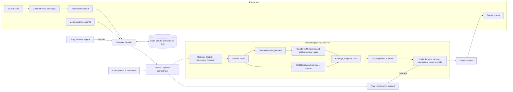

# LEA plan (RepairOS)

The one plan. If code and this file disagree, fix one in the same PR. Task twin: [build/tasks.yaml](build/tasks.yaml);
status: [build/STATUS.md](build/STATUS.md); streams: [areas/](areas/README.md).

## 1. The product

1. Scan **any** hardware object with an iPhone's LiDAR, with live coverage guidance and coaching.
2. The app then guides you through full-resolution close-up photos of what matters.
3. Our models find what a 3D scanner cannot: wiring faults, chip and board issues, breakage, defects, plus labels and markings (OCR).
4. You get a **report**: "looks good" or "potential issues", each finding with its photo evidence and a confidence in words.
5. What was not looked at is `not_inspected`; what cannot be decided is `insufficient_evidence` with the reason. A multimeter reading, if you have one, proves an electrical fault.

## 2. Phase 1 scope

**In**
- iOS app: LiDAR scan, guided close-ups, resumable upload, report screen, optional meter-reading entry.
- Backend: gateway, state, blobs, recorded sessions and replay (built), the Phase 1 pipeline, report generation, pose refinement if on-phone drift correction falls short.
- Detection: OWLv2 zero-shot detector (Grounding DINO swap-in), full-res crops, a trained defect classifier, Claude VLM for explanations and unclear cases, OCR, Jev judgments with decisions in code.
- Benchmark: labelled real captures with held-out products; every target comes from its measurements.
- Import fallback: Stray Scanner (MIT) first; 3D Scanner App "All Data" only after checking its terms.

**Out (Phase 1)**
- Anything that calls Grain: reference designs, design alignment, Grain cross-check, expected electrical values, replacement parts, simulation checks, repair plans, shopping (Phase 2, §9).
- AR probe labels and a meter wizard; speech; segmenters and renderers.
- SpacetimeDB, GPU hosting, multi-user deployment. One laptop runs the backend.
- Training anything except the defect classifier.

## 3. Architecture

The phone talks only to the gateway. [config/providers.yaml](config/providers.yaml) picks every slot's provider.

## 4. Data contracts

JSON Schemas in [spec/contracts/](spec/contracts/README.md) are the contract; `make codegen` generates Pydantic and
Swift from them, `make contracts` checks every example.

| Use | Schemas |
|---|---|
| Phase 1, in use | `scan-package`, `still`, `finding`, `suspect`, `next-action`, `meter-reading` |
| Phase 1, planned | `report` (task B9) |
| Phase 2 | `reference-design`, `repair-plan`, `part-on-hand`, `shopping-quote`, `grain-*` (9 schemas) |

Recorded sessions: [samples/README.md](samples/README.md) and `samples/session.schema.json`.

## 5. Invariants

Code that cannot keep one stops and says so. The ids are the ones code comments cite.

1. **A10 Grain is proprietary.** Only the API surface we call is in the repo; internals stay in `private/` (gitignored). `tools/guard_proprietary.py` enforces it.
2. **GEN3 Nothing fake.** No mocks, stubs or fakes of missing services, devices or data; a missing key or device is HUMAN ACTION NEEDED.
3. **GEN1 Any product.** No product names, refs or class lists in code; one generic vocabulary in `vision/generic_classes.py`; held-out products measure it (GEN2).
4. **I1/I2 Vision is a suspect; the meter is proof.** Only a meter reading makes `is_proof` true or calls an electrical fault proven.
5. **I3 Not looked at means `not_inspected`,** never `ok`.
6. **I4 `insufficient_evidence` is a real answer** and always carries a reason.
7. **S1 Polarity and connection points are never inferred** from wire colour or a rating: power off, measure, confirm. **S4** states the power state before probe points.
8. **S2 A protective part** (fuse, polyfuse, TVS, BMS, thermal cut-off) is judged on its protective ratings, or the answer is no.
9. **S5/A2 Jev judges, code decides.** Numbers are compared in code; models get words; OCR, user and web text are state, never instructions (A9); confidence is shown in words until calibrated on our labelled scans (I6).
10. **L2 Licence-clean.** Shipped code, weights and training data are Apache-2.0, MIT, BSD, CC-BY or the Apple Sample Code License; never GPL, AGPL, LGPL-linked, non-commercial or research-only.
11. **A6 Secrets live in `backend/.env`.** The phone never holds a key.
12. **W1 PRs only.** Never push to `main`. A contract change is its own PR; a behaviour change updates this file in the same PR (W2).

## 6. Phase 1 milestones

Acceptance tests work on any product. No target is invented: MS4 measures the baseline and sets the targets.

| Id | Milestone | Acceptance test | Needs |
|---|---|---|---|
| MS1 | Replay to report | `make replay SESSION=<id>` on a recorded real session writes a report that validates against `report`; every detected region ends as exactly one of finding, `not_inspected` or `insufficient_evidence`; 0 regions shown `ok` that no model looked at; 0 Grain calls. | B9, B10, B11 |
| MS2 | Capture on device | On a product nobody developed against, the app scans, guides close-ups and uploads a session that passes `make sessions-check`; an upload cut mid-way resumes without re-sending finished chunks. | A1-A4 |
| MS3 | Report on the phone | The report for that session shows in the app: verdict, each finding's crop, confidence words, `not_inspected` and `insufficient_evidence` with reasons; a meter reading on a suspect marks it proven or ruled out. | A5, A6, B11 |
| MS4 | Benchmark baseline | `make eval` prints per-split metrics (tuned vs held-out products) for the current pipeline; the numbers and the targets chosen from them are committed with the eval results. | M4, M5 |
| MS5 | Classifier earns its slot | The classifier is selected in config only if, on held-out products, it beats the MS4 baseline on the primary metric with 0 honesty violations. | M6, M7 |
| MS6 | Phase 1 done | On held-out products, app to report meets the MS4 targets with 0 honesty violations; first-time users go from scan to report without help (A7). | all Phase 1 tasks |

## 7. Tasks

`id` leads the PR title (`B10 Pipeline orchestrator`); a task whose id leads a commit on `main` counts as done.
`python3 -I build/next.py` lists what is ready per stream.

### App (iOS)

Capture base (decided 2026-10-24): our own ARKit pipeline, not `ObjectCaptureSession`, which exposes no depth or
poses and owns the camera. Borrow from MIT repos `Dominik-Hagmann/lidar-scanner-ios` (voxels, confidence gate,
PLY writer; keep ARKit Y up), `strayrobots/scanner` (RGB-D format), `cedanmisquith/SwiftUI-LiDAR` (mesh preview)
and Apple samples. Never `arkit-3dgs-scanner` (non-commercial), `record3d` (LGPL), GPL or unlicensed code.

| Id | What | Owns | Done when | Deps |
|---|---|---|---|---|
| A1 | App shell, device probe, pairing | `ios/RepairOS/App/**`, `ios/RepairOSTests/**` | Builds and runs on a LiDAR iPhone; probes at startup whether 48 MP stills work inside the AR session; pairs with the gateway | - |
| A2 | LiDAR scan: `ARWorldTrackingConfiguration` with `sceneReconstruction = .mesh` (live overlay), `sceneDepth` and confidence into a voxel hash with per-voxel hit counts (coverage heat map), own keyframe picker (sharpness score), real-time drift correction (ARKit anchor updates plus our keyframe-level correction where feasible), coaching cues in Apple's Feedback vocabulary (too fast, too close or far, low light, out of view); as fast as quality allows | `ios/RepairOS/Capture/**` | Any table-top object exports a valid `scan-package` (binary PLY in metres, poses, intrinsics, keyframe depth) with live coverage shown | A1 |
| A3 | Guided close-ups via `captureHighResolutionFrame` in the same AR session and world frame; 48 MP when the probe allows, else 12 MP, asking the user only on a trade-off (such as speed); targets from uncovered regions | `ios/RepairOS/Closeups/**` | Every still is a valid `still` at full resolution with pose and intrinsics, linked to the scan; the app shows what is still uncovered | A2 |
| A4 | Upload: chunked, content-hashed, resumable | `ios/RepairOS/Upload/**` | An upload cut mid-way finishes without re-sending done chunks; the gateway session passes `make sessions-check` | A1 |
| A5 | Report screen (live via SSE) | `ios/RepairOS/Report/**` | Renders verdict, findings with crops and confidence words, `not_inspected`, `insufficient_evidence` reasons; never shows a probability number | A4, B11 |
| A6 | Optional meter reading entry | `ios/RepairOS/Meter/**` | Power state shown before probe points (S4); a reading on a suspect shows it proven or ruled out | A5 |
| A7 | First-run usability pass | `ios/RepairOS/**` (fixes) | People new to the app go from scan to report without help; what they hit is fixed or filed | A5 |
| A8 | No-LiDAR mode for any ARKit iPhone: world-tracking poses + guided stills without `sceneDepth` (the NeRFCapture pattern, MIT); geometry and scale from the backend (photo reconstruction or monocular depth) when needed; the scan package records its depth source | `ios/RepairOS/Capture/**` | On a non-LiDAR iPhone, a real object goes from scan to report; the report states what it cannot claim without depth (e.g. sizes) | A2 |

### Modeling + benchmark

| Id | What | Owns | Done when | Deps |
|---|---|---|---|---|
| M1 | Detector slot: OWLv2 default, Grounding DINO alternative, generic vocabulary, prompts, tiling | `slots/detector.py`, `slots/det_*/`, `vision/{generic_classes,prompts,tiling}.py` | **Done** | - |
| M2 | Full-res crops from detector boxes | `vision/crops.py` | **Done** | M1 |
| M3 | VLM crop checks (Claude Haiku, Sonnet on `cannot_tell`) and per-still inspection into findings | `slots/vlm*.py`, `slots/vlm_*/`, `vision/inspect.py` | **Done** | M2 |
| M4 | Benchmark data: labelled real sessions across product kinds, known-good units, held-out products split by object and session | `samples/sessions/**` | `make sessions-check` passes; held-out products are never used for tuning or training | - |
| M5 | Benchmark runner `make eval` | `eval/**` | Per-split precision and recall by defect type, verdict accuracy, honesty violations, calibration of confidence words, latency per stage; one results file per run | M4, B10 |
| M6 | Defect dataset: licence-clean public data plus our labelled crops | `training/data/**`, `licenses/datasets.json` | Every source passes L2; no held-out product in training data | M4 |
| M7 | Defect classifier, CLS slot: frozen DINOv2 backbone with a trained head, licence-clean data, benchmarked against Claude. **In progress** on branch `rohan/defect-classifier` | `slots/classifier.py`, `slots/cls_*/`, `training/models/**` | Conformance passes on real crops; `make eval` reports it against the Claude VLM-only baseline (MS5 decides) | M5, M6 |
| M8 | OCR of labels and markings on crops | `slots/ocr.py`, `slots/ocrb_*/` | Conformance on real label crops; text reaches findings and the report as state (A9) | M2 |
| M9 | Detector choice measured | `config/providers.yaml` (DET line) | OWLv2 vs Grounding DINO on the benchmark (recall, latency); the default follows the numbers | M5 |

Paths are under `backend/repairos/` unless they start with a top-level folder.

### Build execution (Rohan + agents)

| Id | What | Owns | Done when | Deps |
|---|---|---|---|---|
| B1 | Scaffold, Makefile, guard and hook, build tools | `Makefile`, `build/**`, `tools/guard_proprietary.py`, `tools/hooks/**` | **Done** | - |
| B2 | Contracts, codegen (Pydantic, Swift), `check.py` | `spec/contracts/**`, `tools/codegen/**` | **Done** | B1 |
| B3 | Config, secrets, provider registry, release lockout | `config.py`, `registry.py`, `config/**` | **Done** | B1 |
| B4 | State (SQLite, invariant row rules) and blobs (local, content-addressed) | `slots/state*`, `slots/blob*` | **Done** | B3 |
| B5 | Gateway: pairing, resumable uploads, ingestion, reads, SSE | `api/**` | **Done** | B2, B4 |
| B6 | Recorded sessions and replay (`make replay`, `make sessions-check`) | `sessions/**`, `tools/replay.py`, `samples/README.md` | **Done** | B5 |
| B7 | Fusion via Jev: word state, questions, suspects, next action in code, meter override | `fusion/**`, `slots/fusion*`, `tools/jev_smoke.py` | **Done** | B2 |
| B8 | LLM slot (Claude Sonnet) | `slots/llm*` | **Done** | B3 |
| B9 | `report` contract: verdict (`looks_good`, `potential_issues`, `insufficient_evidence`), findings with crop refs and confidence words, `not_inspected` regions, reasons | `spec/contracts/report*`, generated code | `make contracts` and `make codegen-check` pass; invalid examples show an uninspected region cannot be `ok` and `insufficient_evidence` needs a reason | B2 |
| B10 | Phase 1 pipeline orchestrator: detect, crops, classifier when selected, VLM, OCR, findings, Jev, code decisions, report; no Grain | `pipeline/**`, `make run-workers` | MS1 passes on a recorded real session; runs when an upload completes; a stage failure is an error, never a silent default | B9 |
| B11 | Report generation: code picks the verdict, Claude writes plain words from words only (S5); `GET /v1/scans/{id}/report` and an SSE event | `report/**`, report route in `api/app.py` | The report validates; the verdict rule is a tested truth table; A5 renders it | B9, B10 |
| B12 | Import fallback: Stray Scanner (MIT) first; 3D Scanner App "All Data" only after its terms are checked | `tools/import_capture.py` | A real Stray Scanner export imports into a session that passes `make sessions-check`; no closed third-party app capture is used for training or benchmarking | B6 |
| B13 | Backend pose-graph refinement (loop closure) with Open3D and OpenCV, seeded with ARKit poses, then re-fusion; used only if on-phone drift correction (A2) measures not good enough | `recon/**` | On recorded sessions, loop-closure residual and point-to-plane error are reported per session and are lower than with raw ARKit poses | B6 |
| B14 | CI: `make check` on every PR | `.github/workflows/**` | Every PR shows the check; red blocks merge | B1 |
| B15 | Licence check of dependencies and weights against the L2 allowlist | `tools/licence_check.py`, `licenses/weights.json` | Part of `make check`; fails on a disallowed licence | B14 |

## 8. Already built

- **Gateway** (`api/app.py`): pairing, resumable content-hashed uploads, validated ingestion of scans, stills and readings, reads, SSE; every received object is also saved as a replayable session.
- **State and blobs**: SQLite whose transitions enforce I1-I4 and S4; content-addressed local blobs.
- **Sessions and replay**: format, reader, writer, validator, `make replay`, `make sessions-check`; the pipeline stage says `not_built` until B10.
- **Detector slots**: OWLv2 (default) and Grounding DINO, zero-shot, tiled for 12 MP stills, one generic vocabulary.
- **Crops and VLM**: full-res crops; Claude Haiku crop checks, Sonnet on `cannot_tell`; `vision/inspect.py` turns a still into findings.
- **LLM**: Claude Sonnet slot.
- **Jev fusion**: evidence to words, questions in one place, suspect ranking, next-action truth table in code, meter override; `tools/jev_smoke.py`.
- **Contracts and codegen**: 19 schemas with examples; Pydantic and Swift generation with a drift check.
- **Registry and config**: providers from `config/providers.yaml`; typed settings with redacted secrets; release lockout.
- **Tooling**: proprietary guard and hook; `build/doctor.py`, `next.py`, `status.py`.

## 9. Phase 2: Grain (later)

Grain is the team's proprietary design engine; Phase 2 sends it our scans and findings. Internals stay in
`private/grain/` (ask Sritej).

- **Reference designs**: a product's reference (from Grain or built by it) to compare the scan and photos against.
- **Replacement parts**: is the part on hand a fit; what to buy (selection and budget in code, A5).
- **Simulation checks**: a rebuild with a substitute is a "simulation check", never "verified" (I5).
- **The API**: upload, diagnose, electrical check, call. A product Grain did not design has `design_trust: low` (I7).

Contracts already in the repo for Phase 2: `grain-scan-record`, `grain-diagnose-response`, `grain-look-response`,
`grain-electrical-reference`, `grain-electrical-check-request`, `grain-electrical-check-response`,
`grain-call-request`, `grain-call-response`, `grain-error`, `reference-design`, `repair-plan`, `part-on-hand`,
`shopping-quote`. Tasks are written when Phase 1 is done.

## 10. Decisions so far

| Date | Decision | Who |
|---|---|---|
| 2026-10-24 | Phase 1 makes no Grain calls. | Owner |
| 2026-10-24 | Detector default OWLv2 (faster than Grounding DINO tiny in a first measurement, comparable boxes); M9 re-measures. | Owner |
| 2026-10-24 | Jev is required: no deterministic fusion fallback. A meter reading still wins in code. | Owner |
| 2026-10-24 | One laptop: SQLite state, local blobs. | Owner |
| 2026-10-24 | A trained defect classifier is planned; it is selected only when it beats the baseline (MS5). | Owner |
| 2026-10-24 | Capture base: our own app (`ios/`), borrowing the recording engine of [Stray Scanner](https://github.com/strayrobots/scanner) (MIT; depth, confidence, ARKit poses, intrinsics, distortion). Its UI is not used; ours adds a live mesh overlay, coverage map, coaching, sharp-frame picking, guided 48/12 MP close-ups, drift correction, upload and the report. Borrow the no-LiDAR posed-image path from [NeRFCapture](https://github.com/jc211/NeRFCapture) (MIT), mesh preview from [SwiftUI-LiDAR](https://github.com/cedanmisquith/SwiftUI-LiDAR) (MIT), the PLY writer from [lidar-scanner-ios](https://github.com/Dominik-Hagmann/lidar-scanner-ios) (MIT). Not `ObjectCaptureSession`. LiDAR is used when present, never required. Apple Sample Code License allowlisted. | Owner, repo check |
| 2026-10-24 | Drift: correct on the phone in real time first; backend pose-graph loop closure (B13) is acceptable if that is not good enough. | Owner |
| 2026-10-24 | Stills: 12 MP is the base; default to 48 MP when the device and iOS allow it in the AR session (probed at startup); ask the user only on a trade-off. | Owner |
| 2026-10-24 | Scan time: as fast as possible; more time only where quality needs it, with the target set from measurements. | Owner |
| 2026-10-24 | Closed scanner apps (e.g. Polycam) are not used: their terms forbid integration and ML training without written consent. Imports come only from apps whose terms allow it (Stray Scanner, MIT). | Owner, terms check |
| 2026-10-24 | This file replaces the old build and spec documents. | Owner |

## 11. Open questions

| Question | Owner |
|---|---|
| Who runs the App and the Modeling + benchmark streams? | Owner |
| Should close-up targets come from an on-device detector in Phase 1, and for which classes (connector, chip, wire, damage, label)? | App + Modeling |
| OCR on the phone (Apple Vision) or on backend crops? Decide by M5 numbers. | Modeling |
| Where and on what budget does the classifier train (M7)? | Owner |
| Which public defect datasets pass L2 (M6)? | Modeling |
| The benchmark's primary metric, and the Phase 1 targets set at MS4. | Modeling + Owner |
| Is the report only in the app, or also shareable (PDF or link)? | Owner |
| Is Jev's latency per scan acceptable? Measured in M5. | Build (Rohan) |
