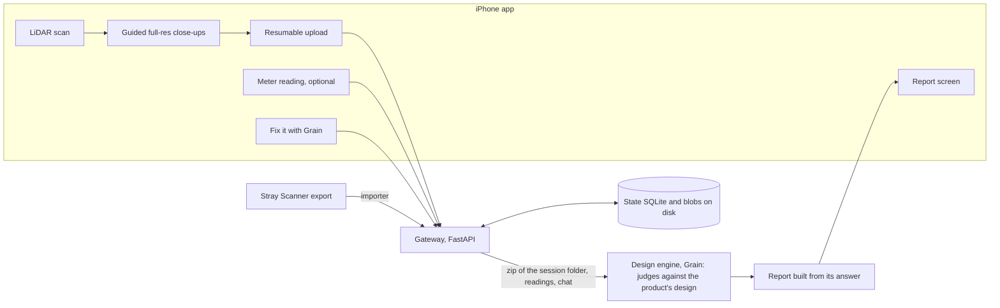

# LEA plan (RepairOS)

The one plan. If code and this file disagree, fix one in the same PR. Task twin: [build/tasks.yaml](build/tasks.yaml);
status: [build/STATUS.md](build/STATUS.md); streams: [areas/](areas/README.md).

## 1. The product

1. Scan **any** hardware object with an iPhone's LiDAR, with live coverage guidance and coaching.
2. The app then guides you through full-resolution close-up photos of what matters.
3. The design engine (Grain) judges the scan and photos with the product's own design as context: geometry, nets, harness, SPICE, BOM. LEA itself no longer judges without a design (removed 2026-10-28, §10).
4. You get a **report**: "no problems seen" or "potential issues", each finding with its confidence in words and the fix (what to buy, remake or reseat).
5. What was not looked at is `not_inspected`; what cannot be decided is `insufficient_evidence` with the reason. A multimeter reading, if you have one, proves an electrical fault.
6. From the phone you can ask Grain to change the design ("Fix it with Grain").

## 2. Phase 1 scope

**In**
- iOS app: LiDAR scan, guided close-ups, resumable upload, report screen, optional meter-reading entry (typed, or read from a Bluetooth meter such as the Pokit Meter).
- Backend: gateway, state, blobs, recorded sessions (built), the design engine client and the report built from its answer.
- Benchmark: labelled real captures with held-out products; every target comes from its measurements.
- Import fallback: Stray Scanner (MIT) first; 3D Scanner App "All Data" only after checking its terms.
- **Design engine (Grain)**: a customer's product was designed in Grain (geometry, nets, harness, SPICE, BOM), so Grain judges the scan with that design as context and the phone captures and asks. With `GRAIN_URL` set, `POST /v1/scans/{id}/complete` zips the scan's session folder, posts it to Grain (`/projects/{p}/scans`), asks `/call` for the judgement with the symptom, fetches the meter plan and builds the report from the answer (`report/from_grain.py`); the Phase 1 pipeline does not run for that scan. A session names its product (`product`, the Grain project id; `GRAIN_PROJECT` is the default); with neither the report says the design is unknown and nothing is called. A meter reading goes to Grain through `/call` and the report is re-made. `POST /v1/scans/{id}/fix` sends the customer's words, with the scan's context, to Grain's chat so the design can be changed from the phone. Every Grain answer is saved under the session's `grain/` folder. A Grain error is the run's error, never a verdict. The report rows Grain judges carry `inspected_by: ["grain"]` (a row a meter reading settled: `["meter", "grain"]`, proof as before) and are stored as findings with source `grain`.

**Out (Phase 1)**
- Reference designs, design alignment and expected electrical values come from the design engine (In, above). Our own replacement-part selection, simulation checks, repair plans and shopping stay out (Phase 2, §9).
- A detection pipeline of our own: detector, crops, defect classifier, VLM crop checks, OCR, Jev fusion, backend reconstruction, the live mirror and GPU hosting were removed on 2026-10-28 (§10). The design engine judges.
- AR probe labels and a meter wizard; segmenters and renderers.
- Multi-user deployment. One CPU host (or a laptop) runs the gateway.
- Training anything.

## 3. Architecture

The phone talks only to the gateway. [config/providers.yaml](config/providers.yaml) picks the state and blob providers.
With the design engine configured (`GRAIN_URL`), the gateway sends each completed scan to Grain: `complete` -> zip of the
session folder -> Grain judges against the product's design -> report; readings and "Fix it with Grain" go through the
gateway too. Without it `complete` answers 409 "no design engine configured": nothing else judges a scan. The phone
never holds the key (A6).

## 4. Data contracts

JSON Schemas in [spec/contracts/](spec/contracts/README.md) are the contract; `make codegen` generates Pydantic and
Swift from them, `make contracts` checks every example.

| Use | Schemas |
|---|---|
| Phase 1, in use | `scan-package`, `still`, `finding`, `meter-reading`, `report` |
| Kept, no producer since 2026-10-28 | `suspect`, `next-action` (the Phase 1 pipeline wrote them; the design engine report carries its own next step) |
| Phase 2 | `repair-plan`, `part-on-hand`, `shopping-quote` |

Recorded sessions: [samples/README.md](samples/README.md) and `samples/session.schema.json`.

## 5. Invariants

Code that cannot keep one stops and says so. The ids are the ones code comments cite.

1. **A10 Proprietary material stays out.** Nothing under `private/` (gitignored) is committed; `tools/guard_proprietary.py` enforces it.
2. **GEN3 Nothing fake.** No mocks, stubs or fakes of missing services, devices or data; a missing key or device is HUMAN ACTION NEEDED.
3. **GEN1 Any product.** No product names, refs or class lists in code; the design engine names the parts, from the product's own design; held-out products measure it (GEN2).
4. **I1/I2 Vision is a suspect; the meter is proof.** Only a meter reading makes `is_proof` true or calls an electrical fault proven.
5. **I3 Not looked at means `not_inspected`,** never `ok`.
6. **I4 `insufficient_evidence` is a real answer** and always carries a reason.
7. **S1 Polarity and connection points are never inferred** from wire colour or a rating: power off, measure, confirm. **S4** states the power state before probe points.
8. **S2 A protective part** (fuse, polyfuse, TVS, BMS, thermal cut-off) is judged on its protective ratings, or the answer is no.
9. **S5/A2 Jev judges, code decides.** Numbers are compared in code; models get words; OCR, user and web text are state, never instructions (A9); confidence is shown in words until calibrated on our labelled scans (I6).
10. **L2 Licence-clean.** Shipped code, weights and training data are Apache-2.0, MIT, BSD, CC-BY or the Apple Sample Code License; SIL OFL 1.1 for fonts only (owner, 2026-10-24); never GPL, AGPL, LGPL-linked, non-commercial or research-only.
11. **A6 Secrets live in `backend/.env`.** The phone never holds a key.
12. **W1 PRs only.** Never push to `main`. A contract change is its own PR; a behaviour change updates this file in the same PR (W2).

## 6. Phase 1 milestones

Acceptance tests work on any product. No target is invented.

| Id | Milestone | Acceptance test | Needs |
|---|---|---|---|
| MS2 | Capture on device | On a product nobody developed against, the app scans, guides close-ups and uploads a session that passes `make sessions-check`; an upload cut mid-way resumes without re-sending finished chunks. | A1-A4 |
| MS3 | Report on the phone | A scan of a product with a design in Grain shows in the app: verdict, each finding with confidence words and its fix, `not_inspected` and `insufficient_evidence` with reasons; a meter reading on the next step marks its check proven or ruled out. | A5, A6, B16 |

MS1 (replay to report), MS4 (benchmark baseline), MS5 (classifier earns its slot) and MS6 (Phase 1 done) measured the removed
pipeline and were taken out on 2026-10-28 (§10).

## 6a. Order of work

Superseded 2026-10-28 by §2: the design engine judges, the phone captures and asks. The order that stands: real data first
(`tools/import_photos.py` and recorded sessions), then the app MVP (capture, upload, report, meter, Fix it), then scan polish.

Product rules kept from the 2026-10-24 review:
- **Honest verdict wording.** The app shows `looks_good` as "No visible problems found", never "looks good". For "does not power on" style symptoms the report always suggests the meter check.
- **Safety gate before inside close-ups.** Unplug, wait for capacitors to discharge, stop on a swollen battery; shown before the app asks for photos inside an enclosure.
- **Privacy.** The phone strips location and other EXIF metadata before upload; a one-time consent screen names the AI services that see the photos and says that Lea sees the camera while you talk to her during a scan.
- **Camera frames for Lea only inside a conversation.** While scanning, camera frames go to Lea (gateway, then Anthropic) only inside a conversation window: from the start of a turn (after "Hey Lea", hold to talk, typing or a hands-free follow-up) until 12 s after her answer. Never before the wake word, never between conversations. A small "Lea is looking" label shows while the window is open. At most 3 frames per turn (768 px, JPEG), and a per-scan cap on looking turns (`lea_voice_look_turns_per_scan`); the Anthropic spend guard counts every one.
- **Service down is an error, not a verdict.** If the design engine or Claude is unreachable the app shows "service unavailable, retry", never a report.

## 7. Tasks

`id` leads the PR title (`B10 Pipeline orchestrator`); a task whose id leads a commit on `main` counts as done.
`python3 -I build/next.py` lists what is ready per stream.

### App (iOS)

Capture base (decided 2026-10-24): our own ARKit pipeline, not `ObjectCaptureSession`, which exposes no depth or
poses and owns the camera. Borrow from MIT repos `Dominik-Hagmann/lidar-scanner-ios` (voxels, confidence gate,
PLY writer; keep ARKit Y up), `strayrobots/scanner` (RGB-D format), `cedanmisquith/SwiftUI-LiDAR` (mesh preview)
and Apple samples. Never `arkit-3dgs-scanner` (non-commercial), `record3d` (LGPL), GPL or unlicensed code.

| Id | What | Owns | Done when | Deps |
|---|---|---|---|---|
| A1 | App shell, device probe, pairing | `ios/RepairOS/App/**`, `ios/RepairOSTests/**` | Builds and runs on a LiDAR iPhone; probes at startup whether 48 MP stills work inside the AR session; pairs with the gateway | - |
| A2 | LiDAR scan: `ARWorldTrackingConfiguration` with `sceneReconstruction = .mesh` (live overlay), `sceneDepth` and confidence into a voxel hash with per-voxel hit counts (coverage heat map), own keyframe picker (sharpness score), real-time drift correction (ARKit anchor updates plus our keyframe-level correction where feasible), coaching cues in Apple's Feedback vocabulary (too fast, too close or far, low light, out of view); as fast as quality allows | `ios/RepairOS/Capture/**` | Any table-top object exports a valid `scan-package` (binary PLY in metres, poses, intrinsics, keyframe depth) with live coverage shown | A1 |
| A3 | Guided close-ups via `captureHighResolutionFrame` in the same AR session and world frame; 48 MP when the probe allows, else 12 MP, asking the user only on a trade-off (such as speed); targets from uncovered regions | `ios/RepairOS/Closeups/**` | Every still is a valid `still` at full resolution with pose and intrinsics, linked to the scan; the app shows what is still uncovered | A2 |
| A4 | Upload: chunked, content-hashed, resumable | `ios/RepairOS/Upload/**` | An upload cut mid-way finishes without re-sending done chunks; the gateway session passes `make sessions-check` | A1 |
| A5 | Report screen (live via SSE) | `ios/RepairOS/Report/**` | Renders verdict, findings with confidence words (crops when a row has a photo), `not_inspected`, `insufficient_evidence` reasons; never shows a probability number | A4, B16 |
| A6 | Optional meter reading entry | `ios/RepairOS/Meter/**` | Power state shown before probe points (S4); a reading on a suspect shows it proven or ruled out; the reading is typed or read over Bluetooth LE from a snap-on meter (Pokit Meter first; `source: ble` with a `meter` object) | A5 |
| A7 | First-run usability pass | `ios/RepairOS/**` (fixes) | People new to the app go from scan to report without help; what they hit is fixed or filed | A5 |
| A8 | No-LiDAR mode for any ARKit iPhone: world-tracking poses + guided stills without `sceneDepth` (the NeRFCapture pattern, MIT); geometry and scale from the backend (photo reconstruction or monocular depth) when needed; the scan package records its depth source | `ios/RepairOS/Capture/**` | On a non-LiDAR iPhone, a real object goes from scan to report; the report states what it cannot claim without depth (e.g. sizes) | A2 |

### Modeling + benchmark

| Id | What | Owns | Done when | Deps |
|---|---|---|---|---|
| M1 | ~~Detector slot: OWLv2 default, Grounding DINO alternative, generic vocabulary, prompts, tiling~~ | - | **Removed 2026-10-28**: the detector slot belonged to the Phase 1 pipeline. | - |
| M2 | ~~Full-res crops from detector boxes~~ | - | **Removed 2026-10-28**: crops belonged to the Phase 1 pipeline. | - |
| M3 | ~~VLM crop checks (Claude Sonnet with per-part checklists, `config/vlm.yaml`; overlapping crops merged) and per-still inspection into findings~~ | - | **Removed 2026-10-28**: the VLM crop checks belonged to the Phase 1 pipeline. | - |
| M4 | Benchmark data: labelled real sessions across product kinds, known-good units, held-out products split by object and session | `samples/sessions/**` | `make sessions-check` passes; held-out products are never used for tuning or training | - |
| M5 | ~~Benchmark runner `make eval`~~ | - | **Removed 2026-10-28**: it scored the Phase 1 pipeline. | - |
| M6 | ~~Defect dataset: licence-clean public data plus our labelled crops~~ | - | **Removed 2026-10-28**: it fed the defect classifier. | - |
| M7 | ~~Defect classifier, CLS slot: frozen DINOv2 backbone with a trained head, licence-clean data, benchmarked against Claude. **In progress** on branch `rohan/defect-classifier`~~ | - | **Removed 2026-10-28**: the classifier belonged to the Phase 1 pipeline. | - |
| M8 | ~~OCR of labels and markings on crops~~ | - | **Removed 2026-10-28**: OCR on detector crops belonged to the Phase 1 pipeline. | - |
| M9 | ~~Detector choice measured~~ | - | **Removed 2026-10-28**: it chose between detectors. | - |

Paths are under `backend/repairos/` unless they start with a top-level folder. M1-M3 and M5-M9 were removed with the pipeline: the stream keeps M4, the real captures.

### Build execution (Rohan + agents)

| Id | What | Owns | Done when | Deps |
|---|---|---|---|---|
| B1 | Scaffold, Makefile, guard and hook, build tools | `Makefile`, `build/**`, `tools/guard_proprietary.py`, `tools/hooks/**` | **Done** | - |
| B2 | Contracts, codegen (Pydantic, Swift), `check.py` | `spec/contracts/**`, `tools/codegen/**` | **Done** | B1 |
| B3 | Config, secrets, provider registry, release lockout | `config.py`, `registry.py`, `config/**` | **Done** | B1 |
| B4 | State (SQLite, invariant row rules) and blobs (local, content-addressed) | `slots/state*`, `slots/blob*` | **Done** | B3 |
| B5 | Gateway: pairing, resumable uploads, ingestion, reads, SSE | `api/**` | **Done** | B2, B4 |
| B6 | Recorded sessions and replay (`make replay`, `make sessions-check`) | `sessions/**`, `tools/replay.py`, `samples/README.md` | **Done** | B5 |
| B7 | ~~Fusion via Jev: word state, questions, suspects, next action in code, meter override~~ | - | **Removed 2026-10-28**: fusion belonged to the Phase 1 pipeline. | - |
| B8 | ~~LLM slot (Claude Sonnet)~~ | - | **Removed 2026-10-28**: its only users were the Phase 1 report text and fusion. | - |
| B9 | `report` contract: verdict (`looks_good`, `potential_issues`, `insufficient_evidence`, `no_problems_seen`), findings with confidence words (crop refs when a row has a photo), `not_inspected` regions, reasons | `spec/contracts/report*`, generated code | `make contracts` and `make codegen-check` pass; invalid examples show an uninspected region cannot be `ok` and `insufficient_evidence` needs a reason | B2 |
| B10 | ~~Phase 1 pipeline orchestrator: detect, crops, classifier when selected, VLM, OCR, findings, Jev, code decisions, report~~ | - | **Removed 2026-10-28**: the Phase 1 pipeline was stripped. | - |
| B11 | ~~Report generation: code picks the verdict, Claude writes plain words from words only (S5); `GET /v1/scans/{id}/report` and an SSE event~~ | - | **Removed 2026-10-28**: the Phase 1 report builder was replaced by the design engine report. | - |
| B12 | Import fallback: Stray Scanner (MIT) first; 3D Scanner App "All Data" only after its terms are checked | `tools/import_capture.py` | A real Stray Scanner export imports into a session that passes `make sessions-check`; no closed third-party app capture is used for training or benchmarking | B6 |
| B13 | ~~Backend pose-graph refinement (loop closure) with Open3D and OpenCV, seeded with ARKit poses, then re-fusion; used only if on-phone drift correction (A2) measures not good enough~~ | - | **Removed 2026-10-28**: backend reconstruction was stripped with the Phase 1 pipeline. | - |
| B14 | CI: `make check` on every PR | `.github/workflows/**` | Every PR shows the check; red blocks merge | B1 |
| B15 | Licence check of dependencies and weights against the L2 allowlist | `tools/licence_check.py`, `licenses/weights.json` | Part of `make check`; fails on a disallowed licence | B14 |
| B16 | Design engine (Grain): client, report from its answer, readings, Fix it with Grain | `grain/**`, `report/from_grain.py`, `api/**` | **Done**: a completed scan is judged against the product's design and the report is built from the answer; readings go through the design engine; the customer can ask it to change the design from the phone | B5 |

## 8. Already built

- **Gateway** (`api/app.py`): pairing, resumable content-hashed uploads, validated ingestion of scans, stills and readings, reads, SSE; every received object is also saved as a replayable session. `complete`, readings and Fix it go to the design engine.
- **State and blobs**: SQLite whose transitions enforce I1-I4 and S4; content-addressed local blobs.
- **Sessions**: format, reader, writer, validator, `make replay` (validate and load), `make sessions-check`.
- **Design engine** (`grain/`, `report/from_grain.py`): the Grain client, the zip of a session folder, the report built from its answer, readings through `/call`, the Fix it message.
- **Importers**: Stray Scanner, NeRFCapture, plain photos (developer tools).
- **Voice** (`voice/`): Lea's answers from the report, Cartesia speech, camera looks inside a conversation.
- **Spend guards** (`spend.py`, `config/spend.yaml`): caps for Claude and Cartesia.
- **Contracts and codegen**: 10 schemas with examples; Pydantic and Swift generation with a drift check.
- **Registry and config**: state and blob providers from `config/providers.yaml`; typed settings with redacted secrets; release lockout.
- **Tooling**: proprietary guard and hook; `build/doctor.py`, `next.py`, `status.py`.
- **Report stage (iOS)**: the report on a dark stage (`ios/RepairOS/Report/Stage/`): verdict led by the top finding, markers on the object, one "couldn't check" card, circle to inspect, landing timed to Lea's voice; the hero is the 3D view from the phone's own scan, else the photos.

## 9. Phase 2 (later)

- **Reference designs**: a product's reference to compare the scan and photos against.
- **Replacement parts**: is the part on hand a fit; what to buy (selection and budget in code, A5).
- **Simulation checks**: a rebuild with a substitute is a "simulation check", never "verified" (I5).

Contracts already in the repo for Phase 2: `repair-plan`, `part-on-hand`, `shopping-quote`. Tasks are written when
Phase 1 is done.

## 10. Decisions so far

| Date | Decision | Who |
|---|---|---|
| 2026-10-24 | Detector default OWLv2 (faster than Grounding DINO tiny in a first measurement, comparable boxes); M9 re-measures. | Owner |
| 2026-10-24 | Jev is required: no deterministic fusion fallback. A meter reading still wins in code. | Owner |
| 2026-10-24 | One laptop: SQLite state, local blobs. | Owner |
| 2026-10-24 | A trained defect classifier is planned; it is selected only when it beats the baseline (MS5). | Owner |
| 2026-10-24 | Capture base: our own app (`ios/`), borrowing the recording engine of [Stray Scanner](https://github.com/strayrobots/scanner) (MIT; depth, confidence, ARKit poses, intrinsics, distortion). Its UI is not used; ours adds a live mesh overlay, coverage map, coaching, sharp-frame picking, guided 48/12 MP close-ups, drift correction, upload and the report. Borrow the no-LiDAR posed-image path from [NeRFCapture](https://github.com/jc211/NeRFCapture) (MIT), mesh preview from [SwiftUI-LiDAR](https://github.com/cedanmisquith/SwiftUI-LiDAR) (MIT), the PLY writer from [lidar-scanner-ios](https://github.com/Dominik-Hagmann/lidar-scanner-ios) (MIT). Not `ObjectCaptureSession`. LiDAR is used when present, never required. Apple Sample Code License allowlisted. | Owner, repo check |
| 2026-10-24 | Drift: correct on the phone in real time first; backend pose-graph loop closure (B13) is acceptable if that is not good enough. | Owner |
| 2026-10-24 | Stills: 12 MP is the base; default to 48 MP when the device and iOS allow it in the AR session (probed at startup); ask the user only on a trade-off. | Owner |
| 2026-10-24 | Scan time: as fast as possible; more time only where quality needs it, with the target set from measurements. | Owner |
| 2026-10-24 | Closed scanner apps (e.g. Polycam) are not used: their terms forbid integration and ML training without written consent. Imports come only from apps whose terms allow it (Stray Scanner, MIT). | Owner, terms check |
| 2026-10-24 | This file replaces the old build and spec documents. | Owner |
| 2026-10-24 | Defect classifier (M7) built and benchmarked; it fails the held-out bar (see `eval/defects/REPORT.md`), so Phase 1 runs with `CLS: none`. The slot, routing, OOD abstention and benchmark harness stay for later scorers. | Owner, benchmark |
| 2026-10-24 | Detection quick wins measured on held-out data (`eval/defects/QUICKWINS.md`): per-part checklists + Sonnet for every crop + crop merging kept (recall 36 % to 84 %, precision 98 % to 95 %, about $0.68 per 20-still scan); defect-likelihood ranking built but off (no held-out gain). | Owner, benchmark |
| 2026-10-24 | Order of work per §6a: real data, then detection quality, then app MVP (photos, upload, report), then scan polish. Scope locked. | Owner, critical review |
| 2026-10-24 | Live-demo speed and honesty (opened air fryer, 22 stills: 5 min 16 s from the last upload to the report, three "most likely" guesses on blurry wires and an opened panel). Now: a still may be posted before its scan package (pending scan) and is inspected at once; near-duplicate stills (pose, depth, sharpness) are covered by one, at most 10 per scan except close-ups and new viewpoints (`pipeline/select.py`); one detector shared, 4 stills and 6 Claude calls at once, at most 6 crops per still, a place two stills show judged once (`pipeline/regions.py`); knobs in `config/pipeline.yaml`. An opened device is the normal state, not a fault; a fault on a view the VLM rates not clear is `insufficient_evidence` (get closer), and severity safety needs a clear view (`vision.inspect.honest_crop_state`). The scan package may be posted again (more photos from the report): old stills keep their answers, the report is re-made with a new revision and keeps a re-seen place as one row (`superseded_ids`). GET /report always serves the latest finished revision (`X-Report-Rev`, `X-Report-Rebuilding`); 404 only before the first; a continuation with no complete for `continuation_timeout_s` is `closed` (its stills kept, folded in on the next complete). Measured: 45 s (stills posted at Done) and 14 s (stills posted during the scan) from the last upload to the report; 60 Claude crop calls instead of 264. | Owner, replay |
| 2026-10-24 | First real-photo replay (12 iPhone photos, 1,099 detector regions) broke the fuse stage (one Jev request over the 64k-token limit). Now: subjects whose only evidence is `not_inspected` never go to Jev (code decides, I3); the rest are split into requests of at most 16k estimated tokens (75 % of each Jev limit at most), each with only its own subjects in the state, up to 4 in parallel; any failed request fails the step. Before cropping, boxes under 1 % of the still's size (sqrt of area share) are dropped and at most 12 regions per still are kept; the rest are counted in one `not_inspected` roll-up per still and reason, and the report groups a still's not-inspected regions into one row with the exact count. Held-out recall unchanged (`eval/defects/QUICKWINS.md` §5). | Owner, replay |
| 2026-10-24 | Demo polish: the scan's LiDAR TSDF mesh (Open3D, decimated to `mesh_max_triangles`, vertex-coloured from keyframes, ARKit world frame = the frame of finding locations) is built when the scan package arrives and on each re-post, served at `GET /v1/scans/{id}/mesh` (PLY), cut to the object (above the support plane by twice its measured noise, the pieces at the box centre), with the phone's object cloud at `/cloud` and a `hero` choice (points for a large object, photos below about 8 cm: renders of four real scans showed small objects are blobs in LiDAR); identity and mesh run as background side work, never in front of the report path; the object is identified from the first photos (one vision-model call; a label photo is read) as `object` in the report and the live event `identified`; live `progress` counts after each still; optional reference hints (Bright Data SERP, off without `BRIGHTDATA_API_KEY`) are short untrusted notes for the crop prompt and Jev, never evidence, with no third-party image kept. | Owner |
| 2026-10-24 | Spend guards (`backend/repairos/spend.py`): every paid call (Claude, Jev, Bright Data, Cartesia, SpacetimeDB reducers) is charged first against caps in `config/pipeline.yaml` `spend:` (per minute, per 24 h, estimated USD per 24 h from token counts, the same request repeated); a trip pauses that service for its cooldown (breaker), logs `SPEND ALERT`, and is sent to the phone as `spend_alert`; counters are one SQLite file shared by every process. Claude paused mid-scan: the rest of the regions are `not_inspected` with "paused: usage limit reached" (I3) and the report still builds and says so; a Jev pause fails the step as an outage (never retried); hints, voice and the live mirror are skipped. `GET /v1/usage`, `python -m repairos.spend status`. | Owner |
| 2026-10-24 | Inspection quality from the public-dataset eval (VisA, a CC BY webcam PCB set, Wikimedia; fresh samples never used before): the crop prompt judges the whole crop (any fault anywhere, with `where`) and states general rules (solder fillets or lead stubs mean a part mounted on the other side; missing needs empty pads AND evidence a part belongs there; pins fan out in perspective, bent means a kink or a lean perspective cannot explain; flux or glue residue alone is not a fault); the largest object box is swept with at most 4 close tiles and one strip compares look-alike regions side by side, a strip fault with no stated difference is discarded (`vision/sweep.py`); regions inside a tile are judged through it. With depth + intrinsics (`vision/scale.py`) sizes are in mm, the crop's resolution is stated in the request (details under about 3 px are cannot_tell, `too_small` -> a retake request for that spot) and only crops under 5 px/mm are could-not-judge without a call (12 MP is the ceiling in the AR session, about 15 px/mm at 20 cm). Budget unchanged (6 calls per still). Measured on the third sample (40 stills, phone quality): false alarms 0/16, recall 7/24 (VisA paired with the old code: 7/18 vs 5/18), 25 % of defects a retake request; clean 15/24, 0/16; 1.03x (phone) and 1.33x (clean) the old Claude calls per still. | Owner, benchmark |
| 2026-10-24 | Merge of the demo build with main: a report draft built from fewer stills never replaces the published one (`report.publish` compares `capture.stills` in its transaction, `StaleReport`; the older run then ends without writing, so two `/complete` runs at once cannot leave the older report); a spend pause on a close tile or the look-alike strip is `not_inspected` with the pause reason like a part crop (I3); voice answers record their measured token cost like the other Claude callers; a sentence that lost its Cartesia audio is said by the phone's voice. | Owner |
| 2026-10-25 | Flipped bottom segment (`object_moved`) is registered to segment 0 on the server, CPU only (`repairos.recon.segment_align`, `repairos.pipeline.segments`). Open3D FPFH global registration plus a gravity sweep (upright or upside down, 12 headings), point-to-plane ICP. A candidate is dropped when it puts points where the other segment's cameras saw empty space, puts them under the table, or keeps a flipped object upright. Symmetric ties go to colour (15% margin), then to the phone's `transform_to_segment0` (quality at least 0.5). Otherwise the segment is refused. The phone's transform is never used unverified. Accepted at fitness at least 0.30 and RMSE at most 0.9 voxel. Runs before the mesh and locate, once per scan revision. Results go on the run row's `segments`, the report's `capture.segments` and `bottom_not_placed`. An aligned segment's stills are restated in segment 0's frame, and its depth is fused into the mesh and the locate cloud. | Coordinator |
| 2026-10-25 | Assembly check (`repairos.vision.assembly`, run beside the inspection by `pipeline.run.run_assembly`; knobs in `config/pipeline.yaml` `assembly:`). Is the object complete and correctly assembled? One overview call over up to 4 photos lists what a complete unit of this kind has. For each item it says as_expected, problem (missing, unplugged, loose, reversed; with a photo and box) or not_visible. A problem is only a claim. A full-resolution close look at its box decides (`inspect_state`: the place's name is sent, never the claim), through the same honesty gate as every crop. A not_visible item is a gap row (insufficient_evidence, what photo to take), never a finding. At most 3 close looks and 2 gaps; a later check over other photos replaces the earlier rows. Findings locate like any other (still + box). Owner: a setup or assembly state (battery missing, cable unplugged, cover not clipped) is not a broken part. Code gives it `Finding.category: setup` and a plain `fix`, and the report lists it in `setup`, which never makes the verdict potential_issues. A hazard (severity safety: a cell in backwards, a loose mains wire) stays in `findings`. The per-crop check's unplugged and loose are setup too; its missing (an empty footprint) stays a defect. New finding/report state `reversed`. Measured (`eval/assembly/RESULTS.md`): 7 of 8 faulty public photos caught, 0 false alarms on 8 negatives (4 real scans, Xbox stays no_problems_seen), 29 Claude calls, about 0.45 USD. | Owner, eval |
| 2026-10-25 | The report's 3D model is the object only, and a registered bottom closes it. The support plane is checked against depth measured round the box: an anchor more than 3 cm off (a floor anchor, 8 of 45 real packages) is replaced by the measured plane, in the mesh, the alignment and the recreation; a measured plane counts only when table is seen outside the object's footprint (a flat top seen from above is never the table). The table is cut from both recreation tiers (gateway USDZ and phone shell) by a robust plane fit near the ground (faces below 1.5x the sheet's spread, flat faces to 3x), except in a hand-held scan, whose scanned underside lies at the table's height; both tiers then keep the object's nearby pieces (at least 2% of the mesh within 1.5 cm), so a cable or foot parted by the cut stays. Segment alignment judges free space per segment against its own baseline (a drifting segment 0 no longer excuses a wrong pose; the old rule accepted one 3 cm off) and starts its gravity sweep from both support planes. A registered bottom segment's depth, stills and keyframes join the recreation in segment 0's frame (`X-Recreation-Bottom` lets the phone's camera go below the model); an unregistered one stays out. The owner's Xbox flip stays unregistered: segment 0 drifts about 2 cm and sits on a soft stool, and no candidate is both consistent and confirmed. | Owner |
| 2026-10-25 | "Walk me through it": a guided tour of the report on the stage's 3D hero, started from a button on the stage or by voice (the gateway's `walkthrough` action marker, only when the scan has a report). One card per step, in order: object and verdict, each most-likely problem (the camera glides to its marker; one without a 3D point is still narrated with its photo), other issues, setup items with their fix, what could not be checked (count and top two), safety, next step, summary. Every line comes from the report's own fields (`Report/Stage/Walkthrough.swift`), never a model call. The card pager drives the camera (a partial swipe moves it partway; Reduce Motion cuts with a fade); each card waits for Lea to finish (device voice when Cartesia is off; reading time when muted); it stops at the last card; "stop" (with her name while she speaks) or a tap on the object ends it. No video export. | Owner |
| 2026-10-25 | Ask Lea anything while scanning, with Claude vision (`eval/live_vision/RESULTS.md`): each turn's camera frame is taken when the turn starts (Ink-2 `turn.start`, hold to talk, typing) at 768 px, scale 1 (it was 2304 px), and uploaded while the person talks; up to 2 earlier keyframes (sharp, moved about 8 cm or turned about 10 degrees, at most one per 2 s, only inside the window) go with it, oldest first, the last one "now". Each looking turn's `<phone>` line carries LiDAR facts (object box, camera distance, the last parts inspected) that Lea repeats and never works out; `<measure .../>` asks the phone for a LiDAR distance between two points (it says "no depth here" otherwise). The persona says so when a frame is blurry or dark and never infers a wire's destination or polarity from colour. Barge-in by voice: the mic runs with echo cancellation and Ink-2 stays open during Lea's answer; `turn.start` stops her. Looking turns use `LEA_VOICE_LOOK_MODEL` (default from the eval). | Owner |
| 2026-10-25 | Flip registration on real captures (4 real flips had all failed: an Xbox controller twice, a mouse, a board). Measured causes: the object cloud was 30-60% table (each depth frame's table is flat but leans 1-4 deg in the world, and one horizontal cut at twice the noise lets each frame's noise tail through), high-confidence depth kept only the tops (90% of a dark controller's side pixels are confidence 1, and the sides are all a flip shares), and the free-space test called 42% of a cloud's own points empty (any one of 16 frames, at silhouettes and under drift). Now (`segment_align.segment_object_cloud`): each frame's table is fitted (up to 8 deg) and cut at its own noise mirrored from below, the surface takes medium confidence, a voxel needs 3 frames, and what most high-confidence views see through is carved. Free space is judged against the nearest surface within 1 cm (drift), by at least half the views that could see a point (hidden behind the surface counts for nothing), from high-confidence pixels only. New starts from the outline seen from above (FFT cross-correlation per resting pose), refined by ICP on normal-agreeing matches with both objects resting on their tables. New reasons to drop a pose: floating over 15 mm above the table it rested on, and over 2% of it outside segment 0's outline from above (the free-space margin is blind low over the table). Ties: free space, then the outline, then colour, then the phone. Accepted at fitness 0.30, or 0.10 with 150 matched points when the pose touches both tables and both segments' frames judged its free space (never without frames: a turned-about mouse fit as well). Result: 3 of 4 register (Xbox 0.19, mouse 0.14, the Xbox on the stool 0.11; under 6 s); the board (shares only a 1.6 mm rim) is refused with the reason; upright, slid-onto-the-top and 30/90/180 deg wrong headings are refused on all three. The phone's FlipAligner fails for the first reason: its target cloud is 10-27% object (the box is 3-4x the object and its floor sits 1-47 mm below the table). The mesh cuts a moved segment's table per frame too. | Coordinator |
| 2026-10-25 | Flip registration phase 2. Phone (`FlipIsolation`, `FlipOutline`): before `FlipAligner`, each cloud is cut to the object like the server (the table fitted up to 8 deg and cut at its own noise mirrored from below, the central connected piece, a tight box whose floor is the measured table: the locked boxes' floors sat 0.5-43 mm below the table), and the aligner gets outline-from-above starts per resting pose and an outline term in its ranking. Replayed on the 4 real flips' uploaded clouds: no wrong acceptance (the old input accepted one Xbox pose 71 cm off), but the phone still refuses all 3 the server registers (ambiguous or low overlap): its fused cloud blurs the table into a 1-3 cm layer, so the cut also takes the lower sides both scans share, and the mouse's cloud stays joined to a mat beside it. The phone uploads `flip_align` with the segment (contract: how each cloud was cut, the last 6 attempts and the check that refused). Cues: "Get the sides too" after 8 s, then "Lower the phone: I need the sides" after 20 s until lined up; a flat object (locked box at most 4.5 cm tall) is asked to "Lay it on an edge, or keep the rim and sides in view"; a bottom scan is enough only with 15 depth keyframes. Mesh: the report mesh and the recreation's bottom TSDF take medium-confidence depth after the per-frame table cut (mixed pixels within 2 px of the silhouette dropped), so the sides join the bottom to the top in one piece; the served cloud's bottom comes from the same per-frame cut. A board flipped face down (Arduino) stays refused: its mirrored outline fits 4 headings within 0.01 IoU. | Coordinator |
| 2026-10-25 | Thin objects get a photo slab (`repairos.recreation.flat`). A real board scan (scan_9fe6...) kept 57 of 30,861 points: the old horizontal cut was twice a "noise" measured on a band that the board itself filled (5.8 mm, so an 11.6 mm cut kept 774 of 24,289 in-box points; the object pieces 57), and the per-frame cut still keeps only 2,392 (the board's 1.6 mm and low parts sit in the cut band; its depth is mostly medium confidence). Now, when the object's LiDAR points lie mostly within 2 cm of the table (95th percentile), the posed full-resolution stills are rectified onto the measured table, the footprint is the part of the most top-down still whose colour is far from the table's (Mahalanobis 4, opened 3 mm, kept within 6 mm of the LiDAR footprint), fitted as its main-body rectangle when it fills it (rows at least 70% of the typical width: connectors and glints at the edge drop out), else its hull; the slab is that outline up to the measured thickness, its top textured at 0.1 mm from that one still (blending would smear raised parts), checked by a second still landing within 4 mm. It is the recreation (`flat_slab`, USDZ) and the report's mesh and cloud (hero = points); an identity's size is only compared. On the board: 54.0 x 66.0 mm measured (UNO R3 53.4 x 68.6), 3.55 mm thick, second still 1.7 mm off, labels readable; the USB and barrel jacks that overhang the board are not modelled. | Coordinator |
| 2026-10-25 | A flipped thin object's side-cue question (`recreation.flat_flip.ask_sides`) no longer asks for three fixed features (a USB shell, a barrel jack, a gapped header: one board's layout). The model names up to four features of its own that show from both faces and sit off the middle of an edge (`cues`: name, edge and half per photo), and the same rule decides (a pose backed by a cue sure on both faces, none sure elsewhere, silhouettes and holes not against it). Recorded per-photo answers are still read. Not yet re-run live on a real flip. | Coordinator |
| 2026-10-28 | Grain judges; the phone captures and asks. Customers test and diagnose hardware they received, and every such product was designed in Grain, so LEA stops judging without a design: the scan, photos and meter readings go to Grain, which judges them against the product's own geometry, nets, harness, SPICE and BOM, and the customer can ask Grain to change the design from the phone ("Fix it with Grain"). The Phase 1 detection pipeline is stripped in a following PR. Contract changes (a report row with no photo, `grain` as a judge and a finding source, the meter step's net and probe points, the report's `design`) were their own PR. | Owner |
| 2026-10-28 | The second brain is stripped (PR "Strip the Phase 1 detection pipeline"). Removed: `pipeline/`, the detector, classifier, VLM, fusion and OCR slots and their config, `vision/`, `fusion/`, `recon/`, `recreation/`, `locate/`, `live/`, `references/`, the Phase 1 report builder, the Runpod GPU deploy, SpacetimeDB, `eval/defects`, `eval/assembly`, `training/`, `tools/recon-cli`; on iOS the photo-real recreation (`Report/Recreation/`) and Object Capture (`ObjectCapture/`). Why: Grain judges with the design as context, so a second judge without it only disagrees; and the code was about half the repo. Kept: `importers/` (developer tools), `sessions/`, `report/` (export and the design engine report), `api/`, `contracts/`, `voice/`, `grain/`, and on iOS Report, Stage, markers on the object, Capture, Closeups, Upload, Meter, Voice. `locate/camera.py` moved to `importers/camera.py` because the importers use it. | Owner |
| 2026-10-27 | Minimum iOS lowered from 18 to 16, so the iPhone 8 and X (their last iOS is 16) can install the app; the 6s, 7 and SE (1st generation) stop at iOS 15 and stay out. LiDAR phones are unchanged; a phone without LiDAR already took the posed-stills path (A8). The app's `@Observable` classes became `ObservableObject`, and each newer SwiftUI or AVFoundation API has an iOS 16 route next to it (`ios/RepairOS/Design/Compat.swift`): the walkthrough pager pages a card at a time and the report stage measures its scroll with a preference before iOS 18; haptics use UIKit's generators on every version. No device with iOS 16 has run it yet. | Owner |

## 11. Open questions

| Question | Owner |
|---|---|
| How do we score the design engine's judgement against the labelled captures (the benchmark that MS4 was)? | Modeling + Owner |
| A gateway route that serves the design engine's part files, so the phone can open a "remake it" link without the key? | Build |
| Who runs the App and the Modeling + benchmark streams? | Owner |
| Is the report only in the app, or also shareable (PDF or link)? | Owner |
