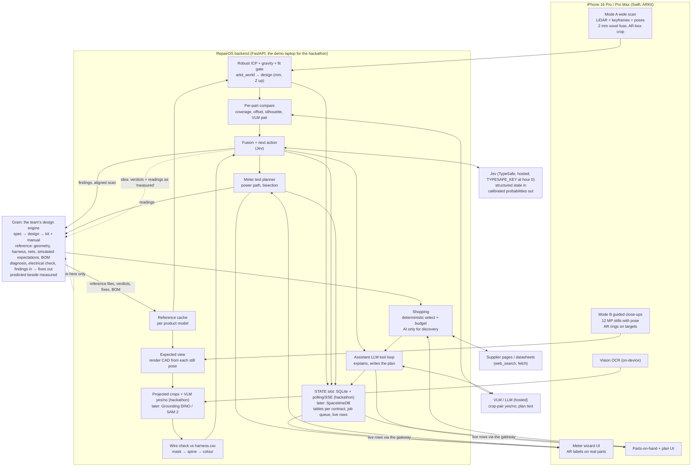
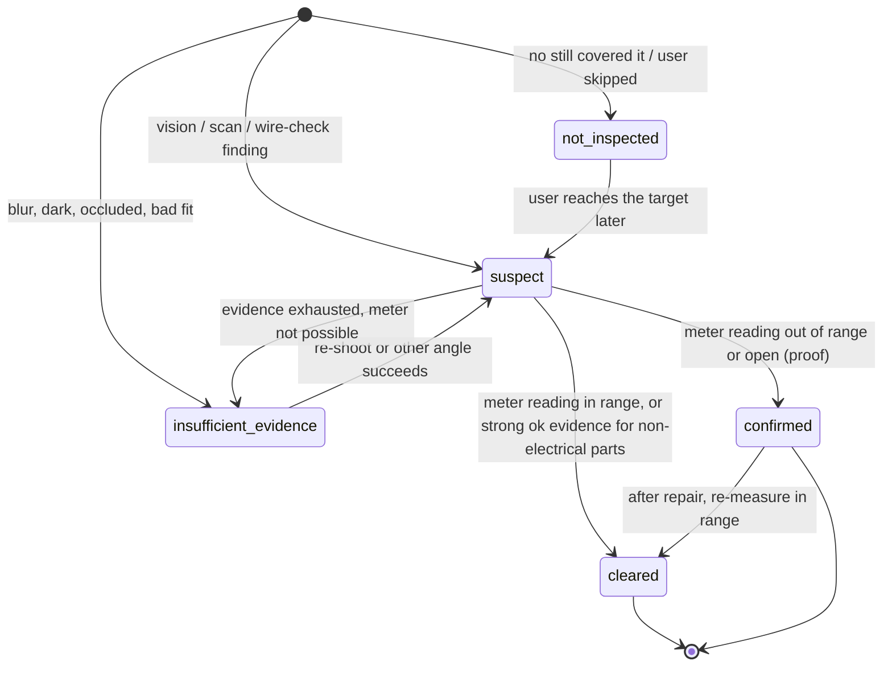

# RepairOS core spec

Version 0.6, 2026-10-24 (Grain internals moved to `private/grain/`; only the Grain API surface stays). This is the single source of truth. Every chat, coding agent and server reads it first.
Short sentences on purpose. The diagrams carry the structure; the tables carry the detail.

Companion files: [AGENTS.md](AGENTS.md) (entry point for agents), [README.md](README.md) (the 24-hour plan),
[BUILD.md](BUILD.md) (how to build it, in what order: §0 the 24-hour plan, then phases, task cards, tests,
milestones; `build/tasks.yaml` is its machine-readable twin), [`spec/contracts/`](spec/contracts/) (JSON Schemas),
[areas/README.md](areas/README.md) (the three work streams: app, modeling + benchmark, build-plan execution).

**Grain facts.** Grain is proprietary: only the API surface RepairOS calls is in this repo. Its shape is pinned by
the `grain-*` schemas in [`spec/contracts/`](spec/contracts/) and checked against private recorded fixtures
(`private/grain/observed/`, gitignored). The detailed Grain spec sheet and status (targets T1–T13, gaps,
handshakes H0–H7) are private: `private/grain/GRAIN_SPEC.md` and `private/grain/GRAIN_STATUS.md` (ask Sritej).
The owner owns Grain. Where this spec and those files disagree about Grain, they win; where a doc and a recorded
response disagree, the response wins.

---

## 1. Purpose and scope

**RepairOS** is an iOS app for the iPhone 16 Pro and 16 Pro Max. You point it at a broken hardware product. It
scans the product with LiDAR and the cameras, works out what is broken, proves electrical faults with a
multimeter, checks the parts you have, finds the parts you need, and gives you a repair plan.

**Grain** is the team's design engine (§2). It supplies the reference: geometry, wiring, expected voltages,
electrical reasoning, the BOM, and simulation-checked part swaps. RepairOS detects first. Grain is asked second,
as a cross-check. What RepairOS needs from Grain is §10 (mapped to Grain's targets T1–T13); the shapes RepairOS
depends on are in §6.

**Hackathon scope.** The first build fits 24 hours including the demo. The demo path and the cut list are in §8
(2026-10-24 rows) and BUILD.md §0; every task card is `track: demo` or `track: later`. This spec describes the
whole product; where the 24-hour build uses a simpler implementation (SQLite instead of SpacetimeDB, crops + VLM
instead of a detector) the slot stays the same and only the profile changes. Fusion is Jev in every profile; there
is no deterministic fallback (§8, 2026-10-24).

### In scope

| Area | What RepairOS does |
|---|---|
| Any product | Works on any physical product. If Grain did not design it, Grain builds a reference design once; RepairOS caches it per product model. |
| Perception | LiDAR shell for geometry and pose; 12 MP close-ups for wires, connectors, labels and damage; on-device OCR. |
| Diagnosis | Fuses evidence into ranked suspects with calibrated probabilities (Jev). Picks the next inspection step. |
| Proof | A guided multimeter wizard. The meter is the proof for every electrical fault. |
| Parts | "I have X, can I use it?" checks; print-it from Grain's STEP; deterministic shopping with a budget. |
| Plan | Numbered repair steps with tools, safety and part sources. Confirm by rescan or re-measure. |

### Non-goals

- Not a general CNN or a wire-reconstruction-in-3D project. Wires are found in 2D; 3D only says where we look.
- Not a replacement for Grain. We never rebuild what Grain has (geometry, harness, nets, circuit simulation, BOM, rebuild).
- Not an autonomous repair robot. A person does every physical step.
- Not a certified safety tool. A simulation check is a limited check, never proof. See the invariants in §7.
- Not mains-voltage repair guidance. Low-voltage DC products only for the hackathon.
- Not Android, not older iPhones, not the iPad.

---

## 2. Grain as a product, and where RepairOS fits

Source: grainhq.ai (2026-10-23, the public site) for the product. API-level statements are pinned by the `grain-*`
schemas and checked against the private recorded fixtures (2026-10-24); detail in `private/grain/GRAIN_SPEC.md`.

**What Grain is.** "Describe the machine. Get the kit." Grain turns a description of a machine into a design you
can build, then ships it as a kit: parts bagged in the order you use them, plus a pictured manual, one step per
page ("Plug the shoulder lead into the socket marked S1. It only fits one way.").

**Design philosophy.**

| Principle | What it means | What RepairOS does with it |
|---|---|---|
| Spec first | "A useful design begins with what the machine must do, where it lives and what limits matter." Grain asks those questions first and writes the answers down as the spec every build is held to. A new design's first chat turn ends with questions. | The reference brief for an unknown product answers Grain's questions from the label OCR, detected parts and observed wiring. |
| Laws refuse, rules of thumb advise | Checks on motion, strength, power, heat, wiring and the board. A short circuit, an under-torqued servo or a part past its rating is refused with the number. A shop preference is advice you can overrule. "What cannot work is refused before anything is bought." | A substitute that Grain refuses is a `no`. A substitute that Grain accepts is a simulation check, not proof (I5); protective parts still need S2. |
| Real parts | Parts come from their own datasheets, priced as you go. Boards are synthesized, placed and routed. Exports: STL, STEP, Gerbers, BOM, schematic PDF, KiCad netlist. Supplier region US, EU or anywhere; cheapest or fastest. | The BOM row, datasheet and STEP are the ground truth for "I have X", print-it and shopping. |
| Predicted beside measured | Every design keeps the numbers it promised, and a build records what the bench found next to each one. | RepairOS is the field half of that loop: scan verdicts and meter readings are measurements of a built unit (idea Q-G1, §11). |

**Example machines on the site** (ready Grain designs): a two-wheeled obstacle rover (TT gearmotors, L298N,
NiMH, IR sensor), a plant waterer on its own PCB (Nano, MOSFET pump switch, soil probe), a quadruped walker
(8× MG996R), a quadcopter (2212 motors, 10" props), a bench press arm (5 N), a TPU parallel gripper, a two-link
arm. They show the kind of machine Grain designs. RepairOS targets none of them in particular: the product is
chosen at runtime from the reference, never baked into code (GEN1). The demo product is picked by the owner at
hour 0 against fixed criteria (§8, 2026-10-24).

**Business facts.** Invite-only (waitlist). Plans: Free, Builder, higher tiers, an Enterprise licence. AI usage is
metered (credits = AI cost + 25%); editing, recompiling, checks and builds do not count. Users can sign in with
ChatGPT or Claude so designs run on their own provider account. The public site documents no public API,
scanning or repair features.

**Our relationship with Grain.** The owner owns Grain; Grain is proprietary, so this repo holds only the API
surface RepairOS calls. The additions RepairOS needs are targets T1–T13 (§10); Sritej builds them. The
**demo-critical Grain work is required inside the 24 hours** (cards S2.7–S2.11): the running Grain serves the
current scan diagnosis and the pilot endpoints, T1 range verdicts, T2 a verdict on every electrical row, T3
structured fix subjects, T12 diagnose holding on real phone scans, and T13 a removed part never `ok` at phone LiDAR
noise. The other targets are not on the demo path; §10 says how RepairOS calls Grain correctly until they land.
Grain cost is not a design constraint.

**What Grain does now (for RepairOS), at API level.** Reference data per built project (`model.glb` and
`model.step` in mm, Z up, the harness, placement, `GET .../electrical` with nets, harness rows and
`expected_volts`, `GET .../bom`); scan upload and per-part `diagnose` (RepairOS uploads binary PLY only; other
formats are not supported by our client); a photo judge `/look` (synchronous, slow); a stateless electrical check;
one `/call` (synchronous; never send photos in it); the design agent by chat (text only, `detach: true` + polling);
and the **pilot** CAD endpoints (bounded mount and enclosure templates, text/voice parameter edits, STEP + STL
export, a rough print estimate). **Grain does not** judge a scan against a non-Grain reference, expose typed CAD
edits on a full project (edits go through chat), order parts, quote fabrication, slice, or drive a printer.

**How RepairOS extends Grain.** Grain designs and ships. RepairOS picks up when the thing breaks: it recognises
the built machine, compares it to the design, proves the fault with a meter, and sources the fix from the same
BOM. Grain's kit manual says "it only fits one way"; RepairOS says "it is not plugged in, and here is the reading
that proves it". Repair is the "measured" half of Grain's loop.

---

## 3. System diagram



Every backend box with a model or service behind it is a **module slot**: config (`config/providers.yaml`) picks the
implementation, code never does. Slots, defaults and alternatives are in BUILD.md §3; `config/providers.yaml`
has a `hackathon` profile (the default for the 24 hours) and a `full` profile (§8, 2026-10-24). The STATE slot
holds all realtime state and the job queue: in the hackathon profile SQLite with polling/SSE inside the FastAPI
backend, in the full profile SpacetimeDB with reducers. Heavy work (ICP, rendering, VLM, LLM, Grain) runs in
Python workers and writes back through the slot. Large binaries live in the BLOB slot (local disk for the
hackathon) with references in tables.

Rules the diagram encodes:

- The phone never holds an API key. Grain, Jev, the VLM and the LLM are called from the backend.
- Perception (detect, segment, OCR, wire check) is code and vision models. Jev never does perception.
- Grain receives the aligned scan and our findings. It is not the first-pass detector.
- Shopping selects and budgets deterministically. AI is allowed only to discover candidates and read datasheets.

---

## 4. End-to-end flow

```mermaid
sequenceDiagram
  autonumber
  actor U as User
  participant P as Phone
  participant B as Backend
  participant J as Jev
  participant G as Grain
  participant L as VLM/LLM
  participant S as Suppliers

  U->>P: Pick product (saved, typed, or label photo) + one-line symptom
  P->>B: product id, symptom
  alt Reference cached
    B->>B: load ReferenceDesign from cache
  else Grain-designed, not cached
    B->>G: fetch reference files, electrical expectations, BOM
    G-->>B: model.glb, harness.csv, elec.json, placement, electrical, bom
  else Not a Grain design
    B->>G: new project + detached design turn "Model <make/model> as sold ..."
    G-->>B: reference after minutes (polled), design_trust=low
  end
  B->>B: cache ReferenceDesign per product model

  U->>P: Mode A wide scan (60–90 s orbit)
  P->>B: ScanPackage (PLY in m, arkit_world Y up, gravity, keyframes + poses)
  B->>B: robust ICP arkit_world→design with gravity, fit gate
  alt fit gate fails
    B-->>P: NextAction rescan (insufficient_evidence)
  end
  B->>B: per-part coverage/offset → Findings (source repairos.scan)
  B-->>P: Mode B target list (connectors, non-ok parts, symptom power path)

  loop each target (≤ 9 stills)
    U->>P: fill the ring, hold still
    P->>B: Still (12 MP, pose, intrinsics, targets)
    B->>B: expected view, project connector targets (GLB node bounds), full-res crops
    B->>L: crop (with the render), structured yes/no
    L-->>B: seated / gap_visible / unplugged / cannot_tell
    B->>B: Findings (source repairos.vision)
  end

  B->>J: state (words, not numbers) + noul/choice questions
  J-->>B: P(fault) per wire/part, next action probabilities
  B->>B: Suspects ranked, NextAction chosen

  B->>G: upload aligned scan once (binary PLY, name ends .ply, units=m, turned Y-up→Z-up into the design frame)
  B->>G: diagnose align=none crop=false (cross-check)
  B->>G: call: scan by id + readings (findings[], not_inspected[], design_trust: target T4)
  opt grey-band parts only
    B->>G: upload crops to the scan record, then /look (slow; detach: target T6)
  end
  G-->>B: per-part verdicts, fixes[], buy[], remake[], electrical, summary
  B->>B: merge: our findings ⊕ Grain verdicts ⊕ electrical (Grain fixes mapped to subjects; T3)

  loop meter wizard until one wire/part or insufficient_evidence
    B-->>P: NextAction (probe X and Y, expect ..., power off/on)
    U->>P: reading (typed)
    P->>B: MeterReading
    B->>B: our range check against [min, max]
    B->>G: electrical check {readings: all so far}
    G-->>B: rows (verdict ok|off, expected, wire) + findings
    B->>J: updated state
    J-->>B: updated P(fault), next step
  end

  U->>P: "I have X" (typed or photo)
  P->>B: PartOnHand
  B->>S: datasheet search (web_search/fetch)
  B->>B: quick check in code, protective-part rules
  opt power path or on request (a Grain turn takes minutes; pre-run and cached for the demo)
    B->>G: scratch copy of the project, design turn "Replace <ref> with <X>", read the report
    G-->>B: Grain's design-check result = simulation check
  end
  B->>S: candidate prices for parts to buy
  B->>B: ShoppingQuote: deterministic select within budget

  B->>L: write the plan from structured inputs
  L-->>B: plan text
  B-->>P: RepairPlan (you have it / print it / buy it, proof per cause)
  U->>P: do the repair
  U->>P: confirm: rescan or rerun the failed reading
  P->>B: ScanPackage or MeterReading
  B-->>P: ok / in range, or the plan reopens
```

---

## 5. Stage table

Owner codes: **P** phone, **B** backend, **G** Grain, **J** Jev, **L** hosted VLM/LLM. Latencies are targets, not measurements. "On failure" is what the stage reports when it cannot decide. Every stage may return
`insufficient_evidence` with a reason.

| # | Stage | Owner | Inputs | Outputs | Model / tool | Latency target | On failure |
|---|---|---|---|---|---|---|---|
| 0 | Identify product | P, B | saved list, typed text, or label photo | `product_id`, make/model | Vision OCR on-device; LLM for fuzzy match | < 2 s | ask the user to type it |
| 1 | Reference cache | B, G | `product_id` | `ReferenceDesign` (files, electrical, bom, `design_trust`) | Grain reference files, electrical expectations, BOM; a detached design turn for unknown products | cached: < 1 s. New product: minutes (a design turn), once per product model, done before the scan | no reference: discovery mode + meter wizard from the symptom (vision spec §4.3) |
| 2 | Mode A wide scan | P | ARKit depth + confidence, 1920×1440 keyframes, poses, gravity | `ScanPackage` (binary PLY in m, `arkit_world`) | ARKit `smoothedSceneDepth`, 2 mm voxel fuse, plane + AR-box crop | ≤ 2 min of user time (§8) | re-scan with guidance (coverage heat map) |
| 3 | Align | B | `ScanPackage`, `model.glb` | transform `arkit_world→design`, `fitness`, `rmse_mm`, gate | Open3D robust point-to-plane ICP, gravity known, yaw search; then the Y-up → Z-up turn and mm into Grain's design frame | 2–5 s | gate fails → `NextAction` rescan; no verdicts on a bad fit. Grain's `align=icp` on the raw scan is a cross-check only |
| 3b | Dense depth (optional; later track) | B | keyframes + ARKit depth | 1–2 mm TSDF cloud | Prompt Depth Anything ViT-S (Apache) | 5–10 s | skip (hackathon: DEPTH=none); use the 2 mm voxel shell |
| 4 | Per-part geometry | B | aligned cloud, `model.glb` | `Finding` per part: coverage, offset_mm, state | our coverage/offset code | < 1 s | mark `insufficient_evidence` where coverage is undefined |
| 5 | Target list | B | harness, stage 4 findings, symptom power path | Mode B targets (part refs + harness rows) | deterministic rules in `wiring.py` | < 1 s | all connectors, in harness order |
| 6 | Mode B close-ups | P | targets | `Still` per target (12 MP, pose, intrinsics, nearest depth) | `captureHighResolutionFrame`, AR rings, blur + smudge gates | ≤ 9 stills, ≈ 2 min user time | "skip, I can't reach it" → `not_inspected` |
| 7 | Expected view | B | `Still`, transform, `model.glb`, harness; pin positions when Grain ships T7 | part-ID mask, depth, projected connector boxes from GLB node bounds (pin/endpoint pixels after T7), rows in view | trimesh or Open3D offscreen (MIT) | tens of ms per still | ICP failed → whole-image mode, findings `unlocated` |
| 8 | Detect, segment, OCR | B (OCR on P) | `Still`, expected view, BOM words | boxes, masks, text per still | Hackathon / Phase 1: DET=gdino (Grounding DINO tiny, zero-shot, no training; owlv2 the alternative), SEG=none (crops from detector boxes at full resolution), OCRB=none, Apple Vision OCR on the phone; prompts are one generic part-class list (+ BOM text with a reference, Phase 2). Later: Grounding DINO or Florence-2 + SAM 2.1 (Apache/MIT); PaddleOCR | later track: 1–2 s per still | nothing found where CAD expects → `not_seen_in_photo` (low weight); blur → re-shoot |
| 9 | Wire check (later track; hackathon: VLM crop question) | B | masks, harness rows in view | per row: `present`, `colour_match` probability, endpoint hits | skeletonize + Lab colour vs palette (ours) | 1–3 s | VLM crop question, lower weight |
| 10 | Per-part compare | B, L | aligned cloud, still depth, crop (SAM mask later), CAD render | `Finding` per part with `vlm_state` | geometry first; `claude-haiku-5-5` yes/no per crop, `claude-sonnet-5-5` only on `cannot_tell` | < 1 s geometry; a few seconds per crop (to measure) | geometry-only finding |
| 11 | Fusion + next action | B, J | compact word-state of all evidence, symptom, `design_trust`, readings so far | `Suspect[]` ranked, `NextAction` | Jev `noul`/`choice` (FUSION=jev in every profile) | < 1 s | none: Jev is required. A Jev error is retried once, then raised as an error (no fallback, owner 2026-10-24); it is never turned into an answer. Jev answers judgments; code picks the action from a truth table (TypeSafe skill) |
| 12 | Grain cross-check | B, G | aligned PLY, readings, findings | Grain per-part verdicts, `fixes[]`, `buy[]`, `remake[]` | Grain scan upload, diagnose, call (§6, §10) | `diagnose` and `/call` without photos: seconds; `/look`: slow, grey band only. No photos or rebuild inside `/call` (synchronous; detach is target T6) | Grain unreachable → plan from our findings only, marked "no Grain cross-check" |
| 13 | Meter wizard | B, P, G | `Suspect[]`, nets, expected ranges, readings | `NextAction` per probe; `MeterReading` verdicts; confirmed wire/part | planner: power path, suspects first, bisection; our `[min, max]` range check in code (S5); Grain `/electrical/check` (range verdicts T1 and a verdict on every row T2 are required Grain work in the 24 h) | < 1 s per step | no Grain → our range check alone |
| 14 | Parts on hand | B, L, J | `PartOnHand`, BOM row, electrical context | yes / yes_with_changes / no / need_simulation_check | datasheet fetch; code comparisons; protective-part rules in code (Jev `choice` triage later) | a few seconds | cannot confirm a protective rating → `no` |
| 15 | Simulation check (on request or power path) | B, G | copied Grain project, candidate datasheet | pass/fail of Grain's design checks; labelled "simulation check" | Grain project copy through the project files API (until T11), detached design turn, report | minutes; pre-run and cached before the demo, per (product, part, candidate) | skip; answer from the quick check only |
| 16 | Shopping | B, L, S | parts to buy, BOM prices, user budget | `ShoppingQuote` | deterministic ranking and budget cap; AI only for candidate discovery and datasheet extraction | seconds | BOM supplier url and price (treated as current) |
| 17 | Repair plan | B, L | suspects, proof readings, parts decisions | `RepairPlan` | LLM writes text from structured inputs; prompt caching on the product block | 5–10 s | template plan without prose |
| 18 | Confirm | P, B, G | rescan or rerun reading | `ok` / in range, or reopen | stages 2–4 or 13 | as above | plan stays open |

Target: ≤ 60 s from the last still to the first finding (research estimate 45–75 s). Hosted-model costs (Haiku
crop pairs, Jev, plan LLM: cents per scan) are reference numbers, not design constraints. Grain cost is not a constraint (§2).

---

## 6. Data contracts

One JSON Schema (draft 2020-12) per object in [`spec/contracts/`](spec/contracts/), with one valid example each in
[`spec/contracts/examples/`](spec/contracts/examples/). Run `python3 -I spec/contracts/check.py` to validate.

Conventions: units live in field names (`_m`, `_mm`, `_px`, `_s`, `volts`, `ohms`) or descriptions. Frames are
named explicitly: `arkit_world` (ARKit's world frame, metres, Y up, gravity known) or `design` (Grain's
`model.glb` frame, **millimetres, Z up**; every Grain `_mm` field is in it). Going from one to the other is our ICP
transform, then the Y-up → Z-up turn; a scan in the design frame is uploaded with `units=m` and Grain multiplies by
1000. Poses are `position_m[3]` + `quaternion_xyzw[4]`. Ids are strings. Times are RFC 3339.

### RepairOS objects

| Object | Produced by | Consumed by | Key fields | Schema |
|---|---|---|---|---|
| **ReferenceDesign** | B (from Grain) | B | `product_id`, `grain_project_id`, `build_hash`, `origin` (grain_designed / grain_reconstructed / none), `design_trust` (high / low), `files{}`, `design_turns_used`, `corrections[]` | [reference-design](spec/contracts/reference-design.schema.json) |
| **ScanPackage** | P | B | `scan_id`, `product_id`, `symptom`, `frame: arkit_world`, `units: m`, `voxel_mm`, `gravity_arkit_world[3]`, `points_file`, `point_count`, `crop_box`, `keyframes[]` (pose, intrinsics, sharpness, tracking_state), optional `alignment` (filled by B: `transform_arkit_world_to_design[16]`, `fitness`, `rmse_mm`, `gate_passed`) | [scan-package](spec/contracts/scan-package.schema.json) |
| **Still** | P | B | `still_id`, `scan_id`, `kind` (guided / macro_detail / label), `image_file`, `width_px`, `height_px`, `camera{frame: arkit_world, position_m, quaternion_xyzw, intrinsics}`, optional `camera_design` (after alignment), `depth_file`, `targets[]` (part refs + harness rows), `sharpness`, `tracking_state`, `torch_on` | [still](spec/contracts/still.schema.json) |
| **Finding** | B (and Grain, wrapped) | Fusion, Grain `/call` | `finding_id`, `scan_id`, `subject{kind: part / wire / net, ref, pins?}` (`ref` for a part is the Grain part name = GLB node, e.g. `U1:usb`, not the BOM ref), `state` (ok / partly / missing / shifted / damaged / broken / worn / dirty / loose / unseated / wrong_pin / colour_mismatch / open / short / out_of_range / unexpected_part / unexpected_wire / not_seen_in_photo / not_inspected / insufficient_evidence / unsure), `source` (repairos.scan / vision / wire_check / ocr / meter / user, grain.diagnose / look / electrical), `confidence` 0–1, `evidence[]`, `evidence_refs{still_ids, keyframe_ids, crop_box_px, crop_file, render_file, reading_id}`, `measurements{coverage, offset_mm, shift_mm (design frame, mm), gap_mm, colour_match_p, silhouette_iou, ocr_text, views, sharpness}`, `vlm_answer`, `design_trust`, `on_symptom_power_path`, `is_proof` (true only for `repairos.meter`), `grain{endpoint, verdict, name, ref, confidence, raw}` for a wrapped Grain result. Grain mapping: diagnose `not_seen` → missing, `not_visible` → not_inspected; electrical `off` → out_of_range, `open` → open, `pin_not_on_net` / `unknown_net` / `no_expected` → insufficient_evidence | [finding](spec/contracts/finding.schema.json) |
| **Suspect** | B (Jev) | Wizard, plan, UI | `subject`, `p_fault`, `p_fault_word`, `rank`, `fault_kind{choice, probabilities}`, `finding_ids[]`, `verdict` (suspect / confirmed / cleared / insufficient_evidence / not_inspected), `proof_reading_id`, `fusion_source` (`jev`; the schema's `rules_fallback` value is retired with A3), `calibration_validated` | [suspect](spec/contracts/suspect.schema.json) |
| **NextAction** | B (Jev) | P (UI), B | `kind` (request_closeup / request_other_angle / run_reference_compare / run_continuity_test / run_voltage_test / run_grain_second_opinion / rescan / report_insufficient_evidence / report_finding), `target`, `instruction` (names AR labels, never pin ids alone), `power_state`, `expected{continuity / volts_min, volts_max / ohms_max}` (RepairOS's own range, taken from Grain's `expected{min, max}`), `safety_notes[]`, `chosen_by` (`code_on_jev`: code decides from Jev judgments; `rules_fallback` retired with A3), `probabilities{}` | [next-action](spec/contracts/next-action.schema.json) |
| **MeterReading** | P | B, Grain `/electrical/check`, fusion | `reading_id` (sent to Grain as the reading's `id` once T2 lands), `scan_id`, `session_id`, `action_id`, `kind` (continuity / voltage_dc / resistance; `kind` fixes `value`), `net` (Grain net name), `pins[2]` (net-style `REF.PIN`; required for continuity and resistance), `value{volts}` / `{continuity}` / `{ohms}`, `power_state` (off / on), `condition` (idle / load / charging / unknown; RepairOS-side only), `expected{continuity, ohms_max, volts_min, volts_max, source}` (RepairOS's range, from Grain's `expected{min, max}`, never `expected.volts` alone), `verdict` (**RepairOS's own**, in code: agrees / disagrees / unknown against `[min − tol, max + tol]`, tol 0.25 V or 5 %; < 5 Ω conducts), `grain_verdict` (Grain's row: ok / off / open / pin_not_on_net / unknown_net / no_expected / null), `grain_verdict_derived` (true while RepairOS derives it, G22), `grain_row` (the raw Grain row), `grain_findings[]`, `grain_remake_wire` (`grain_row.wire.name` for an open), `source` (typed / voice), `raw_text`, `recorded_at` | [meter-reading](spec/contracts/meter-reading.schema.json) |
| **PartOnHand** | P (user) | B | `item_id`, `kind`, `spec{}` (incl. `protective{}` ratings), `mpn`, `dimensions_mm[3]`, `qty`, `photo_file`, `datasheet_url`, `match{order, matched_part_ref, verdict, basis, protective_part_check}` | [part-on-hand](spec/contracts/part-on-hand.schema.json) |
| **ShoppingQuote** | B (deterministic) | Plan | `part_ref`, `mpn`, `budget{cap, currency}` (the user's budget), `candidates[]` (supplier, url, unit_price, currency, qty, in_stock, lead_days, price_source, spec_match, protective_part_check, found_by), `chosen_index`, `selection_rule`, `ai_assist{used, roles[]}`, `made_alternative` | [shopping-quote](spec/contracts/shopping-quote.schema.json) |
| **RepairPlan** | B (LLM text from structure) | P, user | `summary`, `confidence_statement`, `root_causes[]` (subject, verdict, `proof_reading_id`), `not_inspected[]`, `insufficient_evidence[]`, `safety[]`, `tools[]`, `parts[]` (source: have / print / buy; substitute verdict + basis), `root_causes[].fix` (reseat / recrimp / rewire / replace_part / replace_wire / rescan / check / none), `steps[]` (n, text, part_refs, ar_labels, `on_power_path`, `power_state` off / on / n/a, `safety_gate`: required true when `on_power_path` is true or `power_state` is on), `confirm`, `cost_to_buy`, `grain{project_id, build_hash (T11), design_trust high / low / none, cross_check done / skipped / failed, call_version (T10), disagreements[]}`, `generated_by` | [repair-plan](spec/contracts/repair-plan.schema.json) |

### Grain interface contract

These schemas describe the **shapes RepairOS depends on** in its exchanges with Grain. They use Grain's real field
names and shapes, checked against the private recorded fixtures (`private/grain/observed/`, from Sritej; detail
in `private/grain/GRAIN_SPEC.md`). Fields RepairOS needs that Grain does not send yet are optional properties marked
`"x-target": "T<n>"` (§10). `python3 -I spec/contracts/check.py`
validates our examples and, when the private fixtures are present, the recorded responses, and prints a **gap ledger**: each target field Grain does not
send yet. A gap that disappears means Grain shipped it; a new failure means Grain's shape drifted. The schemas keep
`additionalProperties: true` so Grain can add fields without breaking us.

| Contract | Exchange | What RepairOS depends on (now) | Target fields | Private fixture |
|---|---|---|---|---|
| [grain-scan-record](spec/contracts/grain-scan-record.schema.json) | scan upload (`POST .../scans?name=<id>.ply&units=m`, raw body) / get → record | `id` (Grain makes it), `name` (label; must end in the extension), `file`, `units`, `bytes`, `created`, `points`, `bbox_mm{min, max, size}`, `centroid_mm`; `photos[{n, name, file, px, original_px, sha1}]` once photos are added | `frame`, `gravity`, `views` (T9); `Idempotency-Key` (T10) | `scan-upload`, `scan-get`, `photo-upload` |
| [grain-diagnose-response](spec/contracts/grain-diagnose-response.schema.json) | `POST .../scans/{sid}/diagnose?align=none&crop=false&tolerance_mm=2` | `parts[]{name, ref (BOM ref or null), verdict, coverage, visible_share, tolerance_used_mm, median_gap_mm, shift_mm, missing_region_mm, why, bought, buy/make, size_mm}`, `alignment{method, transform, rms_mm, median_mm, inlier_share, ...}`, `thresholds`, `verdicts{}`, `extra_points`, `extra_fraction`, `findings[]` | — | `diagnose-none`, `diagnose-icp` |
| [grain-look-response](spec/contracts/grain-look-response.schema.json) | `POST .../scans/{sid}/look` | `status, model, provider, photos, judgement{matches_design, observations[{part, what, state, confidence (0–1), photo}]}, seconds, note` | photo metadata in the prompt (T5); `detach` (T6) | `look` |
| [grain-electrical-reference](spec/contracts/grain-electrical-reference.schema.json) | `GET /projects/{id}/electrical` | `nets[{name, pins[]}]`, `wires[]` (harness rows), `expected_volts{NET: {volts, min, max, from}}`, `signals{}`, `sim_status`, `sources{}` | expected values on every power-path net and `ohms_max` (T8); pin positions and one pin naming (T7) | `electrical` |
| [grain-electrical-check-request](spec/contracts/grain-electrical-check-request.schema.json) | `POST /projects/{id}/electrical/check` | `readings[]` (≤ 200): `{net, volts}` or `{net, pins[2], continuity}` or `{net, pins[2], ohms}`; pins net-style (e.g. `J1.1`) | `id` per reading (T2) | `electrical-check` |
| [grain-electrical-check-response](spec/contracts/grain-electrical-check-response.schema.json) | ← the same | `{status, readings[], findings[], expected_volts, sources}`; row `{net, known, volts?, expected?{volts, min, max, from}, verdict?: ok\|off, continuity?, wire?}`; finding `{severity, text, where, fix}`. Rows for open, wrong-pin and no-expected cases carry no verdict; findings are not indexed to rows | range verdicts (T1); a verdict on every row ∈ `ok, off, open, pin_not_on_net, unknown_net, no_expected`, `i`, `id`, and `reading: i` on findings (T2) | `electrical-check` |
| [grain-call-request](spec/contracts/grain-call-request.schema.json) | `POST /call` (synchronous) | `project`, `scan{id}`, `readings[]`, `tolerance_mm`, `align: none`, `crop: false`, `rebuild: false`, `question`. Photos only as `[{name, data_base64}]` (never used by RepairOS: slow) | `findings[]`, `not_inspected[]`, `design_trust` (T4); `photos[]{record, n}` (T5); `detach` (T6) | `call`, `call-no-scan`, `call-photo-by-id` (400) |
| [grain-call-response](spec/contracts/grain-call-response.schema.json) | ← the same | `fixes[]{part (display text; free text for electrical fixes), problem, action ∈ buy, remake, reseat, rescan, fix_design, check, rewire, confidence ∈ low, medium, high, detail, how, coverage?, buy?, remake?, shift_mm?, missing_region_mm?}`, `buy[]`, `remake[]`, `diagnosis`, `electrical`, `photos`, `design`, `timings`, `seconds`, `summary` | `subject{kind, id, pins?}`, `sources[]` (T3); `version` (T10) | `call`, `call-no-scan` |
| [grain-error](spec/contracts/grain-error.schema.json) | any 4xx | `{detail}`: one sentence saying what to send (400), auth (401/403), not found (404), busy or no build (409), too large (413) | — | `scan-upload-noext`, `call-photo-by-id` |

How RepairOS talks to Grain (justified by detail, latency and reliability, not cost; handshakes H0–H7 are in
`private/grain/GRAIN_SPEC.md` §5):

1. Upload the scan once, as **binary PLY only**, and refer to it by id afterwards. Never inline scan bytes in a
   call. Other scan formats do not work end to end today (G27, G28). The upload `name` must end in `.ply`; Grain makes the scan id, so a retry is made safe by listing `GET .../scans` and matching
   our `name` before re-uploading (an `Idempotency-Key` is target T10).
2. Upload in the `design` frame: apply our ICP transform (gravity, fit gate) and the Y-up → Z-up turn, upload with
   `units=m`, then `diagnose` with `align=none&crop=false`. Our crop has the AR box. Grain's `align=icp` (reports
   `inlier_share`) on the raw `arkit_world` scan is a cross-check only. Keep the raw PLY for joint
   tuning (T12). Extra per-vertex PLY properties (our `confidence`) are accepted.
3. Never ask for a rebuild inside `/call` and never put photos in it: `/call` is synchronous (detach is target T6).
   Rebuilds and design turns take minutes; they run through chat with `detach: true` and are polled.
4. Send findings as structured data, not whole photos. Grain stores photos downsized, which would erase a 1–2 mm
   wire; our crops keep full resolution and go to our own VLM. For a grey-band part only,
   upload a few named crops (`<part>_<still>.jpg`, ≤ 8 per record) to the scan record and call `/look` on its own
   (slow). A stored photo cannot be referenced in `/call` (target T5).
5. Compact Grain's response before it enters the assistant's context: drop `ok` rows, keep `fixes`, `buy`,
   `remake`, `summary` and the electrical rows that are off or have a finding.
6. Compare rails against `[min, max]` in our own code, always (S5); that is `MeterReading.verdict`. Grain's
   `expected` already carries `{volts, min, max}`; its row `verdict` is not judged against that range yet
   (G2). T1 (range verdicts) and T2 (a verdict on every row, `i`, `id`,
   `finding.reading`) are required Grain work in the 24 hours; until they land, `grain_verdict` is derived
   (`grain_verdict_derived: true`): `continuity: false` + `wire` = open; `known: false` = unknown_net;
   `expected: null` = no_expected; a "not on net" finding = pin_not_on_net.
7. Map Grain's fixes to our subjects: `diagnose` keys parts by `name` (GLB node, sub-parts like `U1:usb`); for
   electrical fixes `part` is free text today. T3 (`subject{kind, id, pins?}`, `sources[]`) is required Grain work
   in the 24 hours; until it lands, map by `wire.name` or the net name before " (".
8. Cache per product model: reference files, electrical expectations, canonical CAD renders, the assistant's
   product system prompt. Key: Grain project id + `last_build` (`seconds` + artifacts now; `last_build.hash` after
   T11). A design turn is never re-run for a product already seen (A4).

---

## 7. Invariants

Numbered rules. An agent that cannot satisfy one stops and says so. None may be weakened without a decision-log row.

### Honesty

- **I1.** A vision finding is a suspect, never a proof. `Finding.is_proof` is true only when `source` is `repairos.meter`.
- **I2.** The meter is the proof for every electrical fault. No electrical root cause enters a `RepairPlan` without a `proof_reading_id`, or an explicit statement that it is unproven.
- **I3.** Anything the camera and LiDAR did not see is a prediction. Parts not inspected are reported `not_inspected`, never `ok`.
- **I4.** `insufficient_evidence` is a first-class outcome at every stage. The app says so with a reason. It never guesses to fill the gap.
- **I5.** Grain's rebuild of a substitute is a **simulation check**. The word "verified" is never used for it, in code, UI or docs.
- **I6.** Probabilities are shown as words (`unlikely`, `unsure`, `likely`) until `Suspect.calibration_validated` is true for that product class, measured by a reliability diagram on our own labelled scans.
- **I7.** For a product Grain did not design, `design_trust` is `low`. Expectations carry priors, Grain's verdicts are advisory, and discovery mode runs. The real photos correct the reference, not the other way round.

### Safety

- **S1.** Polarity and connection points are never inferred from wire colour or from a rating. Any step that cuts or wires a supply first says: disconnect power; measure polarity and voltage with the meter; confirm the connection points on the design.
- **S2.** A protective part (fuse, polyfuse, TVS, BMS, thermal cut-off) is judged on its protective role: hold and trip current, trip time or I²t, voltage rating, breaking capacity, compared in code against the original's datasheet. If any of these cannot be confirmed, the answer is **no**, with the reason. Grain's design-time checks refuse a short or a part past its rating ("laws refuse", grainhq.ai 2026-10-23); they do not show that a protective part still trips in a fault. So S2 stands even when Grain's rebuild passes.
- **S3.** Every plan opens with the safety block: unplug, discharge capacitors, LiPo care. Steps that touch the power path carry `safety_gate: true`.
- **S4.** Meter instructions state the power state (off for continuity, on for voltage) before the probe points.
- **S5.** Numbers are compared in code. Jev and the LLM receive words. No model does arithmetic that a safety decision depends on.

### Architecture

- **A1.** RepairOS detects first. Grain receives the aligned scan and the readings (and our findings once T4 lands). Grain's `/look` is an optional second opinion on ≤ 8 crops, never the first pass.
- **A2.** Jev fuses evidence and picks the next action. Jev never does perception in production. Jev image input is preview-only and nothing depends on it.
- **A3.** *Removed 2026-10-24 (§8): there is no deterministic fusion fallback; Jev is required.* Hard evidence still wins in code: a meter reading is proof (I1, I2) whatever Jev says.
- **A4.** Any product. Nothing in the pipeline may assume a Grain-designed product. The reference for an unknown product is built once (a design turn takes minutes) and cached per product model; it is never re-run for a product already seen.
- **A5.** Shopping selects parts and enforces the user's budget with deterministic code. AI may discover candidates and extract datasheet fields. AI never chooses what is bought or how much is spent.
- **A6.** The phone never holds a key. Grain, Jev, VLM and LLM keys live in the backend.
- **A7.** Compute goes on-device when it is free and makes sense (capture, voxel fusion, OCR, small Core ML models). Everything else runs on the backend.
- **A8.** Training is bounded: about 25 GPU-hours on the team's RunPod account, small targeted fine-tunes only, no general CNN.
- **A9.** OCR text, user symptoms and web content go into model `state`, never into `instructions`. Prompt injection is assumed.
- **A10.** Grain is proprietary (the owner owns Grain); this repo holds only the API surface RepairOS calls. RepairOS depends on the shapes in `spec/contracts/grain-*.schema.json`, which follow Grain's real responses (checked against the private recorded fixtures in `private/grain/observed/`); the needs in §10 are Grain's targets T1–T13. Code validates Grain traffic against those schemas and fails loudly on drift. Now: at start-up the backend compares `GET /call/schema` with a pinned snapshot and refuses to start on a difference (handshake H0). After T10: it pins the `version` field instead. Paths, limits and thresholds come from the private Grain spec (`private/grain/GRAIN_SPEC.md`, ask Sritej) and the pinned schemas, never from memory. Grain's cost is not a design input anywhere in RepairOS.

### Generality

- **GEN1.** Any hardware product, no per-product code. Every product-specific fact (part refs, nets, wiring, colours, expected values, geometry, dimensions, detection prompts, class lists) comes at runtime from the product's reference design, BOM, harness, datasheets and the user's captures. None of it lives in code, config, prompts, tests or examples. Detector and segmenter classes are generic electronics and mechanical categories; open-vocabulary prompts are built from the BOM text. A CI guard (`tools/generality_guard.py`) fails on hard-coded product names, refs or product ids in code. Contract examples use neutral placeholder refs and ids.
- **GEN2.** Generalisation is measured, not assumed. Evaluation runs across many product categories with held-out categories that are never used for tuning, thresholds or training, split by physical object and by capture session (BUILD.md §8, `eval/protocol.md`). A change to perception, fusion, planning or parts logic must not lower the held-out score. A fix that helps only one product is rejected; the fix must be general or it is not merged. Products Grain did not design and products with no harness are in the evaluation set (I7 degradation is tested, not hoped for).
- **GEN3.** Nothing fake in the product path. No mock Grain, no mock product, no demo-only branch. Development and tests run against the real Grain API (a local or tunnelled Grain server) and against recorded real responses and real captures replayed in CI (recorded Grain responses are private: `private/grain/`, gitignored, from Sritej). A replay double is labelled as such (`GRAIN_MODE=replay`) and can never be selected in a release build.

### Licensing

- **L1.** Our code is Apache-2.0. The repo is going public; `LICENSE` and `NOTICE` must exist before it flips.
- **L2.** Shipped dependencies and model weights are permissive: Apache-2.0, MIT, BSD, or CC-BY. No GPL, AGPL, non-commercial, or research-only weights or datasets in anything that ships or is trained for shipping.
- **L3.** Research-only items may be used in experiments and must be named as such in the report. A `licenses/` manifest and a CI check on package metadata enforce L2.
- **L4.** A dependency with no licence file is treated as all rights reserved. Clean-room re-implementation of the idea only.
- **L5.** One narrow, explicit exception to L2: the **SpacetimeDB server runtime** (Business Source License 1.1, Licensor Clockwork Laboratories, Inc., Licensed Work "SpacetimeDB 2.13.0", Change Date 2031-10-14, Change License AGPL-3.0 with a linking exception; `LICENSE.txt` in github.com/clockworklabs/SpacetimeDB, read 2026-10-23). We do not ship or modify it; we run it as a service, self-hosted or on Clockwork's Maincloud, within its Additional Use Grant: **no more than one SpacetimeDB instance in production** and not a "Database Service" (letting third parties create tables whose schemas they control). Our code stays Apache-2.0. Client libraries and bindings that ship in our app or that our shipped code links against must still be permissive (L2): the Rust module bindings `crates/bindings` and `crates/lib` are Apache-2.0; the C# client SDK is Apache-2.0; the Rust client SDK is BSL 1.1 (not used); the TypeScript package `spacetimedb` carries a conflict (repo `LICENSE.txt` BSL 1.1, `package.json` and npm say ISC) and is used only server-side in the module and the worker bridge until Clockwork confirms (Q-S2). The one-instance limit is a scaling constraint recorded in §8.

### Workflow

- **W1.** Every change goes through a pull request. Nothing is pushed to `main` or to another person's branch.
- **W2.** A change to behaviour that this spec describes updates `SPEC.md` in the same PR and adds a decision-log row.
- **W3.** Schemas in `spec/contracts/` are the contract. Code that produces or consumes an object validates against its schema in tests.

---

## 8. Decision log

| Date | Decision | Who | Source |
|---|---|---|---|
| 2026-10-23 | Any product, not only Grain-designed or "verified" ones. Unknown products get a reference built and cached per product model. | Owner | README §10 Q3 answer; owner brief |
| 2026-10-23 | RepairOS detects first (LiDAR + CV + Jev), then sends model/images and findings to Grain. Grain is not the first-pass detector. | Owner | README §10 Q3; owner brief |
| 2026-10-23 | Shopping uses deterministic algorithms (only there, to control the user's budget and guarantee we get what we asked for) plus AI for discovery. | Owner | README §10 Q3 answer |
| 2026-10-23 | Jev = TypeSafe's hosted Jev. Role: fuse evidence and pick the next inspection action. Never perception. Images in preview only. | Owner | owner brief |
| 2026-10-23 | Compute: on-device where it makes sense and is free; backend otherwise. Training ≈ 25 GPU-hours on the team's RunPod account. No general CNN; small targeted fine-tunes. | Owner | owner brief |
| 2026-10-23 | Our code Apache-2.0; repo going public. Dependencies and weights permissive only (Apache/MIT/BSD/CC-BY). No AGPL/GPL/NC. | Owner | owner brief |
| 2026-10-23 | Demo product TBD. No RC car. A 3D printer is at the venue. BOM prices are treated as current. | Owner | README §10 Q6, Q7 answers; owner brief |
| 2026-10-23 | Honesty and safety invariants I1–I7, S1–S5 (vision = suspects; meter = proof; unseen = prediction; insufficient evidence first-class; no polarity from colour; protective parts judged on protective role or `no`; rebuild = simulation check). | Owner | README §7 safety rules (Greptile review, commit 5a3bd5b); owner brief |
| 2026-10-23 | PR-only workflow. Several collaborators. Nothing pushed straight to `main`. | Owner | owner brief |
| 2026-10-23 | **Grain cost is not a design constraint.** The team has a direct line to Grain's CEO. Caching and detached calls are justified by latency and reliability, not money. | Owner ("We know Grain's CEO. Don't worry about costs, just understand the product.") | owner brief via coordinator |
| 2026-10-23 | **Grain builds its API and data for RepairOS's needs.** Grain's current state is not RepairOS's risk. §10 (needs) and the grain-* schemas (shapes) are what both sides build to. | Owner ("We will build the API and info for it, don't worry about it, the CEO's got us.") | owner brief via coordinator |
| 2026-10-23 | The Grain status notes (now private: `private/grain/GRAIN_STATUS.md`) are the Grain team's own notes and may be slightly wrong; it is not authoritative for this spec. Grain's team is the source of truth for Grain. | Owner ("GRAIN_STATUS.md might be slightly wrong; it's specific to Grain.") | owner brief via coordinator |
| 2026-10-23 | Grain's API is team-internal; the public product documents no API, scanning or repair features (A10). | Lead (fact) | grainhq.ai (2026-10-23) |
| 2026-10-23 | The RC car and arm were designed in Grain but not built physically. | Owner | README §10 Q1 answer |
| 2026-10-23 | Upload the scan to Grain pre-aligned in the `design` frame, binary PLY in metres, by id; `align=none`, `crop=false`; never `rebuild` inside `/call`. | Research (lead) | lead's integration research |
| 2026-10-23 | Two capture modes: Mode A wide scan, Mode B guided close-ups with pose. Wires are found in 2D; 3D is for registration. | Research (lead) | lead's perception research |
| 2026-10-23 | Hackathon tier: zero-shot Grounding DINO or Florence-2 + SAM 2.1, Vision OCR, Haiku crop pairs, Jev with rules fallback. Fine-tunes (detector, thin-wire segmenter, connector state) in the next tier. | Research (lead) | lead's perception research |
| 2026-10-23 | Numbers to words before Jev; probabilities shown as words until calibrated on our data. | Research (lead) | lead's perception research |
| 2026-10-23 | **Backend state on SpacetimeDB.** The STATE slot (tables, reducers, job queue, live subscriptions) defaults to SpacetimeDB 2.13.x; Python workers do the heavy work outside the database and write back through reducers; blobs live in the BLOB slot. Licence conditions (L5): BSL 1.1, one production instance, not a database service, change to AGPL-3.0 w/ linking exception on 2031-10-14. The one-instance limit is a known scaling constraint; a Postgres + queue implementation stays an optional alternative. Maincloud terms and the TypeScript bindings licence conflict are open (Q-S1, Q-S2). | Owner ("for the backend we want to use SpacetimeDB") | owner brief via coordinator; spacetimedb.com docs and repo, read 2026-10-23 |
| 2026-10-23 | **Modular build: core + swappable module slots.** Every provider-shaped part (state layer, blob store, Grain client, fusion engine, LLM, VLM, detector, segmenter, OCR, depth, renderer, supplier search, training compute, hosting, speech) is a slot with a Protocol, a conformance suite, a default and alternatives, selected in `config/providers.yaml`. Core cards define "the product works" whatever is selected. Provider names are banned from core code by the CI guard. | Owner (via coordinator) | BUILD.md §3 |
| 2026-10-23 | **Any hardware product, no overfitting, nothing fake.** No demo product in code, examples, prompts or tests; product facts come from the reference at runtime (GEN1). Generalisation is measured on held-out categories (GEN2). No fake Grain server or mock product as a build stage or dev path; real Grain (staging) plus recorded real responses in CI (GEN3). The demo product is figured out later and never shapes the code. | Owner ("we really want to make it work for any hardware product, no overfitting ... we aren't trying to make a fake thing") | owner brief via coordinator |
| 2026-10-24 | **Grain reference.** The Grain status (v2) and spec sheet, checked against recorded Grain responses, are the reference for Grain and win over this spec on Grain facts. Both are private (`private/grain/GRAIN_STATUS.md`, `private/grain/GRAIN_SPEC.md`, gitignored, from Sritej); only the API surface is in the repo. Supersedes the 2026-10-23 row that called GRAIN_STATUS "the Grain team's notes, may be wrong". The owner owns Grain. | Owner (proposed by lead; owner can overrule) | private Grain status v2; private recorded fixtures |
| 2026-10-24 | **Design frame = `model.glb`: millimetres, Z up.** `arkit_world` is metres, Y up. Upload an aligned scan as binary PLY with a name ending `.ply`, `units=m`, after our ICP *and* the Y-up → Z-up turn; `diagnose` with `align=none&crop=false`. Refines the 2026-10-23 upload row (which said the design frame was metres). | Owner (proposed by lead; owner can overrule) | private Grain spec; private recorded fixtures |
| 2026-10-24 | **§10 maps to Grain's targets T1–T12** (GRAIN_STATUS §2) with each row's status (now / partial / target) and the RepairOS workaround; the demo-critical items are required Grain work in the 24 hours (row below). | Owner (proposed by lead; owner can overrule) | GRAIN_STATUS §2–§4 |
| 2026-10-24 | **Grain interface pinning, now:** compare `GET /call/schema` with a pinned snapshot at start-up and refuse to start on drift; pin `version` after T10 (A10 reworded to match). | Owner (proposed by lead; owner can overrule) | GRAIN_SPEC H0 |
| 2026-10-24 | **24-hour scope (the demo path).** Capture (own ARKit app; until it exists, H0–H6, a scanning app's export) → our ICP with gravity + fit gate → Y-up → Z-up → Grain upload + `diagnose` (cross-check) → stills with pose → project connector-level targets (GLB node bounds; G25 fallback) → full-res crops → Claude VLM yes/no per crop → findings → Jev fusion → meter wizard (power-path test plan, bisection, our `[min, max]` check, Grain `/electrical/check`) → "I have X" quick check + a pre-run simulation check → repair plan → rescan / re-measure to confirm. Plus a demo script and a recorded backup video. Every task card is `track: demo` (with `estimate_hours`) or `track: later`; the tools default to the demo track. | Owner (proposed by lead; owner can overrule) | Owner brief 2026-10-24; BUILD.md §0 |
| 2026-10-24 | **Cut from the 24 hours (`track: later`):** SpacetimeDB and every STDB card (a new `sqlite` STATE card replaces it), Grounding DINO / SAM 2 / PaddleOCR, PromptDA, the training tier (P7, RunPod), the generalisation gates (P8; one held-out sanity check stays), hosting and observability beyond the laptop (P9), S3, Modal, Lambda, speech (typed only). GEN2's full held-out evaluation and A8's training budget apply after the hackathon. | Owner (proposed by lead; owner can overrule) | Owner brief 2026-10-24 |
| 2026-10-24 | **Hackathon provider profile** (`config/providers.yaml` `profiles:`; `hackathon` is the default, `full` keeps the earlier defaults): GRAIN=live, FUSION=jev, LLM=anthropic, VLM=anthropic, DET=none, SEG=none, OCRB=none, OCRD=apple_vision, DEPTH=none, RENDER=trimesh, STATE=sqlite, BLOB=local, SUPPLIER=bom_and_web, TRAIN=none, HOST=local_mac, SPEECH=typed_only. Supersedes the 2026-10-23 SpacetimeDB-default and hackathon-tier detector rows for the 24 hours only. | Owner (proposed by lead; owner can overrule) | Owner brief 2026-10-24 |
| 2026-10-24 | **Models (Q3):** `claude-sonnet-5-5` for the assistant and plan text; `claude-haiku-5-5` for crop yes/no, escalating `cannot_tell` to Sonnet. The Anthropic key lives on the backend only (A6). | Owner (proposed by lead; owner can overrule) | Owner brief 2026-10-24 |
| 2026-10-24 | **Demo product (Q1) is picked by the owner at hour 0.** Criteria: low-voltage DC; a removable connector or harness; a battery or USB supply on a clear power path; fits on a table; ideally one Grain already designed, otherwise Grain designs a reference by chat at hour 0–2 (`design_trust: low`). Two units if possible. Product facts live only in `samples/` (GEN1). Supersedes "Demo product TBD". | Owner (proposed by lead; owner can overrule) | Owner brief 2026-10-24 |
| 2026-10-24 | **Samik's CAD/design track maps to Grain's pilot** (bounded mount / enclosure templates, text/voice parameter edits, STEP + STL export, rough print estimate). A demo stretch item only if the core path is done by hour ~16. Ordering, quoting and slicing stay a later track. | Owner (proposed by lead; owner can overrule) | Samik's design plan; private Grain status |
| 2026-10-24 | **ICP (Q2):** RepairOS's ICP (gravity, fit gate) is primary; Grain's `align=icp` on the raw scan is the cross-check. | Owner (proposed by lead; owner can overrule) | Owner brief 2026-10-24 |
| 2026-10-24 | **Grey band (Q5):** fused confidence 0.35–0.65 on the symptom's power path triggers a Grain `/look` second opinion. | Owner (proposed by lead; owner can overrule) | Owner brief 2026-10-24 |
| 2026-10-24 | **Voxel (Q6):** 2 mm point spacing for the upload (denser points let Grain judge with a tighter tolerance). Revisit after the first real scan. | Owner (proposed by lead; owner can overrule) | Owner brief 2026-10-24 |
| 2026-10-24 | **Reference cache (Q7):** backend disk, keyed by Grain project id + `last_build` (`last_build.hash` when T11 lands). | Owner (proposed by lead; owner can overrule) | Owner brief 2026-10-24 |
| 2026-10-24 | **Simulation-checked swap (Q8):** pre-run and cached before the demo. | Owner (proposed by lead; owner can overrule) | Owner brief 2026-10-24 |
| 2026-10-24 | **Substitutes (Q9):** RepairOS searches and ranks candidates; Grain only checks them (simulation check). | Owner (proposed by lead; owner can overrule) | Owner brief 2026-10-24 |
| 2026-10-24 | **On device (Q10):** capture + Apple Vision OCR only; no Core ML conversion in the 24 hours. | Owner (proposed by lead; owner can overrule) | Owner brief 2026-10-24 |
| 2026-10-24 | **User effort (Q12–Q14):** start with 3 stills and ask for more only on `insufficient_evidence`; `insufficient_evidence` followed by "the meter proves it" is an acceptable demo beat; the scan fits in 2 minutes. | Owner (proposed by lead; owner can overrule) | Owner brief 2026-10-24 |
| 2026-10-24 | **Devices and capture (Q15–Q17):** one phone, free Apple ID signing, no TestFlight. Day-0 capture app (H0–H6, before ours exists): Polycam Developer Mode or Stray Scanner, whichever someone has; our app is primary. No purchases needed; a ring light is optional. | Owner (proposed by lead; owner can overrule) | Owner brief 2026-10-24 |
| 2026-10-24 | **Licences and compute (Q18, Q19):** licence follow-ups after the hackathon; add no dependency outside Apache/MIT/BSD/CC-BY. RunPod is not used; no vision training in the 24 hours (a frontier VLM on pose-projected crops; the meter is the proof). | Owner (proposed by lead; owner can overrule) | Owner brief 2026-10-24 |
| 2026-10-24 | **SpacetimeDB questions (Q-S1–Q-S4)** are deferred with the STDB cards. **Q-G1** (feedback into predicted-beside-measured) is a later idea. **Q-G2** (made-part price): use the pilot's print estimate for simple printed parts; otherwise "no price". Grain does not drive the printer. | Owner (proposed by lead; owner can overrule) | Owner brief 2026-10-24 |
| 2026-10-24 | **Jev is the fusion engine, with no deterministic fallback.** FUSION=jev in the hackathon profile; invariant A3 is removed; the rules fallback (`policy.json`) is not built. A TypeSafe key (`TYPESAFE_KEY`, backend only) is an hour-0 prerequisite. Supersedes A3, the 2026-10-23 rows "Jev ... rules fallback" and "Hackathon tier: ... Jev with rules fallback", and the owner brief's Q4 ("Jev optional"). | Owner ("deterministic fallback shouldn't be in, this just gotta work") | owner via coordinator |
| 2026-10-24 | **Demo-critical Grain work lands inside the 24 hours** (the owner owns Grain): the running Grain serves the current scan diagnosis and the pilot (G6), T1 range verdicts, T2 a verdict on every electrical row, T3 structured fix subjects, and the first real iPhone scans through `diagnose` (T12, G1) without calling a removed part `ok` at phone noise (T13, G29). These are required work, not optional items with fallbacks. | Owner | owner via coordinator |
| 2026-10-24 | **Grain is proprietary.** Only the API surface RepairOS calls (endpoints, field shapes, units and frames) is in the repo. The Grain spec sheet, status and recorded responses live in `private/grain/` (gitignored, from Sritej); `check.py` validates the private fixtures when present and skips them otherwise. Earlier rows were scrubbed of Grain internals; their decisions are unchanged. | Owner | owner via coordinator |
| 2026-10-24 | **Two phases.** Phase 1 (now): capture any product into a scan package (binary PLY in metres, full-resolution stills with pose and intrinsics, manifest per `scan-package` / `still`) in the format Grain will later accept, and find broken things ourselves (crops, OCR, VLM, Jev fusion, findings with `not_inspected` / `insufficient_evidence`); no Grain calls. Phase 2 (when Grain is ready): Grain upload, reference, cross-check, electrical check, simulation check and the Grain-dependent parts and plan work. BUILD.md Phases has the rule; `tasks.yaml` marks `phase1: true`. | Owner | owner via coordinator |
| 2026-10-24 | **Phase 1 detector: zero-shot Grounding DINO.** Phase 1 has no Grain, so no projected targets: the hackathon profile uses `DET: gdino` (Grounding DINO tiny via Hugging Face transformers, Apache-2.0 code and weights), `owlv2` as the alternative, `SEG: none` (crops from detector boxes at full resolution). Prompts are one generic part-class list in one file, plus BOM text when a reference exists (Phase 2). No training; fine-tunes only if the benchmark shows the need. Supersedes DET=none in the hackathon-profile row. | Owner | owner via coordinator |
| 2026-10-24 | **Scans go to Grain as binary PLY only.** Other scan formats do not work end to end today (G27, G28). | Lead (fact) | private Grain status G27, G28 |

Research-sourced rows are the lead's proposals that the owner has not contradicted. If the owner overrules one,
add a new row; do not edit the old one.

---

## 9. Status

| Item | State (2026-10-24) |
|---|---|
| `README.md` | Being rewritten as the 24-hour plan. |
| Grain spec sheet, Grain status, recorded Grain fixtures | Private, not in the repo (`private/grain/`, gitignored; from Sritej). `check.py` validates the fixtures when present and skips them otherwise. |
| This spec + `spec/contracts/` | Written. Contract examples use neutral placeholder refs (`J1`, `F1`, `U1`, `LOAD1`, `BRKT1`, `prod_example_0001`). |
| `BUILD.md` + `build/` | Written. §0 is the 24-hour plan; 127 task cards, each `track: demo` or `track: later`. `build/tasks.yaml` is the machine-readable registry; `build/doctor.py`, `build/next.py`, `build/status.py` are the agent tooling. |
| iOS app, backend, samples | **Nothing implemented.** Start with BUILD.md §0. |
| `LICENSE`, `NOTICE` | Missing. Needed before the repo goes public (L1). |
| First real phone scan through Grain | Not done (G1). The first capture at hour ~6 is the test; the three-capture tuning set is T12. |

### Planned repo layout

The full tree with every file's responsibility is BUILD.md §4. Summary:

```
BUILD.md, build/      build plan; tasks.yaml registry; doctor.py, next.py, status.py; STATUS.md (generated)
config/providers.yaml which implementation fills each module slot (STATE, BLOB, GRAIN, FUSION, LLM, VLM, DET, SEG, OCR, DEPTH, RENDER, SUPPLIER, TRAIN, HOST, SPEECH)
stdb/                 (later track) SpacetimeDB module (TypeScript): tables per contract, reducers, scheduled procedures, auth, tests
bridge/               (later track) Node worker bridge: official TypeScript SDK subscribes to job tables, fans out to Python workers, relays live rows
ios/RepairOS/         Swift/SwiftUI: App, Capture (ModeA, Fusion, ModeB, SessionRecorder), AR, Vision (OCR), UI (Findings, Wizard, Parts, Plan), Contracts (generated)
backend/repairos/     FastAPI gateway + Python workers: api, registry + slots/<slot>_<impl>, config, contracts (generated), reference, geometry (align, compare_geom, depth), render, vision (detect, segment, ocr), wiring (targets, wire_check, planner, electrical), compare, fuse (state, jev, rules, suspects, next_action, merge), pipeline, parts, shopping, assistant, obs, security, sessions
backend/tests/        unit, contract (incl. live Grain staging, marked), replay, safety
spec/contracts/       JSON Schemas + examples + check.py
samples/              recorded REAL sessions (ScanPackage, stills, readings, truth.json); recorded Grain responses stay private (samples/**/grain/ is gitignored)
eval/                 categories.yaml, protocol.md, assign_split.py, scorer, gates, calibration
training/             (later track) data builder, synth renders, detector/wire/connector fine-tunes, export; RunPod notes
tools/                codegen, generality_guard.py, license_check.py, replay.py, converters
licenses/             manifest.json of every shipped dependency and weight
deploy/               backend container and GPU-box notes
```

---

## 10. What RepairOS needs from Grain

This section is what RepairOS needs; Grain builds it. It is stated at API level only (Grain is proprietary; detail
in `private/grain/GRAIN_STATUS.md` §2–§3, ask Sritej). Each row names the Grain target (T1–T13), its status as of
the recorded run (**now**: Grain does it today; **partial**: some of it; **target**: not yet), and how RepairOS
calls Grain until it lands. The
demo-critical items (G6, T1, T2, T3, T12, T13) are required work in the 24 hours; the rest are not on the demo path. The shapes are the `grain-*` schemas in §6;
target fields are marked `x-target` there and listed by `check.py`'s gap ledger. Priority 1 is needed for the core
loop. Rows marked **required in the 24 h** are Grain work the owner lands during the hackathon (§8), not optional.

| Priority | Capability RepairOS needs | Semantics RepairOS relies on | Grain target | Status | Until it lands |
|---|---|---|---|---|---|
| 1 | **Reference data per product model**: `model.glb` / `model.step` (mm, Z up), harness rows, nets and pins, placement, BOM, expected voltage ranges | Parts are GLB nodes keyed by `name` (sub-parts `U1:usb`); `ref` is the BOM ref or null for made parts. A cache key that changes on rebuild. | T7 (pin positions, one pin naming), T8 (expected values on every power-path net, `ohms_max`), T11 (`last_build.hash`) | **partial**: all files, `/electrical` and `/bom` now; `expected_volts` for one net; no pin points; harness ends named differently from net pins (G25, G26, G13) | Connector-level targets from GLB node bounds; strip the board prefix from harness ends and match by ref; ≈ 0 Ω for wires, fuses and closed switches, datasheet ranges for regulators; cache key `last_build.seconds` + artifacts |
| 1 | **Reference design for an unknown product** | A hypothesis (`design_trust=low`). Chat with `detach: true`, poll `GET /projects/{id}` until `busy` is false, answer questions when `waiting`. One design turn per product model, corrections as follow-up turns. | — (G15 by design) | **now** | — |
| 1 | **Geometric verdict per part against the reference** | Our pre-aligned cloud (design frame, `units=m`, binary PLY) with `align=none&crop=false` → per part `ok, partly, damaged, not_seen, shifted, not_visible`, coverage, `shift_mm`, `missing_region_mm`; `extra_points`. A removed part must come back `not_seen` at phone noise (iPhone LiDAR is about 5–10 mm per point). `not_visible` from real camera poses would match our `not_inspected`. | T12 (real phone scans: **required in the 24 h**), T13 (a removed part never `ok` at phone noise: **required in the 24 h**), T9 (frame, gravity, `views`) | **partial**: not yet proven on real phone scans (G1); at phone-level noise a removed part can still come back `ok` (G29). Only binary PLY works end to end (G27, G28) | Our coverage result is primary; binary PLY only, dense points, no coarse voxel averaging; the first real capture at hour ~6 records `scan_noise_mm` and the removed part's verdict |
| 1 | **Findings in, fixes out** | `/call` with scan id + readings → `fixes[]` (action ∈ buy, remake, reseat, rescan, fix_design, check, rewire; confidence low / medium / high), `buy[]`, `remake[]`, `summary`. Our findings consumed, `not_inspected` never `ok`, low trust = advisory; fixes with a structured subject. | T3 (`subject`, `sources`: **required in the 24 h**), T4 (findings, `not_inspected`, `design_trust`) | **partial**: `/call` now (fast without photos); T3 in work (G23); T4 target (N1) | T4: merge our suspects with Grain's fixes on our side |
| 1 | **Electrical check with ranges** | Voltage judged against `[min, max]`; a verdict on every row, joined to its finding; `ohms_max` on wires, fuses, closed switches | T1 (range verdicts) and T2 (verdict on every row + `reading: i`): **required in the 24 h**; T8 (`ohms_max`) | **partial**: stateless check now; row `ok`/`off` not yet judged against `[min, max]` (G2); no verdict for open / wrong pin / no expected (G22) | Our `[min, max]` check is always in code (S5). T8: ≈ 0 Ω for wires, fuses, closed switches |
| 1 | **Long work runs detached** | Never block a user step on a multi-minute job or behind the tunnel's 100–125 s cut-off | T6 (`detach` on `/call` and `/look`) | **partial**: chat detaches now; `/call` and `/look` are synchronous (G3) | No photos or rebuild in `/call`; `/look` on its own (slow) |
| 2 | **Second opinion on named crops** | The judge is told the part, the harness rows and the crop's pose; a stored photo can be referenced | T5 (photo metadata, `photos[]{record, n}`) | **partial**: upload + `/look` now; no metadata, stored downsized, no reference in `/call` (G7–G9, G24) | Our full-res crops and our VLM question per crop; `/look` only for grey-band parts |
| 2 | **Scan upload accepts our frame and poses** | Gravity for Grain's own ICP; poses for `not_visible`; extra per-point properties tolerated | T9 | **partial**: extra PLY properties accepted (N9 closed); `align=icp` reports `inlier_share` (G4 partly closed); no frame / gravity / views | Our ICP with gravity and fit gate; upload in the design frame |
| 2 | **Stable, versioned interface; safe retries** | A version to pin; an idempotency key on uploads and `/call` | T10 | **target** (N5, N11) | Pinned `/call/schema` snapshot (A10); list scans and match `name` before re-uploading |
| 3 | **Project copy; cache validation** | A scratch copy for a simulation check; a build hash | T11 | **target** (G16) | Copy through the project files API into a new project; cache key from `last_build` |
| 1 | **Joint tuning on real phone scans** | Three captures (whole, one part removed, one part shifted) through `diagnose`; verdicts hold at phone noise (G29) | T12 | **required in the 24 h** (G1, G29) | — (the owner runs it with the team from hour ~6) |
| — | **Compact responses** | Only the sections we need | — | not planned | We compact on our side (§6 item 5) |
| idea | **Feedback into "predicted beside measured"** | Our verdicts and readings recorded against the design | — | later idea (§8) | — |

---

## 11. Open questions

All open questions were resolved for the 24 hours on 2026-10-24 as decisions in §8 (the owner can overrule any of
them by adding a row). What is still unknown is a **test** with an hour in the 24-hour plan (BUILD.md §0 The
24-hour plan), not a question. "Who" is whoever runs the test.

| Test | Answers | Hour (BUILD.md §0) |
|---|---|---|
| Hi-res stills: 12 or 48 MP via `captureHighResolutionFrame`; does the 4K format run with `sceneDepth`; ultrawide `minimumFocusDistance` (was Q11). A 10-line device test. | Still resolution and format for Mode B | 0–1 |
| Demo product on the table meets the §8 criteria; Grain project exists or a reference chat is started | Q1 | 0 (reference by hour 2) |
| Grain reachable from the backend (`/health`, `/call/schema` matches the snapshot); Grain on the demo laptop or a tunnel (G20) | H0 | 0–1 |
| First real phone scan through our ICP and Grain `diagnose` (G1): does the fit gate (fitness ≥ 0.5, to tune) hold; are verdicts right; is 2 mm voxel enough (Q6) | Fit gate, voxel, Grain's verdicts on real data | ~6 |
| Noise (G29): on the first real scan with one part removed, record Grain's `scan_noise_mm` and `tolerance_used_mm`, and check the removed part reads `not_seen` (T12, T13) | Whether Grain's verdicts hold at iPhone noise (~5–10 mm per point) | ~6 |
| TypeSafe key works (`TYPESAFE_KEY` on the backend; one `noul` + one `choice` round trip) | Jev reachable; fusion has no fallback | 0 |
| VLM yes/no on projected crops of the demo product's connectors | Whether 3 stills are enough (Q12) | after the first stills |

Deferred, not open: Q-S1–Q-S4 (SpacetimeDB) with the STDB cards; Q-G1 (feedback into predicted-beside-measured);
Q18 licence follow-ups (PCB-DSLR, Prompt Depth Anything, lar-unibo, ICText NDA, CLA) after the hackathon.

---

## 12. Glossary

| Term | Meaning |
|---|---|
| **Grain** | The team's design engine. As a product (grainhq.ai, 2026-10-23): "Describe the machine. Get the kit." Spec-first design from a description; checks on motion, strength, power, heat, wiring and the board ("laws refuse, rules of thumb advise"); real parts from datasheets, priced as you go; synthesized, placed and routed boards; exports STL, STEP, Gerbers, BOM, schematic PDF, KiCad netlist; ships a kit with a one-step-per-page pictured manual; keeps "predicted beside measured" per design. Invite-only. Owned by the owner. For RepairOS, at API level: per project the reference geometry (mm, Z up), harness, nets, simulated expected values and BOM, plus scan diagnosis, photo judgement (`/look`), a stateless electrical check, one synchronous `/call` (scan + readings → fixes) and design turns by chat (detached + polled). The additions RepairOS needs are T1–T13 (§10). Proprietary: only the API surface is in this repo. |
| **Grain project** | One design in Grain. One per product model in RepairOS's reference cache. |
| **Design turn** | One Grain chat turn (`detach: true`, poll until `busy` is false). Takes minutes. Used once per unknown product (plus corrections) and once per simulation-checked swap. Always cached. |
| **Reference design** | The Grain project RepairOS compares against. `origin` is `grain_designed` (built by the team in Grain), `grain_reconstructed` (Grain modelled a bought product from a brief), or `none`. |
| **design_trust** | `high` for a Grain-designed product, `low` for a reconstruction. Low trust widens tolerances, softens expectations and makes Grain's verdicts advisory. |
| **Laws refuse, rules of thumb advise** | Grain's check philosophy: physical impossibilities (a short, a part past its rating) are refused with the number; preferences are advice. RepairOS treats a Grain refusal as `no` and a Grain pass as a simulation check only. |
| **Predicted beside measured** | Grain keeps each design's promised numbers next to what the bench found. RepairOS's verdicts and readings are field measurements of a built unit (idea Q-G1). |
| **Jev** | TypeSafe AI's hosted "System One" model (`jev-1.14.0` at time of writing). Structured state in; calibrated probabilities out via `noul` (P(yes)), `choice` (distribution over options) and `score`. Text in production; images in preview only. In RepairOS: fusion and next-action only. |
| **noul / choice** | Jev question types. `noul` answers one yes/no with a probability. `choice` returns a probability per option. |
| **Harness row** | One line of `harness.csv`: wire name, from part.pin, to part.pin, gauge, length, colour. The unit of the wire check. |
| **Net** | A set of electrically connected pins, from Grain's `/electrical` reference. Has an expected voltage range from Grain's simulation. |
| **Power path** | The ordered chain from source to load (e.g. battery → BMS → fuse → switch → regulator → load). The wizard walks it; suspects go first. |
| **Mode A capture** | The wide scan: 60–90 s orbit at 0.4–0.8 m, LiDAR depth + confidence, 1920×1440 keyframes, poses, gravity. Output: `ScanPackage`. |
| **Mode B capture** | Guided close-ups: 12 MP stills with pose at every target the backend names, framed by AR rings. Output: `Still`. |
| **arkit_world** | ARKit's world coordinate frame, metres, Y up with gravity known. The frame of every capture. |
| **design** | Grain's `model.glb` frame, **millimetres, Z up**. The frame of everything compared against the reference; every Grain `_mm` field is in it. Our ICP transform plus the Y-up → Z-up turn maps `arkit_world → design`; an aligned scan is uploaded with `units=m`. |
| **Expected view** | The CAD rendered from a still's pose: part-ID mask, depth, projected connector boxes (GLB node bounds; pin positions after T7), harness rows in view. |
| **Fit gate** | The ICP quality threshold (fitness ≥ 0.5 proposed, to be tuned). Below it, no part verdict is made and a rescan is requested. |
| **Finding** | One piece of evidence about a part, wire or net from one source, with confidence. A suspect, not proof, unless from the meter. |
| **Suspect** | A fused judgement about a subject: `p_fault`, rank, fault kind, verdict. |
| **Verdict states (Grain diagnose)** | `ok`, `partly` (partial coverage), `shifted` (one translation explains it; offset reported), `damaged` (low coverage no shift explains; missing region named), `not_seen`, `not_visible` (the scan could not have seen it), plus `extra` points far from every designed surface. Thresholds come back in `diagnose`'s `thresholds` field; RepairOS reads them and never hard-codes them. Parts are keyed by `name` (GLB node). |
| **Verdict states (RepairOS suspect)** | `suspect` (evidence, unproven), `confirmed` (meter proof), `cleared` (meter in range or strong evidence of ok), `insufficient_evidence`, `not_inspected`. Lifecycle below. |
| **Verdict states (substitute)** | `yes`, `yes_with_changes`, `no`, `need_simulation_check`. Protective parts with unconfirmed ratings are `no`. |
| **Quick check** | The default "I have X" check: datasheet vs BOM row, the net's expected voltage and peak current, fit. Seconds. |
| **Simulation check** | Grain copy + chat "Replace <ref> with <X>" + rebuild; Grain's design checks pass/fail. Limited. Never "verified". A design turn: minutes, detached, cached. |
| **Grey band** | The fused-confidence range (0.35–0.65, §8) in which a Grain `/look` second opinion on a crop is worth its latency. |
| **Discovery mode** | For low-trust products: detect everything nameable, OCR every label, report `unexpected_part` / `unexpected_wire`, feed corrections back to Grain's chat. |
| **Shopping** | Sourcing parts to buy within the user's budget. Deterministic ranking and budget enforcement; AI only for candidate discovery and datasheet extraction. |
| **insufficient_evidence** | A first-class outcome: the stage could not decide, with a reason (blur, dark, occluded, bad fit). |
| **not_inspected** | The user skipped or could not reach a target, or no still covered it. Never reported as `ok`. |
| **G1–G29, N*** | Gap ids in the private Grain status (`private/grain/GRAIN_STATUS.md` §3), each with its status, the target that closes it and the hour it lands. |
| **T1–T13** | Grain's targets: what RepairOS needs added to Grain's API (§10 here). Target fields are marked `x-target: T<n>` in the `grain-*` schemas. |
| **Module slot** | A replaceable part of the system behind a stable interface (Python Protocol or Swift protocol) with a conformance suite: STATE, BLOB, GRAIN, FUSION, LLM, VLM, DET, SEG, OCRB, OCRD, DEPTH, RENDER, SUPPLIER, TRAIN, HOST, SPEECH. `config/providers.yaml` picks the implementation. BUILD.md §3. |
| **SpacetimeDB** | Clockwork Labs' database where application logic runs inside the database as WebAssembly or JavaScript "modules": tables, reducers (atomic functions), procedures (can call HTTP out), scheduled functions, and client subscriptions that push row changes live. v2.13.0 (2026-10-21). STATE implementation in the `full` profile (later track); the hackathon profile uses `sqlite`. Licence: L5. |
| **Reducer** | A SpacetimeDB function that runs atomically and is the only way to change rows. RepairOS reducers enforce state transitions (I1-I4): e.g. a Suspect becomes `confirmed` only with a `proof_reading_id` from a `repairos.meter` reading. |
| **GRAIN_STATUS / GRAIN_SPEC** | The Grain status (now / target / gaps) and spec sheet (handshakes H0–H7). Private, not in the repo: `private/grain/GRAIN_STATUS.md`, `private/grain/GRAIN_SPEC.md` (gitignored; from Sritej). |
| **Pilot** | Grain's parametric CAD endpoints: mount and enclosure templates with bounded parameters, text/voice parameter edits, STEP + STL export, a rough print estimate. The CAD stretch track. |
| **Hackathon profile** | The default `config/providers.yaml` profile for the 24 hours (§8): FUSION=jev, STATE=sqlite, DET=gdino (zero-shot), SEG/OCRB=none, VLM/LLM=anthropic, and so on. `full` keeps the earlier defaults. |
| **track** | Every task card is `track: demo` (on the 24-hour path, with `estimate_hours`) or `track: later`. |

Suspect verdict lifecycle (I1–I4). Only a meter reading moves an electrical subject to `confirmed` or `cleared`.



---

## 13. README

The README is being rewritten now as the 24-hour plan; the old stale-passage list is retired.

---

## 14. How to change this spec

1. Open a PR. Never push to `main` or to someone else's branch (W1).
2. If the PR changes behaviour this spec describes, edit `SPEC.md` in the same PR (W2). Update the stage table, contracts, invariants or status as needed.
3. Add one row to the decision log (§8): date, decision, who, where it came from. Never edit an old row; add a new one that supersedes it.
4. If a data contract changes, change its schema and example in `spec/contracts/` and run `python3 -I spec/contracts/check.py`. For a `grain-*` schema, the change follows Grain's real response: Sritej re-records the private fixtures (`private/grain/observed/`), and the gap ledger must shrink or stay. Only the API shape goes in the schema; never Grain internals (§6, A10).
5. If a test in §11 is answered, record the result as a §8 decision and delete it from §11.
6. If what RepairOS needs from Grain changes, update §10 and the `x-target` fields in the `grain-*` schemas in the same PR (Sritej updates the private Grain status). When Grain ships a target, the private fixtures are re-recorded and the §10 status flips.
7. Bump the version line at the top when the change is more than a typo.
8. A fix must be general. If a PR makes one product pass by special-casing it (a ref, a name, a threshold for one object), it is rejected (GEN1, GEN2). Show the held-out numbers in the PR instead.
9. BUILD.md is the "how". A change to the order of work, a task card or a tool goes to BUILD.md and `build/tasks.yaml` in the same PR.
