# LEA design: Figma snapshots

Fresh exports of the finalized [Figma file](https://www.figma.com/design/acZpRbLDyuavWtoJIqyj1u), synchronized with
[DESIGN.md](../RepairOS/Design/DESIGN.md): violet actions, lavender/deep-purple neutrals, frosted controls and concise
safety/status patterns. The Figma file is the visual source of truth; these snapshots go stale when it changes.
[manifest.json](manifest.json) records node IDs, dimensions and SHA-256 hashes without temporary asset URLs.
Alegreya Sans is the display face. Inter stands in for SF Pro, and drawn icons stand in for SF Symbols. Photo and
3D slots remain marked placeholders; real evidence keeps its true colour.

They live here, outside `ios/RepairOS/`, because Xcode syncs that folder into the app target and would bundle them.

## Cover

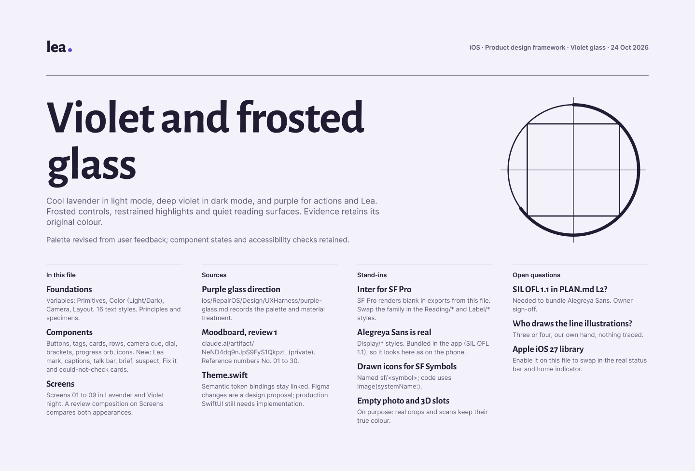

## Screens

Lavender (light) and Violet night (dark). Capture screens 04 and 05 are the same in both appearances and retain
high-contrast camera cues. 09 is the conversation with Lea before a scan.

| | 01 Home, first run | 01b Home, scans | 02 Consent | 03 Pairing |
|---|---|---|---|---|
| Light | 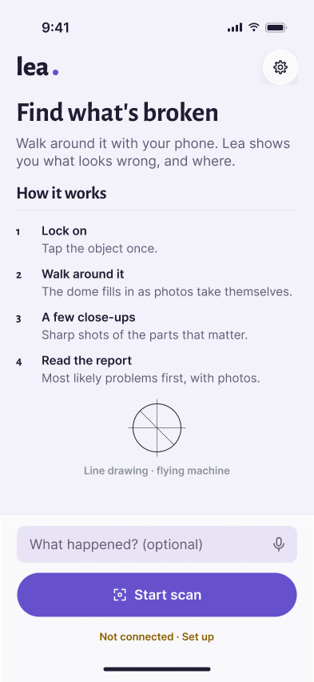 | 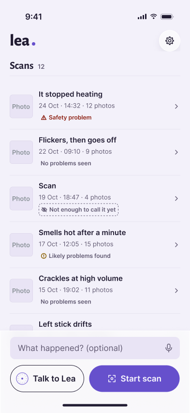 | 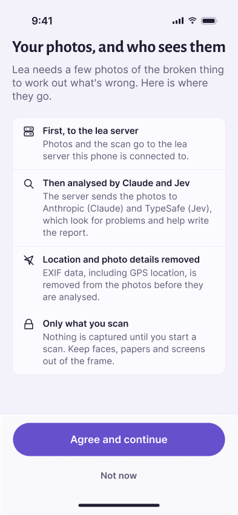 | 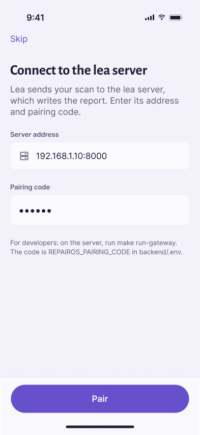 |
| Dark | 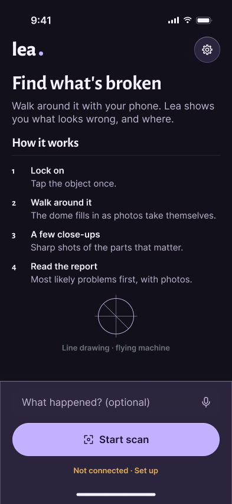 | 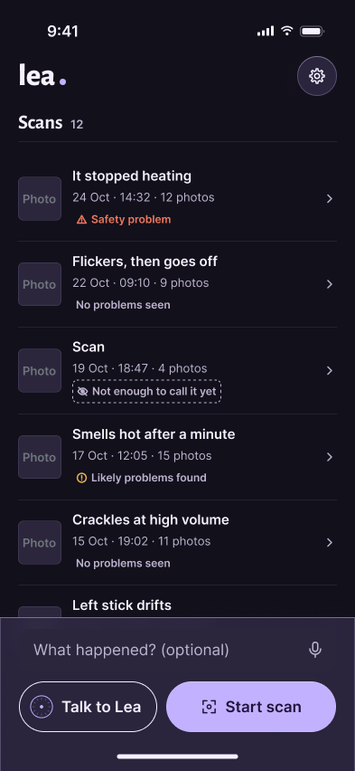 | 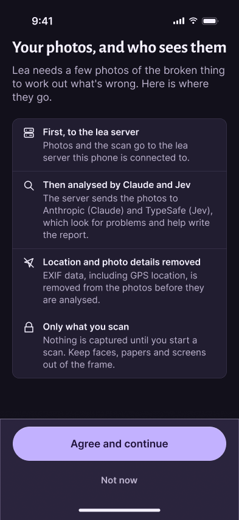 | 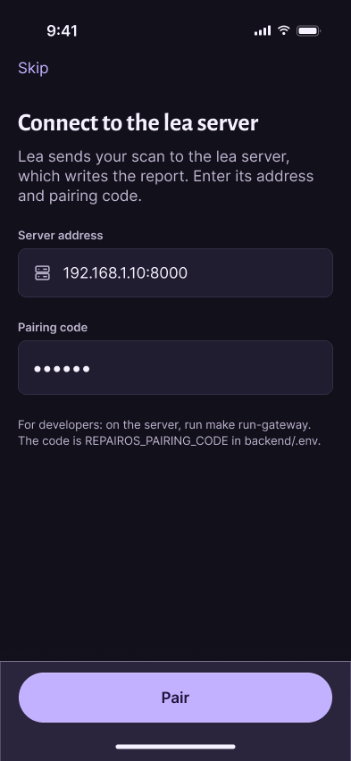 |

| | 04 Capture, searching | 05 Capture, locked | 06 Report progress | 08 Problem detail | 09 Talk to Lea |
|---|---|---|---|---|---|
| Light |  | 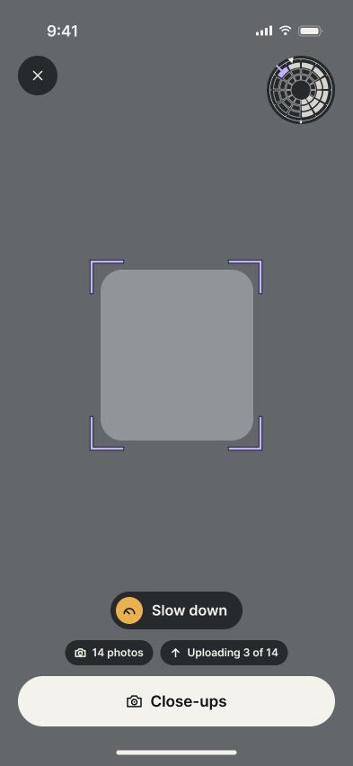 | 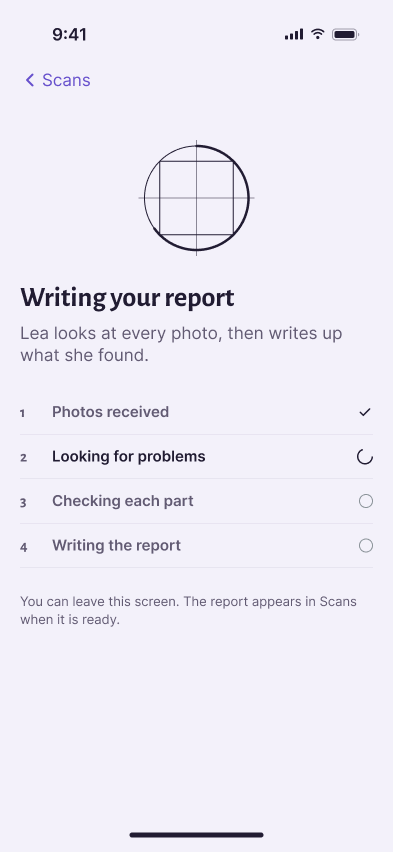 | 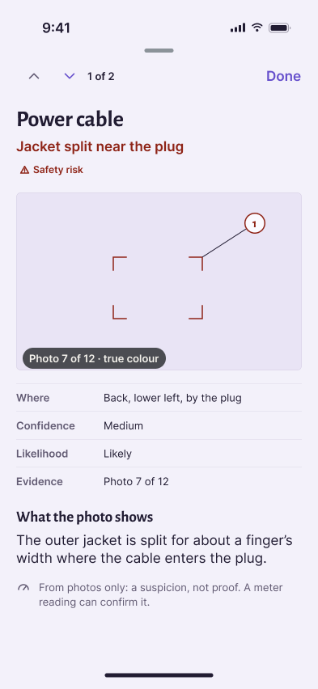 | 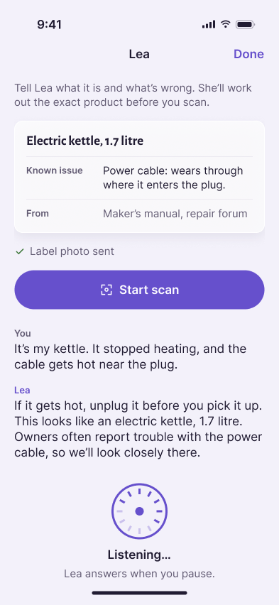 |
| Dark | (same) | (same) | 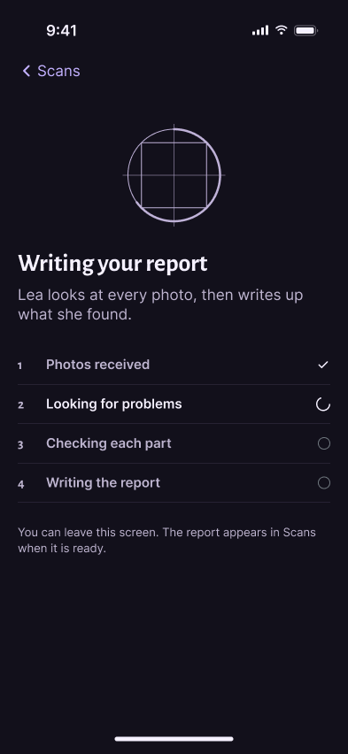 | 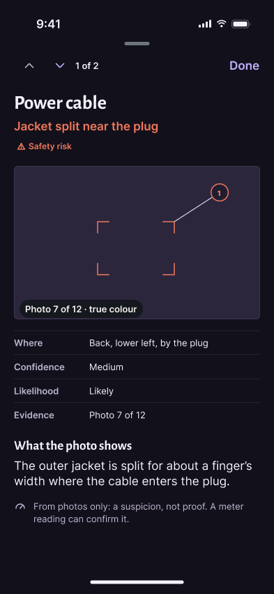 | 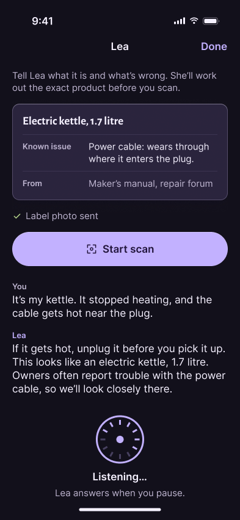 |

### 07 Report, full scroll

| Light | Dark |
|---|---|
| 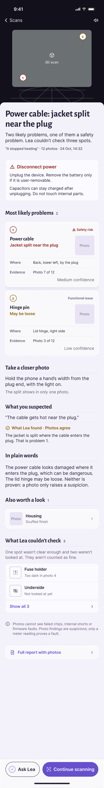 | 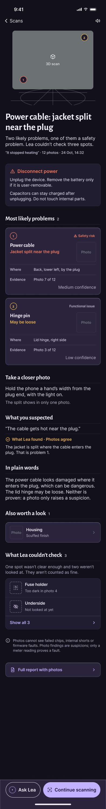 |

## Foundations

Principles, colour in both modes, camera tokens, type and line weights.

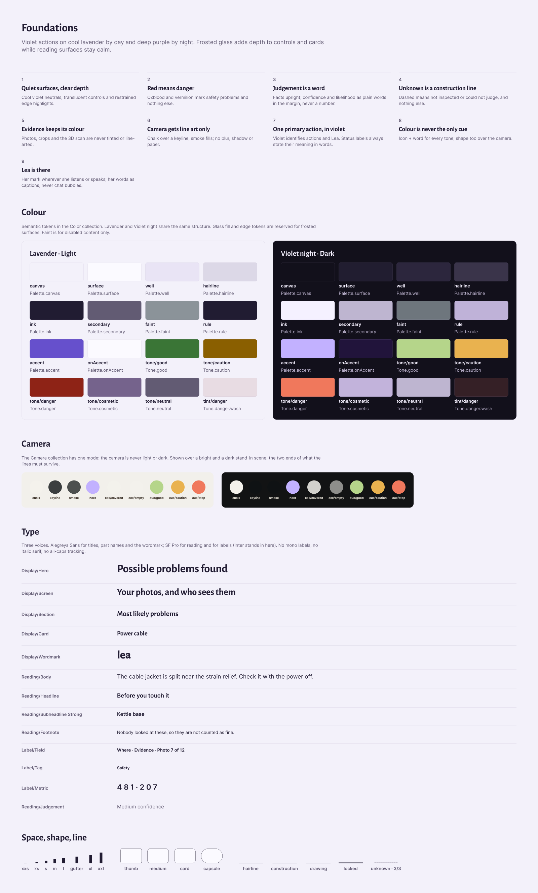

## Components

Including the new ones for Lea: her mark, captions, the talk and Ask Lea bars, and the brief, suspect, Fix it and
could-not-check cards.

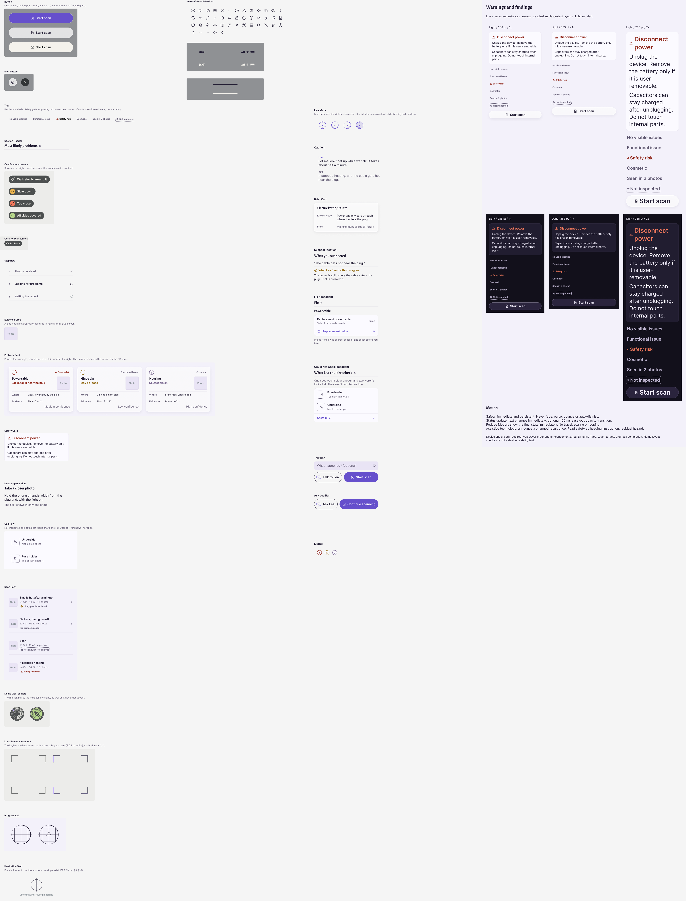

## Final palette review

[Editable review composition](https://www.figma.com/design/acZpRbLDyuavWtoJIqyj1u?node-id=95-1464), with light/dark Home
and Problem detail screens. Token values: [palette.json](../RepairOS/Design/UXHarness/palette.json).

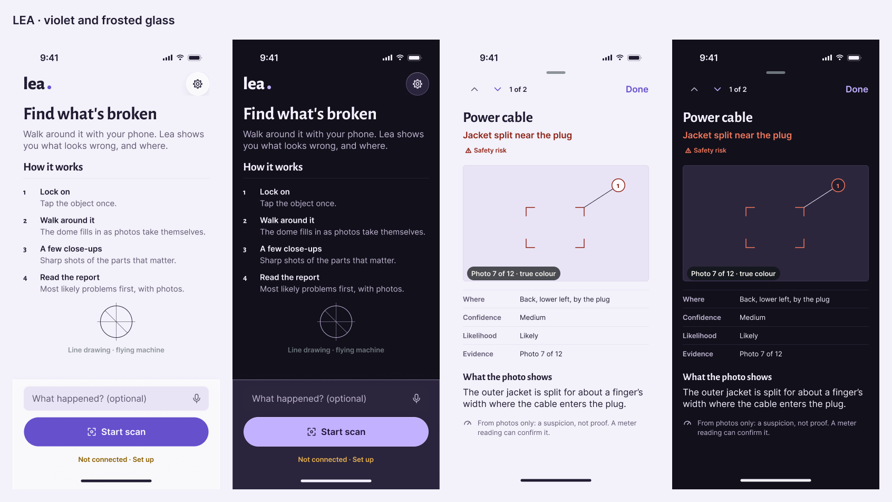

## Component UX regression

Six actual-component layouts cover light/dark, narrow/standard widths, and 200% text, including glass controls.
The [executable harness](../RepairOS/Design/UXHarness/README.md) passes 1,153 assertions. Static snapshots do not
validate native Dynamic Type, VoiceOver, animation or real-user task completion.

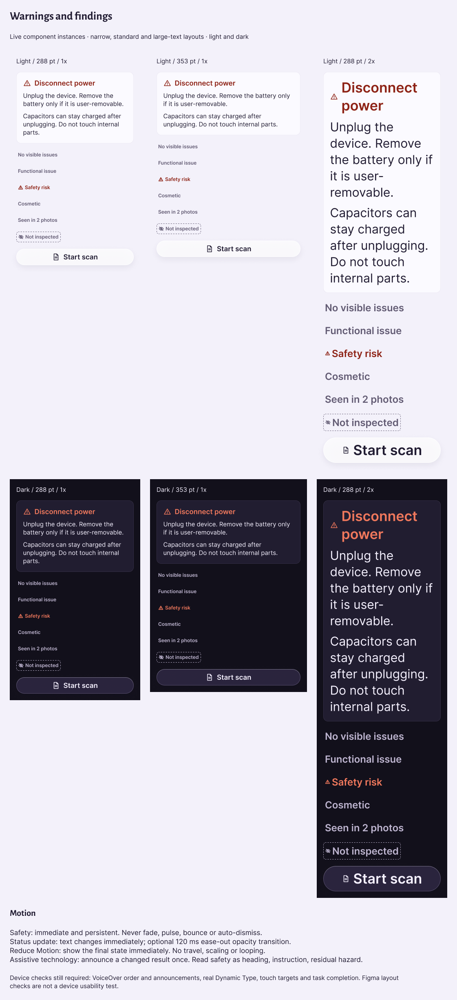

## Motion handoff

[DESIGN.md §6](../RepairOS/Design/DESIGN.md#6-motion-and-moving-parts) defines how moving parts create the wow factor:
lock feedback, actual coverage, voice-responsive Lea, report arrival and evidence selection. Each has a trigger,
timing, stopping condition and Reduce Motion alternative. These images show settled layouts; the specified motion
still needs native implementation and device verification.
