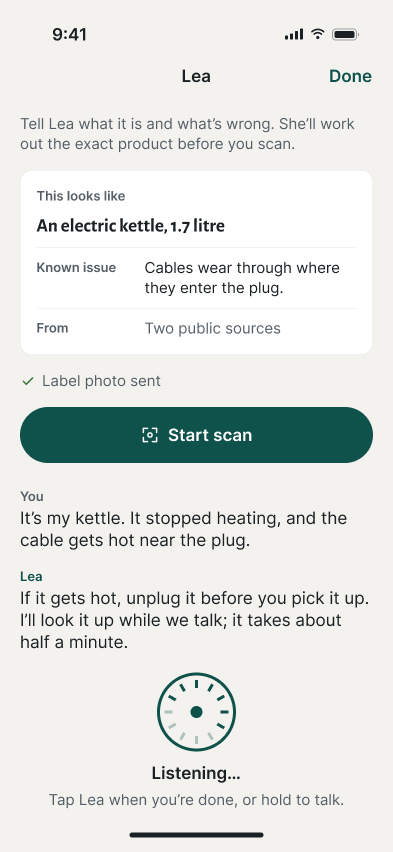
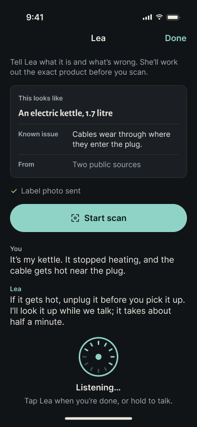

# LEA design: Figma snapshots

Exports of the [Figma file](https://www.figma.com/design/acZpRbLDyuavWtoJIqyj1u/LEA-%E2%80%94-Inspector-s-Codex-%C2%B7-Product-design-framework?m=auto&t=fFachNvR1GBg0FTj-1) on 2026-10-25, for review of
[DESIGN.md](../RepairOS/Design/DESIGN.md) (draft 3.1, after the impeccable critique and polish). The Figma file is the source of truth; these go stale when it
changes. Alegreya Sans is the real display face. SF Pro renders blank in exports, so Inter stands in for it, and drawn
icons stand in for SF Symbols. Photo and 3D slots are empty on purpose: real evidence keeps its true colour.

They live here, outside `ios/RepairOS/`, because Xcode syncs that folder into the app target and would bundle them.

## Cover

## Screens

Gesso (light) and ebony (dark). 04 and 05 are the capture screens: the camera never turns into paper, so they are
the same in both modes. 09 is the conversation with Lea before a scan.

| | 01 Home, first run | 01b Home, scans | 02 Consent | 03 Pairing |
|---|---|---|---|---|
| Light |  |  |  |  |
| Dark |  |  |  |  |

| | 04 Capture, searching | 05 Capture, locked | 06 Report progress | 08 Problem detail | 09 Talk to Lea |
|---|---|---|---|---|---|
| Light |  |  |  |  |  |
| Dark | (same) | (same) |  |  |  |

### 07 Report, full scroll

| Light | Dark |
|---|---|
|  |  |

## Foundations

Principles, colour in both modes, camera tokens, type and line weights.

## Components

Including the new ones for Lea: her mark, captions, the talk and Ask Lea bars, and the brief, suspect, Fix it and
could-not-check cards.

