# LEA design: Figma snapshots

Exports of the [Figma file](https://www.figma.com/design/acZpRbLDyuavWtoJIqyj1u) on 2026-10-24, for review of
[DESIGN.md](../RepairOS/Design/DESIGN.md) (draft 2). The Figma file is the source of truth; these go stale when it
changes. Inter stands in for SF Pro, JetBrains Mono for SF Mono and drawn icons for SF Symbols. Photo and 3D slots are
empty on purpose: real evidence keeps its true colour.

They live here, outside `ios/RepairOS/`, because Xcode syncs that folder into the app target and would bundle them.

## Cover

## Screens

Paper (light) and walnut (dark). 04 and 05 are the capture screens: the camera never turns into paper, so they are
the same in both modes.

| | 01 Home, first run | 01b Home, scans | 02 Consent | 03 Pairing |
|---|---|---|---|---|
| Light | 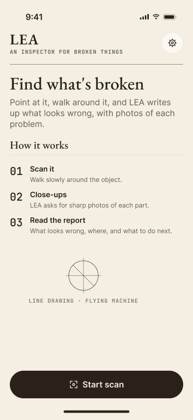 | 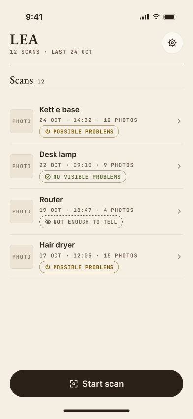 | 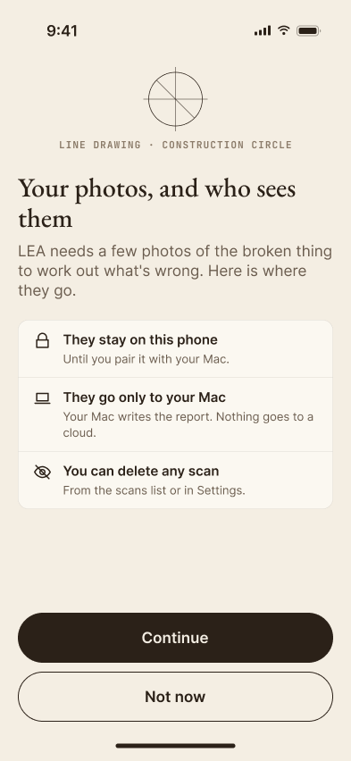 | 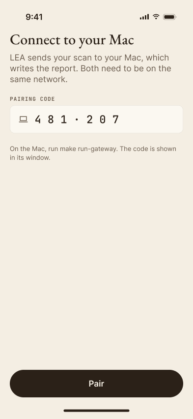 |
| Dark | 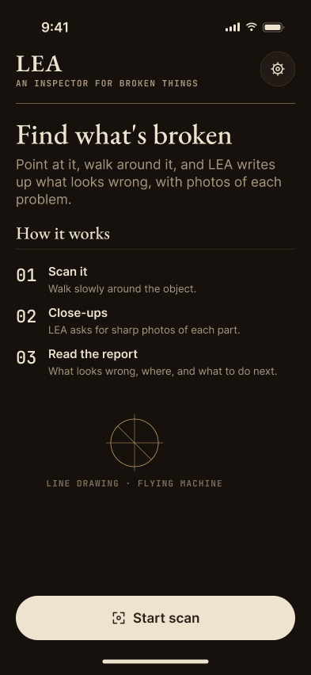 | 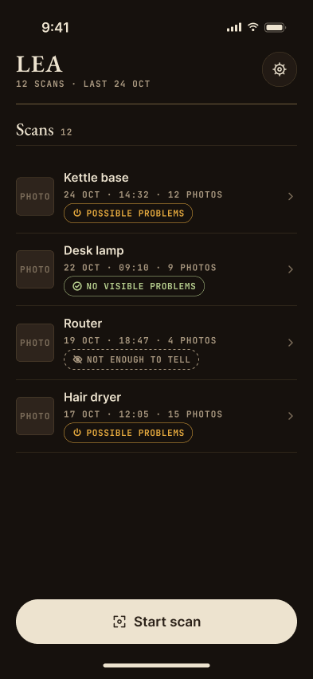 | 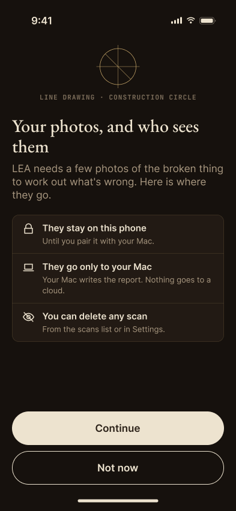 |  |

| | 04 Capture, searching | 05 Capture, locked | 06 Report progress | 08 Problem detail |
|---|---|---|---|---|
| Light | 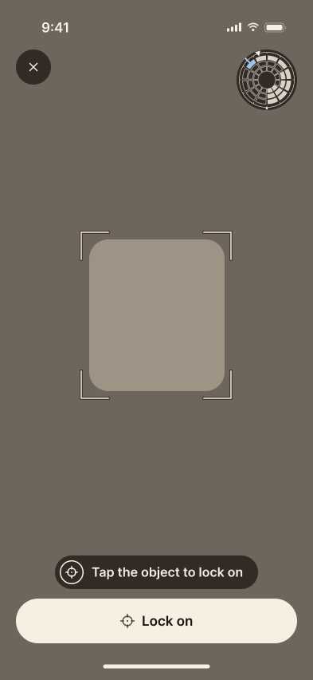 |  | 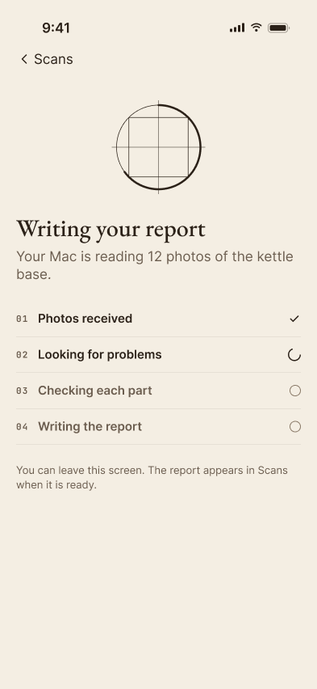 |  |
| Dark | (same) | (same) |  | 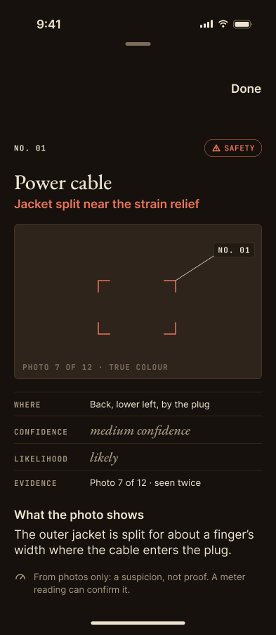 |

### 07 Report, full scroll

| Light | Dark |
|---|---|
| 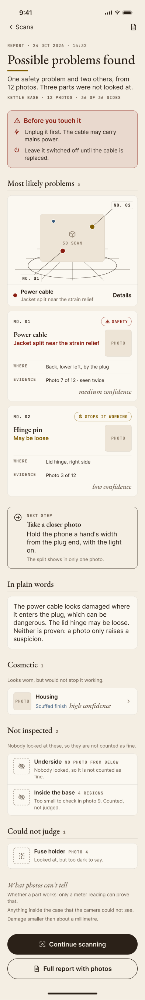 | 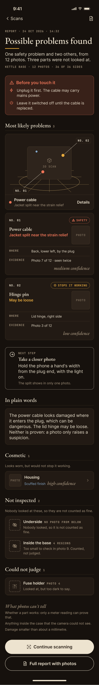 |

## Foundations

Principles, colour in both modes, camera tokens, type and line weights.

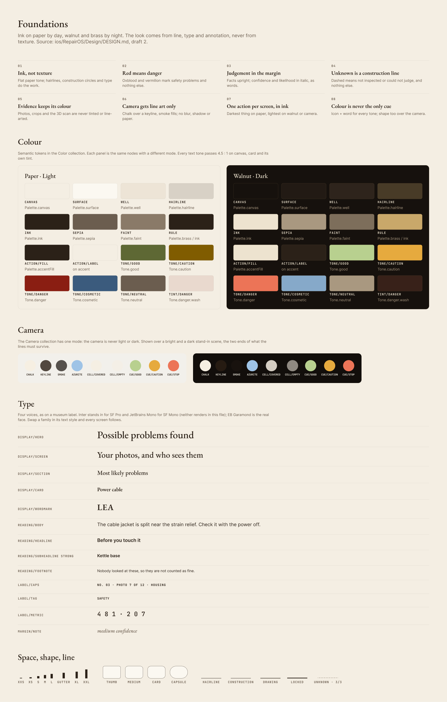

## Components

